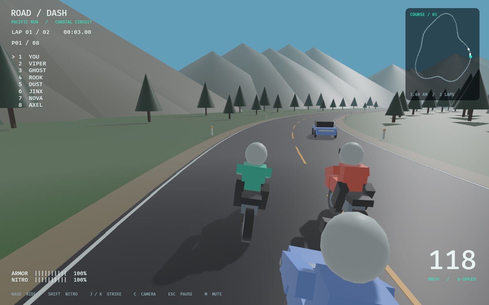
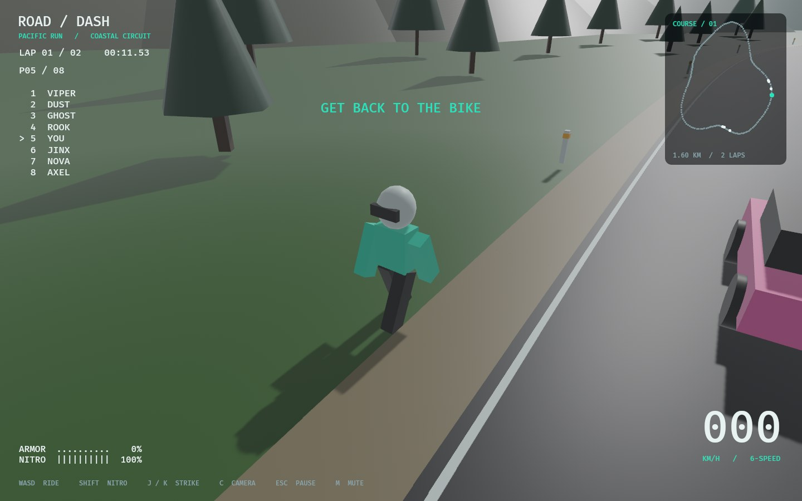

# ROAD / DASH

A native Rust + Bevy motorcycle combat racer. Race a winding coastal circuit against seven rivals, dodge two-way traffic, throw punches, and use nitro to make a pass. Crashes throw a jointed Rapier ragdoll and a tumbling motorcycle onto the road.

This is the first playable foundation of a modern remake, with original procedural 3D scenery and models. It is inspired by Road Rash's racing/combat loop and the [arkits native port](https://github.com/arkits/road-rash). It does not contain that repository's code, sprites, music, or original game data.



## Run

Install [Rust](https://rustup.rs/) (the project pins Rust 1.94.0), then:

```sh
cargo run --release
```

First compilation builds the engine and can take several minutes. A desktop GPU with Vulkan, Metal, or DirectX 12 support is recommended. There are no assets to download or extract.

Linux needs X11 development libraries. Ubuntu/Debian:

```sh
sudo apt-get install build-essential pkg-config libx11-dev libxi-dev libxcursor-dev libxrandr-dev libxinerama-dev libxkbcommon-dev libasound2-dev
```

Fedora:

```sh
sudo dnf install gcc-c++ pkgconf-pkg-config libX11-devel libXi-devel libXcursor-devel libXrandr-devel libXinerama-devel libxkbcommon-devel alsa-lib-devel
```

The Linux build uses X11 (and XWayland on Wayland desktops). Windows and macOS are supported by the engine, but have not yet been runtime-tested for this project.

## Controls

| Key | Action |
| --- | --- |
| Enter / menu button | Start / race again |
| W / Up | Throttle |
| S / Down | Brake |
| A, D / Left, Right | Steer across the road |
| Left or Right Shift | Nitro while accelerating |
| J / K | Punch left / right |
| C | Cycle three camera distances |
| Esc | Pause / resume |
| M | Mute / unmute audio |
| R | Restart from the grid |

The bike follows the road's heading automatically. Steering chooses a line across the road; tight bends push the bike toward the shoulder at high speed. Brake before sharp corners. Nitro regenerates when released. Off-road riding drains armor and speed; traffic collisions, hard bike collisions, and melee damage can knock you off. After a crash, the camera follows your physical ragdoll until it lands. Your rider gets up, runs back to the actual fallen bike, lifts it upright, and remounts. Moving traffic and other racers can knock a rider down again during recovery.

## Included

- An arc-length-sampled closed coastal circuit, two-lap races, and an eight-rider grid.
- Procedural 3D bikes, riders, cars, road markings, trees, mountains, ocean, and start gantry.
- PBR materials, directional shadows, atmospheric distance fog, and a speed-sensitive chase camera.
- Seven AI racers with corner speed adjustment, lane changes, traffic avoidance, and attacks.
- Twelve traffic vehicles traveling in both directions.
- Armor, nitro, directional melee, collision detection, crash recovery, and camera shake.
- Eleven rigid-body rider parts connected with limited ball joints, plus a separate dynamic motorcycle wreck. Continuous collision detection, friction, and restitution are enabled.
- Solid cars, ridden bikes, on-foot riders, trees, mountains, roadside posts, start gantry, and road surfaces. Road markings are visual decals.
- Bike impacts knock the struck rider into a ragdoll while the attacker launches roughly 1.3 meters, lands, and bounces.
- The recovery camera follows the ragdoll and then the running rider. A collision-aware character controller handles the run back and remount at the bike’s actual location.
- Synthesized engine RPM, wind, nitro, braking, impact, landing, punch, footstep, countdown, and finish audio. M mutes the mixer.
- Full-footprint scenery clearance checks keep trees and mountain slopes off the circuit.
- Garage/start menu, countdown, pause/restart, leaderboard, speedometer, live course map, and results.
- Persistent race count, wins, credits, and personal-best time.



## Current scope

This is an arcade prototype, not a finished commercial remake. Riding uses an explicit speed/lane controller; wheel suspension, tire contact, and bike balance are not physically simulated. Ragdolls and wrecks are physically simulated. The environment and characters are procedural low-poly placeholders, and the circuit is flat. There is one course and one bike configuration. Police pursuits, career events, purchasable upgrades, animation rigs, gamepads, multiplayer, and production art remain future work. Credits are saved but cannot yet be spent.

## Development

```sh
cargo fmt --check
cargo clippy --locked --all-targets -- -D warnings
cargo test --locked
cargo run -- --smoke-test
```

The render smoke test opens a real window, captures the garage, racing, a triggered crash, getting up, running back, remounting, and results into `screenshots/`, then exits. It needs a working display/GPU and audio output. It verifies that audio playback sinks initialize and racing audio is playing. It does not modify the saved profile. CI runs format, lint, and headless tests; screenshots are a separate local check.

Source layout:

- `src/track.rs`: circuit geometry, arc-length lookup, curvature, and wraparound.
- `src/world.rs`: scenery, materials, and procedural bike models.
- `src/game.rs`: racing, AI, combat, traffic, camera, and persistence.
- `src/recovery.rs`: articulated crashes, physical impacts, on-foot recovery, and remounting.
- `src/sound.rs`: in-memory PCM synthesis, sound cues, engine loops, and mute control.
- `src/ui.rs`: garage, HUD, minimap, and results.
- `src/verification.rs`: scripted render smoke check.

The audio backend needs ALSA development headers on Linux (`alsa-lib-devel` on Fedora, `libasound2-dev` on Ubuntu/Debian). No sound files need downloading. A missing audio device leaves the game playable with a backend warning.

Profiles are written atomically to `$XDG_DATA_HOME/roaddash/profile.json` on Linux (default `~/.local/share/roaddash/profile.json`), or `%LOCALAPPDATA%/roaddash/profile.json` on Windows. Set `ROADDASH_SAVE_DIR` to choose another directory. An unreadable save is ignored with a warning for malformed JSON.

## License

MIT for this project's source. Bevy and Rapier retain their respective upstream licenses. `vendor/cpal` is Apache-2.0 licensed CPAL 0.15.3, with a small ALSA underrun recovery patch documented in `vendor/cpal/ROADDASH-PATCH.md`. Road Rash is a trademark of its respective owners; this project is an independent game prototype.
