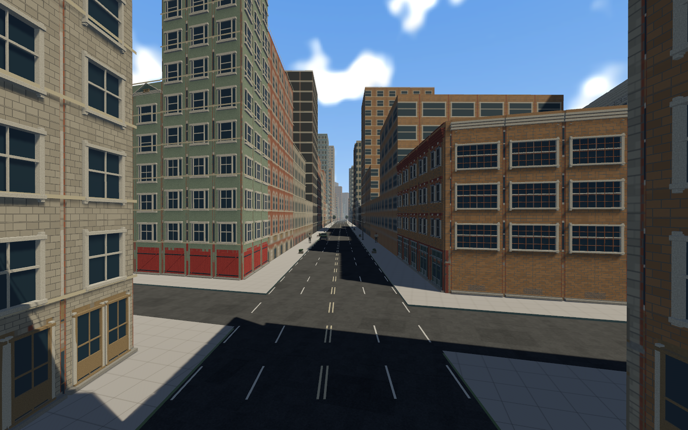

# ROAD / DASH

A native Rust + Bevy motorcycle combat racer. Race an 11 km interval of the preserved 12 km farm-to-city Metropolis map, with one split and rejoin against fourteen rivals, dodge two-way traffic, throw punches and kicks, and fight for a clean pass. Player nitrous is temporarily disabled. Crashes separate the rider into a jointed Rapier ragdoll and a tumbling motorcycle, using measured approach velocity and gravity.

This is the first playable foundation of a modern remake, with original procedural 3D scenery and models. It is inspired by Road Rash's racing/combat loop and the [arkits native port](https://github.com/arkits/road-rash). It does not contain that repository's code, sprites, music, or original game data. Metropolis is now the default. The legacy maps remain available with `ROADDASH_TRACK=valley cargo run --release` and `ROADDASH_TRACK=city cargo run --release`. [Implementation, native views and remaining gates](docs/testing/metropolis/README.md).



[Main-street traffic, varied lanes and roof heights](docs/testing/metropolis-street-life/README.md) previously added96 moving cars,65 parked vehicles and995 curb objects; see the current living-city census below.

[Persistent prop destruction](docs/testing/prop-destruction/README.md) now covers all995 Metropolis sidewalk objects; cars remain intact. Damage clears on restart.

[Original3D facade models now render on nearby Metropolis faces](docs/testing/metropolis-authored/README.md); broader district/catalog coverage remains PALETTE-01.

[Wider Metropolis sidewalks and populated curb bands](docs/testing/metropolis-sidewalks/README.md) now reuse the original street furniture catalog.

Selected 3D prop drafts now appear in gameplay: traffic, city furniture/lamps/trees and human/cow NPC skins. [Integration screenshots and limits](docs/testing/props-in-game/README.md). Use `ROADDASH_LEGACY_PROPS=1` to compare the earlier presentation.

[Cast AI and living-city pass](docs/testing/living-city-ai/README.md): dossier-based opponents and weapons, safer reversing,154 moving city/main cars,192 urban pedestrians, City Hall in park3 and a detailed fountain park in park5,12 covered cafes, approach infill and wider walks. The current [civic access and AI escape follow-up](docs/testing/civic-access-ai/README.md) addresses the rejected empty civic plaza, disconnected park paths and trapped riders; art/balance and the16.7ms performance gate remain open.

[Denser civic greenery, city-width proposal and character gallery](docs/testing/civic-greenery/README.md). The reduction is a map preview; the live city retains all blocks.

Latest local integration: the gameplay/graphics, AI and civic work is merged into `main`; `codex/city-next-pass` starts from it. [Run instructions, full change summary and biker views](docs/testing/main-merge-2026-11-09/README.md).

[Fresh-agent follow-up](docs/testing/next-pass/README.md) is integrated on `codex/city-next-pass`: detailed Town Hall and civic PBR, restored original biker outfit, researched sky illumination,11km race/no visible gates, consistent entry lanes, queued-rider passing, persistent crop trails,25%stronger elevation and officer uniform/custom patrol bike.481tests, required code/build/audit checks,12release native checks and18paired lab cases pass. Route wall p9522.38ms still misses16.7ms; user art/feel and broad hardware/performance gates remain open.

[Multiplayer, walking and city activity](docs/testing/online-city-final/README.md) is integrated on `codex/multiplayer-ui-walking`: Host/Join/Quick Play, public/private lobbies, original local backgrounds, corrected rider walking, slow-queue passing,48extra city-only cars,384urban pedestrians and occasional crossings.529workspace tests pass; native city/reload checks pass. Separate-network reachability and production bandwidth remain open.

[Hills](docs/testing/hills/README.md) adds a separate12.5km city-to-mountains-to-western-town-to-dunes course. Strong winding relief, solid guardrails, two town streets rejoining inside town, farms, trees, grass, cattle, static saddled horses, cowboy residents and trucks. Launch with `ROADDASH_TRACK=hills cargo run --release --locked`; Metropolis remains the default. Art/feel and broad performance gates remain open.

[Hills polish](docs/testing/hills-polish/README.md) adds grounded dust, circling birds, coherent cloud/lighting changes, original cacti/rocks/deadwood, varied trees, western signs and five walking horse-and-cowboy pairs. Original road relief and the in-town merge are preserved; human art/performance acceptance remains open.

[Hills revision](docs/testing/hills-revision/REPORT.md) reuses the final city kilometre, tightens hill bends, limits guardrails to curves, develops hill farms/greenery and brings western frontage closer. A canyon suspension bridge has unrailed edges and thick square supports; eight semitrailers and six tractors join traffic. Launch with `cargo run --release --locked -- --hills`. Verification and measured performance are recorded in the report; human full-course acceptance remains open.

[Course menu and landscape follow-up](docs/testing/hills-delivery/REPORT.md): choose **Thrash → Hills or Metropolis → Ride**; legacy courses remain available. Bridge hangers now connect to deck supports, a river runs beneath the span, six farms use gentler parcels, spatial cumulus clouds and a visible sun replace the flat cloud presentation, and city shadows extend to 500 m. Verification, timing and remaining acceptance gates are recorded in the report. [Grid, passing and road-edge corrections](docs/testing/hills-grid/REPORT.md) address the rear Hills spawn, false AI stops/passing failures at Metropolis bends, and the thin green asphalt seam. Existing HILLS-01/AI-QUEUE-02/CITY-CIVIC-01 acceptance remains open for broader review.

## Run

Install [Rust](https://rustup.rs/) (the project pins Rust 1.94.0), then run from the repository directory:

```sh
git clone https://github.com/ImadMashhood/RoadDash.git
cd RoadDash
cargo run --release
```

First compilation builds the engine and can take several minutes. A desktop GPU with Vulkan, Metal, or DirectX 12 support is recommended. There are no assets to download or extract.

Linux needs X11 development libraries. Ubuntu/Debian:

```sh
sudo apt-get install build-essential pkg-config libx11-dev libxi-dev libxcursor-dev libxrandr-dev libxinerama-dev libxkbcommon-dev libasound2-dev libudev-dev
```

Fedora:

```sh
sudo dnf install gcc-c++ pkgconf-pkg-config libX11-devel libXi-devel libXcursor-devel libXrandr-devel libXinerama-devel libxkbcommon-devel alsa-lib-devel systemd-devel
```

Keyboard bindings can be supplied through `ROADDASH_BINDINGS=/path/to/input.json` using the validated [input schema](content/input.json). Features: `offline` + `devtools` + `parallel_physics` by default, minimal serial `--no-default-features --features offline` (add `parallel_physics` to retain multicore solving), optional `--features debug_physics`. This branch includes player-hosted online races; Internet/NAT and production acceptance remain open. See the [multiplayer integration report](docs/testing/online-pass/README.md). [Architecture and developer guide](docs/ARCHITECTURE.md).

The Linux build uses X11 (and XWayland on Wayland desktops). Windows and macOS are supported by the engine, but have not yet been runtime-tested for this project.

Review the new course with `cargo run -- --metro-survey`; inspect its manifest with `cargo run -- --inspect-metropolis`. Review legacy facade transitions with `ROADDASH_TRACK=valley cargo run -- --lod-survey` or `ROADDASH_TRACK=city cargo run -- --lod-survey`. [Implementation and native evidence](docs/testing/facade-lod/README.md).

Physics uses Rapier's parallel island solver by default. To compare the serial backend,
run `cargo run --release --locked --no-default-features --features offline,devtools`.
This changes scheduling, not body/joint/substep tuning. [Benchmarks and limits](docs/testing/parallel-physics/README.md).

Course loading now reuses exact terrain queries, uses eight material jobs during
loading (two during gameplay), and dispatches the fixed schedule on one thread.
Rapier's internal parallel solving, 60 Hz simulation and physical rigs remain
unchanged. [Controlled measurements and limits](docs/testing/issue25-performance/REPORT.md)
show local loading and frame-time gains; sustained 60 FPS and broader hardware
remain open. Diagnostic controls are `ROADDASH_TERRAIN_CACHE=0`,
`ROADDASH_FIXED_EXECUTOR=multi` and `ROADDASH_LOAD_JOBS=2`.

## Controls

| Key | Action |
| --- | --- |
| Enter / menu button | Start / race again; interact to remount while walking manually |
| W / Up | Throttle; move forward on foot |
| S / Down | Brake, then hold to reverse slowly; move backward on foot |
| A, D / Left, Right | Steer; move sideways on foot |
| Left or Right Shift | Nitrous temporarily disabled |
| J / K or left / right mouse | Punch left / right; swing when holding a club |
| Space | Kick nearest reachable target to either side |
| E / Q | Pick up nearby unobstructed club / drop (queues until contact completes) |
| C | Cycle three camera distances |
| Esc | Pause / resume |
| M | Mute / unmute audio |
| F2 / controller LB | Comfort settings and rebinding |
| F3 | Toggle developer frame/tick/physics/entity diagnostics |
| F4 | Toggle track spline/normal/bounds/spawn inspector |
| F5 / F6 | Cycle handling preset / adjust road assist (developer tuning) |
| F7 | Toggle optional biomechanical ragdoll diagnostics |
| R | Restart from the grid |

The dynamic bike has assisted road-relative steering and independent physical momentum. Holding a direction builds steering force; release and countersteering unwind it. Bike and rider lean together only from that steering input. The camera stays within compact chase distances at speed. Steering chooses a line across the road; tight bends push the bike toward the shoulder at high speed. Brake before sharp corners. Player nitrous is disabled in both physics adapters; the input binding is retained for later re-enabling. Grass reduces traction and speed while remaining driveable; it does not drain armor or cause a crash by itself. Traffic collisions, hard bike collisions, and melee damage can knock you off. After a crash, the camera follows your physical ragdoll until it lands. Your rider gets up and seeks the actual fallen bike. WASD or the left stick immediately takes over movement; after 0.35 seconds of neutral input the assist resumes. Walk away to finish on foot with valid checkpoints, or approach a slow bike and press Enter/menu-start to remount manually. Disable automatic seeking with `--manual-recovery`. The rider lifts the bike upright and remounts. Moving traffic and other racers can knock a rider down again during recovery.

Controller: left stick steers (both axes move on foot), RT throttles, LT brakes, X/B punch left/right,
Y boost is temporarily disabled, A starts, Start pauses, Select restarts and right-stick click changes
camera. Right stick freelooks and returns to chase when released. LB opens settings;
Guide is an alternate. Remap buttons/keys in the F2 panel; its up/down selects,
left/right adjusts, Enter/A activates, Tab/Y changes binding device, and Esc/Start
cancels a binding or saves/closes. Reserved LB/Guide and F2 always open settings.

Comfort defaults to 75° FOV, configurable 60–95°, with adjustable camera response
and shake. Anti-nausea disables shake, speed FOV, turn anticipation and speed lines.
Preferences save under `$XDG_CONFIG_HOME/roaddash/settings.json` (fallback
`~/.config/roaddash/settings.json`) or `%APPDATA%/roaddash/settings.json` on Windows.
Override with `ROADDASH_SETTINGS`; unknown/corrupt files are preserved read-only.
Keyboard JSON through `ROADDASH_BINDINGS` still overrides the loaded keyboard map.
Gamepad support uses Bevy's Gilrs backend; Linux now also needs the libudev development
package listed above. Multiple pads use the lowest entity ID; disconnect clears input.

The [biomechanical ragdoll](docs/testing/RAGDOLL_BIOMECHANICS.md) defaults to the selected velocity-muscle controller:16 physical bodies, anatomical constraints, passive tissue resistance and bounded angular muscle corrections. The native-motor comparison candidate is not integrated. [Selection and facade-streaming follow-up](docs/testing/velocity-popin/README.md). Run `cargo run --release` normally; no B press or extra flag is required. Use `--ragdoll-baseline` to compare the original eleven-body rig, or `--ragdoll-lab-view` for the standalone lab (B switches modes there). [Integration evidence](docs/testing/ragdoll/integration/README.md).

See the dedicated [animation production plan](#animation-production) for the full reference/keyframe and runtime-animation backlog.

## Original crash comparison (separate branch)

`cargo run --release -- --original-crashes` opts into recovered original bike/bike
and bike/car contact calculations. `cargo run -- --original-crash-report` prints
the formulas' numeric scenarios without graphics. See the [calculation report](docs/research/ORIGINAL_CRASH_CALCULATIONS.md)
for original boosts, damage and signed velocity rules, retail verification and
explicit 3D adaptation limits. This does not include the biomechanical PR12;
full native trajectory/caller parity remains CRASHREF-004.

## Included

- A 6.85 km authored point-to-point course: open farmland, dense city streets, then rolling hills. Fifteen racers, nine ordered gates, one finish.
- A separate approximately 2 km handling test fixture, headless track validation and F4 spline/normal/bounds/spawn inspection.
- Seeded farms/fences and solid cows that react physically on contact; city cross traffic and walking sidewalk pedestrians; elevated hill terrain and guardrails.
- Authored textured rider and sport motorcycle meshes, plus original procedural cars, road markings, trees, farms, buildings, cows, pedestrians and start/finish markers. Human skins follow the existing ragdoll joints.
- PBR materials, directional shadows, atmospheric distance fog, and a speed-sensitive chase camera.
- Fourteen AI racers with pursuit, speed matching, lane changes, traffic avoidance, attacks, and selective downed-rider hunts.
- Twelve traffic vehicles traveling in both directions.
- Three direct side-by-side punches knock out a target when each consecutive hit is within three seconds; misses, gaps and duplicate contact do not count.
- Armor, nitro, collision detection, crash recovery and camera shake.
- Sixteen rider bodies with anatomical limits, directional elbow/knee hinges and bounded passive/active joint motors. The eleven-body control remains available with `--ragdoll-baseline`. This approximates tissue resistance; it is not biological muscle simulation.
- Independent bike wrecks slide on slopes and retain stopping friction on flat ground. Boost release/exhaustion slows gradually, and steering is about 20% tighter.
- Solid cars, bikes, riders, cows, pedestrians, trees, buildings, fences, curbs, guardrails and road/terrain surfaces. Road markings are visual decals.
- Equal-speed motorcycle contact and gentle side taps transfer momentum; fast rear/side impacts cause measured knockoffs. NPC hits can produce separate human or quadruped ragdolls.
- Crash entry uses measured approach velocities and explicit vehicle/civilian speed-loss rules, without scripted upward launch or spawn spin. The separated rider and wreck fall independently. Mounted yaw follows steering input; contacts can translate the bike without steering it.
- The recovery camera follows the ragdoll and then the running rider. A collision-aware character controller handles the run back and remount at the bike’s actual location.
- Synthesized engine RPM, wind, nitro, braking, impact, landing, punch, footstep, countdown, and finish audio. M mutes the mixer.
- Full-footprint scenery checks keep props clear; collision rays verify terrain does not cover banked road lanes.
- Garage/start menu, countdown, pause/restart, leaderboard, speedometer, live course map, and results.
- Persistent race count, wins, credits, and personal-best time.


Handling target: [arkits/road-rash investigation](docs/research/ROAD_RASH_HANDLING.md).
Progressive steering is implemented; **the entire original handling is not yet
reproduced**. Original bike/table data is absent, and current physics/profile
values remain RoadDash-authored. [Correction evidence](docs/testing/HANDLING_CORRECTION.md).

For a mounted animation review, run `cargo run -- --animation-lab-view`: keys 1–8 select mounted motions, 9 selects standing, 0 walking, R running, and C changes view. [Part 03 implementation and limits](docs/testing/animation-part03/README.md). Asset IO workers now have an explicit stack budget; both native Valley and City Run load without RUST_MIN_STACK. [Loader and surface follow-up](docs/testing/world-polish/README.md).

## Current scope

All twelve sequential gameplay/graphics polish passes are integrated and parent-reviewed; final439-test regression, ten native cases and18-case paired lab passed. The16.7ms frame target, first-survey capture readiness, art/feel and hardware gates remain open. No new IDs or checklist closures (220 verified/245 open). [Final evidence and remaining work](docs/testing/polish-12/final/README.md).

The native frontend now uses the approved grotesque painted artwork: splash → main → Thrash/current course, or Big Game/current rider → street hub → race. Shop/bar visits and existing options/results are connected; campaign, purchases and online modes remain deferred. [Controls, artwork and limits](docs/ui/NATIVE_FRONTEND.md).

This is an arcade prototype, not a finished commercial remake. Native riding now uses an assisted dynamic chassis with two raycast wheels, suspension, combined grip limits, torque/gears and upright feedback. A retained kinematic adapter is available for regression comparison. Ragdolls and wrecks are physically simulated. The environment remains procedural; authored rider/bike meshes now replace the primitives, with connected anatomical visual bindings and the accepted physical ragdolls. There is one playable point-to-point course and three handling presets. One resident police motorcycle now uses warning, pursuit/interception, lost-target search, on-foot arrest and escape; bespoke police art and human balance remain open. Career events, purchasable upgrades, polished animation clips, multiplayer, and the wider production art pass remain future work. Credits are saved but cannot yet be spent.

## Development roadmap — completed first, remaining work in order

**224 verified tasks complete; 281 tasks remain open.** Part 00 contains all completed work. Parts 01–08 follow the requested fixes → animation study → animation implementation → buildings → props → NPCs/landscape → weapons → police sequence. Then continue with the existing Parts 09/10, followed by the remaining production requirements.

**One live checklist:** every task is now in this README, exactly once. Stable IDs retain their historical numbers; their current section determines execution order. An old `P06` ID under Part 03 does not mean work must wait for Part 06. The [historical blueprint checklist](docs/roadmap/BLUEPRINT_PARTS_01_08.md) is a frozen reference, not a second live backlog. [Progress](docs/PROGRESS.md) is generated from this README.

**Status:** `[x]` means implemented and verified; `[ ]` includes partial and unverified work. Moving a task does not change its status or close a gate. Carried-forward requirements retain their full original wording: some subfeatures already work, but their remaining tests, polish or acceptance keep the whole requirement open. The [execution contract](docs/roadmap/EXECUTION_V2.md) defines the new V2 acceptance criteria; the [supporting blueprint contracts](docs/roadmap/SUPPORTING_CONTRACTS.md) retain dependency proposals, environment/audio inventories, budgets and rights context. [Known issues](docs/KNOWN_ISSUES.md), [decisions](docs/DECISIONS.md) and [history](docs/CHANGELOG_DEV.md) retain evidence and limitations.

Upright rear-bike contacts now share normal momentum without a hop; closing speed of 60 km/h or more knocks the front rider down. Downed-object ride-over remains separate. Crash motion uses a bounded, energy-paid grounded roll and brief frontal leg-release motors. [Fixes, screenshots and limits](docs/testing/recovery-polish/README.md).

PR16 is merged. Soft-actor/wreck contacts, temporal facade transitions, shared material microdetail, semantic Valley props and original cloud/daylight sky are integrated on the follow-up branch. [New evidence and open art gates](docs/testing/part05-world/README.md).

High-rise/infill fallback detail, mipmapped asphalt and ready-scene LOD swaps are integrated. Unseen rear NPC crashes now use the requested five-second recovery approximation; visible/player physics remain physical. [Behavior and limits](docs/testing/world-polish/README.md).

Part 04 now applies the existing authored 3D building drafts to Valley with repeated storeys, deterministic role pools and bounded detail loading. [Native views, test results and remaining gates](docs/testing/architecture-valley/README.md).

Current pinned baseline: **Rust 1.94.0, Bevy 0.17.3, Rapier 0.32.0, built-in Bevy audio**. The PDF's dependency upgrades remain proposals. The Animation A authoring tools use these installed versions; no dependency migration is included.

| Part | Work | Status |
| --- | --- | --- |
| [00](#part-00) | Completed and verified foundations | 224 verified complete |
| [01](#part-01) | Remaining handling, crash response and runtime corrections | 34 open |
| [02](#part-02) | Animation A — reference study, labeled keyframes and pose approval | 15 open |
| [03](#part-03) | Animation B — interpolation, terrain locomotion and active recovery | 29 open |
| [04](#part-04) | World A — facade study, original textures and procedural buildings | 33 open |
| [05](#part-05) | World B — props, materials and procedural dressing | 10 open |
| [06](#part-06) | World C — NPCs first, then sky/terrain/landscape art | 29 open |
| [07](#part-07) | Weapons and complete riding combat | 10 open |
| [08](#part-08) | Police, pursuit and arrest/escape loop | 10 open |
| [09](#part-09) | Vertical-slice playtest gate | 22 open |
| [10](#part-10) | Networking feasibility spike | 10 open |
| [11](#part-11) | Remaining production-art integration and acceptance | 3 open |
| [12](#part-12) | Garage, economy, progression and saves | 7 open |
| [13](#part-13) | Authoritative online races and lobbies | 11 open |
| [14](#part-14) | Content expansion and modes | 9 open |
| [15](#part-15) | Presentation, audio, UI and accessibility | 25 open |
| [16](#part-16) | QA, performance, platform, dependency and release gates | 24 open |

<a id="part-00"></a>

### Part 00 — Completed and verified foundations

- [x] **RFU-MOVE-03** Reverse steering turns heading left for D and right for A. Reason: issue #28 reports wrong reverse heading; part: 01; dependencies: REVERSE-01/P03-019; acceptance: both Dynamic and Assisted paths, symmetric inputs, continuous zero crossing and unchanged forward handling; verification: integrated vehicle tests and native reverse/forward review. [Evidence](docs/testing/issue-28-movement/README.md).
- [x] **RFU-MOVE-04** Keep run cadence matched to measured movement. Reason: issue #28 forbids silent recovery-speed tuning; part: 03; dependencies: RFU-MOVE-01; acceptance: measured-distance phase, continuous speed changes, unchanged 6m/s controller and physical recovery; verification: gait trajectories, models differential checks and paired lab/native recovery. [Evidence](docs/testing/issue-28-movement/README.md).


- [x] **CITY-ACTIVITY-02** Increase urban main traffic by50%, double urban pedestrians and add occasional sidewalk-to-sidewalk crossings. Reason: explicit user city-activity request; part: 06; dependencies: approved Metropolis baker, NPC patrols and host authority; acceptance:144 main traffic vehicles and384 city pedestrians, rural counts unchanged, paced grounded crossings and preserved collision; verification: authoring/runtime tests, generated census and native Metropolis survey. Verified:144main cars/384urban pedestrians,10clear crossing routes, two completed native crossings, rural/structural preservation and full integrated checks. [Evidence](docs/testing/city-activity-02/README.md). Performance remains a separate open gate.

- [x] **RACE-TRIM-01** Move Metropolis start forward and finish backward by approximately 500m each, preserving the full map and removing visible race gates. Reason: user wants a tighter race without rebuilding the world; originating part: 01; dependencies: METRO-01, RACE-SETUP-01; acceptance: shifted starting grid and finish, correct race-relative HUD/results/retry/AI, no gate structures or gate HUD, both branches and physical world preserved; verification: start/finish/progress/retry/branch tests and native race/recovery captures. Verified:481-test workspace suite, interval/branch/false-win/retry tests and both-route release recovery/results captures; [integrated evidence](docs/testing/next-pass/README.md). Full-race user balance/performance remain separate gates.

- [x] **SETTINGS-01** Integrate grouped Camera, Controls, Audio and Display settings. Reason: replace the flat editor with usable persisted settings; originating part: 15; dependencies: UI-POLISH-01 and existing input/preferences; acceptance: four categories, live master volume/mute/window controls, safe legacy loading, rebinding, save failure handling and session-only close, pause/input preservation; verification: [automated checks and native keyboard/save/reload walkthrough](docs/testing/settings-menu/README.md). Independent audio buses, quality presets and human/controller/display acceptance remain open under UI-02/P15-006/P15-007/AUDIO-013.

- [x] **UI-POLISH-01** Replace the rejected literal-retro entry UI with modern art-led presentation. Reason: user rejected hard red/shadowed headings,black strips,letterboxing and yellow rails as dated; originating part: 15; dependencies: UI-RETRY-01 and existing approved art/font intake; acceptance: full-window proportional image cover/height-aware type,right-side main choices/inset secondary actions,native soft gradients/quiet focus,preserved4×4/dossiers and navigation/retry/physics; verification: [408tests,strict checks and native22-stage/all16portrait/five-viewport review](docs/testing/modern-ui-polish/README.md). UI-FORMAT-01 is retained as superseded history; human styling/crop approval and broad UI-02/UI-05/HUD/settings/hardware/performance gates stay open.

- [x] **UI-FORMAT-01** Apply original-table proportions to the native entry frontend. Historical verified pass; the user rejected its dated styling and ADR103/UI-POLISH-01 supersedes its presentation. Reason: wide cards and an inset action strip did not match the original UI formatting; originating part: 15; dependencies: UI-01/UI-RETRY-01 and existing approved entry/portrait art; acceptance: all-entry4:3 stage, source RR09/RR0F bottom-cell proportions, compact live copy/focus and licensed geometric typography, preserved16-card picker/dossiers/actions/retry and no retail media/font import; verification: [408 tests, native22-stage/all16portrait/five-viewport review and font intake](docs/testing/original-ui-format/README.md). User art/font/crop approval and full HUD/pause/settings/dynamic-screen parity remain UI-02/UI-05 gates.

- [x] **UI-RETRY-01** Preserve captured R retry from Finished/Busted through the real frontend. Reason: native police integration exposed the results menu clearing restart before game authority could consume it; originating part: 15 (police integration08); dependencies: UI-02/P08-006 and buffered input; acceptance: one edge dispatches normal Ride/Starting with readiness guards, no repeated held-key/garage/settings launch, cleared arrest with retained roster/profile/no payout; verification: two actual-frontend input/context regressions, [407-test suite and final native police arrest/R retry](docs/testing/combat-police-downtown/README.md). Broader UI art/controller/viewport and police fairness gates remain open.

- [x] **DOWNTOWN-01** Populate the complete urban race corridor with trees, parked side-street cars and physically supported walking pedestrians. Reason: no avenue trees, sparse parking coverage and unchecked walker patrols left downtown empty; originating part: 05 (NPC support06); dependencies: STREET-LIFE-01/SIDEWALK-01/DESTRUCTION-01; acceptance: deterministic bounded district allocation, retained main4/3/4 race lanes/all building footprints, original-road curb bays with1.5m clear outer walks, whole capsule/furniture-clear authored patrols and native movement/residency evidence; verification: [coverage, authoring tests and native survey](docs/testing/downtown-street-life/README.md), [combined407-test/native pass](docs/testing/combat-police-downtown/README.md). Final density/art, crowd animation and user-hardware performance remain open.

- [x] **AI-12** Predict car approaches, swept crossing conflicts and occupied passes before braking or steering. Reason: rivals repeatedly drive into vehicles; part: 01; dependencies: AI-09/AI-10 and shared traffic/vehicle adapters; acceptance: actual car motion and map-correct outbound bounds, speed-aware yielding/following/passing and hazard-only rider occupancy, unchanged player/crash/contact/role rules; verification: deterministic pure and real dynamic stop/follow/crossing/field scenarios plus integrated native/recovery regressions in [AI repair evidence](docs/testing/ai-traffic-repair/README.md). Broad race balance/human review remains AI-11.

- [x] **ROAD-WALK-01** Make the approved four/three/four roads legible and restore physical road/sidewalk access on foot. Reason: city entry appears two-lane and grounded walkers stick at support edges; part: 04 (recovery support 01); dependencies: RACE-SETUP-01/METRO-01 and shared foot recovery; acceptance: continuous divider/edge paint, regular lane dashes with real pavement support, historical four-lane entry proof (superseded by ADR123’s verified4→2entry alignment), grounded adhesion fix with original capsule/step/rig/collisions retained, actual two-way terrain/sidewalk crossings and solid-wall rejection; verification: authoring audit, real-source Rapier crossing fixtures and both-route native walk/remount evidence in [road/walkability evidence](docs/testing/roads-walkability/README.md). Full map art/hardware gates remain open.

- [x] **WEAPON-MODELS-01** Author original chain, whip, pizza rolling pin and baseball bat models for the existing hand sockets. Reason: user requests actual 3D assets for the new weapon concepts; part: 07; dependencies: P05-003/ANIM-15; acceptance: four editable sources, twelve meter-scale GLBs across three bounded LODs, validated source/binary geometry and grip frames, native viewer/equipped proof and safe optional held/pickup skin lifecycle with working club/physics retained; verification: [model catalog, native renders, hashes and regression evidence](docs/testing/new-weapon-models/README.md). Flexible chain/whip mechanics, distinct family attacks, character loadouts, automatic runtime LOD and final art/performance approval remain V2-07 gates.

- [x] **ANIM-15** Integrate visual glove grip/fist profiles and typed hand sockets. Reason: rigid open fingers ignored punch/grip contexts; originating part: 02; dependencies: ANIM-14, existing model/contact rig; acceptance: independent side-specific shapes, interpolated weights, relaxed fallback, shared bounded glove-only GPU targets, validated grip/weapon frames and unchanged physical rig; verification: socket/mesh/shape/blend/content tests, physics differential checks and [native review](docs/testing/hand-contacts/README.md). This completes technical integration only; final art and authoring round-trip stay open under ANIM-02/16.

- [x] **RECOVERY-01** Remount at the live wreck pickup position and support height. Reason: the riding chassis snapped away after pickup; originating part: 01; dependencies: existing recovery/physics adapters; acceptance: live wreck coordinates, backend current/next pose, velocity/state/history synchronized without stale crash restoration; verification: displaced/elevated-wreck tests in both adapters, repeated dynamic ticks and two native zero-error remounts in [receipt](docs/testing/remount-reverse/README.md). Full obstruction/art acceptance remains P06-009.
- [x] **REVERSE-01** Back out with the existing brake input after stopping. Reason: a solid obstacle could trap a mounted player; originating part: 01; dependencies: existing drive intent/tire force; acceptance: forward braking before bounded parking reverse, no throttle/reverse conflict, throttle returns forward, solid-wall backout and both adapters retain recovery/checkpoints; verification: 30/60/120 Hz domain tests, dynamic wall and assisted integration, native reverse in [receipt](docs/testing/remount-reverse/README.md).
- [x] **ANIM-14** Reconcile context-first draft sequences with shipped runtime clips. Reason: next animation work needs an explicit source-to-runtime gap inventory; originating part: 02; dependencies: ANIM-05/08 and existing catalogs; acceptance: hash-bound sequence/pose/contact/entry/exit/interrupt mapping, unmatched keys and absent clips explicit, no invented native timing or pose approval; verification: reproducible [coverage report](docs/animation/RUNTIME_COVERAGE.md), --check and six context tests; [next review](docs/animation/NEXT_REVIEW.md). V2-02 and ANIM-02/03/04/06 approval gates remain open.

- [x] **PERF-09** Enable supported multicore physics with a serial fallback and measured comparisons. Reason: user requests parallel physics after logged simulation slowdown; part: 11; dependencies: PERF-07 and pinned Rapier feature/license review; acceptance: default parallel_physics forwards native island parallelism, logs identify compiled backend, unchanged physical tuning passes regressions, exact serial/parallel lab/native comparisons are recorded and new transitives audited; verification: [feature graphs,307 physical tests, paired crash labs and native logs](docs/testing/parallel-physics/README.md). This does not close PERF-08's full-race frame budget.

- [x] **RACE-SETUP-01** Align default rider color schemes, disable player nitrous and widen the starting route/grid. Reason: user requests original-style colors, no player boost, more starting clearance and four/three/four lanes; originating part: 01 (world support04/05); dependencies: REPAIR-01, STREET-LIFE-01 and shared authored rider materials; acceptance: reference-informed fifteen-slot swatches and readable neutral leather, boost disabled in both adapters,20m station gaps/player last, supported extended grid, four3m lanes before/after the fork and three on each branch with matched pavement/traffic/paint, preserved paths/buildings/rigs; verification: [364tests, clearance audit, native road views and recovery](docs/testing/race-setup/README.md). Technical integration verified; full race balance and color/art/performance approval remain open.

- [x] **REPAIR-01** Correct seated knee stance, fence ends, opening road/traffic, skyline transition and low-speed car wipeouts. Reason: user reports inward knees, missing posts, start pileups, abrupt city and touch-triggered ejection; part: 01 (world support04/05); dependencies: mounted IK, approved Metropolis compiler and contact policy; acceptance: outward seated bend with held pegs and unchanged unheld anatomy, both fence ends, matching10m farm pavement/handling with shoulders,64 delayed-start cars, gradual city-edge heights preserving paths/footprints, gentle solid contacts without ejection and preserved high-speed crash/recovery; verification: anatomy/contact regressions, authoring/clearance audits and native both-route/survey views in [evidence](docs/testing/startup-world-diagnostics/README.md). Full art/balance remains open.

- [x] **PERF-07** Capture local bounded frame and scene diagnostics. Reason: low FPS is unexplained by aggregate CPU/GPU utilization; part: 01; dependencies: existing fixed diagnostics and Bevy render app; acceptance: nonblocking1Hz rotated JSONL with wall/main/gameplay/physics/render extraction/render CPU-wait, visibility/assets/bodies and Linux memory/paging, printed path, disable/directory controls and a summary tool, without false GPU attribution; verification: bounded producer/source tests, native real-file parse/timing samples and build/regression receipts in [evidence](docs/testing/startup-world-diagnostics/README.md).

- [x] **AI-10** Split rivals evenly into racers and killers with exact-attacker retaliation. Reason: user requests passive overtaking racers and aggressive hunters instead of shared personality hostility; part: 01; dependencies: roster pursuit, direct combat and existing steering; acceptance: seven/seven roles, racers pass without initiating fights and only retaliate against actual attackers, killers actively pursue and fight, auto-kick respects permissions, restart clears memory, existing handling/crash/recovery retained; verification: [domain identity/role/passing tests, integrated hit/innocent-bystander regression and both native routes](docs/testing/racer-killer-ai/README.md). Human balance remains AI-11.

- [x] **DESTRUCTION-01** Make every placed Metropolis sidewalk prop persistently destructible. Reason: impacts should leave the race visibly damaged; part: 05; dependencies: STREET-LIFE-01 and original prop/physics/navigation systems; acceptance: all995 props/13 types accumulate collision or direct melee damage, original models topple/crumple with solid matching geometry, bounded active debris persists until restart, poses/colliders/health/navigation reset, cars remain intact and rider/ragdoll gameplay passes regressions; verification: [real-model collision/reset views, headless contact/melee/budget/settling/navigation tests and native recovery](docs/testing/prop-destruction/README.md). Scope excludes cars, buildings, roads and legacy-map retrofit; coarse damage is not finished fracture art.

- [x] **STREET-LIFE-01** Populate main streets with lane-aware traffic, parking/furniture and distinct roof heights. Reason: sparse main-road activity, uniform lane count and block-level heights miss the requested living city; part: 05 (road/height integration04); dependencies: METRO-01, SIDEWALK-01, AUTHORED-01 and existing traffic/prop assets; acceptance: actual96-car American main-street flow, data-driven2/3/4-lane sections with100m tapers and following/yielding, racer-centred170/220m collision interest, full vehicle-pavement clearance, more checked furniture/parking, pronounced per-building height variety and intact footprints/race/sidewalks/accepted physics; verification: [domain/schema/authoring tests,3,480-point pavement audit, native flow/height census, views and recovery](docs/testing/metropolis-street-life/README.md). Verified:288 Rust tests, five authoring fixtures,3,480 chassis-clearance samples, native lane/fleet/height census and both release recovery branches; full-course art/platform/performance acceptance remains open.

- [x] **AUTHORED-01** Use the earlier detailed3D facade kit on source-mapped Metropolis polygon faces. Reason: flat source-derived atlas walls omitted the authored storefront/window/crown meshes; part: 04; dependencies: METRO-01, KIT-01 and SIDEWALK-01; acceptance: actual original GLB primitives on nearby faces, repeated ground/upper/crown bays, unique signs not repeated by floor, fully prepared resident sources, smooth bounded additive detail with retained physical envelopes and recovery; verification: [source/atlas audit, edge/height/sign tests, native draw-handle/cap census and visual/recovery views](docs/testing/metropolis-authored/README.md). Verified:283 Rust tests, original kit/atlas audits, native original-mesh/cap census and both-branch recovery/restart; full art/palette/performance acceptance remains open.

- [x] **SIDEWALK-01** Widen Metropolis sidewalks and populate curb bands with reusable street furniture. Reason: user requests more sidewalk space and a populated streetscape; part: 05; dependencies: METRO-01 and existing original prop catalog; acceptance: typical3.4m walks, unchanged building IDs/routes/farms, physical furniture on pavement,2m building-side walk,20m priority-junction setbacks, original slab paving, preserved recovery and bounded static placement; verification: [authoring geometry fixtures, preservation manifest, schema tests and native captures](docs/testing/metropolis-sidewalks/README.md). Verified:281 Rust tests, two authoring fixtures, identical rebake, preservation checks and native survey/recovery/restart on both branches; production performance and subjective art approval stay open.

- [x] **METRO-01** Integrate the approved metropolis as a separately selectable playable course. Reason: user approved construction of the race-first layout; part: 04; dependencies: LAYOUT-03/04/05 approved source, existing facade/prop art and fixed gameplay; acceptance: exact source building IDs/heights, full solid envelopes, both routes with ordered gates and branch-aware AI/camera/recovery/HUD, native restart/crash/remount/results and unchanged legacy content; verification: [bake identity, tests, native receipts and screenshots](docs/testing/metropolis/README.md). Verified on both native branch recovery fixtures, fifteen-rider grid restart and automated gate/schema/navigation regressions. Broader art/performance and production playtest gates remain separate.

- [x] **WORLDPLAN-01** Export measured street/property/current-height plans before city rearrangement. Reason: the city needs an explicit layout; part: 04; dependencies: generated world inspection; acceptance: all 657 stable parcels, entrances, proposed owner/fence/access identities, full-route sheets and readable block study; verification: [plans and source fingerprint](docs/planning/world-redesign/README.md). Fence placement, new heights and city rearrangement are not implied.
- [x] **LOD-05** Keep both opaque backup cores behind every scaled facade band. Reason: full-size far shells and fixed-depth near insets could hide authored faces; part: 04; dependencies: LOD-04; acceptance: cross-LOD depth after bay scaling, static near/far insets, no collider changes; verification: all-lot depth regression and 79 native large-facade transitions in [repair evidence](docs/testing/world-repair/README.md). Broad pop-in acceptance remains LOD-03.
- [x] **ANIM-KNEE-01** Correct visual knee bend planes and same-side ankles during pickup and locomotion. Reason: sideways knees/crossed pickup feet; part: 03; dependencies: existing contact IK; acceptance: stable forward pole, unchanged segment lengths, same-side unheld ankle targets; verification: 100 samples each of pickup/mirrored/run/getup plus held-contact/length regressions in [evidence](docs/testing/world-repair/README.md). Physical ragdoll extremes remain separate.
- [x] **COLLISION-08** Gate static-wall wipeouts by normal closing speed. Reason: parking touches caused crashes; part: 01; dependencies: existing contact classification; acceptance: 1 km/h touches and fast parallel scrapes stay mounted, hard direct hits detach, existing car policies preserved; verification: integrated contact tests, car regressions and native recovery smoke in [evidence](docs/testing/world-repair/README.md).
- [x] **AI-09** Adapt ranked roster pace to the modern player bike class. Reason: all original-unit cruise targets were slower than normal player speed; part: 01; dependencies: authored personality profiles; acceptance: shipped roster 94–106 percent of unboosted player top speed without positional rubber-banding or aggression changes; verification: pure roster-pace test and native racing smoke in [evidence](docs/testing/world-repair/README.md). Human race-balance approval remains open.
- [x] **COMBAT-09** Resolve kick-facing outside hit reach and sharpen attack presentation. Reason: wrong-side misses and slow clips; part: 03; dependencies: animation clips/direct-strike geometry; acceptance: nearest opponent within 12 m selects visual leg while unreachable targets take no hit, 1.8× clip playback, distinct original kick transient and confirmed-hit feedback; verification: kick-side/reach and tuck/return tests, PCM validation and native audio/recovery smoke in [evidence](docs/testing/world-repair/README.md). Contact timing/subjective feel remains COMBAT-FEEL-01.
- [x] **ROAD-02** Narrow rural carriageways and verges while retaining the route and lots. Reason: back roads looked like broad urban pavement; part: 04; dependencies: validated track profiles; acceptance: 7.2 m farms / 6.8 m hills carriageway, 0.8 m verges, wider urban road, proportional traffic lane placement and unchanged lot IDs/quotas; verification: width validation, actual-width road-support rays, inspect-world and native route smoke in [evidence](docs/testing/world-repair/README.md).
- [x] **TRAFFIC-04** Double route traffic and yield/honk for a downed rider in lane. Reason: requested traffic density and recovery interaction; part: 06; dependencies: projected recovery targets and existing traffic/audio; acceptance: 24 cars, bounded braking to 5 m clearance, 3 s horn cooldown, resume on clearance and signed actual speed retained for collisions; verification: ten-second integrated queue/horn/resume test, pure braking rule and native 24-car census in [evidence](docs/testing/world-repair/README.md). General intersection and car-to-car queuing remain future work.

- [x] **LOD-04** Integrate model-derived distant facade identity and bounded City Run scene crossfades. Reason: generic far windows changed facade identity and the alternate map still swapped scenes; part: 04; dependencies: LOD-02 and immutable authored source catalog; acceptance: all 128 designs/383 bands, provenance/mip guards, bounded resident proxies/cache/overlap, face-aware coverage, actual native transitions and preserved world/physics; verification: [source, unit, native and census evidence](docs/testing/facade-lod/README.md). User visual/long-streaming approval remains LOD-03.

- [x] **RAG-12** Adopt the user-selected velocity muscles as the default without the native-motor candidate. Reason: user selected velocity after A/B comparison; part: 03; dependencies: shared continuous release and Method B; acceptance: normal launch uses velocity, anatomical constraints/passive resistance and baseline remain intact, paired lab and crash/recovery pass; verification: [selection evidence](docs/testing/velocity-popin/README.md).

- [x] **LOD-02** Remove fallback flashes and incorrect dither during authored facade replacements. Reason: severe user-reported texture pop-in; part: 04; dependencies: LOD-01 and KIT-05; acceptance: direct ready-to-ready transitions, complementary pixel coverage, final-camera range synchronization, material/tangent readiness, early requests and bounded overlap/cache; verification: shader-equivalent regression, native route survey/census and recovery smoke in [evidence](docs/testing/velocity-popin/README.md).

- [x] **RAG-11** Audit original crash animation/control and open-source active-ragdoll approaches before changing gameplay. Reason: requested realistic roll-to-back, protective arms and continuous combat ejection, then findings before implementation; originating part: 03; dependencies: RAG-10, V2-01-006 and existing physical rig; acceptance: identify current teleport/support/roll gaps, pin actual source/licenses/compatibility, distinguish original behavior from proposals, adopt no runtime changes; verification: [source audit and file hashes](docs/research/crash-behavior/README.md). This completes research only; V2-01-006 and V2-03-005 remain open.

- [x] **DRESS-02** Vary roadside scenery through biome-specific groups and independent seeded sides. Reason: repeated mirrored single-object placement; part: 05; dependencies: DRESS-01 and PROP-03; acceptance: at least28 actual roles and16 groups in all five zones, broad zone coverage, bounded224 owners, guarded road/access/support and unchanged tree counts; verification: deterministic/group validation tests, native mesh/role/zone census and farm/city/hill captures ([evidence](docs/testing/roadside-variety/README.md)). Finished prop art and broad performance acceptance remain separate.

- [x] **COLLISION-07** Preserve forward motion through pedestrians, recovering riders and downed bikes. Reason: post-solver stopped velocity erased speed; part: 01; dependencies: COLLISION-04 and entry motion snapshots; acceptance: attacker remains mounted, soft target falls, downed-bike lift spends remaining linear kinetic energy, no backward response; verification: three-preset and pre-sync contact regressions plus native recovery smoke ([evidence](docs/testing/part05-world/README.md)).

- [x] **LOD-01** Transition ready authored facade groups through the detailed fallback over 0.30s. Reason: abrupt scene replacement remained visible; part: 04; dependencies: KIT-05; acceptance: native shader dither, no blank replacement, one displayed group/lot, actual display and hidden budgets enforced; verification: opacity tests and native 15-section displayed-mesh census ([evidence](docs/testing/part05-world/README.md)). Full silhouette morphing and long streaming QA stay open.

- [x] **DRESS-01** Place existing prop models in guarded Valley sidewalk, field-edge, rural and hill sockets. Reason: the restored map lacked semantic dressing; part: 05; dependencies: PROP-03 and structural layout; acceptance: deterministic IDs, whole-footprint road/access/building guards, solid supported owners and bounded counts; verification: placement tests and native 131-owner/376-mesh census ([evidence](docs/testing/part05-world/README.md)). Full prop/category art and behavior gates remain open.

- [x] **MAT-01** Add shared original palette micro-normal/roughness maps, missing tangents and repeated concrete paving. Reason: flat surfaces and missing glTF tangents; part: 05; dependencies: KIT-02 and verified original palettes; acceptance:34 exact source profiles, bounded asynchronous derivation, shared maps, original colors/positions/skinning preserved; verification: all 34 source/decode hashes, PBR/tangent tests and native 934-material census ([evidence](docs/testing/part05-world/README.md)). Bespoke albedo painting stays open.

- [x] **SKY-01** Add an original seamless cloud sky, daylight environment, warm sun, exposure and fog. Reason: user explicitly requested sky/cloud/lighting before the full landscape pass; part: 06; dependencies: current native renderer; acceptance: bounded typed settings, cube mips/seams, rendered drifting clouds and native recovery smoke; verification: cube/config tests and native screenshots ([evidence](docs/testing/part05-world/README.md)). Volumetric weather and full landscape art are not included. [Polish04](docs/testing/polish-12/pass04/README.md) coordinates warm late-afternoon sunlight, cool fill and explicit exposure/tonemapping; human art and hardware acceptance remain open. [Polish09](docs/testing/polish-12/pass09/README.md) adds bounded near-readable aerial haze and shared exposed horizon colour without changing geometry or LOD; [Polish10](docs/testing/polish-12/pass10/README.md) matches the supported non-HDR display horizon, adds layered cloud shading and fixes world sun direction. Clouds are stationary pending independent motion; full landscape/art/hardware acceptance remains V2-06-007.

Everything checked off lives here, grouped by the original system. These are verified requirements, not a claim that every broader feature or production milestone is finished. Expand a group for the exact IDs and evidence.

<details>
<summary>World detail, loading and unseen-crash follow-up — 4 verified tasks</summary>

- [x] **KIT-04** Improve high-rise/infill and road surface detail. Reason: fallback towers/infill were visibly plain and roads were flat gray; part: 04; dependencies: KIT-02 and immutable structural geometry; acceptance: measured-scale batched window reveals/mullions/floor bands/cornices, owner-family infill masonry and original mipmapped asphalt albedo/normal/roughness across main/side roads without collider changes; verification: [relief/PBR tests, native street views and unchanged support/recovery](docs/testing/world-polish/README.md). Full art approval and bespoke roles remain open.
- [x] **KIT-05** Keep facades visible while replacement LODs load and instantiate. Reason: asset/cache changes and early scene swaps caused missing-detail frames; part: 04; dependencies: KIT-02 and native scene intake; acceptance: finite coarse/masonry residency, bounded high-LOD cache and hidden preparation, old scene retained until every replacement instance is ready, spatial hysteresis and displayed-budget assertions; verification: [native instantiated-mesh/preparation census and full-route survey](docs/testing/world-polish/README.md). Perfect geometry crossfades and production streaming stress remain open.
- [x] **PERF-06** Abstract unseen rear NPC crashes to a five-second delay. Reason: the user requests skipping ragdoll simulation for racers behind them; part: 01 performance/contact; dependencies: current crash entry, fixed simulation and reset; acceptance: distant rear/out-of-view mounted NPCs allocate no ragdoll/wreck, wait exactly300 active ticks and return at road centre at the recorded crash station, pause/restart work, player/visible/already-physical crashes unchanged; verification: [eligibility/no-body/timer/pause/return/reset tests and native recovery regression](docs/testing/world-polish/README.md).
- [x] **ANIM-12** Resolve and verify default-stack asset loading. Reproduced the IO worker overflow, configured only asset IO workers with16MiB stacks while retaining Bevy's1–4 thread policy, and verified native Valley and City Run startup/crash/recovery/finish without RUST_MIN_STACK. [Before trace, design and native receipts](docs/testing/world-polish/README.md). Broader platforms/loader memory optimization remain open; no upstream parser stack reduction is claimed.

</details>

<details>
<summary>Part 04 Valley architecture integration — 3 verified tasks</summary>

- [x] **KIT-01** Compile and validate reusable authored facade storeys. Reason: Valley needs the existing modeled assets with real repeated floors rather than whole-building vertical stretching; part: 04; dependencies: original 100 facade/28 structure drafts and source provenance; acceptance: 128 designs, three ground/upper/crown GLB LODs per ID, shared own-textures, unchanged source hashes and independent binary geometry validation; verification: [384 GLBs, 34 shared textures, source/export hashes and band bounds](docs/testing/architecture-valley/README.md). Final art approval remains MESH/V2-04 work.
- [x] **KIT-02** Integrate bounded authored geometry on every existing Valley building lot. Reason: the default Valley still used generic shells despite the modeled City Run assets; part: 04; dependencies: KIT-01 and existing supported lot generator; acceptance: all 657 existing lot IDs mapped through 19 role pools, deterministic in-envelope storey assembly, bounded pending/active scenes and cache, actual native GLB geometry with no added colliders; verification: [all-lot tests, native mesh census, 15-section survey and recovery smoke](docs/testing/architecture-valley/README.md). The measured frame-time target is unmet and remains V2-04-006; this task does not certify production performance.
- [x] **V2-04-005** Retain supported ground, roads, collision and navigation. Verified canonical quotas/IDs/rights of way and geometry fingerprint unchanged; visual kit remains independent of colliders and pad support, with existing route/walk/recovery tests and native smoke passing. [Evidence](docs/testing/architecture-valley/README.md). New building interiors/navigation remain ENV-005.

</details>

<details>
<summary>Baseline and dependency decisions — 1 verified task</summary>

- [x] **BASE-003** Record dependency versions, purposes, licenses, and notices in `docs/third_party/REPOSITORIES.md`; record media provenance in `docs/third_party/ASSETS.csv`.


</details>

<details>
<summary>Camera, collision, motion and map follow-up — 5 verified tasks</summary>

- [x] **CAM-02** Prevent actor proximity and low ceilings from collapsing/flipping the chase camera. Reason: reported nearby-body/under-object camera jumps; originating part: 01; dependencies: static obstruction cast and recovery focus; acceptance: moving/owned/NPC bodies do not shorten the boom, low-ceiling flat/lower candidates retain a usable chase direction and degenerate look vectors keep orientation; verification: mounted/on-foot ceiling plus foreign-ragdoll tests at 60/144 Hz, wall regression and native race in [receipt](docs/testing/recovery-polish/README.md).

- [x] **COLLISION-06** Replace upright rear-bike hops with momentum sharing and a 60 km/h closing-speed knockoff. Reason: latest user supersedes the earlier rear-hop request; originating part: 01; dependencies: contact classification and pre-solver velocity snapshots; acceptance: mass-weighted normal-speed exchange, no scripted rear lift, front victim knocked down at threshold, side/head-on/downed routing retained; verification: pair momentum/energy, below/above threshold, both entity orders and real-contact regressions in [receipt](docs/testing/recovery-polish/README.md).

- [x] **ANIM-13** Rewrite the gait and correct downward elbows and neutral wrist alignment. Reason: user rejected walking, raised tuck elbows and sideways wrists; originating part: 03; dependencies: ANIM-11, RAG-09 and shared FK/IK; acceptance: continuous opposing foot/arm cycle, stable forward knee poles, downward held-arm poles and parent-relative neutral distal binds with straight hanging wrists; verification: cycle continuity/chain tests, standing/seated wrist-axis tests and native eleven-motion/three-view review in [receipt](docs/testing/recovery-polish/README.md). Full production/user motion acceptance remains ANIM-09.

- [x] **RAG-10** Add a bounded grounded roll and brief frontal leg-release prototype. Reason: requested side rolling, forward somersault tendency and kick-back variation; originating part: 03; dependencies: accepted biomechanical rig and crash energy guard; acceptance: one-shot support/speed-gated angular cue paid from at most 8% of current horizontal COM energy, direction follows slide, frontal hip/knee targets use capped motors and no direct ejection impulse, baseline/limits preserved; verification: forward/side energy and one-shot tests, unsupported/baseline rejection, motor-only velocity parity and native comparison demo in [receipt](docs/testing/recovery-polish/README.md). Contacts may interrupt rolls; final feel review remains RAG-05/ANIM-09.

- [x] **MAP-01** Restore the original Valley route as the launch default while retaining City Run. Reason: user wants the original mixed-environment map instead of the city test route; originating part: 01; dependencies: both existing track definitions and structural generators; acceptance: bare launch selects Valley, explicit valley/city aliases work without altering geometry/quotas/IDs; verification: default native farm/city/hill recovery/results smoke and retained city tests in [receipt](docs/testing/recovery-polish/README.md).

</details>

<details>
<summary>Part 03 animation and manual recovery — 10 verified tasks</summary>

- [x] **FOOT-001** Crash 5 m before the finish; manually run forward across it -> finish once with valid prior checkpoints. Evidence: [Part 03 receipt](docs/testing/animation-part03/README.md), integrated fixed-loop tests and native recovery/HUD review.

- [x] **FOOT-002** Crash 5 m before the finish; run away from the bike across the line -> manual control wins and foot finish succeeds. Evidence: [Part 03 receipt](docs/testing/animation-part03/README.md), integrated fixed-loop tests and native recovery/HUD review.

- [x] **FOOT-004** Hold left/right/back after a crash -> independent chosen movement immediately; release -> assist resumes only after the configured neutral delay. Evidence: [Part 03 receipt](docs/testing/animation-part03/README.md), integrated fixed-loop tests and native recovery/HUD review.

- [x] **FOOT-005** Walk deliberately away near the bike -> no forced remount or teleport; camera follows rider and HUD shows bike arrow/distance. Evidence: [Part 03 receipt](docs/testing/animation-part03/README.md), integrated fixed-loop tests and native recovery/HUD review.

- [x] **FOOT-006** Bike and rider cross in the same tick -> exactly one racer-level finish event and payout. Evidence: [Part 03 receipt](docs/testing/animation-part03/README.md), integrated fixed-loop tests and native recovery/HUD review.

- [x] **FOOT-007** Walk backward through finish or skip a checkpoint -> reject until ordered forward progress is valid. Evidence: [Part 03 receipt](docs/testing/animation-part03/README.md), integrated fixed-loop tests and native recovery/HUD review.

- [x] **P06-007** Add immediate camera-relative 360-degree WASD/stick manual walking override, including running away from the bike; resume assist only after 0.25-0.5 s neutral input. Evidence: [Part 03 receipt](docs/testing/animation-part03/README.md), integrated fixed-loop tests and native recovery/HUD review.

- [x] **ANIM-10** Correct resolved punch/kick side and draw elbows inward during tuck/lean while retaining grips. Reason: user-reported side inversion and flared elbows; originating part: 03; dependencies: ANIM-08; acceptance: both attacks select the matching gameplay side and both elbows move inward without stretched chains or grip release; verification: four-side selector, endpoint/length tests and native rear/front/side review in [Part 03 receipt](docs/testing/animation-part03/README.md).

- [x] **ANIM-11** Integrate a visual terrain-gait and physical-landing prototype. Reason: time-only running and a generic get-up start ignored actual displacement/landing; originating part: 03; dependencies: ANIM-08 and physical pose snapshots; acceptance: traveled-distance stride, stop blend, support-normal sole IK, stance locks and captured-pose get-up blend stay renderer-only; verification: slope/chain tests, paired physical parity and native recovery in [Part 03 receipt](docs/testing/animation-part03/README.md). Production terrain/clearance metrics remain V2-03-003/006.

- [x] **RAG-09** Drive the pilot skin with independent wrist/foot/spine joints. Reason: sixteen physical bodies were presented through eleven skin joints; originating part: 03; dependencies: RAG-07 and ART-03; acceptance: sixteen normalized skin influences, independently rotated distal skin joints and unchanged no-input body simulation; verification: skin-weight, distal articulation and paired 180-tick physics tests in [Part 03 receipt](docs/testing/animation-part03/README.md). Prop NPC skins/fingers/final art approval remain RAG-05/ANIM-09.

</details>

<details>
<summary>Research, scope, and rights — 9 verified tasks</summary>

- [x] **P00-001** Document the original-successor approach and exclude the reference port's code, original game data, sprites, and soundtrack. Evidence: introduction and License sections of this README.
- [x] **P00-002** Establish a top-level production backlog from the blueprint. Evidence: this progress tracker.
- [x] **P00-003** Write a GDD v0.1 under 12 pages with P0/P1/P2 priorities, player fantasy, session length, fun metrics, and performance targets.
- [x] **P00-004** Lock the slice definition: one road, one bike plus two variants, at least three AI, punches/kicks, traffic, crash-to-foot control, valid foot finish, results, and retry.
- [x] **P00-005** Create at least 20 confidence-rated reference observations with source URL, build/version, date, recording description, and independent implementation notes.
- [x] **P00-006** Build bike, weapon, rider/outfit/palette, track, shop, progression, and UI content sheets; distinguish historical observation from new design.
- [x] **P00-007** Maintain research fields `source_id`, `observed_behavior`, `confidence`, `asset_owner`, `allowed_usage`, and `follow_up`.
- [x] **P00-008** Complete a rights register covering code, art, sound, fonts, contributors, attribution, and redistribution; remove unknown-license runtime content.
- [x] **P00-009** **Exit gate:** original-content policy, content schema, backlog, and one-page slice definition exist, with the reference and rights inventories reviewed.

</details>

<details>
<summary>Stabilize restart, rival steering and crash entry — 7 verified tasks</summary>

- [x] **V2-01-001** Restart at the authored grid, including on a zero-physics-tick frame.
- [x] **V2-01-002** Give AI proportionate, gradual steering and lean.
- [x] **V2-01-003** Use pre-contact world momentum for physical knockoffs. Pass02 also aligns downed-body/wreck lift eligibility to paired pre-solver samples; [focused contact/recovery audit](docs/testing/polish-12/pass02/README.md).
- [x] **V2-01-004** Repair visual skeleton attachments and anatomical bending. [Verification for corrections 001–004](docs/testing/MOTION_REPAIRS.md).

- [x] **CRASHREF-001** Independently implement original integer contact, damage, entry and scalar drag calculations. Reason: compare actual original crash rules; part: 01; dependencies: pinned R01 and retail facts; acceptance: explicit fixed-point rounding, mass/order, signed velocity, damage scaling, caller-specific boosts and clamps; verification: nine domain tests and [calculation report](docs/research/ORIGINAL_CRASH_CALCULATIONS.md).
- [x] **CRASHREF-002** Verify recovered arithmetic against the local retail executable. Reason: reconstruction comments can differ from native fields; part: 01; dependencies: CRASHREF-001 and user's hashed EXE; acceptance: compare Rust outputs to bounded native x86 execution without distributing original bytes; verification: 23 passing [retail checks](docs/testing/ORIGINAL_CRASHES.md), signed-field discrepancy recorded.
- [x] **CRASHREF-003** Integrate an opt-in bike/bike and bike/car crash comparison while preserving the passive rig. Reason: compare independently of biomechanical PR12; part: 01; dependencies: CRASHREF-001/002 and existing collision/recovery; acceptance: separate rider/wreck entry velocities, persistent comparison condition, explicit SI/geometry adaptation, default behavior retained, remount resets state; verification: adapter tests, native-window smoke and fixed-simulation contact-to-remount regression in [test receipt](docs/testing/ORIGINAL_CRASHES.md).


</details>

<details>
<summary>Scenic world and original asset production — 2 verified tasks</summary>

- [x] **P11-001** Provide placeholder road, trees, mountains, ocean, bikes/riders/cars, solid scenery proxies, and full-footprint road-clearance validation. Evidence: [world](src/world.rs), [track](src/track.rs).
- [x] **P11-011** Use one human mesh/proportion/outfit definition for seated bikers, pedestrians, recovery runners and ragdolls; change pose without swapping appearance. Evidence: [shared model and four-state test](src/human.rs); the new authored skins use [four-state/physics parity tests](src/models/tests.rs) and [native receipts](docs/testing/MODELS.md).

</details>

<details>
<summary>Garage, economy, progression, and saves — 2 verified tasks</summary>

- [x] **P12-001** Award and persist credits, wins, race count, and a best time; write profile updates through a temporary file and atomic rename in the user data directory. Evidence: [profile](src/game.rs).
- [x] **P12-002** Test that a finished race pays once across subsequent updates. Evidence: `finish_awards_results_once_and_button_starts_next_race` in [game tests](src/game.rs).

</details>

<details>
<summary>Presentation, audio, UI, and accessibility — 5 verified tasks</summary>

- [x] **UI-01** Catalog original UI/media and deliver an editable artist skeleton. Reason: user will create replacement art and needs all source references, IDs and screen context first; originating part: 15; dependencies: P00-006 and the user-supplied local game/reference R01; acceptance: complete supplied IMAGES/embedded-icon inventory, original screen/popup/native-dialog geometry, external-only reference gallery, frozen IDs/dimensions/replacement briefs and functioning standalone preview/progress workflow; verification: [142 UI resources,29 populated screen entries,13 popups,7 unique Windows dialogs,28 draft pages,63 SVGs,17 Python tests and browser checks](docs/ui/README.md). No original media shipped and no game UI replaced; artwork/Bevy integration remain UI-02/P15-006.
- [x] **UI-03** Provide original-art generation prompts for every UI screen and source-image replacement. Reason: user will generate the art independently; originating part: 15; dependencies: UI-01 catalog and current rider/bike references; acceptance: all 28 proposed screens and 142 UI image IDs / 66 master families have specific subject, composition, quiet UI areas, aspect/export and identity/variant guidance without baked text or premature approval; verification: [screen and per-image prompts](docs/ui/SCREEN_GENERATION_PROMPTS.md), machine-readable coverage and deterministic rebuild tests in [performance/UI evidence](docs/testing/performance-ui-prompts/README.md). All production art and UI-02 integration gates remain open.
- [x] **UI-04** Generate and place all 28 proposed screen drafts in the artist preview. Reason: user requests ChatGPT image generation and usable screen placement; originating part: 15; dependencies: UI-03 prompts and existing project model views; acceptance: one saved traceable PNG per screen, real alpha for HUD/pause/confirmation, persistent matching-page art, live separate labels/buttons, gallery/download/review metadata and retained wireframe/source-resource workflows; verification: [28 decoded browser pages, PNG/alpha/hash checks and review/download workflow](docs/testing/generated-ui/README.md). The first batch’s art direction was subsequently rejected; the user approved the grotesque painted style and four additional original scene variations are saved for individual review (docs/ui/UI_ART_DIRECTION.md). This verifies historical draft availability only; user art approval, layered/high-resolution masters and native Bevy integration remain UI-05/UI-02.
- [x] **P15-001** Provide baseline PBR lighting, shadows/fog, menus/HUD/results, engine/wind/nitro/braking loops, impacts/footsteps/countdown/finish cues, and mute. Evidence: [world](src/world.rs), [UI](src/ui.rs), [audio](src/sound.rs).
- [x] **P15-002** Generate original PCM sounds in memory; verify valid non-silent WAV data and initialized/playing audio sinks in the native smoke check. Evidence: [sound test](src/sound.rs), [render/audio check](src/verification.rs).

</details>

<details>
<summary>QA, performance, packaging, and release — 2 verified tasks</summary>

- [x] **P16-001** Maintain functional regression tests for steering, circuit/projection, countdown/nitro/pause, combat, physical contacts, repeated knockdowns, camera tracking, full recovery, payouts, and scenery clearance. Evidence: tests in [game](src/game.rs), [track](src/track.rs), [world](src/world.rs), [sound](src/sound.rs).
- [x] **P16-002** Build and run a local Linux release; smoke-check garage -> riding -> crash -> get up -> run -> remount -> results with active audio. Evidence: [verification script](src/verification.rs).

</details>

<details>
<summary>Audio acquisition, event inventory, and mix acceptance — 1 verified task</summary>

- [x] **AUDIO-014** Exclude proprietary original Road Rash music, voices, and sound files from the current build; current effects are synthesized in [sound](src/sound.rs).

</details>

<details>
<summary>Rights, delivery evidence, and work-session order — 12 verified tasks</summary>

- [x] **CITY-01** Add side-road grids and denser urban blocks; compare road/sidewalk/frontage proportions against the verified original disc. Evidence: [city/combat verification](docs/testing/CITY_COMBAT.md), 657 solid buildings, native city captures and 9.56 ms p95 survey.
- [x] **COMBAT-01** Space auto-side kick pushes bikes and animates the selected leg; mouse buttons punch left/right. Evidence: nearest-side/push/input tests and native left/right kick captures in [verification](docs/testing/CITY_COMBAT.md).
- [x] **RIDE-01** Correct rival camera obstruction and supported contact-yaw instability; add symmetric input-only lean presentation. Evidence: crowd-camera/yaw tests, seven native bank captures and crash/recovery smoke in [verification](docs/testing/CITY_COMBAT.md).
- [x] **CITY-02** Join neighboring city buildings into continuous street fronts. Reason: the user rejected detached six-metre gaps; part: world development; dependencies: CITY-01, solid lots and recovery routing; acceptance: shared-edge infill, clear streets, exposed-perimeter recovery paths and road-height screenshots; verification: 347 shared-edge sections, physics rays for every infill, 113 passing tests and native road-height survey; [evidence](docs/testing/FRONTAGES.md).
- [x] **CITY-03** Improve sidewalks, plant solid street trees and raise urban buildings. Reason: user requested better pavement and a taller, greener city; part: world development; dependencies: CITY-01/02 and shared ground; acceptance: flat sidewalk shading, clear walking strip, solid trees outside junctions, taller whole-floor buildings without lot changes; verification: geometry/physics tests, native survey and crash/recovery smoke; [evidence](docs/testing/STREETSCAPE.md).
- [x] **COMBAT-02** Strengthen kick displacement and adopt the fifteen-racer CITY roster with reference-inspired shirt, helmet and bike colors. Reason: user requested original roster/color schemes and stronger kicks; part: combat/world; dependencies: COMBAT-01 and shared human meshes; acceptance: 14 named rivals, consistent minimap/ragdoll colors and stronger signed physical shove; verification: combat/UI tests and native captures; [evidence](docs/testing/RIDERS.md).
- [x] **CITY-04** Thin sidewalk trees from 22 to 44 m spacing. Reason: user found the avenue overplanted; part: world; dependencies: CITY-03; acceptance: roughly half the sites with existing clearances/collision; verification: placement tests and native survey.
- [x] **RIDE-02** Require player steering through curves, increase turn strength 50%, and topple abandoned bikes. Reason: user reported automatic driving and upright wrecks; part: Parts 03/04; dependencies: dynamic chassis and recovery; acceptance: neutral heading stays independent of road, stronger turn settings and physical roll without linear launch; verification: heading/roll/momentum/remount regressions and native smoke.
- [x] **AI-01** Add measured rival pursuit, speed matching and selective attacks on downed riders. Reason: user requested reference-inspired fighting/chaos; part: AI follow-up; dependencies: relative contacts and crash recovery; acceptance: start grace, bounded approach, alongside spacing, gradual speed matching, limited downed hunts and attack cooldowns; verification: deterministic pursuit scenarios, regression suite and native survey. Original relationship-table parity remains future work.
- [x] **AI-02** Match individual level-zero rival pace/stats and relationship-driven race/follow/fight choices; start YOU last with 12 m gaps. Reason: user rejected uniform aggression and crowded/front starts; part: AI follow-up/track setup; dependencies: AI-01 and supported dynamic grid; acceptance: distinct validated profiles, selective hostility and hit reactions, per-rider pace/strength/stamina/weight, solid separated rear grid and retry; verification: profile/decision/physical-grid tests plus native smoke/survey; [evidence](docs/testing/PERSONALITIES.md).
- [x] **ART-01** Research rigged character sources matching the user's faceted, natural-proportion references and biker gear. Reason: user requested a visual upgrade; part: character art; dependencies: reference images and shared human lifecycle; acceptance: sourced shortlist, format/rig claims and license review; verification: publisher/marketplace pages reviewed 2026-10-31; [findings](docs/third_party/CHARACTER_CANDIDATES.md).
- [x] **ART-03** Integrate the approved authored rider and motorcycle as presentation-only replacements, retaining all accepted ragdoll bodies/joints and crash/recovery behavior. Reason: explicit user request; part: 11 art; dependencies: authored GLBs/seat pose and existing visual joints; acceptance: shared rider through riding/walking/ragdoll, bike/wreck replacement, unchanged physics trajectories, complete recovery, native visual check; verification: [tests](src/models/tests.rs), [evidence](docs/testing/MODELS.md).

</details>

<details>
<summary>Workspace, CI, and runtime architecture — 11 verified tasks</summary>

- [x] **P01-001** Pin a Rust toolchain and dependencies; provide formatting, Clippy with warnings denied, and Linux headless tests in CI. Evidence: [toolchain](rust-toolchain.toml), [manifest](Cargo.toml), [CI](.github/workflows/ci.yml).
- [x] **P01-002** Launch a native Fedora/Linux 3D build with ground, lighting, camera, keyboard input, menus, pause, and reset. Evidence: [app](src/main.rs), [render smoke check](src/verification.rs).
- [x] **P01-005** Implement Boot/MainMenu/Loading/Race/Results lifecycle and fixed 60 Hz gameplay/physics scheduling, with independent render interpolation.
- [x] **P01-008** Add FPS, average/P95 frame time, 60 Hz tick count, entity/collider counts, physics timing, toggleable debug UI, logs, and panic reports.
- [x] **P01-012** Verify 30/60/120 render-FPS simulation equality and 100 crash/pause/resume/reset cycles without actor leaks. Evidence: [game tests](src/game.rs).
- [x] **P01-013** Preserve and consume short attack inputs once across zero/multiple fixed ticks. Evidence: [core buffer](crates/rr_core/src/lib.rs), [input tests](src/game.rs).
- [x] **P01-014** Version prototype profiles while retaining legacy progress and rejecting unsupported/corrupt data. Evidence: [profile tests](src/game.rs).
- [x] **P01-015** Provide a headless content-validation CLI and local panic report process probe. Evidence: [entry point](src/main.rs), [test receipts](docs/testing/PARTS_00_01.md).
- [x] **P01-016** Keep the complete README/tracker task index synchronized by stable IDs. Evidence: [sync checker](tools/sync_progress.py).
- [x] **P01-017** Audit declared dependency/media provenance, font notices, source hashes and excluded unverified embedded LUTs. Evidence: [audit](tools/audit.py), [inventory](docs/third_party/ASSETS.csv).
- [x] **P01-019** Decode Cargo metadata and repository text explicitly as UTF-8 across host locales; regress the Windows cp1252 audit failure. Evidence: [audit tests](tools/test_audit.py), [CI follow-up](docs/testing/PART_02.md).

</details>

<details>
<summary>Scenic road graybox and track format — 13 verified tasks</summary>

- [x] **P02-001** Build a closed driveable circuit with lanes, shoulders, solid road surfaces, and canonical arc-length progress. Evidence: [track](src/track.rs), [world](src/world.rs).
- [x] **P02-002** Validate circuit closure, distance wrapping, camera-right lane direction, progress projection, and full-footprint scenery clearance in headless tests. Evidence: tests in [track](src/track.rs) and [world](src/world.rs).
- [x] **P02-003** Document meter units, +Y up, spline-tangent forward, origin, and any future origin-rebasing policy.
- [x] **P02-005** Define typed track IDs, control points, surfaces, ordered checkpoint IDs, prop placement, spawn points, and safe foot/verge regions.
- [x] **P02-006** Build simplified collision meshes separately from render meshes, initially sampling around 2-3 m; add curbs, guardrails, fencing, and reliable highway boundaries.
- [x] **P02-007** Implement ordered gates and forward crossing validation; validate checkpoint order, intersections, NaNs, negative widths, and spawn overlap.
- [x] **P02-008** Add asphalt/dirt/gravel/grass/water metadata and traction/friction modifiers, animal crossings, and cliff hazard zones.
- [x] **P02-009** Add a track inspector for spline normals, triangle count, driving line, bounds, and spawns; load authored tracks headlessly.
- [x] **P02-012** Build the user-directed point-to-point map with distinct start/finish, no endpoint wrapping, canonical route HUD and safe endpoint/retry behavior. Evidence: [track](src/track.rs), [race tests](src/game.rs).
- [x] **P02-013** Populate seeded farm openings/fences/cows, city buildings/cross traffic/walking pedestrians, and elevated hills with physical guardrails. Evidence: [environment](src/environment.rs), [native captures](docs/testing/PART_02.md).
- [x] **P02-014** Keep terrain below banked road lanes and verify route support, render/collision winding and independent collision resolution. Evidence: [geometry tests](src/environment.rs).
- [x] **P02-015** Verify actual hill crash/get-up/run/remount at elevation without resetting the bike to sea level. Evidence: [recovery](src/recovery.rs), [native receipt](docs/testing/PART_02.md).
- [x] **P02-016** Keep hill guardrails on outer curves, open the straights, and add varied trees in all zones plus window/door/roof, cross-vehicle and pedestrian detail. Evidence: [environment](src/environment.rs), [native captures](docs/testing/PART_03.md).

</details>

<details>
<summary>First-map structural world - B00–B10 — 14 verified tasks</summary>

- [x] **BW-B00** Capture existing track/world statistics, measured legacy building census, reproducibility and native baseline views.
- [x] **BW-B01** Validate 15 sections, 19 archetypes, lot rules and exact 247/177/70/family budgets; allocate stable seeded planning IDs headlessly.
- [x] **BW-B02** Bind districts to baked road stations, resolve/blend all boundaries and final endpoint, reject mismatched courses and expose F4 preview.
- [x] **BW-B03** Generate field parcels and farm/suburban/city/hill ground classification across all sections.
- [x] **BW-B04** Build at least seven reserved junctions, side-street foundations and continuous accessible curbs/sidewalks.
- [x] **BW-B05** Generate non-overlapping, reachable frontage/secondary lots outside every road/junction/gate/spawn reservation.
- [x] **BW-B06** Place exactly 247 structural building roots with mass/roof/collision and validated full-footprint clearance.
- [x] **BW-B07** Grade supported pads and hillside foundations with shared render/collision heights and local cut/fill.
- [x] **BW-B08** Prove farm/city-alley/hill on-foot recovery and escape paths without geometry traps.
- [x] **BW-B09** Implement spatial building LOD/chunks while preserving collision/IDs and measure representative 1080p performance.
- [x] **BW-B10** Complete the full-map survey, plan export, count/geometry hashes, provenance, regressions and all base-world exit criteria.
- [x] **BW-X01** Protect paired LOD origins and local terrain vertices against disappearing ground; verify all 160 tile pairs and building children plus the native atlas.
- [x] **BW-X02** Record actual survey resolution/focus and use continuous uncapped benchmark updates so background idle timers cannot masquerade as frame cost.
- [x] **BW-X03** Clear recovery motion/routes on exceptional rescue and apply one visible five-second penalty; verify normal capsule routes and rescue state transitions.

</details>

<details>
<summary>Motorcycle physics and controls — 19 verified tasks</summary>

- [x] **P03-001** M0: reach the finish with a kinematic road-following arcade controller, throttle, braking, steering/lean visuals, and nitro. Evidence: [racing controller](src/game.rs).
- [x] **P03-002** Integrate collision-driven knockoff, continuous movement checks against solid geometry, and impact launch/landing/bounce behavior. Evidence: [controller](src/game.rs), [impacts](src/recovery.rs), steering/collision/bounce tests. Rider-to-rider contact is now severity-based (P06-019); historical universal hops are superseded.
- [x] **P03-003** M1: implement a dynamic chassis with mass, center of mass/inertia, upright assist, and separate rider/wheel visuals behind `VehiclePhysicsAdapter`.
- [x] **P03-004** M2: add front/rear wheel contact rays, spring-damper suspension forces, engine braking, service braking, and a torque/RPM/redline/gear model.
- [x] **P03-005** M3: implement surface-dependent combined longitudinal/lateral traction budget, slip, controlled drift, speed-sensitive steering, aerodynamic drag proportional to speed squared, and low-speed self-righting.
- [x] **P03-006** Define a simulation-facing `BikeState` with pose/velocity, yaw/lean, slip, grounded wheels, actual RPM/gear, damage, and rider condition references.
- [x] **P03-007** Author three data-driven handling presets: light/agile, balanced, and heavy/powerful; initially target 150-290 kg dry plus rider, 0-100 km/h in 3.5-6.5 s, and a roughly 50-60 degree lean clamp.
- [x] **P03-008** Expose live tuning and per-tick telemetry: bike ID, tick/dt, pose, velocity, inputs, yaw rate, lean, wheel contacts, spring forces, slip, surface mu, damage, and crash state.
- [x] **P03-009** Benchmark acceleration, braking distance, steady turns, lean recovery, and curb hits; compare numeric results at 30/60/120 render FPS and collect 100 Hz traces where needed.
- [x] **P03-012** Decelerate smoothly when boost is released or exhausted; preserve excess speed instead of clamping to the ordinary top speed. Evidence: [regression](src/game.rs).
- [x] **P03-013** Allow player/AI forward movement in grass, with reduced traction/speed and no grass-only health loss or knockoff; AI can return to the road. Evidence: [four-scenario regression](src/game.rs).
- [x] **P03-014** Tighten lateral handling approximately 20% using validated authored steering rates, retaining older schema-1 catalogs with defaults. Evidence: [tuning](content/catalog.json), [schema tests](crates/rr_content/src/lib.rs).
- [x] **P03-015** Reduce road assistance without pulling the rider to lane zero; expose F6 adjustment and preserve free lane choice. Evidence: [stationary-offset regression](src/vehicle_tests.rs).
- [x] **P03-016** Feed AI and human tick intentions through the same dynamic adapter, retaining AI traffic avoidance and launch grace. Evidence: [controller](src/game.rs), [dynamic grid regression](src/vehicle_tests.rs).
- [x] **P03-018** Investigate the C++ reference's steering, drive/braking, traction, gear, nitro and motion paths at an exact revision, separating source facts from missing calibration data. Evidence: [investigation](docs/research/ROAD_RASH_HANDLING.md).
- [x] **P03-019** Accumulate player steering force while held, unwind on release/reversal, scale the target with speed, and prevent parked sideways driving. Evidence: [pure rules](crates/rr_core/src/steering.rs), [integration tests](src/vehicle_tests.rs). Timing values remain provisional RoadDash tuning.
- [x] **P03-021** Double full-lean response left/right by halving steering buildup/return times and doubling visual bank response, retaining angle/force limits. Evidence: [symmetric rate test](crates/rr_core/src/steering.rs), [full lean/neutral test](src/vehicle_tests.rs).
- [x] **P03-022** Increase full-lean turn strength by 25% in each handling class, with shared profile gain in both driving adapters and unchanged visual bank. Evidence: [left/right comparison](src/vehicle_tests.rs), [verification receipt](docs/testing/HANDLING_CORRECTION.md).
- [x] **P03-017** Preserve selected dry bike mass in abandoned wrecks and clear stale velocity on dynamic remount. Evidence: [mass/recovery regressions](src/vehicle_tests.rs).

</details>

<details>
<summary>Chase camera, speed feel, and input — 13 verified tasks</summary>

- [x] **P04-001** Provide smoothed follow/look-ahead, near/default/far chase views, speed-sensitive FOV, impact shake, and scenery collision avoidance. Evidence: [camera](src/game.rs).
- [x] **P04-002** Provide keyboard throttle/brake/steering, pause/reset, and correct left/right steering in chase-camera space. Evidence: [input and regression tests](src/game.rs).
- [x] **P04-003** Add speed-linked engine pitch and wind feedback. Evidence: [sound](src/sound.rs).
- [x] **P04-005** Add gamepad stick steering/freelook, analog throttle/brake triggers, attack bindings, deadzones, and key/controller rebinding.
- [x] **P04-006** Provide persistent FOV/smoothing/anti-nausea settings; target configurable 60-95 degrees, about 75 degrees default, with optional reduced shake.
- [x] **P04-007** Add readable slip/traction feedback and optional speed lines; allocate the independent on-foot input context.
- [x] **P04-011** Verify camera continuity at 60/120/144 Hz, swept-volume obstacle clearance and safe large-warp snapping using automated scenarios. Evidence: [camera tests](src/camera_tests.rs).
- [x] **P04-012** Preserve malformed/future settings files, reject conflicting bindings, and prevent modal settings input leaking into racing. Evidence: [settings](src/settings.rs), [input tests](src/controls.rs).
- [x] **P04-013** Carry analog triggers into chassis forces and clear input on controller disconnect while retaining keyboard fallback. Evidence: [adapter test](src/vehicle_tests.rs), [device tests](src/controls.rs).
- [x] **P04-015** Historical correction: keep the character upright during steering. This was verified in Part 04, then superseded by the user’s coordinated, input-only bike/rider lean request in P04-016. [Historical receipt](docs/testing/PART_04.md).
- [x] **P04-016** Bank bike and rider together from accumulated steering input only; remove road/chassis bank from rendered roll and preserve the shared human model. Evidence: [bank/road-neutral test](src/human.rs).
- [x] **P04-017** Keep near/default/far camera views close at high speed, eliminate follow-lag zoom-out, and reduce optional speed FOV to three degrees. Evidence: [27 camera scenarios](src/camera_tests.rs), [native receipt](docs/testing/HANDLING_CORRECTION.md).
- [x] **P04-010** Color only racer minimap dots by their shirt palette, sharing the model color source. Evidence: [palette test](src/ui.rs), [shirt colors](src/world.rs).

</details>

<details>
<summary>Riding melee and weapons — 5 verified tasks</summary>

- [x] **RIVAL-WEAPONS-01** Equip a seeded random subset of rivals at race start/retry. Reason: user requests starting weapons on random riders; originating part: 07; dependencies: P05-003, validated weapon content and existing reset/held-socket paths; acceptance: default seven of fourteen rivals armed, player/police excluded, reproducible seed/order-independent selection, reroll only on new grids, retained AI grace/retaliation, drop/recovery and bounded resident visuals; verification: [375 workspace tests, seeded native equipped/held census and isolated entry receipt](docs/testing/random-rival-weapons/README.md). Full arsenal and human balance gates remain open.

- [x] **P05-001** Implement left/right punches, directional range checks, damage, cooldown, simple arm animation, hit sound, and HUD feedback. Evidence: [combat](src/combat.rs), [animation](src/world.rs), [sound](src/sound.rs).
- [x] **P05-002** Test directional damage and a single takedown reward. Evidence: `directional_melee_damages_the_target_and_awards_one_takedown` in [game tests](src/game.rs).
- [x] **P05-003** Add left/right kicks, then one simple held weapon and pickup rules. Evidence: [first-club implementation and actual native keyboard pickup/contact/drop](docs/testing/part07-weapons/README.md), fixed moving contact/LOS/range/AI/drop/crash/reset tests; broad arsenal, grip art, balance and exit gates remain open.
- [x] **P05-009** Require three direct side-by-side hits with no more than three seconds between hits, with reach/side/height/heading/occlusion checks, one target per attack and duplicate-hit protection. Evidence: [core rules](crates/rr_core/src/lib.rs), [melee](src/combat.rs), [regressions](src/game.rs).

</details>

<details>
<summary>Damage, ragdoll, and controllable recovery — 14 verified tasks</summary>

- [x] **P06-001** Trigger physical knockoff from attacks, vehicle contacts, and solid roadside obstacles; maintain rider health and crash state. Evidence: [impacts](src/recovery.rs), [controller](src/game.rs).
- [x] **P06-002** Use separate owner-linked ragdoll, abandoned bike, and on-foot actors; implement falling -> getting up -> assisted run -> right bike -> remount. Evidence: [recovery](src/recovery.rs).
- [x] **P06-003** Provide an 11-body jointed ragdoll, CCD, friction/restitution, collision filtering for the hidden riding body, and a solid on-foot capsule with step/slope handling. Evidence: [recovery](src/recovery.rs).
- [x] **P06-004** Follow the physical torso and on-foot rider with the camera; allow traffic/rivals to knock a recovering rider down again without duplicate ragdolls. Evidence: [camera](src/game.rs), recovery-camera and repeat-knockdown tests.
- [x] **P06-005** Provide impact/footstep cues and verify the rendered crash/get-up/run/remount sequence. Evidence: [sound](src/sound.rs), [render check](src/verification.rs).
- [x] **P06-014** Preserve current crash momentum without synthetic upward launch and visibly separate the rider from the riderless wreck. Evidence: [crash tests](src/game.rs), [recovery](src/recovery.rs), [native receipt](docs/testing/PARTS_00_01.md).
- [x] **P06-015** Remount against the actual fallen bike collision shape, including sideways, upside-down and vertical poses, without the runner pushing it away. Evidence: twelve automated approaches in [game tests](src/game.rs) and native recovery smoke.
- [x] **P06-016** Apply post-remount protection to shoulder damage so recovery does not immediately drain health. Evidence: end-to-end recovery regression in [game tests](src/game.rs). Historical behavior: P03-013 now removes grass-only damage entirely.
- [x] **P06-017** Replace universal ball-joint limits with anatomical stops, directional hinges and bounded passive tissue resistance; verify 100 high-speed drops without detached joints or twisted hinge axes. Evidence: [articulation](src/recovery.rs), [stress test](src/game.rs).
- [x] **P06-018** Make fallen bikes slide on steep solid terrain while retaining flat-road stopping friction. Evidence: [slope contact friction](src/recovery.rs), [ramp regression](src/game.rs).
- [x] **P06-019** Classify motorcycle wipeouts by relative closing speed: >=50 km/h longitudinal or substantial side impact; lighter contacts nudge without universal launch/knockoff. Evidence: [severity rules](crates/rr_core/src/lib.rs), [contact tests](src/game.rs).
- [x] **P06-020** Add distinct pedestrian/cow ragdolls with direct-hit and solid-impact paths, an eight-actor budget, safe delayed standing and complete reset cleanup. Evidence: [NPC systems/tests](src/npc.rs), [native actor capture](docs/testing/PART_03.md).
- [x] **P06-022** Launch a mounted biker above cows/pedestrians using obstacle-height and mass-aware clearance impulses; preserve horizontal approach momentum and civilian ragdolls. Evidence: [six clearance cases](src/vehicle_tests.rs), [measurements](docs/testing/part-04/hazard-clearance.json).
Historical note: P06-022 records the earlier verified clearance-jump request. The latest user request supersedes that behavior under COLLISION-02: no scripted collision launch. The old receipt remains history.

- [x] **P06-021** Treat sidewalks as rideable support so low curb contact raises the bike instead of causing an obstacle wipeout. Evidence: [suspension](src/vehicle.rs), [curb-transition test](src/vehicle_tests.rs).

</details>

<details>
<summary>Race rules, HUD, and results — 2 verified tasks</summary>

- [x] **P07-001** Implement countdown, laps/progress standings, race clock, speed/armor/nitro readouts, minimap, results/payouts, and restart. Evidence: [race](src/game.rs), [HUD](src/ui.rs).
- [x] **P07-002** Persist basic race count, wins, credits, and personal-best time; test one-time finish rewards and restarting. Evidence: [profile and finish tests](src/game.rs).

</details>

<details>
<summary>AI racers, traffic, and police — 4 verified tasks</summary>

- [x] **P08-001** Populate seven rival racers with curve-speed planning, lane changes, traffic avoidance, attacks, and recovery through the shared recovery system. Evidence: [AI controller](src/game.rs), [recovery](src/recovery.rs).
- [x] **P08-002** Populate two-way civilian traffic with solid vehicle colliders. Evidence: [traffic setup/update](src/game.rs).
- [x] **P08-006** Add police patrol, violation assessment, chase/intercept/bust, loss of target, and return-to-patrol states with testable transitions. Evidence: [resident police implementation, deterministic transitions, safe contact/priority and native all-state bust/escape/retry](docs/testing/part08-police/README.md). This verifies the narrow police-state requirement; bespoke art, moving-foot capture, discretionary encounters, human fairness and full offline/performance exit gates remain open.
- [x] **P08-011** Treat crossing traffic as an explicit wipeout hazard with continuous/all-type contacts, including a moving car striking a stopped bike. Evidence: [four physical collision cases](src/vehicle_tests.rs).
- [x] **P08-010** Use American right-hand traffic lanes and separate one-way cross-traffic lanes; stop automatic AI fights/weaving during grid launch. Evidence: [traffic](src/game.rs), [cross streets](src/environment.rs), [grid tests](src/vehicle_tests.rs).

</details>


<details>
<summary>Collision heading, velocity and energy corrections — 3 verified tasks</summary>

- [x] **COLLISION-01** Keep mounted heading input-owned through contacts. Reason: contact spin steers the bike; part: 01; dependencies: dynamic chassis and fixed input; acceptance: neutral input cannot acquire collision yaw, gradual intended steering and recovery still work; verification: repeated spin at 30/60/120 Hz, handling/camera regressions and native smoke.
- [x] **COLLISION-02** Remove scripted collision launches and spawn spin. Reason: latest request supersedes civilian clearance jumps; part: 01; dependencies: separated rider/wreck and civilian knockdowns; acceptance: zero added upward/spin velocity at entry, gravity-led wreck toppling, civilian momentum sharing and working recovery; verification: six civilian/bike-class cases, entry snapshots, slope/toppling tests and native actor/race smoke.
- [x] **COLLISION-03** Apply measured arcade vehicle speed loss and a dissipative crash envelope. Reason: player/AI crashes reverse or gain energy; part: 01; dependencies: pre-contact samples and physical body mass/inertia; acceptance: 120 km/h rider versus either direction of 40 km/h car seeds 80 km/h forward, never negative retained speed, no added aggregate energy beyond gravity or reverse crash centre-of-mass motion; verification: player/AI directional cases, kinetic/potential/rotation budget checks, cross-traffic contacts and native recovery.

- [x] **COLLISION-04** Separate fallen rider/wreck ride-over contacts from mounted wipeouts. Reason: any detached limb or bike triggered another crash; part: 01; dependencies: separated bodies and contact events; acceptance: solid downed contacts do not script another wipeout, low shapes support passage, mounted glances nudge, standing runners and car crashes remain functional; verification: player/AI and own/foreign body matrix in both crash modes, physical wreck traversal, full regressions and native crash/recovery smoke. [Evidence](docs/testing/contact-routing/README.md).

- [x] **PROP-01** Deliver exhaustive scoped world-prop reference extraction and review infrastructure. Reason: the building workflow must extend to all roadside props and actors without hidden exclusions; originating part: 05; dependencies: local source resources and building catalog; acceptance: every indexed CEL in all families, five vehicle libraries and global CELs is accounted for, stable IDs/aliases/views retained, labeled 3×2 sheets/searchable gallery and explicit rebuild stages; verification: [4,172 source CELs, 1,310 images, 597 review banks, 105 sheets, independent coverage/image/zip validation and browser checks](docs/testing/prop-catalog/README.md). This verifies extraction, not completed prop models or production art.

- [x] **PROP-02** Deliver source-mapped draft volumetric prop exports and an isolated GLB inspector. Reason: move the full bitmap catalog into editable 3D authoring; originating part: 05; dependencies: PROP-01 and the 369-ID concept queue; acceptance: all IDs have actual volumes, three reduced geometry LODs, original self-contained materials, editable category sources, independently re-imported render proofs and a working native viewer; verification: [binary/LOD/material/ID checks, authoring regressions and native smoke](docs/testing/prop-meshes/README.md). This closes draft export infrastructure only; V2-05-002 retains concept fidelity, finished art, rigs, collider/placement and performance gates.
- [x] **PROP-03** Apply selected draft props in the playable maps. Reason: connect the 3D catalog to gameplay; originating part: 05; dependencies: PROP-02, existing traffic/NPC/physics and city reservations; acceptance: working moving/cross traffic, trees/lamps, clear sidewalk/parallel-street sockets, consistent human/cow visuals through knockdown, independent preserved body definitions and momentum, validated LOD skins, native survey and recovery smoke; verification: [integration tests, actual-game screenshots and selected-ID receipts](docs/testing/props-in-game/README.md). This verifies development integration, not all 369 banks placed or final art/performance/release approval.


[Verification and limitations](docs/testing/COLLISION_RESPONSE.md).

</details>

<details>
<summary>Animation foundations and initial playback — 5 verified tasks</summary>

- [x] **V2-02-004** Investigate animation, IK and active-ragdoll repositories. Evidence: [five pinned source comparisons, licenses and compatibility](docs/research/ANIMATION_AND_RAGDOLL.md); no library or source imported.
- [x] **ANIM-01** Deliver the first reviewable static pose catalog and authoring validator. Reason: Animation A needs reproducible review assets before playback; originating part: 02; dependencies: existing authored rider/bike/contact rig; acceptance: 247 numbered draft candidates across 27 use cases, offline gallery, editable single-frame pose assets and independent connected-rig/contact validation; verification: [140 Rust / 14 Python tests, all-pose Blender round trip and gallery review](docs/testing/ANIMATION_A.md). This completes the review infrastructure, not pose approval or final animation coverage. V1 semantic labels were rejected and are superseded by the context-first trace below.

- [x] **ANIM-05** Recover source-ordered action/phase/view context before reconstruction. Reason: V1 misclassified inspection-helper slots; originating part: 02; dependencies: supplied retail build and pinned reference selectors; acceptance: all 104 bank/code slots, 194 ordered descriptors and 371 sprite-slot usages include semantic IDs, mirror/view variants, controls, timing counters and explicit fallbacks/unknowns; verification: independent decoder versus separately compiled reference (194 descriptor/rear matches), reproducible metadata and semantic/bounds tests. [Corrected catalog and limits](docs/animation/context/README.md).
- [x] **ANIM-07** Correct torso and support motion in the source-linked mounted action keys. Reason: limb-only poses missed the original silhouettes; originating part: 02; dependencies: ANIM-05 and shared authoring contacts; acceptance: punch lean/target look, raised kick hips/released seat, full-body tuck and mirrored phases, with retained fixed-length support contacts; verification: 138 static Action reloads, 20 Python tests and regenerated labeled review renders. [Evidence and art limits](docs/testing/ANIMATION_B.md).
- [x] **ANIM-08** Integrate the first full-body normal/tuck/turn/combat/recovery clip set. Reason: static keys need continuous presentation; originating part: 03; dependencies: ANIM-07 and existing visual skin adapter; acceptance: 36 keys / 13 clips, current-pose action entry/exit, steering-only turns, reference-informed tuck selection, held-contact constraints, pause/crash interruption and pickup space handoff without physical writes; verification: Rust sampler/state/contact/parity tests, nine authoring GIFs and native crash/remount/finish smoke. [Evidence and remaining production gates](docs/testing/ANIMATION_B.md).
</details>

<details>
<summary>Biomechanical ragdoll comparison — 4 verified tasks</summary>

- [x] **RAG-01** Audit the current rig and five requested biomechanics references. Reason: the existing system already had limits and must be diagnosed before replacement; originating part: 03; dependencies: current source/lockfile and reference source access; acceptance: actual joint/CCD/mass/bind/control causes, five pinned source and license decisions, no unlicensed imports; verification: [investigation](docs/research/RAGDOLL_BIOMECHANICS.md), repository register and ADR-036.
- [x] **RAG-02** Implement the 16-body anatomical articulation and passive resistance. Reason: wrists/ankles/split spine and bounded resistance were missing; originating part: 03; dependencies: RAG-01 and native Rapier; acceptance: calibrated local frames, elbow/knee hinges, bounded neck/spine/shoulders/hips/wrists/ankles, safe quaternion chart, 70 kg distribution/shape inertia, persistent passive motors and predictive collision; verification: native joint/torque tests and [nine dual-mode fixtures](docs/testing/ragdoll/lab-results.json). Original eleven-body control remains selectable.
- [x] **RAG-03** Integrate capped muscles and coherent crash release. Reason: crash states lacked smooth loss of strength and animation/spin handoff; originating part: 03; dependencies: RAG-02 and animation bind frames; acceptance: configurable native PD pose tracking, bracing/ejection/tumble/rest curves, bind-calibrated initial pose with coincident anchors, COM/pre-impact spin preservation, unchanged ejection events, no forced upright motion and natural sleep; verification: pose-hold/external-force/state/bind/momentum tests, bounded energy and 15-rider settling results in [report](docs/testing/RAGDOLL_BIOMECHANICS.md).
- [x] **RAG-04** Deliver the reproducible ragdoll comparison and tuning tools. Reason: the overhaul must be reviewable before merging; originating part: 03; dependencies: RAG-02/03; acceptance: central validated JSON, F7 shape/axis/limit/motor diagnostics, nine headless and native scenarios, B/reset baseline comparison, native clips and recovery/actor regressions; [automatic launch selection](docs/testing/ragdoll/default-launch/README.md) with explicit baseline override (2026-11-02); verification: 164 Rust tests, 20 tooling tests, native comparison/race/actor smoke, build/Clippy/format/audit [receipts](docs/testing/ragdoll/receipt.json).
- [x] **RAG-07** Integrate the approved biomechanical rig with current City Run, props and contact routing. Reason: comparison branch predates the live race; part: 03; dependencies: RAG-04, CITYGEN-01, PROP-03, COLLISION-04; acceptance: automatic new mode, explicit original baseline, current human/cow skins and recovery, original-crash direction policy retained; verification: [200 Rust tests, native paired race/actor/view and 18 lab runs](docs/testing/ragdoll/integration/README.md). User authorized merge on2026-11-06; distal art and broad performance gates remain open.
- [x] **RAG-08** Strengthen passive hip/knee resistance and constrain inward leg crossing. Reason: user reported crossing knees and loose legs; part: 03; dependencies: RAG-02/07; acceptance: mirrored hip adduction/twist limits, persistent stronger leg motors, knees remain separated under paired inward torque, improved equal-load deflection and bounded high-speed settling; verification: [physical knee-load/separation tests and native settled capture](docs/testing/ragdoll/integration/README.md). Baseline control articulation remains selectable.
- [x] **COLLISION-05** Hop over rear/downed rider and bike contacts without ejecting the attacking rider. Reason: user requested ramp-like arcade contacts; part: 01; dependencies: COLLISION-04; acceptance: bounded speed-gated hop, fast rear hit knocks target down, downed/runner impacts push or knock target over, own bodies and tiny taps excluded, repeated limb hits deduplicated by cooldown, head-on/car behavior retained; verification: [both entity orders, actual dynamic contacts, no duplicate bodies and native recovery tests](docs/testing/ragdoll/integration/README.md). This user-requested hop supersedes the earlier no-launch policy for these contact classes only. Upright rear hops are superseded by COLLISION-06; downed-body/wreck hops remain.


</details>

<a id="part-01"></a>

<details>
<summary>Architectural district organization — 1 verified task</summary>

- [x] **DISTRICT-01** Organize all 146 modeled IDs into district/support sets and original-course eligibility indexes. Reason: procedural scenery needs coherent local pools instead of a global random mix; originating part: 04; dependencies: complete draft mesh catalog and local resource research; acceptance: exactly one primary group per ID, five measured course-family views, labeled previews, canonical mesh links and explicit evidence/inference separation; verification: [146 name matches, 13 groups, 438 unchanged linked LODs, parser/coverage tests](docs/testing/building-districts/README.md). District placement and transitions remain under V2-04-003.

</details>

<details>
<summary>Playable generated city — 1 verified task</summary>

- [x] **CITYGEN-01** Assemble full-depth buildings from the modeled facades and generate the playable 5.3 km City Run. Reason: district catalogs need a real race-world implementation rather than another isolated preview; originating part: 04; dependencies: DISTRICT-01, geometric facade assets, shared physics/recovery; acceptance: complete facade/roof/rear/end assemblies, coherent districts, exact 5,300 m open race, solid support/buildings, all 15 grid starts, working recovery/restart/checkpoints/finish, preserved Valley fallback; verification: [deterministic bake, per-building Rapier rays, foot routes, all gates, native city and Valley smoke, nine actual-game survey views](docs/testing/city-5300/README.md). Production fidelity, fine collision/art review and broad performance/platform acceptance remain V2-04 gates.

</details>

### Part 01 — Remaining handling, crash response and runtime corrections


- [ ] **RFU-PERF-01** Measure and reduce Hills and Metropolis loading. Reason: issue25 reports excessive startup; part:01; dependencies: existing course construction/readiness; acceptance: repeated cold/warm samples separating generation, assets, collision, construction and playable readiness, fewer measured seconds with unchanged content/collision; verification: stage profiles, matched native runs and geometry/recovery regressions. Controlled cold-asset/warm repeats and both-rig/map recovery pass; see docs/testing/issue25-performance/REPORT.md. Full cold-boot/presentation timing and broader hardware remain open.
- [ ] **RFU-PERF-04** Evaluate offline baking/caching, streaming, instancing, culling and bounded simulation against measured bottlenecks. Reason: issue25 requests substantial performance improvements; part:01; dependencies: RFU-PERF-01/02 and preserved world/physics contracts; acceptance: measured gains without removing resident hazards, source identities or required content; verification: matched profiles, deterministic geometry/collision and long-route recovery/streaming checks.

- [ ] **AI-QUEUE-02** Resolve multi-rider slow queues with safe committed overtakes and escape from blocked approaches. Reason: user observes racers piling up despite the earlier single-queue fix; part: 01; dependencies: traffic avoidance and shared vehicle controls; acceptance: multiple rivals make progress around slower traffic when a reachable gap exists, without entering sidewalks or bypassing collision; verification: deterministic multi-rider physical regression and native queue observation. Implemented; four-rider physical regressions pass, dedicated rendered queue/human balance review remains open. Civilian circular-wait correction and verification are tracked in [traffic stall follow-up](docs/testing/traffic-stall/README.md); legitimate obstacle yielding is retained.


- [ ] **CAST-AI-01** Use the approved portrait cast for race names, description-based equipment and distinct driving/combat traits. Reason: dossiers and race opponents were disconnected; part: 01; dependencies: AI-12, WEAPON-MODELS-01; acceptance: stable save IDs, fourteen distinct active opponents with matching dossier names/loadouts, bounded lane decisions, safe reverse recovery and obstacle-aware mounted/on-foot escapes; verification: cast/core tests, real dynamic reverse fixtures and native races; human balance remains open.

- [ ] **FOOT-SPAWN-01** Validate collision-clear get-up origins without moving legitimate rooftop/car-supported riders. Reason: production GettingUp uses a centre support ray without building-interior/capsule-volume validation; an invalid native setup demonstrated a fully enclosed start, but ordinary-crash incidence is unverified; part: 01; dependencies: shared recovery, world navigation and FOOT-004; acceptance: reproduce actual invalid production placement, retain safe original origins, bound any nearby stand-up search, preserve roof/car support and solid walls, and explicitly handle deep invalid states without silent wreck teleport or indefinite recovery; verification: real-world closed-envelope/near-wall/roof/car and crash/run/remount tests. Deferred inspection finding from [road/walkability evidence](docs/testing/roads-walkability/README.md); no placement/rescue policy changed in this pass.


<!-- DEVELOPMENT_PASS_01 -->
<details>
<summary>Reviewed development pass — 29 open requirements retained (expand)</summary>

- [ ] **AI-11** Review full-race racer/killer balance with human playtests. Reason: deterministic roles and combat tests do not establish fun/fair aggression; part: 01; dependencies: AI-10; acceptance: completed races on both branches with visible overtaking racers, readable killer threats and practical escapes/recovery, no unavoidable spawn pileup, user-approved difficulty; verification: recorded human races and tuning feedback with crash/attack counts.

- [ ] **CRASHREF-004** Extend original-crash coverage and establish trajectory parity before changing the default. Reason: native 2.5D geometry, other callers and post-entry laws exceed the first 3D comparison; part: 01; dependencies: CRASHREF-001–003, retail trajectory fixtures and explicit gameplay review; acceptance: low/static object, combat, downed-body/traction/wall caller routing, original condition/regeneration tables, pair ordering/reciprocal traffic response, and justified native-vs-Rapier bounce/drag trajectories documented and tested; verification: reproducible original-vs-modern traces, multi-rider contact/energy/recovery scenes and user comparison. Current comparison boundaries remain explicit in [research](docs/research/ORIGINAL_CRASH_CALCULATIONS.md).


Part01 runtime review: measured vehicle contact observations and low-speed solid-obstacle interruption during combat loss of balance are integrated. Over-car nose-down/vault trajectories, full reference calibration and gameplay acceptance remain open. See the [29-task audit and evidence](docs/testing/part01-runtime/README.md). Preserve the accepted player handling and passive ragdoll. The gradual AI steering, pre-contact velocity handoff, anatomical visual chains and grid retry fixes are already completed in Part 00. Older control/platform/architecture requirements below remain open where their full acceptance has not passed.


- [ ] **V2-01-005** Design and implement measured vehicle-impact and over-car crash responses. Partial: bounded tick/entity contact observations record both pre-solver world velocities, normal closing speed, rear/oncoming/side/grazing/stopped approach and solid collider height. Existing dissipative entry/CCD remain; measured over-car trajectories, bounded nose-down/vault response and user acceptance remain open.
- [ ] **V2-01-006** Add a combat knockoff loss-of-balance sequence. Partial: the default velocity-muscle path already performs mounted away-from-hit swerve/countersteer, three-hit release, seated-pose continuity and protective arms. Solid wall/vehicle contacts at ≥1m/s normal closing now interrupt either mounted phase without added launch or a new ordinary-riding threshold; both sides/phases and baseline are regression-tested. Full obstacle/terrain/multi-rider matrix, release velocity/pose trajectory measurements and recorded user gameplay approval remain open. [Audit and evidence](docs/testing/part01-runtime/README.md).
- [ ] **V2-01-007** Compare the reference crash/control code and evaluate bounded physics changes.
- [ ] **V2-01-008** Exit gate: accept corrections before authoring motion.

#### Carried-forward requirements — still unfinished

- [ ] **ARCH-001** Isolate `client`, pure `sim`, `physics`, authoritative `server`, typed `content`, and developer `tools` responsibilities; clients never adjudicate hits/results from reported transforms.
- [ ] **ARCH-002** Define stable bike/rider/weapon/track IDs, cosmetic-versus-physics IDs, schema versions, validators, and migration-safe saves/protocols.
- [ ] **ARCH-003** Define `AttackIntent`, `AttackResolved`, `CrashStarted`, `RecoveryCompleted`, racer-level `RaceFinished`, and `PoliceBusted` contracts with IDs/ticks and single-result semantics.
- [ ] **ARCH-007** Tick/control simulation at 60 Hz, AI perception at 5-15 Hz, interpolate independently, and use explicit adapter-observed components/events rather than renderer or animation authority.
- [ ] **RIGHTS-006** Sessions 01-02: workspace, CI, debug metrics, clean Fedora scene.
- [ ] **RIGHTS-008** Sessions 05-08: acceleration/brakes, two wheel rays, stable camera/turns.
- [ ] **RIGHTS-009** Sessions 09-10: lean, surface grip, three distinct presets.
- [ ] **P01-003** Split the single-crate prototype into client/server/core/vehicle/combat/race/AI/content/network/tools responsibilities, with a plugin per subsystem and conventional commit rules.
- [ ] **P01-004** Keep pure simulation independent of UI/rendering; isolate the physics adapter, presentation, typed content, dev tools, and later server authority.
- [ ] **P01-006** Add action mapping/input contexts, stable content IDs, schema versions, and the intent -> simulation -> authoritative event -> presentation contract.
- [ ] **P01-007** Add `devtools`, `debug_physics`, `offline`, and `netplay` feature boundaries and reproducible quality modes.
- [ ] **P01-009** Extend CI to a validated Windows build plus content/license audits and workspace-wide checks; verify the dependency migration separately.
- [ ] **P01-010** Validate a native Fedora/NVIDIA launch, Windows launch, and 100 pause/reset cycles without state corruption.
- [ ] **P01-011** **Exit gate:** independent 60 Hz ticks are measured, both platform launches are verified, and the required CI matrix passes.
- [ ] **P01-018** Obtain actual Windows and Fedora/NVIDIA native launch/input/audio receipts in addition to the CI build matrix; record the measured adapter and keep unmet hardware gates open.
- [ ] **P03-010** Run a ten-minute aggressive-turning soak without NaNs/tunneling/unexplained flips; record at least ten test rides and controller feedback.
- [ ] **P03-011** **Exit gate:** three presets feel distinct, a beginner can finish, and handling is fun and stable with placeholder art.
- [ ] **P03-020** Reproduce and numerically verify the entire reference handling, including original bike specs, drive/brake ramps, gear thresholds, nitro charges, surface tables and fixed-point effects. Verified local-disc calibration tables are available; complete numerical calibration and source reuse permission remain unresolved. See [precise remaining work](docs/research/ROAD_RASH_HANDLING.md).
- [ ] **P04-004** Drive camera motion from interpolated fixed-step poses; verify no jitter at 120-144 Hz and readability through tight turns, impacts, and jumps.
- [ ] **P04-008** Validate camera clipping, both input devices, comfort-setting persistence, and responsive handling with an external tester.
- [ ] **P04-009** **Exit gate:** riding is fast, comfortable, responsive, and finishable with keyboard and gamepad without unintended auto steering.
- [ ] **P04-014** Verify the default mapping for the OS-discovered controller that Gilrs reports as unmapped; exercise real buttons/axes and add a licensed mapping only if needed. Evidence: [native receipt](docs/testing/PART_04.md); physical mapping acceptance remains open.
- [ ] **P06-006** Add independent stamina, bike durability, balance/wobble, police-hit and bad-landing crash thresholds, and one authoritative `CrashStarted` event.

</details>

<a id="animation-production"></a>

## Animation production — complete reference-to-game pipeline

**Status: unfinished.** The authored rider/bike, seat/contact reference pose and connected visual joints are a starting point. They are not a complete animation library. This work is split into **Part 02: study, create and approve keyframes**, then **Part 03: animate, interpolate and integrate them**. The latest user request starts Part 02 now; remaining Part 01 crash choreography is represented by draft candidates, with its acceptance still open. Buildings, props, NPCs/landscape, weapons and police follow this animation work.

The player handling already feels right: preserve it. Motion must express gradual steering, grounded movement and readable contact without driving authoritative physics from cosmetic poses. Keep the accepted passive ragdoll as the regression fixture. Any active recovery is a separate, bounded, tested option.

### Required animation coverage

Every row needs reference observations, labeled original 3D keyframes, contact/state metadata, approved screenshots, interpolated clips/transitions and in-game verification. This is the coverage of the existing V2-02/V2-03 checkboxes, not a claim that any row is already finished.

| Family | Required actions and key poses | What must feel right |
| --- | --- | --- |
| Riding and banking | Neutral seat, shallow/medium/full left and right banks, release to upright, countersteer, throttle tuck, braking and gear changes | Small AI corrections stay shallow; banks ease through neutral without repeated full-lock left/right snaps. Lean follows control input, not the road's curve. |
| Shared bike contacts | Mount approach, sit, grips, foot pegs, steering reach, tuck and hand/foot release | Universal seat/grip/peg anchors work across future bikes; hands and feet stay attached until the action explicitly releases them. |
| Unarmed combat | Left/right punch and kick: anticipation, windup, contact, follow-through, recoil, recovery, miss and interrupted attack | Side selection, reach, cooldown and hit windows remain gameplay-owned. An arm or leg cannot detach, twist through its joint or clip through the body. |
| Hits and combat knockoff | Light hit, flinch, stagger, decisive blow, outward swerve, smaller countersteer, separation and forward tumble | The loss-of-balance sequence retains useful forward momentum and can be interrupted by real obstacles; animation never adds an arbitrary launch. |
| Vehicle impacts | Rear, oncoming, crossing, side/grazing, stopped obstacle, nose-down pitch and proposed over-car vault | Label approach/contact/separation/landing poses against measured velocities and contact geometry. A pose is not permission to teleport or create kinetic energy. |
| Ragdoll reactions | Brace, tuck, reach, protect head, attempt to roll/right oneself, failed recovery, settle and repeated hit | Compare bounded active control against the accepted passive body. Solid contacts, anatomical limits and an energy budget always win over target poses. |
| Ground locomotion | Idle, walk, run, sprint, accelerate, decelerate, stop, turn, reverse, strafe and directional transitions | Stride follows actual speed; planted feet do not skate. Starts/stops and weight shifts read naturally from the chase camera. |
| Terrain locomotion | Uphill/downhill, cross-slope, steps/curbs, uneven ground, ledges and obstructed stride | Foot placement, knee direction, pelvis height and body balance follow the surface while collision/navigation remain authoritative. |
| Recovery and remount | Landing, slide, roll, stumble, front/back/side get-up, orient, seek bike, approach, lift bike, mount and resume | Blend from the actual ragdoll pose and ground, respect a fallen bike's orientation, allow manual movement, and avoid snapping or forced remount. |
| Weapons and police hooks | One/two-handed sockets, draw/hold/swing/recover/drop, police gestures, arrest/escape transitions | Reserve labeled contacts/transitions now; gameplay/content implementation remains Parts 07/08. |
| Pedestrians and animals | Human idle/walk/run/react/fall/get-up; quadruped idle/graze/walk/run/startle/cross/react/recover | Share the human model through all human states; use separate animal anatomy and gait rather than stretching human poses onto cows. |

### Research, labels and deliverables

Study every original Road Rash rider sprite category and relevant reference-code state/timing. Link each observed frame to a semantic use case; label missing, duplicate and view-dependent frames. Use original frames as research/keyframe references, then author our own poses on the approved 3D character. Keep local retail media out of runtime assets.

For every pose/clip record a stable number/name, action/state/side, original frame reference where known, confidence, bike/contact anchors, joint constraints, event phase, duration basis, entry/exit poses, interruption rules and blend neighbors. Do not guess recovered timing and present it as an original-game fact. Publish front/back/side and action/contact sheets with the same numbering used by the authored files.

Investigate verified games using the Synty/POLYGON character family for readable starts/stops, stride, terrain adaptation and weight. Our current rider is independently authored. Initial publisher examples and limitations are in [the research notes](docs/research/ANIMATION_AND_RAGDOLL.md); identify the actual pack or technique only when supported by evidence.

Compare these pinned research candidates before adopting an algorithm or dependency: [Sergio Abreu active-ragdolls](https://github.com/sergioabreu-g/active-ragdolls), [Hairibar.Ragdoll](https://github.com/hairibar/Hairibar.Ragdoll), [JoltPhysics](https://github.com/jrouwe/JoltPhysics), [bevy_mod_inverse_kinematics](https://github.com/Kurble/bevy_mod_inverse_kinematics) and [ozz-animation](https://github.com/guillaumeblanc/ozz-animation). Record licensing, separate asset rights, exact versions, Bevy compatibility, maintenance, integration cost and prototype measurements in the [repository register](docs/third_party/REPOSITORIES.md). A listed repository is not an adopted dependency or permission to copy code.

Part 02 delivers the complete use-case catalog, original numbered pose files, contact metadata, comparison notes and approved gallery. Part 03 delivers the state/blend graph, interpolated clips, terrain/contact solvers, bounded recovery prototype, event integration and regression/visual evidence. Part 02 requires reference-backed coverage and explicit pose approval. Part 03 additionally requires in-game verification; gallery renders alone cannot close its runtime gates.

<a id="part-02"></a>

### Part 02 — Animation A — reference study, labeled keyframes and pose approval

<!-- DEVELOPMENT_PASS_02 -->
<details>
<summary>Reviewed development pass — 15 open requirements retained (expand)</summary>

First study every original rider animation category, use sprites as reference keyframes, label every pose and use case, and publish a numbered gallery. Compare verified Synty/POLYGON-style games and animation/IK/ragdoll repositories; record licenses and compatibility. Initial research and static poses are starting points, not completion of this animation library.

**Current correction:** V1's slot-based action labels are superseded. Use the [context-first source catalog](docs/animation/context/README.md) and [new action-grouped gallery](art/animation/context/gallery/index.html): 104 action slots / 194 temporal descriptors, with 138 new draft human poses and 16 bike-only layouts. Ordered phases, actual mirror/view flags and native logical counters are recorded separately. The earlier 247 candidates remain historical drafts. Pose fidelity/approval, unknown callers and native execution validation stay open; the initial Part 03 runtime subset is already integrated under ANIM-08.

- [ ] **V2-02-001** Build a complete animation/use-case catalog. ANIM-14 resumes source-to-runtime coverage review; unresolved caller/timing and full pose approval remain open. See [next review](docs/animation/NEXT_REVIEW.md).
- [ ] **V2-02-002** Inspect all original rider animation categories.
- [ ] **V2-02-003** Research Synty/POLYGON-style games and authentic locomotion.
- [ ] **V2-02-005** Author and label the full original 3D keyframe set.
- [ ] **V2-02-006** Cover running, on-foot recovery and non-rider characters.
- [ ] **V2-02-007** Publish a numbered pose gallery with anatomical review.
- [ ] **V2-02-008** Exit gate: keyframes and catalog approved.

- [ ] **ANIM-02** Refine fingers, grips, fists and weapon sockets. Runtime glove shapes and visual sockets are integrated under ANIM-15; shared authoring profiles and GLB reload are implemented in the [Part02 pass](docs/testing/part02-authoring/README.md); final thumb/finger silhouettes, reviewed clearance and exact source/runtime normal/tessellation parity remain open. Reason: the current twenty-bone rig has rigid hands; part: 02; dependencies: rider mesh/rig and contact catalog; acceptance: believable closed fists, wrapped grips and compatible held-weapon points without changing passive physics; verification: front/rear/side hand close-ups and rig/contact validation.
- [ ] **ANIM-03** Resolve reference sequence linkage, timing and ambiguous labels. Reason: sprite slots include view/depth variants and do not establish timing; part: 02; dependencies: local reference metadata and CANS/RRAN/EXE research; acceptance: evidence-backed phase/side/weapon labels and timing or explicit unknowns for every reference family; verification: source-linked sequence audit, no guessed native durations.
- [ ] **ANIM-04** Complete and review recovery/support and specialist poses. Reason: get-up kneel/sit candidates are preliminary crouches and arrest/equip/drop coverage is missing; part: 02; dependencies: catalog and hand refinement; acceptance: supported get-ups/lifts/mounts, reviewed vault/knockoff proposals, weapon equip/drop, police restraint and refined quadruped anatomy with clothing/body/bike clearance; verification: multi-angle art review, endpoint/chain checks and user pose approval before Part 03.
- [ ] **ANIM-06** Review context-first pose fidelity and finish unresolved action bindings. Reason: correct sequence metadata alone does not prove faithful 3D silhouettes; part: 02; dependencies: ANIM-05 and new source-linked draft poses; acceptance: review every action/phase, source mirroring, fixed grip/fist/weapon placement, grounded get-up/mount support, crash/bike silhouettes, additional camera views and unknown caller aliases; verification: labeled source/recreation strips, joint/contact tests, multi-angle art review and explicit approval before interpolation.

- [ ] **ANIM-16** Round-trip the glove profiles and sockets through the static authoring library. Shared profile/assembly/socket authoring and actual Blender export/reload are implemented; exact source/runtime silhouettes/normals and user approval remain open (ADR080). Reason: existing Blender Context_Fist drafts use a different compression recipe from the new runtime hinge shapes; part: 02; dependencies: ANIM-15, original source rig and context poses; acceptance: one profile source for open/grip/fist and sockets, preserved UVs/normals/contacts, matching source/runtime silhouettes and user review; verification: Blender export/reload, source/hash audits, per-hand multi-angle comparisons and unchanged physical trajectories.

#### Carried-forward requirements — still unfinished

- [ ] **P11-003** Establish tested Blender -> glTF/GLB scale, axes, rig/bone names, PBR materials, collision naming, LODs, and source/export folder separation.
- [ ] **P11-006** Introduce asset validation for triangles, skeleton paths, textures/material references, ownership metadata, release clearance, and content hashes.
- [ ] **ARCH-006** Define evidence/classic-reference/new-design/rights/QA catalog fields; keep original-source observations distinct from new stats/unlocks/visuals.

</details>

<a id="part-03"></a>

### Part 03 — Animation B — interpolation, terrain locomotion and active recovery


- [ ] **RFU-MOVE-02** Align recovery feet/body over slopes, crests and uneven elevations. Reason: issue #28 terrain-contact defects; part: 03; dependencies: RFU-MOVE-01 and existing physical support locks; acceptance: bounded swing clearance, stable stance, continuous transitions and no physical rig changes; verification: translated up/down/cross-slope contact tests, native uneven-ground/manual/automatic/remount captures and user review. [Evidence](docs/testing/issue-28-movement/README.md).

- [ ] **RFU-MOVE-01** Present urgent bike-return running. Reason: issue #28 reports a slow-looking recovery walk; part: 03; dependencies: V2-03-003/ADR130; acceptance: readable run at unchanged actual movement speed with user visual review; verification: distance-matched gait tests and native flat/slope sequences. Implementation pending acceptance; [evidence](docs/testing/issue-28-movement/README.md).

<!-- DEVELOPMENT_PASS_03 -->
<details>
<summary>Reviewed development pass — 27 open requirements retained (expand)</summary>

- [ ] **COMBAT-FEEL-01** Synchronize strikes to visible contact keyframes and review impact feel/audio. Partial: fixed-clock windup/contact and interruption/pause/reset handling are integrated in the [Part03 pass](docs/testing/part03-runtime/README.md). [Polish12](docs/testing/polish-12/pass12/README.md) adds bounded confirmed-hit directional punch/kick recoil with held contacts and attack priority; subjective impact/audio, full geometry and user playtest approval remain open. Reason: faster playback alone does not align input-tick hit resolution; part: 03; dependencies: COMBAT-09 and fixed input buffering; acceptance: one strike at contact, interruption/pause safe, strong readable left/right impacts and approved sound/feel; verification: timed contact/miss/recovery tests, native recording and user playtest.


- [ ] **RAG-B-01** Implement and verify reciprocal angular-impulse muscle control on the existing constrained rig. Reason: user requested a second method for comparison; part: 03; dependencies: RAG-11 and shared crash lifecycle; acceptance: tensor reciprocal momentum, no authored linear/position correction, torque/rate/work caps, real support, finite attempts and baseline/sleep preservation; verification: focused/backend/full regression and native evidence in [Method B](docs/testing/crash-comparison/method-b/README.md). Automated subset implemented; native/user gates remain open.

- [ ] **RAG-B-02** Verify complete Method B combat/crash/recovery integration. Reason: compare both methods using identical triggers; part: 03; dependencies: RAG-B-01 and shared A/B lifecycle; acceptance: real three-hit swerve/countersteer, continuous release, obstacle interruption, safe own-wreck grace, manual foot finish/remount/reset/pause, comparison saves disabled; verification: headless integration, native smoke and F8/F9/F10 review.

- [ ] **RAG-B-03** Choose the preferred crash behavior after A/B gameplay review. Reason: the user will select the winner; part: 03; dependencies: RAG-B-01/02 and Method A; acceptance: identical20/60/120/200km/h cases, documented keep/change decisions, approved feel and no critical regressions; verification: user playtest and recorded comparison. Velocity was selected by the user on 2026-11-07; prototype B acceptance and broad tuning gates remain open. The native comparison candidate is not integrated. User selection is now recorded: velocity on 2026-11-07 (RAG-12); remaining integration/tuning acceptance depends on RAG-B-01/02, not another selection question.

The user authorized the initial clip integration after correcting torso motion; ANIM-08 records that verified subset. Full keyframe approval and the production gates below remain open. Animate and interpolate the full set. Make walking/running feel grounded through terrain-aware stride, foot planting, starts/stops and turns. Preserve universal seat/grip/peg contacts, improve get-up/remount, and prototype bounded attempts to regain control during ragdoll. Include manual on-foot control and valid foot finishes; keep the accepted passive ragdoll as the comparison fixture.

- [ ] **V2-03-001** Implement a data-driven animation state/blend graph. Initial riding/attack/recovery graph verified under ANIM-08; fixed contact scheduling now shares the authored clip clock and validates explicit contact keys (ADR081); full weapon/police/locomotion coverage and approval remain open.
- [ ] **V2-03-002** Interpolate approved keyframes and combat/recovery transitions.
- [ ] **V2-03-003** Make walking/running match velocity and terrain. Partial: distance-driven stride, velocity blend, support-ray sole alignment, finite swing release, fresh stance capture and physics-local moving-support locks are integrated; pelvis/stair/turn-in-place and measured terrain slip acceptance remain open.
- [ ] **V2-03-004** Keep hands and feet on bike contacts when required. Initial four-contact render solver passes fixed-length/endpoint tests; full runtime hand/foot deformation and clearance approval remain open.
- [ ] **V2-03-005** Prototype bounded active ragdoll and player attempts to recover. Partial: supported player input raises only existing capped joint motors to 0.12 activation; neutral restores the passive crash curve. Controlled work/energy, conscious/unconscious policy and user feel approval remain open. RAG-11 proposes true ground-normal support checks, posture-aware directional bracing, bounded attempts to roll supine, physical back sliding, timeout/yield under speed/spin/obstruction and work-budget integration with the existing energy guard. No such changes are implemented; retain passive fallback and verify high-speed/airborne/wall contacts, failed attempts, momentum, joint integrity and recovery.
- [ ] **V2-03-006** Blend physical landings into terrain-aware get-up and remount. Partial: capture the settled physical pose and blend into get-up, followed by terrain-aware feet and existing mirrored remount. Confined clearance, recovery direction selection and full terrain approval remain open.
- [ ] **V2-03-007** Add motion/audio polish without changing gameplay outcomes. Partial: footsteps follow measured travel instead of elapsed recovery time. Contact-event timing, breathing/look and broader motion/audio polish remain open.
- [ ] **ANIM-09** Finish native full-body animation acceptance. Reason: authoring renders and numeric constraints do not certify every runtime deformation/transition; part: 03; dependencies: ANIM-08, ANIM-02/04/06 and terrain locomotion; acceptance: native multi-angle normal/tuck-to-all-attacks, mirrored pickup and physical-pose get-up review, fingers/feet and cloth/bike clearance, Windows hardware and user approval; verification: labeled native video matrix, contact/deformation checks and regression parity.
- [ ] **RAG-05** Approve native biomechanics silhouettes and finish distal skin articulation. Reason: pilot distal skin articulation and impact peaks require human review; prop NPC skins still use eleven joints; part: 03; dependencies: RAG-02/03, ART-04 and ANIM-02/09; acceptance: independently visible wrists/feet/spine, reviewed source-pose release and multi-angle drop/car/terrain/knockoff clearance, acceptable distal impact velocities and remaining multi-angle art approval; the user approved default integration on2026-11-06; verification: native videos, deformation/contact metrics and explicit user review. Partial: pilot wrists/feet/spine now use sixteen independent visual joints. Prop pedestrian skins, finger detail, all impact-camera views and final art approval remain open.
- [ ] **RAG-06** Profile and approve worst-case race ragdoll performance. Reason: additional bodies/solver work cost more than the baseline and instrumented headless timing is not race FPS; part: 03; dependencies: RAG-04 and representative traffic/environment load; acceptance: compare frame/physics p95 and allocations across15 racers plus bounded NPC crashes, sleeping/wakeup, Windows hardware and quality presets without regressions; verification: repeatable native profiling on target hardware and user acceptance, recording remaining production performance acceptance separately from the2026-11-06 default integration approval.
- [ ] **V2-03-008** Exit gate: motion is responsive, coherent and physically readable.

#### Carried-forward requirements — still unfinished

- [ ] **P11-008** Animate riding, fighting, crash, walking, and remount through a production rig; add lightweight animal animation/AI and safe cliff recovery.
- [ ] **FOOT-003** Crash with neutral input -> seek bike around a known obstacle; verify safe proximity/facing/low-speed remount.
- [ ] **FOOT-008** Run off a cliff or become trapped between a fence and car -> recover without an invisible-wall/terrain softlock.
- [ ] **RIGHTS-012** Sessions 16-18: manual foot movement, optional assist, foot finish, remount, no softlocks.
- [ ] **ART-02** Acquire a licensed pilot rider and integrate one shared skinned avatar across riding, fighting, walking and ragdoll. Original authored pilot integration is tracked under ART-03; complete production deformation/animation/LOD acceptance remains open. Reason: researched assets are not yet working models; part: character art/animation; dependencies: ART-01, model selection/acquisition and exact archive license; acceptance: biker outfit/color zones, coherent rig and recovery, unchanged physics/controls, 15-racer performance/LOD acceptance; verification: deformation/animation/ragdoll tests, native visual checks and profiling.
- [ ] **ART-04** Polish the visual retarget and authored animation transitions without changing simulation. Partial ADR119: [helmeted matte clothing](docs/testing/stylized-humans-grass/README.md) preserves authored surfaces, skin influences and physical rigs; user chose helmets, while final appearance remains for review. Partial: [polish11 ankle pivot correction](docs/testing/polish-12/pass11/README.md) aligns boot articulation with the authored chain and preserves source geometry/weights, neutral wrists and both physical rigs; full deformation, civilian seams, motion/art and hardware acceptance remain open. Reason: authoring rig has 20 bones and the current fingers/pose drivers are prototypes; part: 11 art/animation; dependencies: ART-03 and static pose library; acceptance: clean grip/fist/deformation and contact-aware transitions at gameplay speeds; verification: pose review, native clips and repeated physics parity tests.
- [ ] **P05-006** Implement idle/lean/punch/kick/hit/stagger animation states, input buffering/priorities, anti-spam, and gameplay-owned timing. Partial: buffered intent and one fixed contact per attack share the visible clip clock; polish12 adds replaceable confirmed-hit presentation pulses with attack/knockoff priority and no input lock. Complete priority/state coverage and user acceptance remain open.
- [ ] **P06-008** Separate OnFootAutoSeekBike and OnFootManual states; support FinishedOnFoot and BustedOrRecover outcomes. Auto/manual/FinishedOnFoot and the Part08 busted/no-payout/retry outcome are implemented; explicit production outcome/state separation and broader manual/human acceptance remain open.
- [ ] **P06-009** Make remount safe: proximity, facing/interaction option, low bike speed, animation/collision checks, and no unwanted snap while deliberately walking away. Partial: proximity, facing, low-speed and explicit interaction gates are tested; final animation/obstruction clearance acceptance remains open.
- [ ] **P06-010** Tune control handoff toward 1-3 s after a crash; add optional delayed stuck recovery with penalties and no automatic finish-line teleport.
- [ ] **P06-012** Run 100 high-speed crashes without frozen physics/terrain clipping; audit trapping around fences, buildings, curbs, cliffs, and traffic, and tune repeated-hit protection/time loss.
- [ ] **P06-013** **Exit gate:** knockoff, manual foot movement, optional assist, valid foot finish, and safe remount all work smoothly.


</details>

## World production and subsequent gameplay

Continue here after the animation gates: buildings → props → NPCs → sky/landscape → weapons → police → existing Parts 09/10.

<a id="part-04"></a>

### Part 04 — World A — facade study, original textures and procedural buildings

- [ ] **ELEVATION-01** Make Metropolis elevation moderately more pronounced. Reason: user requests stronger terrain relief; part: 04; dependencies: METRO-01, LAYOUT-03 and shared elevation/support; acceptance: 20–25% greater longitudinal relief, smooth grades below4%, exact planar/identity/lane preservation, support and recovery on both branches; verification: [authoring/preservation/support receipts](docs/testing/next-elevation/README.md), integrated native survey/recovery and user feel review.

- [ ] **CITY-WIDTH-01** Preview a narrower Metropolis retaining all race-road frontage and removing about half of non-frontage blocks. Reason: the city is overbuilt laterally; part: 04; dependencies: METRO-01, CITY-CIVIC-01; acceptance: actual-source before/after map, explicit whole-block IDs/counts, both race branches and civic sites retained; runtime deletion is pending map selection; verification: read-only geometry/count audit, then source bake/navigation/recovery and measured native performance if implemented. [Proposal](docs/testing/civic-greenery/README.md).

- [ ] **CITY-CIVIC-01** Build original City Hall, fountain park, covered cafe frontages and a gradual farm-to-city approach. Reason: reserved city sites and rural entry feel empty; part: 04; dependencies: METRO-01, WORLDART-01; acceptance: grand City Hall in park3 near the driving street with arches facing it and surrounding buildings, dense trees and grass, detailed full-block fountain park in park5 with sidewalk-connected paths, increasing standalone frontage density, safe access and persistent collision; verification: authoring geometry audits, native civic/route captures and recovery.

- [ ] **CITY-WALK-02** Expand urban sidewalks by approximately20% while preserving declared lanes and car/pavement fit. Reason: narrow walks and lane/traffic mismatch; part: 04; dependencies: ROAD-WALK-01, METRO-01; acceptance: measured expansion, retained building IDs/closed envelopes and carriageway, legible lane paint and pedestrian crosswalks; verification: baked geometry/whole-car audits and native street views.


<!-- DEVELOPMENT_PASS_04 -->
<details>
<summary>Reviewed development pass — 29 open requirements retained (expand)</summary>

- [ ] **PALETTE-01** Extend Metropolis beyond its twelve source-mapped facade families with curated city-district pools. Reason: reusing the currently mapped3D assets does not integrate every eligible earlier facade draft; part: 04; dependencies: AUTHORED-01, MESH-01 and MAT-03; acceptance: type-appropriate expanded catalog coverage, deterministic district/role assignment, matching full/coarse source identity, unique signage rules and retained ready/collision/performance budgets; verification: catalog/role/atlas hashes and coverage tests, close/far native district views and measured budgets. Partial: [Part04 district pass](docs/testing/part04-world/README.md) expands12→24 source families with deterministic district/tower pools and matching three-band coarse/detail fitting. [Polish08](docs/testing/polish-12/pass08/README.md) adds a height-aware roadside/workshop/neighborhood blend within existing approach envelopes, with unchanged taller/distant assignments and access geometry. Final palette/signage/art, extended streaming and performance acceptance remain open; no claim that all128 designs are instantiated in Metropolis.


- [ ] **LAYOUT-05** Review the race-centered city and primary-avenue intersection plan. Reason: user reference requires the whole city to be built around the race line, with intersections track first; part: 04; dependencies: LAYOUT-03 street-first parcels and LAYOUT-04 height/detail/access rules; acceptance: balanced whole-block development around both legal race alternatives, unchanged race/farm alignment, primary-avenue junction priority and protected fork throats, no competing secondary runs within110m for48m at under40degrees, connected secondary grid, fitted straight-edged buildings and retained height/detail hierarchy; verification: [centered whole map, junction close-up, centering/connectivity/junction/geometry/negative-case and deterministic checks](docs/planning/farms-long-city/RACE_FIRST.md), user review and later construction/traffic/native verification. User approved construction; runtime implementation and current limitations: [Metropolis evidence](docs/testing/metropolis/README.md). Full construction/traffic/performance acceptance remains open.
- [ ] **LAYOUT-04** Finalize height zoning, scattered taller buildings and route-distance detail before 3D rendering. Reason: the street-first plan lacked a skyline/detail hierarchy and interior buildings; part: 04; dependencies: LAYOUT-03 street/property plan, access reservations and existing facade identity rules; acceptance: taller central Market Quarter tapering to outskirts, seed-stable frontage accents/interior towers, clear six-metre access with affected parcels recorded, per-building heights and detail tiers measured from both race alternatives, complete distant silhouettes and user-reviewed maps before 3D; verification: [height/detail/downtown plans, overlap/access/zone/tier/negative-case and deterministic checks](docs/planning/farms-long-city/MASSING.md), user review and later native LOD/construction validation. Approved heights/detail tiers are baked into Metropolis; wider native construction/art acceptance remains open.
- [ ] **LAYOUT-03** Review the entire farm-to-extended-city route with one split, elevation and street-derived polygon blocks. Reason: the user replaces the hills ending/two-fork concept and clarifies the NYC/Flatiron principle: roads define land, and straight-edged buildings fit its shape; part: 04; dependencies: current farm trace, density/city-center goals and layout-only scope; acceptance: recognizable farm approach, longer city through urban finish, one early split rejoining near the first city quarter, 180 × 360 m regular grid, curved/diagonal streets cutting triangular/trapezoidal blocks, fitted parcels/corner buildings, detailed property/landmark plan and elevation study; verification: [whole map, corner/property close-up, profile and geometry/graph/grade/determinism checks](docs/planning/farms-long-city/README.md), user review and later construction validation. Approved ~12 km spine / 8.85 km city is now integrated as Metropolis; final construction acceptance remains open. The earlier all-rectangles rule and forced right-angle junction approach are superseded.
- [ ] **WORLD-EXTEND-01** Bake an accepted extended farm-to-city map in a later implementation step. Reason: the current game still uses the earlier hills-ended world; part: 04, deferred beyond layout; dependencies: LAYOUT-03, LAYOUT-04, LAYOUT-05, explicit validated ID/quota migration, terrain/rights-of-way and rendering budgets; acceptance: farm start, continuous enlarged city to finish, supported graded roads/sidewalks/lots, straight undeformed building geometry and preserved gameplay/physics/saves; verification: content/geometry/access tests, inspect-world, world survey, crash/recovery/finish native checks and performance review. Metropolis runtime now implements the accepted source without migrating legacy quotas; performance/support review remains open.

- [ ] **LAYOUT-02** Review the city-center footprint and connected neighborhoods. Reason: user rejected a corridor-shaped city; part: 04; dependencies: LAYOUT-01 density goals; acceptance: accepted downtown/civic places, connected districts, close rigid street fronts and a validated city/route/access plan; verification: [earlier city-center study](docs/planning/city-center/README.md) and latest LAYOUT-03 review. Historical two-split topology is superseded by the user’s one-split, farm-to-long-city brief; city-center goals carry forward. No runtime or 3D changes.
- [ ] **ROUTE-SPLIT-01** Integrate the accepted single split/rejoin into the extended city in a later implementation step. Reason: the current single-centerline game cannot load the proposal; part: 04, deferred beyond layout; dependencies: LAYOUT-03, WORLD-EXTEND-01, P02-004 and validated junction/terrain authoring; acceptance: both legal alternatives, ordered branch gates/shared progress, AI choices, branch-aware recovery/camera/HUD, safe merges and no shortcut finish credit while preserving controls/physics/saves; verification: two deterministic race/foot/recovery scenarios, schema/transition/traffic tests and native review. Latest one-split brief explicitly supersedes the earlier two-split/four-combination target. Implemented in Metropolis; full production merge/traffic/playtest acceptance remains open.

- [ ] **LAYOUT-01** Review the dense road-hugging city layout before any 3D changes. Reason: user rejected sparse/dispersed placement and explicitly restricted this step to layout; part: 04; dependencies: measured race centerline and WORLDPLAN-01; acceptance: touching primary frontages, narrow sidewalks/minimal setbacks, rear courts/service access, dense secondary blocks and accepted street/property plan; verification: [2D plans, dimensions, parcel continuity checks and limits](docs/planning/dense-city-layout/README.md), user layout review and later corner/overlap/access validation. Earlier draft: 752 concept parcels and close frontage; user rejected the corridor-only approach. Density goals carry forward into LAYOUT-02. No runtime geometry or asset changes.

- [ ] **LOD-03** Match distant facade identity and extend direct fades to optional City Run. Reason: initial generic-to-authored geometry still differs and City Run uses a separate scene-swap renderer; part: 04; dependencies: LOD-02 and approved facade families; acceptance: matching window/trim/material layout across distance levels, ready complementary transitions on both maps, prolonged high-speed and reverse-camera review without visible facade identity changes; verification: repeated native moving-camera captures, stream/cache census and user visual review. Technical implementation is now integrated under LOD-04, including matching far proxies and optional City Run. This checkbox remains open for user visual acceptance and extended streaming review.


Study the original building/facade textures locally, rebuild them as original art in the approved RoadDash style, define the procedural city/world grammar, then generate detailed building families and whole blocks. Existing structural graybox and dense street fronts are completed foundations, not final facade art.

- [ ] **V2-04-001** Catalog every reference building/facade family locally.
- [ ] **V2-04-002** Create original facade textures in the RoadDash style. A first realistic AI reference batch covers 25 sheets / 146 source IDs; [manifest](art/buildings/realistic_sheets/MANIFEST.json) and [prompts](art/buildings/realistic_sheets/PROMPTS.json). Production textures, exact layout/text cleanup and art/rights acceptance remain open.
- [ ] **V2-04-003** Plan a data-driven city/world construction grammar. Valley now maps all 657 unchanged lots through 19 role pools and actual ground/repeated-upper/crown geometry; [grammar and limits](docs/art/BUILDING_GRAMMAR.md). Broader acceptance stays open. Earlier partial: the [playable 5.3 km City Run](docs/testing/city-5300/README.md) now builds 977 complete exterior lots across 53 blocks and eight district zones using 85 City-eligible geometric facade designs, shared closed roofs, recessed rear openings and cross-street facade returns. Canonical Valley quotas/IDs remain unchanged. Broader terrain grammar, final transitions/site variety and full world acceptance remain open.
- [ ] **V2-04-004** Generate detailed building archetypes and whole blocks. The default Valley now uses the derived storey kit with bounded streaming (KIT-01/02); final infill/role fidelity and material/user approval remain open. [Complete draft model catalog](art/buildings/mesh_assets/README.md) now covers 100 facades, 28 structures and 18 surface modules with editable Blender sources and 438 embedded GLB LOD files, real apertures/storefronts/canopies/bays/roof geometry, independent binary validation and native placement in the 5.3 km playable city. Earlier palette/flat-facade previews were rejected and do not satisfy this task. Draft mesh coverage and city runtime assembly are implemented; full material/art fidelity, user review, optimization and production acceptance remain open.
- [ ] **V2-04-006** Validate city life, visual density and performance. The latest Valley native survey meets its local 16.7 ms wall-frame p95 target at15.83 ms after ornament-shadow trimming; [measurement and limits](docs/testing/world-polish/README.md). Broader racing/memory/platform acceptance remains open. [Native playable-city survey and crash/recovery/retry evidence](docs/testing/city-5300/README.md) available; production art/LOD, encounter tuning and broad racing performance acceptance remain open.
- [ ] **V2-04-007** Exit gate: coherent procedural buildings are accepted.
- [ ] **KIT-03** Finish Valley infill skins and bespoke role geometry. Reason: native views expose plain party-wall infill and parking/service roles using generic industrial cladding; part: 04; dependencies: KIT-02, immutable lot/rights-of-way constraints and material/art review; acceptance: infill joins visually match neighbors without street intrusion, and parking/service/farm roles have appropriate full exterior geometry rather than misleading reused fronts; verification: join-envelope tests, per-role coverage and native multi-angle riding/on-foot review. Performance remains V2-04-006.
- [ ] **MESH-01** Model the remaining 94 facade designs from the approved three-quarter renders. Reason: the first sheet supplies six genuine meshes, not the full catalog; part: 04; dependencies: six-model kit, per-design reference review and material authoring; acceptance: every remaining facade ID maps to a distinct editable 3D model with actual openings/details/roof/sides and verified GLB LODs; verification: catalog coverage, mesh/material/bounds validation, native multi-angle renders and user art review. Partial: all 94 additional facade drafts exported with editable sources and three LODs; artist/user fidelity approval remains open.
- [ ] **MESH-02** Author the 46 structure/surface references appropriately. Reason: barns, churches, tanks and surface samples must not be miscounted as completed facade buildings; part: 04; dependencies: structure classification and reference/model grammar; acceptance: each ID becomes its appropriate volumetric structure or usable material asset with scale, provenance and export metadata; verification: type-aware coverage, geometry/material intake and native visual review. Partial: 28 standalone structures and 18 volumetric surface modules exported; final material/art and production intake gates remain open.

#### Carried-forward requirements — still unfinished

- [ ] **P11-002** Create a road-world art bible for distinct town, farm, cliff, coast, and woodland identities before polishing bike/rider art. Partial: [Valley architecture vocabulary and construction contract](docs/art/BUILDING_GRAMMAR.md); cliff/coast/woodland and full art direction remain open.
- [ ] **P11-004** Author modular roads/intersections/sidewalks, storefronts/homes, barns/silos/fields/fences, cattle/tractors, cliffs/rocks/barriers, signs, poles, and landmarks. Partial: [polish06 road/paving materials](docs/testing/polish-12/pass06/README.md) connects original mipmapped asphalt to Metropolis, with restrained repairs, opaque faded paint and weathered paving seams; full modular content, authored drainage and human art/temporal acceptance remain open.
- [ ] **P11-005** Build the route-zone/lot/terrain/encounter pipeline and foot-accessible collision/navigation surfaces described in the environment checklist below.
- [ ] **ENV-001** E0: author spline, widths, shoulders/sidewalks, vertical curves, checkpoint and finish volumes. Partial: [polish pass03](docs/testing/polish-12/pass03/README.md) adds a shared authored C2 Metropolis profile, tiled apron/fields and both-route support checks; full-course human/terrain acceptance remains open.
- [ ] **ENV-002** E1: author distance-station zones (example: town 0-2 km, farm 2-5 km, cliffs 5-8 km) with smooth art/audio transitions.
- [ ] **ENV-003** E2: stamp roadside lots/terrain cells; reserve 10-30 m of critical visibility at bends and intersections.
- [ ] **ENV-005** E4: validate bike and on-foot collision/navigation through curbs, barns, fences, buildings, and cliffs; remove trapping/invisible barriers.
- [ ] **ENV-007** Define `WorldZone` ID/from/to/biome/road style/speed profile/scenery/audio/music/encounters/hazards/safe-spawn fields and corresponding schema validation.
- [ ] **ARCH-005** Author track bundles containing road, ordered checkpoints, spawn groups, props/LOD, original source art, runtime GLB, and separate collider GLB.
- [ ] **RIGHTS-007** Sessions 03-04: spline mesh/collision road and valid start/finish/checkpoint gates.
- [ ] **P02-004** Replace the generated flat polyline with an authorable Catmull-Rom/Bezier centerline supporting widths, banking, elevation, sectors, and optional route splits/merges.


</details>

<a id="part-05"></a>

### Part 05 — World B — props, materials and procedural dressing

<!-- DEVELOPMENT_PASS_05 -->
<details>
<summary>Reviewed development pass — 10 open requirements retained (expand)</summary>


- [ ] **DESTRUCTION-02** Author dedicated broken prop variants and review damage readability. Reason: runtime crush/topple retains original meshes but is coarse damage art; part: 05; dependencies: DESTRUCTION-01, V2-05-002 and approved prop art; acceptance: original severed/broken/deformed variants for all13 Metropolis types with matching solid colliders, clear before/after silhouettes and budgeted debris, preserving racer physics and restart; verification: per-role native contact sheets, collider/reset tests and measured damaged-street performance. Partial: [Part05 furniture pass](docs/testing/part05-props/README.md) adds12 original-source buckled variants for the six crush roles with ready/material-gated presentation, preserved solid bounds and contact-timed melee. Seven topple roles, finished art approval and full damaged-street performance remain open.

- [ ] **WORLDART-01** Rebuild the world art around the confirmed 3D Come Bye direction and measured property plan. Reason: current city/terrain/sky assets and placement remain inconsistent; part: 05/06; dependencies: WORLDPLAN-01, LAYOUT-01, LAYOUT-02, LAYOUT-03, MAT-02/MAT-03, stable LOD and performance budget; acceptance: coherent properties/field borders/access/fences, intentional building height groups,2/3/4lane transitions, consistent building textures, improved terrain/clouds/sky and readable RoadDash identity; verification: plan-to-geometry/access audits, close/far and rural/city native views, measured performance and user visual acceptance. [Direction and plans](docs/planning/world-redesign/README.md).

- [ ] **MAT-03** Keep distant facade proxies synchronized with new texture families. Reason: runtime-only palette or PBR changes would reintroduce close/far identity shifts; part: 05; dependencies: LOD-04 and MAT-02; acceptance: rebake against delivered close material data, update source/output hashes and mip guards, preserve matching close/far appearance; verification: source/hash audit, material coverage and paired native distance views. Partial: [polish07 source material pass](docs/testing/polish-12/pass07/README.md) coordinates24 placed families, preserves geometry, rebakes all383source bands/mips and aligns effective roughness with runtime profiles. Human near/far art, extended streaming and hardware/performance acceptance remain open.

- [ ] **MAT-02** Author bespoke detailed albedo/PBR texture families for remaining buildings, vehicles, props and riders. Reason: shared microdetail does not finish every requested texture; part: 05; dependencies: MAT-01, source provenance and approved art direction; acceptance: per-family approved source art, consistent texel density, mip/normal/roughness review, native close/far views with no missing maps; verification: asset hash/license audit, contact sheets and in-game visual approval.


Repeat the reference → original textures/models → procedural placement → collision/audio/QA pipeline for props after buildings are accepted.

- [ ] **V2-05-001** Inventory reference prop categories and gameplay roles. [Scoped source catalog and rebuild queue](docs/research/props/README.md) extracted across all five courses; category/role proposals and eleven visually reviewed unresolved banks remain subject to identity/archetype/source-use review. Includes pedestrians, animals, traffic/parked vehicles, lamps/utilities, trees/plants, signs, furniture, fences, rocks and ground hazards. Source view/color/size banks are not unique finished models.
- [ ] **V2-05-002** Author original prop meshes and texture families. [Actual draft mesh catalog](art/props/mesh_assets/README.md): 369 source IDs, 1,107 GLBs, 13 editable Blender scenes and exported-mesh proof renders. These are rough shared-archetype geometry drafts, not faithful finished reproductions of the [66 concept sheets](art/props/concept_3d/ALL_CONCEPTS.html). Significant silhouette/material/pictogram/actor refinement, finished deformation rigs, collider refinement, wider placement and final art approval remain open. Selected drafts now run in game through PROP-03. Inspect with `cargo run --locked --bin prop_preview`; accepted race physics remain unchanged.
- [ ] **V2-05-003** Place props through semantic rules. PROP-03 adds reserved city sockets, existing tree/lamp replacements and traffic/NPC attachment; DRESS-01 adds131 guarded Valley props across15 roles. Full category placement, variety and encounter review remain open.
- [ ] **V2-05-004** Give gameplay props reliable physical/audio behavior. PROP-03 preserves existing moving-owner and ragdoll collisions and adds solid furniture; Metropolis breakables and synthesized break cues are verified in DESTRUCTION-01; other category audio and comprehensive behavior/art QA remain open.
- [ ] **V2-05-005** Exit gate: dressed world remains playable.

#### Carried-forward requirements — still unfinished

- [ ] **ENV-004** E3: place memorable landmarks plus interactive fences, cows, cars, rocks, and tractors; make encounters readable rather than unavoidable surprise spawns.


</details>

<a id="part-06"></a>

### Part 06 — World C — NPCs first, then sky/terrain/landscape art

- [ ] **RFU-TRAF-01** Pass sustained slower civilian leaders. Reason: issue27 reports indefinite tractor/truck queues; part:06; dependencies:P08-005 and shared traffic support; acceptance: tractors remain slowest, semis next, cars faster, with eventual passing in an opening; verification: deterministic core/native multi-follower runs on Hills/Metropolis. Evidence: [civilian overtaking](docs/testing/civilian-overtaking/REPORT.md): native selected passes, full-fleet progress and corrected endpoint admission verified; human full-course acceptance remains open.
- [ ] **RFU-TRAF-02** Reserve opposing-lane passes using vehicle length, relative speed and merge room. Reason: opposing large traffic must prevent unsafe completion; part:06; dependencies:RFU-TRAF-01; acceptance: both directions reject blocked horizons and retain terrain/bridge support; verification: oncoming-car/long-trailer fixtures and native motion/support checks.
- [ ] **RFU-TRAF-03** Allow civilian passing despite an upright oncoming biker. Reason: explicitly requested gameplay hazard; part:06; dependencies:RFU-TRAF-02 and physical contact/recovery; acceptance: biker presence alone does not veto a pass, no teleports/collision exemptions, downed-person yielding retained; verification: paired biker/no-biker native decision fixture and collision/recovery regressions.
- [ ] **RFU-TRAF-04** Resolve competing civilian passes and new obstructions. Reason: prevent overlapping claims and perpetual queues; part:06; dependencies:RFU-TRAF-01/02; acceptance: deterministic reservation, bounded abort/merge and eventual progress with room; verification: multi-follower and mid-pass obstacle tests, measured planner cost and native motion; long-race/hardware performance acceptance remains open.

- [ ] **HILLS-11** Add a visible river beneath the Hills suspension bridge. Reason: user requests a river in the canyon; part:06; dependencies:HILLS-08 and resident canyon terrain; acceptance: continuous original water surface seated in the canyon with readable banks and bounded presentation, no invisible bridge support or changes to accepted rider physics; verification: terrain/water bounds tests and native bridge/bank views.

- [ ] **SKY-SUN-01** Make the visible sun distinct and coherent with separate volumetric clouds. Reason: user cannot see a real sun and rejects flat skybox-like clouds; part:06; dependencies:SKY-01 and HILLS-10; acceptance: clearly readable solar disc aligned with the directional light, spatial cloud depth separate from the display sky with bounded cost, consistent fog/exposure and other-map behavior; verification: sun-direction/cloud-volume tests and native sun/cloud views.

- [ ] **HILLS-10** Add bounded volumetric clouds to Hills with measured cost. Reason: user requests volumetric clouds while prioritizing speed; part:06; dependencies:HILLS-04 and PERF-08; acceptance: visible spatial cloud depth, coherent daylight, fixed resource/step budgets and a measured low-cost option, no unverified FPS claim; verification: native cloud views, fixed-budget tests and matched release performance comparison.

- [ ] **HILLS-07** Replace the plain Hills composition with a clearly urban opening, developed rolling-hill farms and giant rocks, and dense close western frontage. Reason: user rejected the sparse result and requested the earlier farm concept; part:06; dependencies:HILLS-01/03/06; acceptance: city before hills, no opening farms, supported farm parcels on hills, visibly denser buildings close to both town roads without blocking roads or mounted paths; verification: actual footprint/support tests, driving-height city/farm/town captures and full-course review. Partial implementation and current checks: [revision evidence](docs/testing/hills-revision/REPORT.md); full acceptance remains open.

- [ ] **HILLS-08** Add a suspension bridge over a physical canyon with open edges and thick square supports. Reason: user requests a memorable bridge where riders can fall or be kicked off; part:06; dependencies:HILLS-01 and existing collision/recovery; acceptance: supported suspended deck, deep canyon below, original towers/cables, open deck edges with no low railing or hidden blocking collider, thicker square vertical supports and working fall/recovery; verification: physical deck/open-edge/support/fall tests and native bridge views and fall fixture, preserving accepted rigs. Partial implementation and current checks: [revision evidence](docs/testing/hills-revision/REPORT.md); full acceptance remains open.

- [ ] **HILLS-09** Add moving eighteen-wheel semitrailers and agricultural tractors to Hills traffic. Reason: user requests richer vehicle traffic; part:06; dependencies:HILLS-01/02/08 and existing traffic/network interfaces; acceptance: recognizable original/reused vehicles, full-size collision and articulated turning, safe supported course/branch traversal, consistent traffic avoidance and guest presentation, no other-map regression; verification: wheel/dimension/path tests, native moving-traffic views, bridge/town traversal and recovery controls. Partial implementation and current checks: [revision evidence](docs/testing/hills-revision/REPORT.md); full acceptance remains open.

- [ ] **HILLS-04** Polish Hills atmosphere with grounded dust, flying birds, coherent clouds and improved lighting. Reason: explicit extra polish request; part:06; dependencies:HILLS-01/03 and existing sky/presentation systems; acceptance: bounded effects, dust tied to actual moving ground contacts/surfaces, pause/reset safety, coherent sun/fog/IBL, no other-map or physics regression; verification: effect budgets/state tests, native active views and recovery/legacy controls. Human art and full-course performance remain open. Partial: implemented and technically checked in [Hills polish evidence](docs/testing/hills-polish/README.md); final human acceptance remains open.

- [ ] **HILLS-05** Add cowboys riding moving horses around Hills. Reason: explicit mounted-life request; part:06; dependencies:HILLS-03 and authoritative world-actor interfaces; acceptance: recognizable riders, horse gait, supported clear patrols, matched physical bodies, pause/restart and host/guest consistency without player-rig tuning; verification: path/body/animation tests, native movement/contact/recovery evidence. Full animal behavior/art remains open. Partial: implemented and technically checked in [Hills polish evidence](docs/testing/hills-polish/README.md); final human acceptance remains open.

- [ ] **HILLS-06** Enrich Hills with original cacti, tree variation, rocks/deadwood and western street details. Reason: user grants agents room for environmental polish; part:06; dependencies:HILLS-03; acceptance: biome-specific original/reused assets, road-clear supported placement, bounded detail independent of solid collision and readable town/dunes; verification: actual-placement/support tests, provenance and native close/wide views. Final art and target-hardware performance remain open. Partial: implemented and technically checked in [Hills polish evidence](docs/testing/hills-polish/README.md); final human acceptance remains open.

- [ ] **HILLS-01** Add a separate12.5km Hills course with city opening, winding elevated hills, flat western town and dune finish. Reason: user map request/reference on2026-11-10; part:06; dependencies: existing track, road/terrain collision and race systems; acceptance: selectable course, strong supported relief/guardrails, preserved legacy maps/default, complete race/checkpoints/retry and both physical rigs; verification: route/content tests, locked regression suite and native Hills survey/recovery. Human full-course feel and hardware review remain open.

- [ ] **HILLS-02** Split Hills at town entry and rejoin inside the town before its exit. Reason: user's explicit correction to the reference diagram; part:06; dependencies:HILLS-01 and existing branch navigation; acceptance: fork around5.5km, merge around7.4km with town continuing to8.5km, two supported race corridors, correct AI/traffic/minimap/checkpoints and no shortcut wins; verification: route projection/choice/gate tests and native both-branch coverage.

- [ ] **HILLS-03** Populate Hills with original western storefronts, cattle, horses, cowboys and trucks, plus trees, grass, farms and city/hill/dune scenery. Reason: requested setting, asset reuse and follow-up for a livelier countryside; part:06; dependencies:HILLS-01/HILLS-02 and original prop catalog; acceptance: buildings on both sides of both town branches and after merge, road-clear trees/grass/pastures/farms, solid supported props/railings, distinct requested silhouettes and retained collision/recovery; verification: asset provenance, placed-geometry tests and native visual review. Final art, animal animation and broad performance approval remain open.


- [ ] **CROP-TRAIL-01** Add farm crops with animated persistent crash, walking and driving deformation. Reason: user wants visible interaction trails in fields; part: 06; dependencies: WORLDART-01, current fixed simulation and vegetation renderer; acceptance: actual field crops, contact-only continuous footprints and trails, smoothly animated bends retained through the race and cleared on restart, bounded state/uploads/geometry; verification: contact/reset/sweep tests, native visual sequences and measured memory/CPU/render cost with documented method comparison.

- [ ] **CITY-LIFE-02** Increase only urban traffic/pedestrian density and eliminate kinematic recycle-speed spikes. Reason: city is underpopulated and crossing cars occasionally jump at extreme speed; part: 06; dependencies: DOWNTOWN-01, AI-12; acceptance: extra cars stay in city, increased capsule-clear urban patrols, backend-safe recycling, preserved farm density and legacy maps; verification: fixed-step recycle regression, authoring counts and native actor/traffic surveys; broad hardware performance remains open.

<!-- DEVELOPMENT_PASS_06 -->
<details>
<summary>Reviewed development pass — 11 open requirements retained (expand)</summary>

- [ ] **NPC-SEAMS-01** Repair civilian source binds/weights and visible segment seams. Reason: user reports floating NPC pieces; part: 06; dependencies: current actor skin catalog and preserved physical drivers; acceptance: connected-looking torso/limbs throughout walking, impact and ragdoll poses without replacing physics; verification: per-family bind/weight/attachment tests and close-up native visual review. Actor lifecycle smoke alone is insufficient. Partial: [Part06 civilian weight pass](docs/testing/part06-npcs/README.md) adds shared source-space multi-bone fields, a continuous pelvic midline and bounded conforming neutral-surface refinement across55 families/two LODs; exact physics/cow assets remain unchanged. Mean posed attachments improve, but some coarse torso/shoulder samples worsen, original volume seams/art approval and full performance remain open.

Repeat the same pipeline for pedestrians, riders, animals and believable NPC activity first. Then study and rebuild skyboxes, atmosphere, landscape textures and terrain materials; integrate them into the first map.

- [ ] **V2-06-001** Build NPC reference catalog and original character variants. Pedestrian/animal source banks are included in the [shared prop catalog](docs/research/props/README.md); PROP-03 binds draft human/cow appearances to existing walking and ragdoll frames; identity/species review, finished deformation and animations remain open. Preserve the accepted human/quadruped physical rigs when replacing visuals.
- [ ] **V2-06-002** Create animal-specific art, animation and physical responses.
- [ ] **V2-06-003** Populate the world with believable NPC activity.
- [ ] **V2-06-004** NPC exit gate before the landscape pass.
- [ ] **V2-06-005** Study skyboxes, atmosphere and landscape references. Partial: [landscape source/compatibility review](docs/testing/landscape-graphics/PROVENANCE.md) records three pinned open-source Bevy grass implementations and the supplied pastoral references; no external code/media imported.
- [ ] **V2-06-006** Author original sky and landscape textures/materials. Partial: [landscape follow-up](docs/testing/landscape-graphics/README.md) adds shared original mipmapped ground flecks, coherent pasture/grain/fallow tint and material-matched soil edges; full landscape art acceptance remains open.
- [ ] **V2-06-007** Integrate landscape art with the playable world. Partial: [bounded farm landscape pass](docs/testing/landscape-graphics/README.md) adds original deterministic grass, coherent field variation and irregular soil shoulders; full-map art, temporal/hardware/performance and user acceptance remain open. Follow-up ADR118 adds a gravel-to-grass verge, fence-clear cow placement and16 existing farm props; see [farm verge evidence](docs/testing/farm-verges/README.md). ADR119 adds thinner curved grass with bounded GPU wind; see [grass and clothing evidence](docs/testing/stylized-humans-grass/README.md).
- [ ] **V2-06-008** Landscape exit gate: the complete first-map art pass is accepted.

#### Carried-forward requirements — still unfinished

- [ ] **ENV-008** Implement cow grazing/startled/turn/cross/react states with simple critical collision proxies; animal ragdolls remain optional cosmetics.
- [ ] **P08-005** Add traffic gap keeping, braking, lane changes/intersections, and obstacle rerouting.


</details>

<a id="part-07"></a>

### Part 07 — Weapons and complete riding combat


<!-- DEVELOPMENT_PASS_07 -->
<details>
<summary>Reviewed development pass — 10 open requirements retained (expand)</summary>

Add weapons after motion and world foundations: reference behavior, original assets, pickups, timing, contacts, animations and fair rival use. Existing punches/kicks remain working foundations. A [first-club development pass](docs/testing/part07-weapons/README.md) integrates pickup/drop, authored side attacks and shared rival contact rules; broad art/arsenal/balance/exit gates remain open.

- [ ] **V2-07-001** Research weapon behavior and define original data/assets. Partial: pinned R01 study, original Club/Chain/Whip/RollingPin/BaseballBat sources/GLBs and validated schema2 family reach/stamina/cooldown, with schema1 compatibility (ADR085/100); full specialist behavior/art and acceptance remain open.
- [ ] **V2-07-002** Integrate weapon animations, contacts and outcomes. Partial: five typed inventory/pickup/drop families, frozen family contact rules and ready model fallback now integrate with existing side clips/recovery (ADR100); distinct/flexible attack motion, holster/equip art and acceptance remain open.
- [ ] **V2-07-003** Teach rivals fair weapon use and tune combat. Partial: stable seeded family loadouts, per-family reach/cost/cooldown, shared pickup/LOS/tells and exact attacker retaliation; defense/personality tuning and human balance remain open. See [fresh arsenal evidence](docs/testing/part07-arsenal-fresh/README.md).
- [ ] **V2-07-004** Exit gate: weapons improve the race loop.

#### Carried-forward requirements — still unfinished

- [ ] **ARCH-004** Define weapon timing/range/stamina/damage/stagger/knockback/pickup data and bike class/mass/top speed/torque/grip/lean/durability/visual-asset data as authored files.
- [ ] **RIGHTS-011** Sessions 13-15: punches/kicks, timing/range/stagger validation.
- [ ] **P05-004** Define typed ability data for startup/active/recovery, range, stamina cost, impulse, damage, stagger, and cooldown; initial punch timing 0.15/0.12/0.30 s and kick timing 0.24/0.16/0.50 s are tuning proposals.
- [ ] **P05-005** Use stable side/front cones and transient swept sensor volumes; resolve each attack once with attacker/target/attack ID/contact point/relative speed/tick/result fields.
- [ ] **P05-007** Build a matched-speed side-by-side combat harness; test no double-hit, misses 0.5 m beyond range, and cooldown/stamina/immunity boundaries. Partial: first-club real-input moving fixtures at30/60/120/144Hz cover contact poses, misses/LOS/side/immunity, data changes and interruption; full harness presentation and exhaustive boundary matrix remain open.
- [ ] **P05-008** **Exit gate:** three minutes of enjoyable punch/kick combat without weapons, with timing and hit validation evidence.


</details>

<a id="part-08"></a>

### Part 08 — Police, pursuit and arrest/escape loop

- [ ] **POLICE-ART-01** Give the officer a distinct uniform texture and custom police motorcycle. Reason: user wants identifiable police presentation; part: 08; dependencies: COP-01, current rider/bike assets; acceptance: original readable officer/bike identity at gameplay distance, preserved rider/bike physical rigs and pursuit/arrest/recovery behavior; verification: model parity, police native captures and pursuit/recovery tests.

Add police after weapons: patrol, violations, pursuit/interception, knockoffs, on-foot chase, arrest/escape and fair feedback. Finish the offline loop before Part 09.

Partial: [Part08 resident police pass](docs/testing/part08-police/README.md) integrates one non-racing motorcycle through shared handling/combat/recovery, validated authored rules, witnessed violations, bounded LOS pursuit/search, safe arrest and retry. Fresh follow-up corrects unseen interception direction, last-seen Search braking and repeated pursuit cues, and adds warning/loss countdowns (ADR101; [evidence](docs/testing/part08-police-fresh/README.md)). Bespoke police art, broader target discretion, human fairness, full performance/hardware and exit acceptance remain open; P08-006 alone is verified in Part00; the other9 requirements retain unmet gates.

- [ ] **V2-08-001** Research original police behavior and author police content.
- [ ] **V2-08-002** Implement bounded police pursuit and interceptions.
- [ ] **V2-08-003** Integrate rider knockoff, on-foot pursuit and arrest/escape.
- [ ] **V2-08-004** Tune police feedback and fairness.
- [ ] **V2-08-005** Validate the complete offline loop before Part 09.
- [ ] **V2-08-006** Exit gate: proceed to existing Part 09, then Part 10.

#### Carried-forward requirements — still unfinished

- [ ] **RIGHTS-014** Sessions 23-24: police, town/farm/cliff audio zones, placeholder soundscape.
- [ ] **P08-004** Implement Cruise/SeekOvertake/Defend/Attack/Recover/Pursued/Arrested states with a blackboard and aggressive/cautious/opportunistic/reckless weights.
- [ ] **P08-009** **Exit gate:** fair, repeatable four-racer race with traffic, police, and melee, including opponent overtakes, hits, and recovery.

<a id="part-09"></a>

### Part 09 — Vertical-slice playtest gate

Then resume the original Part 09: full offline-slice validation, ten external play sessions, fun metrics, tuning and measured performance. Keep the original acceptance criteria.

First development pass: [isolated scripted entry/race/results receipts](docs/testing/part09-start/README.md). The approved 12km Metropolis default is retained; no human sessions or three-minute/four-racer gate is claimed.

- [ ] **P09-AUTO-01** Verify an isolated current-course scripted slice suite. Reason: reproducible failure-reporting is needed before external playtests; part: 09; dependencies: native frontend, club grid, police and recovery fixtures; acceptance: protected new receipt directories, isolated saves/preferences, pinned seeds, process failure/timeout reporting and actual native entry/police/recovery passes on the approved map; verification: CLI tests plus per-case native logs/reports. Partial: entry mode is implemented; the combined full suite remains unverified.

- [ ] **P09-001** Consolidate the three-minute town/farm/cliff route with player plus three AI, traffic/police, punch/kick, manual foot control, foot finish, checkpoints, results, and retry.
- [ ] **P09-002** Run at least ten external play sessions with recordings, handling A/B comparisons, perceived-speed/crash feedback, and failure/input notes.
- [ ] **P09-003** Measure finish rate, retries, voluntary replay, attack/hit counts, collisions, and time outside player control; record the five biggest frustrations.
- [ ] **P09-004** Test the proposed fun targets: 80% finish within three tries, over 50% voluntary replay, and time outside control below 12% of a session.
- [ ] **P09-005** Measure a 1080p Fedora/RTX 3080 slice with all P0 systems active against a stable 60 FPS baseline; store P95 frame-time evidence.
- [ ] **P09-006** Record keep/change/remove decisions and freeze the minimal controller/combat/race interfaces for the network spike.
- [ ] **P09-007** **Exit gate:** core loops need no debug intervention and external playtest evidence supports replaying the graybox; retune before expanding content otherwise.
- [ ] **ENV-009** Verify a distinct silhouette/encounter every 10-25 s at 100-220 km/h and recognizable locations without reading the HUD; record the on-foot hazard audit and frame times.
- [ ] **RIGHTS-010** Sessions 11-12: timer, standings, results, complete retry loop and evidence.
- [ ] **RIGHTS-013** Sessions 19-22: AI and traffic budgets, repeatable full race.
- [ ] **RIGHTS-015** Sessions 25-27: ten external playtests, metrics, tuning, frustration fixes.
- [ ] **P02-010** Build a short approximately 2 km handling road, then a roughly 6-9 km town -> farm -> cliff corridor tuned for a three-minute race, with straight, turns, hairpin, and hazards.
- [ ] **P02-011** **Exit gate:** an authored graybox supports a complete race with valid gates, stable collision, clear progress, and no terrain fall-through.
- [ ] **P07-003** Add seeded starts, ordered forward-crossed checkpoints, route segments, canonical racer-level progress, and out-of-bounds recovery.
- [ ] **P07-004** Accept a valid forward finish from either rider or bike with shared racer identity; record source OnFoot/Bike and a single finish tick/event/payout. **Correction:** bike/foot finish foundations already exist (FOOT-001/002/006); full Part09 race/edge-case acceptance remains open.
- [ ] **P07-005** Reject backward crossings, skipped gates, shortcuts, and finish teleports; handle same-tick rider/bike crossing exactly once.
- [ ] **P07-006** Add distance/progress, bike damage, weapon state, and on-foot bike-direction/distance HUD; retain stable placement on split routes and off-road movement.
- [ ] **P07-008** Verify retry retains settings while resetting all live race state, including traffic and recovery actors.
- [ ] **P07-009** **Exit gate:** repeatable approximately three-minute start-to-results-to-retry race with stable, checkpoint-validated bike and foot finishes.
- [ ] **P08-003** Route AI through the same `BikeControl`/vehicle physics interface as human input; remove hidden grip/acceleration differences unless explicitly presented as difficulty assists.
- [ ] **P08-008** Add AI debug goals, paths, desired speeds, and headless tournaments; complete 100 races without deadlock and test human/AI foot recovery separately.

<a id="part-10"></a>

### Part 10 — Networking feasibility spike

Then resume the original Part 10: a measured server-authoritative two-client networking spike. The original documentation change did not authorize networking. The 2026-11-09 user request now authorizes player-hosted multiplayer; engine migration and the remaining production acceptance gates are not implied.

- [ ] **P10-001** Introduce Lightyear only after the offline slice gate; run a headless authoritative server with two LAN clients on one graybox track.
- [ ] **P10-002** Send tick/sequence-numbered input batches covering bike controls, attacks, manual foot movement, and remount; server owns simulation, hits, rankings, and rewards.
- [ ] **P10-003** Predict local movement, buffer/interpolate remote snapshots, reconcile errors, and deduplicate confirmed combat/crash/result events.
- [ ] **P10-004** Test 2 -> 4 players, high-speed opposing collisions, and punch adjudication; consider server-owned simplified/cosmetic client ragdolls.
- [ ] **P10-005** Measure 60 Hz server simulation, 20-30 Hz snapshots, and an initial bandwidth target below 100 kbps/client for four players.
- [ ] **P10-006** Exercise 0/50/100/150 ms RTT, jitter, and 0/1/5% packet loss; record correction distances, response, recoverability, and consistent hit outcomes.
- [ ] **P10-007** **Exit gate:** two clients race at 100 ms simulated RTT, loss does not create a desync storm, and the authority/physics approach is documented with measurements rather than deterministic-lockstep assumptions.
- [ ] **ARCH-008** Document snapshot/prediction/reconciliation assumptions and clock offsets; do not require cross-machine bit-identical physics or replicate individual cosmetic fragments.
- [ ] **RIGHTS-016** Sessions 28-30: reproducible two-client/server Lightyear spike and 100 ms test report.
- [ ] **P06-011** Separate simulation-critical colliders from cosmetic debris; budget ragdoll bodies/joints and avoid per-fragment replication.

<a id="part-11"></a>

### Part 11 — Remaining production-art integration and acceptance


- [ ] **PERF-08** Profile and optimize the measured low-FPS bottleneck on the user's hardware. Reason: instrumentation and aggregate utilization alone do not establish root cause or60FPS; part: 11; dependencies: PERF-07, reproducible farm/edge/downtown and damaged-course logs; acceptance: identify dominant main/render/simulation/paging spans, capture GPU timestamps when needed, make justified focused optimizations and demonstrate target P95 frame budget without removing authoritative hazards; verification: before/after native logs, GPU profiler receipts when applicable and user hardware confirmation. Current user-authorized follow-up: controlled release profiling, collision-pair classification and cheaper pedestrian crossing admission on `codex/performance-profile-pass`; evidence and rejected experiments are recorded in [performance pass](docs/testing/performance-pass/README.md). Partial: [ADR089 performance pass](docs/testing/performance-ui-prompts/README.md) adds separate sync/step/writeback and catch-up diagnostics, stable render updates and exact semantic static-collider batching; full target-hardware city/crash frame-budget acceptance remains open. Sequential polish pass01 adds retained-only facade selection hysteresis and paired native profiling; see [pass01 evidence](docs/testing/polish-12/pass01/README.md). Independent [issue40 GPU candidate D](docs/testing/issue40-gpu/REPORT.md) changes grass wind math; repeated both-map gain is within variation and this draft is not selected.

Cross-cutting production-art acceptance left from the original blueprint. Carry its criteria into Parts 02–06 where they apply; this section is the final integration gate, not a second world-build pass.

- [ ] **P11-009** Validate readable scenery at racing speed, zero missing material/texture references, provenance/credits, and asset swaps without gameplay changes.
- [ ] **P11-010** **Exit gate:** the original town/farm/cliff art replaces graybox assets without changing physics/race rules and fits measured budgets.

<a id="part-12"></a>

### Part 12 — Garage, economy, progression and saves

Retain these unfinished original blueprint requirements and acceptance gates. Schedule prerequisite work alongside the relevant earlier part; final acceptance remains here.

- [ ] **P12-003** Add real garage selection/ownership, prices, upgrade tiers, stat comparisons, repair costs, and cosmetic/loadout unlocks. The current garage is a start menu and credits cannot be spent.
- [ ] **P12-004** Define typed RON/TOML/JSON bike/rider/weapon/track/loadout/economy data; validate on load without recompiling tunables.
- [ ] **P12-005** Extend saves to owned bikes, finances, class/track records, unlocks, and options with explicit schema versions, migration fixtures, checksums, and rotating backups.
- [ ] **P12-006** Test interrupted writes, crash/quit/restart double-credit prevention, and save/load equality over 100 write cycles; keep absolute asset paths out of saves.
- [ ] **P12-007** Build an economy/progression simulator and play through starter -> upgraded bike without softlocks; keep offline/online trust models separate.
- [ ] **P12-008** **Exit gate:** purchasing a better bike changes play, saves/migrations are reliable, and repeated races have a working reward loop.
- [ ] **P07-007** Add penalties, practice/free-ride, best records per class/track, and data-driven race length/AI/traffic/police/difficulty settings.

<a id="part-13"></a>

### Part 13 — Authoritative online races and lobbies

Retain these unfinished original blueprint requirements and acceptance gates. Schedule prerequisite work alongside the relevant earlier part; final acceptance remains here.

- [ ] **ONLINE-PLAY-01** Implement player-hosted races with Host/Join codes, public/private custom lobbies and map selection, and Quick Play joining an available measured RTT <=250ms lobby or becoming host otherwise. Reason: explicit user request for real multiplayer across different internet connections without operating a separate lobby server; part: 13; dependencies: fixed input/authority separation, discovery and host reachability; acceptance: 15-second Quick Play countdown, randomized grid, bots replaced by joining humans, synchronized movement/combat/foot/recovery/results and honest disconnect/error handling; verification: domain/protocol tests, multi-process native races, separate-network discovery/connectivity and latency tests. In progress; LAN discovery alone does not satisfy internet acceptance.

- [ ] **P13-001** Add join/lobby/ready/bike selection, synchronized starts, disconnect handling, reconnect policy, and consistent results.
- [ ] **P13-002** Define unreliable-sequenced redundant input batches and delta snapshots; use reliable/bounded or ID-deduplicated combat/crash/pickup/bust/finish events and idempotent rewards.
- [ ] **P13-003** Validate input magnitude/rate, selected bike, weapon ownership, reach/cooldown, damage, transforms, checkpoint order, and foot-or-bike finish on the server.
- [ ] **P13-004** Implement interest culling, interpolation buffers, prediction smoothing, replication priority, CPU/egress/RTT telemetry, and lag-compensated melee history.
- [ ] **P13-005** Replicate rider-foot and abandoned-bike states separately; keep particles/cosmetic ragdolls separate from authoritative crash/recovery state.
- [ ] **P13-006** Add authenticated identity, abuse/rate limits, instance IDs, heartbeat/logs, replay/incident dumps, and a 30-60 s reconnect/spectator policy without retroactive placement.
- [ ] **P13-007** Validate four-player races at 150 ms RTT / 1% loss with identical results and no duplicated finish/prize or bypassed attack limits.
- [ ] **P13-008** Measure eight-player stress before enabling it: 60 Hz tick budget 16.67 ms, target server P95 below 8 ms, and bounded bandwidth/corrections.
- [ ] **P13-009** **Exit gate:** stable private four-player races; eight players remain a stretch goal until measured headroom exists.
- [ ] **FOOT-009** Disconnect while on foot -> reconnect/AI timeout preserves authoritative rider/bike state and results.

<a id="part-14"></a>

### Part 14 — Content expansion and modes

Retain these unfinished original blueprint requirements and acceptance gates. Schedule prerequisite work alongside the relevant earlier part; final acceptance remains here.

- [ ] **P14-001** Add at least three further distinct original tracks spanning city, farm/livestock, coast/cliffs, and optional mountain woodland with unique hazards and passing opportunities.
- [ ] **P14-002** Build lightweight/balanced/touring/superbike/specialty classes, rider archetypes, cosmetics, loadouts, weapon pickups, and police variants.
- [ ] **P14-003** Add classic sprint, career/tournament, time trial, private multiplayer, and optional combat arena modes.
- [ ] **P14-004** Provide accessible difficulty controls and progression/unlock tests; only surface intentional AI assists explicitly.
- [ ] **P14-005** Use one versioned, validated content format across player/AI/network; separate cosmetics from physics and load new bikes/tracks without core-code edits.
- [ ] **P14-006** Add track/spawn editing tools when multiple contributors need them; verify packaged content hashes.
- [ ] **P14-007** Balance classes with 1,000 automated races plus human playtests; prevent career softlocks and regressions against the original slice gate.
- [ ] **P14-008** **Exit gate:** several unique tracks/bikes work through the same data pipeline without breaking the quality gate.
- [ ] **AI-03** Extend original AI parity to all career levels, full three-axis relationships/events, seeded career speed jitter and rubber-band tables. Reason: normalized current-level rules do not prove full original behavior; part: future AI/career; dependencies: AI-02 and career/difficulty authoring; acceptance: independently implemented per-level scenarios and documented unit/random calibration; verification: pinned-reference scenario comparisons and human difficulty tests.

<a id="part-15"></a>

### Part 15 — Presentation, audio, UI and accessibility

- [ ] **UI-COURSE-01** Select Metropolis and Hills from the native menu. Reason: user needs level access without command-line flags; part:15; dependencies:UI-02 and HILLS-01; acceptance: two prominent course choices, preserved legacy maps, keyboard/controller/mouse navigation, selected course launches/retries correctly and preserves profiles/settings, online map changes not overridden by inherited CLI flags; verification: frontend/state/launch tests and native selection-to-race walkthrough.

- [ ] **SHADOW-RANGE-01** Extend readable city shadow coverage. Reason: user requests shadows farther through the city; part:15; dependencies:P15-004 and existing facade lifecycle; acceptance: broader bounded cascade coverage with preserved close contacts, no collision or facade-LOD regression, measured cost and a baseline comparison; verification: cascade policy tests, native city near/far views and matched timing.

Retain these unfinished original blueprint requirements and acceptance gates. Schedule prerequisite work alongside the relevant earlier part; final acceptance remains here.

- [ ] **UI-RETRO-BG-01** Clean the entry/lobby UI and use the user-provided original-game background pictures locally. Reason: explicit user art/UI direction; part: 15; dependencies: UI-02, ONLINE-PLAY-01 and the external reference kit; acceptance: readable keyboard/controller/mouse flows, correctly fitted original backgrounds with project-art fallback, functioning multiplayer actions and no retail image redistribution; verification: native screen captures and actual host/join/lobby navigation. In progress.

- [ ] **UI-02** Create/approve the replacement UI art and integrate the approved skeleton into Bevy. Partial: native entry flow, current-course launch, street visits and settings/results hooks now exist (ADR091); the approved sixteen-portrait Biker Bar browser has a 4×4 picker and full-page 4:3 biographies with retro typography (ADR094/095; docs/ui/APPROVED_PORTRAITS.md), with native visual acceptance pending; ADR102 source-table styling was rejected; ADR103 now uses full-window art/clean typography/soft gradients ([polish evidence](docs/testing/modern-ui-polish/README.md)); grouped functional settings now integrate via ADR104 ([settings evidence](docs/testing/settings-menu/README.md)); broader required art/HUD/pause/accessibility and hardware acceptance remain open. Reason: UI-01 is a reference/authoring kit, not production UI; part: 15; dependencies: UI-01, artist-approved required master families/components and existing lifecycle/settings/profile contracts; acceptance: original cleared art with correct slot identity, scalable typography/widgets, real garage/HUD/pause/busted/results and setting/input hooks, inactive career/network features clearly deferred, retained gameplay/saves/recovery, readable focus/accessibility and viewport behavior; verification: art review against the asset checklist, native keyboard/controller flows, saved-setting/error/retry cases and 1080p/1440p/4K/wide screenshots.
- [ ] **UI-05** Review/refine generated screen art into production masters and reusable layers. Reason: UI-04 outputs native ~1672×941 full-screen drafts rather than requested 3840×2160 layered masters or every source-resource variant; part: 15; dependencies: UI-04 and user art feedback; acceptance: approved model/outfit/bike identity, anatomy/composition, clean alpha edges, adequate 1080p/1440p/4K texel density, separate required portraits/bikes/frames and deliberate mapping to needed source variants/components without claiming a resize adds detail; verification: [28 screen review rows](docs/ui/SCREEN_ART_REVIEW.md), master dimensions/layers/edges, small/large viewport comparisons and human art signoff before UI-02 native integration.
- [ ] **P15-003** Implement the licensed free-audio catalog, actual RPM/load-driven engine-band crossfades, spatial emitters/listener, surface sounds, location ambience, music buses, and audio QA below.
- [ ] **P15-004** Add scalable lighting/shadows, sensible optional SSAO/SSR/reflections, decals, anti-aliasing controls, and optional motion blur; do not require grain/blur/heavy shake. [Pass05 bounded contact-bias/cascade evidence](docs/testing/polish-12/pass05/README.md); presets, temporal/hardware and broad performance acceptance remain open.
- [ ] **P15-005** Evaluate optional Hanabi particles for dust/exhaust/skids/sparks and cosmetic debris; cap emitters, GPU cost, and overdraw per quality setting.
- [ ] **P15-006** Polish garage/race/results UI, subtitles/non-speech captions, colorblind affordances, persistent input/audio/comfort settings, and rebinding.
- [ ] **P15-007** Add quality presets; test HUD at 1080p/1440p/4K and wide/ultrawide displays; never rely on color alone for critical state.
- [ ] **P15-008** Measure stable 1080p medium 60 FPS with four players/busy traffic and the aspirational 1080p high 120 FPS RTX 3080 target; add replay/highlight tools only if performance permits.
- [ ] **P15-009** **Exit gate:** presentation and audio are trailer-ready while meeting performance, legibility, accessibility, provenance, and saved-setting checks.
- [ ] **AUDIO-001** Create `content/audio_manifest.ron` / the asset ledger: path, author, exact source URL/license copy, acquisition date, hash, edits, redistribution permissions, attribution, and approval timestamp.
- [ ] **AUDIO-002** Motorbike inventory (~10 clips): idle, two mid bands, high band, rev hit, shifts up/down, two pass-bys, starter.
- [ ] **AUDIO-003** Surface inventory (~6): asphalt, gravel, dirt, grass, skid, wind; drive from wheel slip and `SurfaceType`.
- [ ] **AUDIO-004** Combat inventory (~5): light/heavy punch, kick, weapon, grunt; choose 3-5 licensed variants where appropriate from validated hit events.
- [ ] **AUDIO-005** Crash inventory (~5): body fall, metal hit, scrape, fence break, glass/crumple; layer by contact severity once per confirmed event.
- [ ] **AUDIO-006** World inventory (~6): city bed, farm insects/wind, cow, tractor, cliff wind, coast/surf; tie localized sources and ambience blends to zones.
- [ ] **AUDIO-007** Police/UI inventory (~4): near/far sirens, checkpoint, menu/finish cues; keep audible threat/readability priorities.
- [ ] **AUDIO-008** Implement an `AudioService` boundary with 3-4 seamless engine RPM/load bands, envelope crossfades, actual gear/transmission transients, and modest pitch changes.
- [ ] **AUDIO-009** Put the listener at the chase camera and emitters on bikes, police, cattle, and landmarks; test stereo/rolloff, opponent minimum volume, and distinct distance/gear cues.
- [ ] **AUDIO-010** Blend town/farm/cliff/coast ambience; visible livestock/tractors must match their sounds; keep music on a separate licensed, duckable, streamer-safe bus.
- [ ] **AUDIO-011** Evaluate Kira only if needed; if chosen, avoid running conflicting default Bevy audio and Kira backends.
- [ ] **AUDIO-012** Validate no loop clicks/gaps/clipping from idle to redline, distinguishable location ambiences, and no doubled combat/crash sound after prediction correction.
- [ ] **AUDIO-013** Persist master/engine/SFX/ambience/music sliders and input/audio options; caption critical non-speech cues and validate source release permissions. Partial: ADR104 persists master volume/mute with absolute live loop/one-shot gain and existing bindings/comfort; independent buses, captions and full audible/hardware acceptance remain open.

<a id="part-16"></a>

### Part 16 — QA, performance, platform, dependency and release gates

- [ ] **RFU-PERF-02** Profile runtime CPU/GPU, raw frame-time distributions, stalls and memory on both courses. Reason: issue25 reports poor runtime; part:16; dependencies: PERF-07 and RFU-PERF-01; acceptance: populated areas, live traffic/combat and route traversal with p50/p95/p99/max, supported GPU timestamps, physics/AI/render attribution and measured improvements; verification: repeated release runs with pinned seed/settings/hardware, raw logs, recovery and full-route controls. Existing60FPS and broader hardware gates remain open.
- [ ] **RFU-PERF-03** Evaluate baked/hybrid stationary lighting. Reason: issue25 proposes baking as a candidate; part:16; dependencies: RFU-PERF-02 and MAT-03; acceptance: compare shadow cost, lightmap memory/load, visual quality and procedural-content compatibility before migration; verification: primary API/source review, measured GPU passes and documented tradeoffs, with no assumed FPS benefit or unapproved content replacement.
- [ ] **RFU-PERF-05** Establish explicit content budgets and quality/density controls. Reason: issue25 requires headroom before clouds/birds/vegetation/props/herds grow; part:16 coordinating05/06; dependencies: RFU-PERF-02 and content-family follow-ups; acceptance: bounded counts/draws/memory/work, appropriate presentation-only quality controls and preserved authoritative populations/collision; verification: budget tests, native census and matched per-quality profiles.

Retain these unfinished original blueprint requirements and acceptance gates. Schedule prerequisite work alongside the relevant earlier part; final acceptance remains here.

- [ ] **BASE-001** Verify the proposed dependency combination with locked Fedora/Linux and Windows builds; record the selected versions and migration decision.
- [ ] **BASE-002** Preserve a working baseline while migrating; keep engine, physics, input, audio, and networking adapters independently testable.
- [ ] **P11-007** Give every scenery family LOD, collision, and audio metadata; reveal recognizable landmarks or encounters every 10-25 s without hidden active hazards/pop-in.
- [ ] **P16-003** Profile CPU/GPU/render stages, draw calls, animation, contacts, networking, server ticks, and repeatable 1080p/1440p frame-time percentiles.
- [ ] **P16-004** Add golden state/replay checks, reproducible crash reports, a bug template, automated 30-minute eight-bot soak, and high-latency/loss multiplayer soak.
- [ ] **P16-005** Verify clean Fedora KDE Wayland/NVIDIA and Windows NVIDIA/AMD installations, controller/reconnect matrix, ultrawide HUD, save migration, and network ports.
- [ ] **P16-006** Add dependency/content/license audit and compatible `cargo audit`/`deny` checks to CI; generate current SBOM/attributions and resolve all P0/P1 bugs.
- [ ] **P16-007** Review localization, accessibility, opt-in telemetry/crash reporting, privacy/moderation policy, source-asset permissions, and final public-title/trademark clearance.
- [ ] **P16-008** Package/install-test distributions; add Steam depots/achievements/cloud saves only if selected; rehearse hotfix/support and stage closed test -> demo -> launch.
- [ ] **P16-009** Verify beta crash-free sessions above 99%, 60 FPS preset P95 frame time <=16.7 ms, and server P95 tick <=8 ms on recorded target hardware.
- [ ] **P16-010** **Exit gate:** functional, platform, performance, stability, rights, clean-install, support, and release-signoff evidence is complete; a successful build alone is not release approval.
- [ ] **ENV-006** E5: stream/LOD by visibility/distance without unloading or hiding authoritative hazards.
- [ ] **NFR-001** Store repeatable benchmark scenarios and results against every mandatory row above; distinguish requirements from aspirational targets and record intentional scope cuts.
- [ ] **NFR-002** Validate adaptive scenery budgets: modular building boxes/low LOD, near-corridor tree/rock proxies, lightweight distant animals, stable cliff collision, and batched road furniture.
- [ ] **RIGHTS-001** Obtain written commercial-use permission for acquired assets/contributions and proof for soundtrack, voices, logos, and any real motorcycle brands.
- [ ] **RIGHTS-002** Review the original-successor title/marketing and any close reproduction of protected expression; assume no permission for EA branding, exact tracks/characters/art, original retail files, or extracted media.
- [ ] **RIGHTS-003** Generate attribution/SBOM notices from the actual lockfile and asset manifests; audit installers, screenshots, trailers, and website material.
- [ ] **RIGHTS-004** Archive selected source/license versions for R01-R09 and the audio/art catalogs; research-only code stays research-only unless permission is established.
- [ ] **RIGHTS-005** After each part, attach a tagged build, test results, recording, performance metrics, architectural decision, explicit remaining bugs, and source/rights notes.
- [ ] **ART-05** Author distance LODs and validate the detailed rider/bike budget on more hardware. Reason: LOD0 replaces cheap primitives across 15 racers; part: 11 optimization; dependencies: ART-03 and profiler; acceptance: readable silhouettes, stable collision-independent swaps and measured frame budget; verification: native distance/performance surveys and Windows hardware review.
- [ ] **P08-007** Budget active racers/cars/police by visibility and distance; perception 5-15 Hz, controls 60 Hz, safe spawn/despawn outside view.

## Development

```sh
cargo fmt --all --check
cargo clippy --workspace --locked --all-targets -- -D warnings
cargo test --workspace --locked
python3 tools/audit.py
python3 tools/sync_progress.py --check
cargo run -- --smoke-test
```

The render smoke test opens a real window, captures the garage, farmland racing/recovery, city, hills, a second hill crash/recovery, track inspector and results into `screenshots/`, then exits. It needs a working display/GPU and audio output. It verifies that audio playback sinks initialize and racing audio is playing. It does not modify the saved profile. CI runs format, lint, and headless tests; screenshots are a separate local check.

Source layout:

- `crates/rr_core`, `crates/rr_content`: pure rules, stable IDs, input buffering and typed content validation.
- `src/lib.rs`, `src/runtime.rs`: app assembly, subsystem plugins, lifecycle, fixed schedules and render interpolation.
- `src/controls.rs`, `src/content.rs`, `src/diagnostics.rs`: bindings, authored content, F3 metrics and local panic reports.
- `tools/`: declared-license/media audit and roadmap synchronization.
- `src/track.rs`: authored Catmull-Rom baking, 3D arc length, projection, endpoint rules and physical ordered gates.
- `src/environment.rs`: road/terrain meshes, collisions, zone dressing, gameplay actors and track inspector.
- `content/tracks/`: validated track files; override with `ROADDASH_TRACK`.
- `src/world.rs`: scenery, materials, and procedural bike models.
- `src/game.rs`: racing, AI, combat, traffic, camera, and persistence.
- `src/vehicle.rs`, `content/handling.json`: dynamic chassis, suspension, drivetrain, grip, presets and telemetry.
- `src/combat.rs`, `src/npc.rs`: direct-hit chains, actor knockdowns and bounded lifecycle.
- `src/recovery.rs`: articulated crashes, physical impacts, on-foot recovery, and remounting.
- `src/sound.rs`: in-memory PCM synthesis, sound cues, engine loops, and mute control.
- `src/ui.rs`: garage, HUD, minimap, and results.
- `src/verification.rs`: scripted render smoke check.

The audio backend needs ALSA development headers on Linux (`alsa-lib-devel systemd-devel` on Fedora, `libasound2-dev libudev-dev` on Ubuntu/Debian). No sound files need downloading. A missing audio device leaves the game playable with a backend warning.

Profiles now declare schema version 1; previous versionless profiles retain credits and records. Unsupported or corrupted existing profiles are preserved read-only instead of overwritten. Profiles are written atomically to `$XDG_DATA_HOME/roaddash/profile.json` on Linux (default `~/.local/share/roaddash/profile.json`), or `%LOCALAPPDATA%/roaddash/profile.json` on Windows. Set `ROADDASH_SAVE_DIR` to choose another directory. A malformed or unsupported existing save produces a warning and disables saving until that file is moved or restored.

## License

MIT for this project's source. Bevy and Rapier retain their respective upstream licenses. `vendor/cpal` is Apache-2.0 licensed CPAL 0.15.3, with a small ALSA underrun recovery patch documented in `vendor/cpal/ROADDASH-PATCH.md`. Road Rash is a trademark of its respective owners; this project is an independent game prototype.
