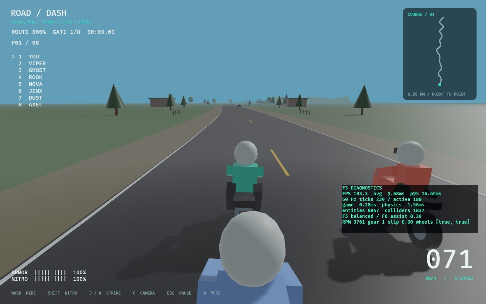
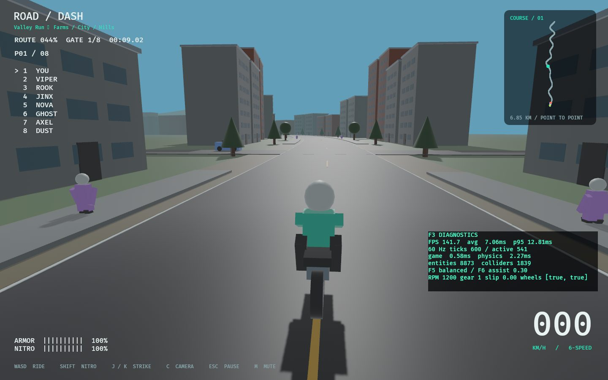

# ROAD / DASH

A native Rust + Bevy motorcycle combat racer. Race a point-to-point farmland → city → hills route against seven rivals, dodge two-way traffic, throw punches, and use nitro to make a pass. Crashes separate the rider into a jointed Rapier ragdoll and a tumbling motorcycle, preserving current momentum.

This is the first playable foundation of a modern remake, with original procedural 3D scenery and models. It is inspired by Road Rash's racing/combat loop and the [arkits native port](https://github.com/arkits/road-rash). It does not contain that repository's code, sprites, music, or original game data.



## Run

Install [Rust](https://rustup.rs/) (the project pins Rust 1.94.0), then run from the repository directory:

```sh
git clone https://github.com/ImadMashhood/RoadDash.git
cd RoadDash
cargo run --release
```

First compilation builds the engine and can take several minutes. A desktop GPU with Vulkan, Metal, or DirectX 12 support is recommended. There are no assets to download or extract.

Linux needs X11 development libraries. Ubuntu/Debian:

```sh
sudo apt-get install build-essential pkg-config libx11-dev libxi-dev libxcursor-dev libxrandr-dev libxinerama-dev libxkbcommon-dev libasound2-dev
```

Fedora:

```sh
sudo dnf install gcc-c++ pkgconf-pkg-config libX11-devel libXi-devel libXcursor-devel libXrandr-devel libXinerama-devel libxkbcommon-devel alsa-lib-devel
```

Keyboard bindings can be supplied through `ROADDASH_BINDINGS=/path/to/input.json` using the validated [input schema](content/input.json). Features: `offline` + `devtools` by default, minimal `--no-default-features --features offline`, optional `--features debug_physics`. No online transport is implemented. [Architecture and developer guide](docs/ARCHITECTURE.md).

The Linux build uses X11 (and XWayland on Wayland desktops). Windows and macOS are supported by the engine, but have not yet been runtime-tested for this project.

## Controls

| Key | Action |
| --- | --- |
| Enter / menu button | Start / race again |
| W / Up | Throttle |
| S / Down | Brake |
| A, D / Left, Right | Steer across the road |
| Left or Right Shift | Nitro while accelerating |
| J / K | Punch left / right |
| C | Cycle three camera distances |
| Esc | Pause / resume |
| M | Mute / unmute audio |
| F3 | Toggle developer frame/tick/physics/entity diagnostics |
| F4 | Toggle track spline/normal/bounds/spawn inspector |
| F5 / F6 | Cycle handling preset / adjust road assist (developer tuning) |
| R | Restart from the grid |

The dynamic bike has assisted road-relative steering and independent physical momentum. Steering chooses a line across the road; tight bends push the bike toward the shoulder at high speed. Brake before sharp corners. Nitro regenerates when released. Grass reduces traction and speed while remaining driveable; it does not drain armor or cause a crash by itself. Traffic collisions, hard bike collisions, and melee damage can knock you off. After a crash, the camera follows your physical ragdoll until it lands. Your rider gets up, runs back to the actual fallen bike, lifts it upright, and remounts. Moving traffic and other racers can knock a rider down again during recovery.

## Included

- A 6.85 km authored point-to-point course: open farmland, dense city streets, then rolling hills. Eight riders, nine ordered gates, one finish.
- A separate approximately 2 km handling test fixture, headless track validation and F4 spline/normal/bounds/spawn inspection.
- Seeded farms/fences and solid cows that lift riders on contact; city cross traffic and walking sidewalk pedestrians; elevated hill terrain and guardrails.
- Original procedural 3D bikes, riders, cars, road markings, trees, farms, buildings, cows, pedestrians and start/finish markers.
- PBR materials, directional shadows, atmospheric distance fog, and a speed-sensitive chase camera.
- Seven AI racers with corner speed adjustment, lane changes, traffic avoidance, and attacks.
- Twelve traffic vehicles traveling in both directions.
- Three direct side-by-side punches knock out a target when each consecutive hit is within three seconds; misses, gaps and duplicate contact do not count.
- Armor, nitro, collision detection, crash recovery and camera shake.
- Eleven rider bodies with anatomical shoulder/hip/spine/neck limits, directional elbow/knee hinges and bounded passive spring/damping resistance. This approximates tissue resistance; it is not biological muscle simulation.
- Independent bike wrecks slide on slopes and retain stopping friction on flat ground. Boost release/exhaustion slows gradually, and steering is about 20% tighter.
- Solid cars, bikes, riders, cows, pedestrians, trees, buildings, fences, curbs, guardrails and road/terrain surfaces. Road markings are visual decals.
- Equal-speed motorcycle contact and gentle side taps transfer momentum; fast rear/side impacts cause measured knockoffs. NPC hits can produce separate human or quadruped ragdolls.
- Ordinary crashes preserve current velocity without an artificial upward launch. The separated rider and wreck fall independently.
- The recovery camera follows the ragdoll and then the running rider. A collision-aware character controller handles the run back and remount at the bike’s actual location.
- Synthesized engine RPM, wind, nitro, braking, impact, landing, punch, footstep, countdown, and finish audio. M mutes the mixer.
- Full-footprint scenery checks keep props clear; collision rays verify terrain does not cover banked road lanes.
- Garage/start menu, countdown, pause/restart, leaderboard, speedometer, live course map, and results.
- Persistent race count, wins, credits, and personal-best time.



## Current scope

This is an arcade prototype, not a finished commercial remake. Native riding now uses an assisted dynamic chassis with two raycast wheels, suspension, combined grip limits, torque/gears and upright feedback. A retained kinematic adapter is available for regression comparison. Ragdolls and wrecks are physically simulated. The environment and characters are procedural low-poly placeholders, with authored elevation and banking. There is one playable point-to-point course and three handling presets. Police pursuits, career events, purchasable upgrades, animation rigs, gamepads, multiplayer, and production art remain future work. Credits are saved but cannot yet be spent.

## Production blueprint v3 progress

Source: [Road Rash Bevy Production Blueprint v3.0](docs/road-rash-production-blueprint-v3.pdf), 39 pages, prepared October 30, 2026. The checklist below translates its 17 build parts and technical appendices into work to track; the linked PDF retains the full rationale, examples, references, and proposed tuning values.

**Status rules:** `[x]` means the specifically described capability exists in this prototype. `[ ]` means not implemented, partial, or not yet validated to the stated requirement. A prototype feature does not satisfy a larger production gate automatically. When completing an item, attach its code/test, measurement, playtest report, or rights record; leave unverified acceptance criteria unchecked. Baseline history: commit `03f12b2` had 18 behavior tests; Parts 00-01 now add the workspace, fixed scheduler and permanent evidence records. Current verification and outstanding gates are recorded in [PROGRESS](docs/PROGRESS.md) and [test receipts](docs/testing/PARTS_00_01.md).

Active implementation: user-requested combat/contact/NPC/traffic/map changes and Part 03; the playable route is point-to-point. See [Part 02 receipts](docs/testing/PART_02.md) and [track authoring](docs/tracks/AUTHORING.md). Earlier parts remain historical; see [Part 03 receipts](docs/testing/PART_03.md) and [vehicle/combat contract](docs/VEHICLE_AND_COMBAT.md). See [GDD](docs/GDD.md), [slice contract](docs/VERTICAL_SLICE.md), [architecture](docs/ARCHITECTURE.md), [decisions](docs/DECISIONS.md), [known issues](docs/KNOWN_ISSUES.md), and [development history](docs/CHANGELOG_DEV.md). Future gameplay and online requirements stay in their assigned parts.

### Baseline and dependency decisions

The current build remains **Rust 1.94.0, Bevy 0.17.3, Rapier 0.32.0, built-in Bevy audio**, as pinned in [Cargo.toml](Cargo.toml), [Cargo.lock](Cargo.lock), and [rust-toolchain.toml](rust-toolchain.toml). Gameplay and Rapier now run at fixed 60 Hz with three physics substeps; render-only visual children and camera focus interpolate independently. The source-verified newer plugin manifests target Bevy 0.20, so migration remains a coordinated decision rather than mixing incompatible versions.

The following are **the PDF's proposed targets**, not newly verified compatibility claims or dependencies already installed. Recheck releases, compatibility, licenses, and platform builds before adopting them.

| Component | Blueprint target | Tracking decision |
| --- | --- | --- |
| Bevy | 0.20.1 patch line | Pending compatibility review and migration decision |
| Avian3D | 0.8.0 | Pending decision on replacing the current Rapier adapter |
| Bevy Enhanced Input | 0.27.x | Pending action maps, controllers, and rebinding |
| Lightyear | 0.31.0 | Defer until the offline slice gate and networking spike |
| Hanabi | Explicit compatible release/commit | Optional; adopt only after VFX/performance evaluation |
| Bevy Kira Audio | 0.27.x | Optional; evaluate only if built-in audio fails the mixing/crossfade requirements |
| Blender / glTF 2.0 | Tested, pinned authoring/export workflow | Pending production asset pipeline |

- [ ] **BASE-001** Verify the proposed dependency combination with locked Fedora/Linux and Windows builds; record the selected versions and migration decision.
- [ ] **BASE-002** Preserve a working baseline while migrating; keep engine, physics, input, audio, and networking adapters independently testable.
- [x] **BASE-003** Record dependency versions, purposes, licenses, and notices in `docs/third_party/REPOSITORIES.md`; record media provenance in `docs/third_party/ASSETS.csv`.

### Repository and source map

Repository roles below follow the PDF. A research listing is not permission to copy code or assets. Recheck file-level licensing when considering reuse; media licenses are separate from code licenses.

| ID | Repository | Role / parts |
| --- | --- | --- |
| R01 | [arkits/road-rash](https://github.com/arkits/road-rash) | Behavioral research only; P00, P02-P03, P05, P07-P09, P12, P14 |
| R02 | [Bevy-Jam-5/bike-game](https://github.com/Bevy-Jam-5/bike-game) | Camera, handling, scenery, and authoring example; code reuse only with verified notices, assets audited separately; P00, P02-P04, P09, P11, P14 |
| R03 | [blyfoten/driftmaster](https://github.com/blyfoten/driftmaster) | Tire, suspension, and telemetry research only until reuse permission is verified; P03, P06, P08 |
| R04 | [avianphysics/avian](https://github.com/avianphysics/avian) | Proposed physics adapter; P01-P08, P10, P13, P16 |
| R05 | [cBournhonesque/lightyear](https://github.com/cBournhonesque/lightyear) | Proposed later networking; P10, P13, P16 |
| R06 | [simgine/bevy_enhanced_input](https://github.com/simgine/bevy_enhanced_input) | Proposed action maps, gamepads, and rebinding; P01, P03-P06, P13 |
| R07 | [djeedai/bevy_hanabi](https://github.com/djeedai/bevy_hanabi) | Optional particles; P11, P15 |
| R08 | [bevyengine/bevy](https://github.com/bevyengine/bevy) | Current core engine; throughout |
| R09 | [NiklasEi/bevy_kira_audio](https://github.com/NiklasEi/bevy_kira_audio) | Optional audio mixer alternative; P15, earlier only if justified |

### Part 00 - Research, scope, and rights

PDF p. 8; references R01, R02.

- [x] **P00-001** Document the original-successor approach and exclude the reference port's code, original game data, sprites, and soundtrack. Evidence: introduction and License sections of this README.
- [x] **P00-002** Establish a top-level production backlog from the blueprint. Evidence: this progress tracker.
- [x] **P00-003** Write a GDD v0.1 under 12 pages with P0/P1/P2 priorities, player fantasy, session length, fun metrics, and performance targets.
- [x] **P00-004** Lock the slice definition: one road, one bike plus two variants, at least three AI, punches/kicks, traffic, crash-to-foot control, valid foot finish, results, and retry.
- [x] **P00-005** Create at least 20 confidence-rated reference observations with source URL, build/version, date, recording description, and independent implementation notes.
- [x] **P00-006** Build bike, weapon, rider/outfit/palette, track, shop, progression, and UI content sheets; distinguish historical observation from new design.
- [x] **P00-007** Maintain research fields `source_id`, `observed_behavior`, `confidence`, `asset_owner`, `allowed_usage`, and `follow_up`.
- [x] **P00-008** Complete a rights register covering code, art, sound, fonts, contributors, attribution, and redistribution; remove unknown-license runtime content.
- [x] **P00-009** **Exit gate:** original-content policy, content schema, backlog, and one-page slice definition exist, with the reference and rights inventories reviewed.

### Part 01 - Workspace, CI, and runtime architecture

PDF pp. 7, 9; references R08, R04, R06.

- [x] **P01-001** Pin a Rust toolchain and dependencies; provide formatting, Clippy with warnings denied, and Linux headless tests in CI. Evidence: [toolchain](rust-toolchain.toml), [manifest](Cargo.toml), [CI](.github/workflows/ci.yml).
- [x] **P01-002** Launch a native Fedora/Linux 3D build with ground, lighting, camera, keyboard input, menus, pause, and reset. Evidence: [app](src/main.rs), [render smoke check](src/verification.rs).
- [ ] **P01-003** Split the single-crate prototype into client/server/core/vehicle/combat/race/AI/content/network/tools responsibilities, with a plugin per subsystem and conventional commit rules.
- [ ] **P01-004** Keep pure simulation independent of UI/rendering; isolate the physics adapter, presentation, typed content, dev tools, and later server authority.
- [x] **P01-005** Implement Boot/MainMenu/Loading/Race/Results lifecycle and fixed 60 Hz gameplay/physics scheduling, with independent render interpolation.
- [ ] **P01-006** Add action mapping/input contexts, stable content IDs, schema versions, and the intent -> simulation -> authoritative event -> presentation contract.
- [ ] **P01-007** Add `devtools`, `debug_physics`, `offline`, and `netplay` feature boundaries and reproducible quality modes.
- [x] **P01-008** Add FPS, average/P95 frame time, 60 Hz tick count, entity/collider counts, physics timing, toggleable debug UI, logs, and panic reports.
- [ ] **P01-009** Extend CI to a validated Windows build plus content/license audits and workspace-wide checks; verify the dependency migration separately.
- [ ] **P01-010** Validate a native Fedora/NVIDIA launch, Windows launch, and 100 pause/reset cycles without state corruption.
- [ ] **P01-011** **Exit gate:** independent 60 Hz ticks are measured, both platform launches are verified, and the required CI matrix passes.

- [x] **P01-012** Verify 30/60/120 render-FPS simulation equality and 100 crash/pause/resume/reset cycles without actor leaks. Evidence: [game tests](src/game.rs).
- [x] **P01-013** Preserve and consume short attack inputs once across zero/multiple fixed ticks. Evidence: [core buffer](crates/rr_core/src/lib.rs), [input tests](src/game.rs).
- [x] **P01-014** Version prototype profiles while retaining legacy progress and rejecting unsupported/corrupt data. Evidence: [profile tests](src/game.rs).
- [x] **P01-015** Provide a headless content-validation CLI and local panic report process probe. Evidence: [entry point](src/main.rs), [test receipts](docs/testing/PARTS_00_01.md).
- [x] **P01-016** Keep the complete README/tracker task index synchronized by stable IDs. Evidence: [sync checker](tools/sync_progress.py).
- [x] **P01-017** Audit declared dependency/media provenance, font notices, source hashes and excluded unverified embedded LUTs. Evidence: [audit](tools/audit.py), [inventory](docs/third_party/ASSETS.csv).
- [ ] **P01-018** Obtain actual Windows and Fedora/NVIDIA native launch/input/audio receipts in addition to the CI build matrix; record the measured adapter and keep unmet hardware gates open.
- [x] **P01-019** Decode Cargo metadata and repository text explicitly as UTF-8 across host locales; regress the Windows cp1252 audit failure. Evidence: [audit tests](tools/test_audit.py), [CI follow-up](docs/testing/PART_02.md).

### Part 02 - Scenic road graybox and track format

PDF p. 10; references R01, R02, R08.

- [x] **P02-001** Build a closed driveable circuit with lanes, shoulders, solid road surfaces, and canonical arc-length progress. Evidence: [track](src/track.rs), [world](src/world.rs).
- [x] **P02-002** Validate circuit closure, distance wrapping, camera-right lane direction, progress projection, and full-footprint scenery clearance in headless tests. Evidence: tests in [track](src/track.rs) and [world](src/world.rs).
- [x] **P02-003** Document meter units, +Y up, spline-tangent forward, origin, and any future origin-rebasing policy.
- [ ] **P02-004** Replace the generated flat polyline with an authorable Catmull-Rom/Bezier centerline supporting widths, banking, elevation, sectors, and optional route splits/merges.
- [x] **P02-005** Define typed track IDs, control points, surfaces, ordered checkpoint IDs, prop placement, spawn points, and safe foot/verge regions.
- [x] **P02-006** Build simplified collision meshes separately from render meshes, initially sampling around 2-3 m; add curbs, guardrails, fencing, and reliable highway boundaries.
- [x] **P02-007** Implement ordered gates and forward crossing validation; validate checkpoint order, intersections, NaNs, negative widths, and spawn overlap.
- [x] **P02-008** Add asphalt/dirt/gravel/grass/water metadata and traction/friction modifiers, animal crossings, and cliff hazard zones.
- [x] **P02-009** Add a track inspector for spline normals, triangle count, driving line, bounds, and spawns; load authored tracks headlessly.
- [ ] **P02-010** Build a short approximately 2 km handling road, then a roughly 6-9 km town -> farm -> cliff corridor tuned for a three-minute race, with straight, turns, hairpin, and hazards.
- [ ] **P02-011** **Exit gate:** an authored graybox supports a complete race with valid gates, stable collision, clear progress, and no terrain fall-through.

Implementation evidence: [track format](docs/tracks/AUTHORING.md), [schema](crates/rr_content/src/track.rs), [track/gate tests](src/track.rs), [geometry and actors](src/environment.rs), [receipt](docs/testing/PART_02.md). P02-004 is partial: spline/width/bank/elevation/sectors are working; optional branch/split/merge support remains. P02-010 has both road lengths; busy-race pacing remains unverified. User-directed route order is farmland → city → hills, with no return loop. The overall gate remains open until those outstanding requirements are resolved.

- [x] **P02-012** Build the user-directed point-to-point map with distinct start/finish, no endpoint wrapping, canonical route HUD and safe endpoint/retry behavior. Evidence: [track](src/track.rs), [race tests](src/game.rs).
- [x] **P02-013** Populate seeded farm openings/fences/cows, city buildings/cross traffic/walking pedestrians, and elevated hills with physical guardrails. Evidence: [environment](src/environment.rs), [native captures](docs/testing/PART_02.md).
- [x] **P02-014** Keep terrain below banked road lanes and verify route support, render/collision winding and independent collision resolution. Evidence: [geometry tests](src/environment.rs).
- [x] **P02-015** Verify actual hill crash/get-up/run/remount at elevation without resetting the bike to sea level. Evidence: [recovery](src/recovery.rs), [native receipt](docs/testing/PART_02.md).

- [x] **P02-016** Keep hill guardrails on outer curves, open the straights, and add varied trees in all zones plus window/door/roof, cross-vehicle and pedestrian detail. Evidence: [environment](src/environment.rs), [native captures](docs/testing/PART_03.md).

### Part 03 - Motorcycle physics and controls

PDF pp. 11-12, 32; references R02, R03, R04.

- [x] **P03-001** M0: reach the finish with a kinematic road-following arcade controller, throttle, braking, steering/lean visuals, and nitro. Evidence: [racing controller](src/game.rs).
- [x] **P03-002** Integrate collision-driven knockoff, continuous movement checks against solid geometry, and impact launch/landing/bounce behavior. Evidence: [controller](src/game.rs), [impacts](src/recovery.rs), steering/collision/bounce tests. Rider-to-rider contact is now severity-based (P06-019); historical universal hops are superseded.
- [x] **P03-003** M1: implement a dynamic chassis with mass, center of mass/inertia, upright assist, and separate rider/wheel visuals behind `VehiclePhysicsAdapter`.
- [x] **P03-004** M2: add front/rear wheel contact rays, spring-damper suspension forces, engine braking, service braking, and a torque/RPM/redline/gear model.
- [x] **P03-005** M3: implement surface-dependent combined longitudinal/lateral traction budget, slip, controlled drift, speed-sensitive steering, aerodynamic drag proportional to speed squared, and low-speed self-righting.
- [x] **P03-006** Define a simulation-facing `BikeState` with pose/velocity, yaw/lean, slip, grounded wheels, actual RPM/gear, damage, and rider condition references.
- [x] **P03-007** Author three data-driven handling presets: light/agile, balanced, and heavy/powerful; initially target 150-290 kg dry plus rider, 0-100 km/h in 3.5-6.5 s, and a roughly 50-60 degree lean clamp.
- [x] **P03-008** Expose live tuning and per-tick telemetry: bike ID, tick/dt, pose, velocity, inputs, yaw rate, lean, wheel contacts, spring forces, slip, surface mu, damage, and crash state.
- [x] **P03-009** Benchmark acceleration, braking distance, steady turns, lean recovery, and curb hits; compare numeric results at 30/60/120 render FPS and collect 100 Hz traces where needed.
- [ ] **P03-010** Run a ten-minute aggressive-turning soak without NaNs/tunneling/unexplained flips; record at least ten test rides and controller feedback.
- [ ] **P03-011** **Exit gate:** three presets feel distinct, a beginner can finish, and handling is fun and stable with placeholder art.
- [x] **P03-012** Decelerate smoothly when boost is released or exhausted; preserve excess speed instead of clamping to the ordinary top speed. Evidence: [regression](src/game.rs).
- [x] **P03-013** Allow player/AI forward movement in grass, with reduced traction/speed and no grass-only health loss or knockoff; AI can return to the road. Evidence: [four-scenario regression](src/game.rs).
- [x] **P03-014** Tighten lateral handling approximately 20% using validated authored steering rates, retaining older schema-1 catalogs with defaults. Evidence: [tuning](content/catalog.json), [schema tests](crates/rr_content/src/lib.rs).

- [x] **P03-015** Reduce road assistance without pulling the rider to lane zero; expose F6 adjustment and preserve free lane choice. Evidence: [stationary-offset regression](src/vehicle_tests.rs).
- [x] **P03-016** Feed AI and human tick intentions through the same dynamic adapter, retaining AI traffic avoidance and launch grace. Evidence: [controller](src/game.rs), [dynamic grid regression](src/vehicle_tests.rs).
- [x] **P03-017** Preserve selected dry bike mass in abandoned wrecks and clear stale velocity on dynamic remount. Evidence: [mass/recovery regressions](src/vehicle_tests.rs).

Part 03 evidence: [vehicle/combat contract](docs/VEHICLE_AND_COMBAT.md), [numeric tests](src/vehicle_tests.rs), [receipts](docs/testing/PART_03.md). P03-010 is partial: the 600-second simulated turning soak ran, but ten human rides/subjective feedback are not available. P03-011 stays open pending that beginner/fun acceptance; no Part 04 advancement is implied. Telemetry is sampled at the authoritative 60 Hz, with no fabricated 100 Hz data.

### Part 04 - Chase camera, speed feel, and input

PDF p. 13; references R02, R06, R08.

- [x] **P04-001** Provide smoothed follow/look-ahead, near/default/far chase views, speed-sensitive FOV, impact shake, and scenery collision avoidance. Evidence: [camera](src/game.rs).
- [x] **P04-002** Provide keyboard throttle/brake/steering, pause/reset, and correct left/right steering in chase-camera space. Evidence: [input and regression tests](src/game.rs).
- [x] **P04-003** Add speed-linked engine pitch and wind feedback. Evidence: [sound](src/sound.rs).
- [ ] **P04-004** Drive camera motion from interpolated fixed-step poses; verify no jitter at 120-144 Hz and readability through tight turns, impacts, and jumps.
- [ ] **P04-005** Add gamepad stick steering/freelook, analog throttle/brake triggers, attack bindings, deadzones, and key/controller rebinding.
- [ ] **P04-006** Provide persistent FOV/smoothing/anti-nausea settings; target configurable 60-95 degrees, about 75 degrees default, with optional reduced shake.
- [ ] **P04-007** Add readable slip/traction feedback and optional speed lines; allocate the independent on-foot input context.
- [ ] **P04-008** Validate camera clipping, both input devices, comfort-setting persistence, and responsive handling with an external tester.
- [ ] **P04-009** **Exit gate:** riding is fast, comfortable, responsive, and finishable with keyboard and gamepad without unintended auto steering.

- [x] **P04-010** Color only racer minimap dots by their shirt palette, sharing the model color source. Evidence: [palette test](src/ui.rs), [shirt colors](src/world.rs).

### Part 05 - Riding melee and weapons

PDF p. 14; references R01, R04.

- [x] **P05-001** Implement left/right punches, directional range checks, damage, cooldown, simple arm animation, hit sound, and HUD feedback. Evidence: [combat](src/combat.rs), [animation](src/world.rs), [sound](src/sound.rs).
- [x] **P05-002** Test directional damage and a single takedown reward. Evidence: `directional_melee_damages_the_target_and_awards_one_takedown` in [game tests](src/game.rs).
- [ ] **P05-003** Add left/right kicks, then one simple held weapon and pickup rules.
- [ ] **P05-004** Define typed ability data for startup/active/recovery, range, stamina cost, impulse, damage, stagger, and cooldown; initial punch timing 0.15/0.12/0.30 s and kick timing 0.24/0.16/0.50 s are tuning proposals.
- [ ] **P05-005** Use stable side/front cones and transient swept sensor volumes; resolve each attack once with attacker/target/attack ID/contact point/relative speed/tick/result fields.
- [ ] **P05-006** Implement idle/lean/punch/kick/hit/stagger animation states, input buffering/priorities, anti-spam, and gameplay-owned timing.
- [ ] **P05-007** Build a matched-speed side-by-side combat harness; test no double-hit, misses 0.5 m beyond range, and cooldown/stamina/immunity boundaries.
- [ ] **P05-008** **Exit gate:** three minutes of enjoyable punch/kick combat without weapons, with timing and hit validation evidence.

- [x] **P05-009** Require three direct side-by-side hits with no more than three seconds between hits, with reach/side/height/heading/occlusion checks, one target per attack and duplicate-hit protection. Evidence: [core rules](crates/rr_core/src/lib.rs), [melee](src/combat.rs), [regressions](src/game.rs).

### Part 06 - Damage, ragdoll, and controllable recovery

PDF p. 15 and dismounted-control contract pp. 28-29; references R03, R04.

- [x] **P06-001** Trigger physical knockoff from attacks, vehicle contacts, and solid roadside obstacles; maintain rider health and crash state. Evidence: [impacts](src/recovery.rs), [controller](src/game.rs).
- [x] **P06-002** Use separate owner-linked ragdoll, abandoned bike, and on-foot actors; implement falling -> getting up -> assisted run -> right bike -> remount. Evidence: [recovery](src/recovery.rs).
- [x] **P06-003** Provide an 11-body jointed ragdoll, CCD, friction/restitution, collision filtering for the hidden riding body, and a solid on-foot capsule with step/slope handling. Evidence: [recovery](src/recovery.rs).
- [x] **P06-004** Follow the physical torso and on-foot rider with the camera; allow traffic/rivals to knock a recovering rider down again without duplicate ragdolls. Evidence: [camera](src/game.rs), recovery-camera and repeat-knockdown tests.
- [x] **P06-005** Provide impact/footstep cues and verify the rendered crash/get-up/run/remount sequence. Evidence: [sound](src/sound.rs), [render check](src/verification.rs).
- [ ] **P06-006** Add independent stamina, bike durability, balance/wobble, police-hit and bad-landing crash thresholds, and one authoritative `CrashStarted` event.
- [ ] **P06-007** Add immediate camera-relative 360-degree WASD/stick manual walking override, including running away from the bike; resume assist only after 0.25-0.5 s neutral input.
- [ ] **P06-008** Separate OnFootAutoSeekBike and OnFootManual states; support FinishedOnFoot and BustedOrRecover outcomes. **The current runner is automatic only.**
- [ ] **P06-009** Make remount safe: proximity, facing/interaction option, low bike speed, animation/collision checks, and no unwanted snap while deliberately walking away.
- [ ] **P06-010** Tune control handoff toward 1-3 s after a crash; add optional delayed stuck recovery with penalties and no automatic finish-line teleport.
- [ ] **P06-011** Separate simulation-critical colliders from cosmetic debris; budget ragdoll bodies/joints and avoid per-fragment replication.
- [ ] **P06-012** Run 100 high-speed crashes without frozen physics/terrain clipping; audit trapping around fences, buildings, curbs, cliffs, and traffic, and tune repeated-hit protection/time loss.
- [ ] **P06-013** **Exit gate:** knockoff, manual foot movement, optional assist, valid foot finish, and safe remount all work smoothly.
- [x] **P06-014** Preserve current crash momentum without synthetic upward launch and visibly separate the rider from the riderless wreck. Evidence: [crash tests](src/game.rs), [recovery](src/recovery.rs), [native receipt](docs/testing/PARTS_00_01.md).
- [x] **P06-015** Remount against the actual fallen bike collision shape, including sideways, upside-down and vertical poses, without the runner pushing it away. Evidence: twelve automated approaches in [game tests](src/game.rs) and native recovery smoke.
- [x] **P06-016** Apply post-remount protection to shoulder damage so recovery does not immediately drain health. Evidence: end-to-end recovery regression in [game tests](src/game.rs). Historical behavior: P03-013 now removes grass-only damage entirely.
- [x] **P06-017** Replace universal ball-joint limits with anatomical stops, directional hinges and bounded passive tissue resistance; verify 100 high-speed drops without detached joints or twisted hinge axes. Evidence: [articulation](src/recovery.rs), [stress test](src/game.rs).
- [x] **P06-018** Make fallen bikes slide on steep solid terrain while retaining flat-road stopping friction. Evidence: [slope contact friction](src/recovery.rs), [ramp regression](src/game.rs).

- [x] **P06-019** Classify motorcycle wipeouts by relative closing speed: >=50 km/h longitudinal or substantial side impact; lighter contacts nudge without universal launch/knockoff. Evidence: [severity rules](crates/rr_core/src/lib.rs), [contact tests](src/game.rs).
- [x] **P06-020** Add distinct pedestrian/cow ragdolls with direct-hit and solid-impact paths, an eight-actor budget, safe delayed standing and complete reset cleanup. Evidence: [NPC systems/tests](src/npc.rs), [native actor capture](docs/testing/PART_03.md).
- [x] **P06-021** Treat sidewalks as rideable support so low curb contact raises the bike instead of causing an obstacle wipeout. Evidence: [suspension](src/vehicle.rs), [curb-transition test](src/vehicle_tests.rs).

### Part 07 - Race rules, HUD, and results

PDF p. 16 and finish contract pp. 28-29; references R01, R08.

- [x] **P07-001** Implement countdown, laps/progress standings, race clock, speed/armor/nitro readouts, minimap, results/payouts, and restart. Evidence: [race](src/game.rs), [HUD](src/ui.rs).
- [x] **P07-002** Persist basic race count, wins, credits, and personal-best time; test one-time finish rewards and restarting. Evidence: [profile and finish tests](src/game.rs).
- [ ] **P07-003** Add seeded starts, ordered forward-crossed checkpoints, route segments, canonical racer-level progress, and out-of-bounds recovery.
- [ ] **P07-004** Accept a valid forward finish from either rider or bike with shared racer identity; record source OnFoot/Bike and a single finish tick/event/payout. **Finishing while on foot is not implemented.**
- [ ] **P07-005** Reject backward crossings, skipped gates, shortcuts, and finish teleports; handle same-tick rider/bike crossing exactly once.
- [ ] **P07-006** Add distance/progress, bike damage, weapon state, and on-foot bike-direction/distance HUD; retain stable placement on split routes and off-road movement.
- [ ] **P07-007** Add penalties, practice/free-ride, best records per class/track, and data-driven race length/AI/traffic/police/difficulty settings.
- [ ] **P07-008** Verify retry retains settings while resetting all live race state, including traffic and recovery actors.
- [ ] **P07-009** **Exit gate:** repeatable approximately three-minute start-to-results-to-retry race with stable, checkpoint-validated bike and foot finishes.

### Part 08 - AI racers, traffic, and police

PDF pp. 17, 33; references R01, R03, R04.

- [x] **P08-001** Populate seven rival racers with curve-speed planning, lane changes, traffic avoidance, attacks, and recovery through the shared recovery system. Evidence: [AI controller](src/game.rs), [recovery](src/recovery.rs).
- [x] **P08-002** Populate two-way civilian traffic with solid vehicle colliders. Evidence: [traffic setup/update](src/game.rs).
- [ ] **P08-003** Route AI through the same `BikeControl`/vehicle physics interface as human input; remove hidden grip/acceleration differences unless explicitly presented as difficulty assists.
- [ ] **P08-004** Implement Cruise/SeekOvertake/Defend/Attack/Recover/Pursued/Arrested states with a blackboard and aggressive/cautious/opportunistic/reckless weights.
- [ ] **P08-005** Add traffic gap keeping, braking, lane changes/intersections, and obstacle rerouting.
- [ ] **P08-006** Add police patrol, violation assessment, chase/intercept/bust, loss of target, and return-to-patrol states with testable transitions.
- [ ] **P08-007** Budget active racers/cars/police by visibility and distance; perception 5-15 Hz, controls 60 Hz, safe spawn/despawn outside view.
- [ ] **P08-008** Add AI debug goals, paths, desired speeds, and headless tournaments; complete 100 races without deadlock and test human/AI foot recovery separately.
- [ ] **P08-009** **Exit gate:** fair, repeatable four-racer race with traffic, police, and melee, including opponent overtakes, hits, and recovery.

- [x] **P08-010** Use American right-hand traffic lanes and separate one-way cross-traffic lanes; stop automatic AI fights/weaving during grid launch. Evidence: [traffic](src/game.rs), [cross streets](src/environment.rs), [grid tests](src/vehicle_tests.rs).

### Part 09 - Vertical-slice playtest gate

PDF p. 18; references R01, R02, R08.

- [ ] **P09-001** Consolidate the three-minute town/farm/cliff route with player plus three AI, traffic/police, punch/kick, manual foot control, foot finish, checkpoints, results, and retry.
- [ ] **P09-002** Run at least ten external play sessions with recordings, handling A/B comparisons, perceived-speed/crash feedback, and failure/input notes.
- [ ] **P09-003** Measure finish rate, retries, voluntary replay, attack/hit counts, collisions, and time outside player control; record the five biggest frustrations.
- [ ] **P09-004** Test the proposed fun targets: 80% finish within three tries, over 50% voluntary replay, and time outside control below 12% of a session.
- [ ] **P09-005** Measure a 1080p Fedora/RTX 3080 slice with all P0 systems active against a stable 60 FPS baseline; store P95 frame-time evidence.
- [ ] **P09-006** Record keep/change/remove decisions and freeze the minimal controller/combat/race interfaces for the network spike.
- [ ] **P09-007** **Exit gate:** core loops need no debug intervention and external playtest evidence supports replaying the graybox; retune before expanding content otherwise.

### Part 10 - Networking feasibility spike

PDF pp. 19, 34; references R04, R05.

- [ ] **P10-001** Introduce Lightyear only after the offline slice gate; run a headless authoritative server with two LAN clients on one graybox track.
- [ ] **P10-002** Send tick/sequence-numbered input batches covering bike controls, attacks, manual foot movement, and remount; server owns simulation, hits, rankings, and rewards.
- [ ] **P10-003** Predict local movement, buffer/interpolate remote snapshots, reconcile errors, and deduplicate confirmed combat/crash/result events.
- [ ] **P10-004** Test 2 -> 4 players, high-speed opposing collisions, and punch adjudication; consider server-owned simplified/cosmetic client ragdolls.
- [ ] **P10-005** Measure 60 Hz server simulation, 20-30 Hz snapshots, and an initial bandwidth target below 100 kbps/client for four players.
- [ ] **P10-006** Exercise 0/50/100/150 ms RTT, jitter, and 0/1/5% packet loss; record correction distances, response, recoverability, and consistent hit outcomes.
- [ ] **P10-007** **Exit gate:** two clients race at 100 ms simulated RTT, loss does not create a desync storm, and the authority/physics approach is documented with measurements rather than deterministic-lockstep assumptions.

### Part 11 - Scenic world and original asset production

PDF pp. 20, 26-27, 35; references R02, R07 optional, R08.

- [x] **P11-001** Provide placeholder road, trees, mountains, ocean, bikes/riders/cars, solid scenery proxies, and full-footprint road-clearance validation. Evidence: [world](src/world.rs), [track](src/track.rs).
- [ ] **P11-002** Create a road-world art bible for distinct town, farm, cliff, coast, and woodland identities before polishing bike/rider art.
- [ ] **P11-003** Establish tested Blender -> glTF/GLB scale, axes, rig/bone names, PBR materials, collision naming, LODs, and source/export folder separation.
- [ ] **P11-004** Author modular roads/intersections/sidewalks, storefronts/homes, barns/silos/fields/fences, cattle/tractors, cliffs/rocks/barriers, signs, poles, and landmarks.
- [ ] **P11-005** Build the route-zone/lot/terrain/encounter pipeline and foot-accessible collision/navigation surfaces described in the environment checklist below.
- [ ] **P11-006** Introduce asset validation for triangles, skeleton paths, textures/material references, ownership metadata, release clearance, and content hashes.
- [ ] **P11-007** Give every scenery family LOD, collision, and audio metadata; reveal recognizable landmarks or encounters every 10-25 s without hidden active hazards/pop-in.
- [ ] **P11-008** Animate riding, fighting, crash, walking, and remount through a production rig; add lightweight animal animation/AI and safe cliff recovery.
- [ ] **P11-009** Validate readable scenery at racing speed, zero missing material/texture references, provenance/credits, and asset swaps without gameplay changes.
- [ ] **P11-010** **Exit gate:** the original town/farm/cliff art replaces graybox assets without changing physics/race rules and fits measured budgets.

### Part 12 - Garage, economy, progression, and saves

PDF p. 21; reference R01.

- [x] **P12-001** Award and persist credits, wins, race count, and a best time; write profile updates through a temporary file and atomic rename in the user data directory. Evidence: [profile](src/game.rs).
- [x] **P12-002** Test that a finished race pays once across subsequent updates. Evidence: `finish_awards_results_once_and_button_starts_next_race` in [game tests](src/game.rs).
- [ ] **P12-003** Add real garage selection/ownership, prices, upgrade tiers, stat comparisons, repair costs, and cosmetic/loadout unlocks. The current garage is a start menu and credits cannot be spent.
- [ ] **P12-004** Define typed RON/TOML/JSON bike/rider/weapon/track/loadout/economy data; validate on load without recompiling tunables.
- [ ] **P12-005** Extend saves to owned bikes, finances, class/track records, unlocks, and options with explicit schema versions, migration fixtures, checksums, and rotating backups.
- [ ] **P12-006** Test interrupted writes, crash/quit/restart double-credit prevention, and save/load equality over 100 write cycles; keep absolute asset paths out of saves.
- [ ] **P12-007** Build an economy/progression simulator and play through starter -> upgraded bike without softlocks; keep offline/online trust models separate.
- [ ] **P12-008** **Exit gate:** purchasing a better bike changes play, saves/migrations are reliable, and repeated races have a working reward loop.

### Part 13 - Authoritative online races and lobbies

PDF pp. 22, 34; references R04, R05, R06, R08.

- [ ] **P13-001** Add join/lobby/ready/bike selection, synchronized starts, disconnect handling, reconnect policy, and consistent results.
- [ ] **P13-002** Define unreliable-sequenced redundant input batches and delta snapshots; use reliable/bounded or ID-deduplicated combat/crash/pickup/bust/finish events and idempotent rewards.
- [ ] **P13-003** Validate input magnitude/rate, selected bike, weapon ownership, reach/cooldown, damage, transforms, checkpoint order, and foot-or-bike finish on the server.
- [ ] **P13-004** Implement interest culling, interpolation buffers, prediction smoothing, replication priority, CPU/egress/RTT telemetry, and lag-compensated melee history.
- [ ] **P13-005** Replicate rider-foot and abandoned-bike states separately; keep particles/cosmetic ragdolls separate from authoritative crash/recovery state.
- [ ] **P13-006** Add authenticated identity, abuse/rate limits, instance IDs, heartbeat/logs, replay/incident dumps, and a 30-60 s reconnect/spectator policy without retroactive placement.
- [ ] **P13-007** Validate four-player races at 150 ms RTT / 1% loss with identical results and no duplicated finish/prize or bypassed attack limits.
- [ ] **P13-008** Measure eight-player stress before enabling it: 60 Hz tick budget 16.67 ms, target server P95 below 8 ms, and bounded bandwidth/corrections.
- [ ] **P13-009** **Exit gate:** stable private four-player races; eight players remain a stretch goal until measured headroom exists.

### Part 14 - Content expansion and modes

PDF p. 23; references R01, R02, R08.

- [ ] **P14-001** Add at least three further distinct original tracks spanning city, farm/livestock, coast/cliffs, and optional mountain woodland with unique hazards and passing opportunities.
- [ ] **P14-002** Build lightweight/balanced/touring/superbike/specialty classes, rider archetypes, cosmetics, loadouts, weapon pickups, and police variants.
- [ ] **P14-003** Add classic sprint, career/tournament, time trial, private multiplayer, and optional combat arena modes.
- [ ] **P14-004** Provide accessible difficulty controls and progression/unlock tests; only surface intentional AI assists explicitly.
- [ ] **P14-005** Use one versioned, validated content format across player/AI/network; separate cosmetics from physics and load new bikes/tracks without core-code edits.
- [ ] **P14-006** Add track/spawn editing tools when multiple contributors need them; verify packaged content hashes.
- [ ] **P14-007** Balance classes with 1,000 automated races plus human playtests; prevent career softlocks and regressions against the original slice gate.
- [ ] **P14-008** **Exit gate:** several unique tracks/bikes work through the same data pipeline without breaking the quality gate.

### Part 15 - Presentation, audio, UI, and accessibility

PDF pp. 24, 30-31; references R07 optional, R08, R09 optional.

- [x] **P15-001** Provide baseline PBR lighting, shadows/fog, menus/HUD/results, engine/wind/nitro/braking loops, impacts/footsteps/countdown/finish cues, and mute. Evidence: [world](src/world.rs), [UI](src/ui.rs), [audio](src/sound.rs).
- [x] **P15-002** Generate original PCM sounds in memory; verify valid non-silent WAV data and initialized/playing audio sinks in the native smoke check. Evidence: [sound test](src/sound.rs), [render/audio check](src/verification.rs).
- [ ] **P15-003** Implement the licensed free-audio catalog, actual RPM/load-driven engine-band crossfades, spatial emitters/listener, surface sounds, location ambience, music buses, and audio QA below.
- [ ] **P15-004** Add scalable lighting/shadows, sensible optional SSAO/SSR/reflections, decals, anti-aliasing controls, and optional motion blur; do not require grain/blur/heavy shake.
- [ ] **P15-005** Evaluate optional Hanabi particles for dust/exhaust/skids/sparks and cosmetic debris; cap emitters, GPU cost, and overdraw per quality setting.
- [ ] **P15-006** Polish garage/race/results UI, subtitles/non-speech captions, colorblind affordances, persistent input/audio/comfort settings, and rebinding.
- [ ] **P15-007** Add quality presets; test HUD at 1080p/1440p/4K and wide/ultrawide displays; never rely on color alone for critical state.
- [ ] **P15-008** Measure stable 1080p medium 60 FPS with four players/busy traffic and the aspirational 1080p high 120 FPS RTX 3080 target; add replay/highlight tools only if performance permits.
- [ ] **P15-009** **Exit gate:** presentation and audio are trailer-ready while meeting performance, legibility, accessibility, provenance, and saved-setting checks.

### Part 16 - QA, performance, packaging, and release

PDF pp. 25, 36-38; references R04, R05, R08.

- [x] **P16-001** Maintain functional regression tests for steering, circuit/projection, countdown/nitro/pause, combat, physical contacts, repeated knockdowns, camera tracking, full recovery, payouts, and scenery clearance. Evidence: tests in [game](src/game.rs), [track](src/track.rs), [world](src/world.rs), [sound](src/sound.rs).
- [x] **P16-002** Build and run a local Linux release; smoke-check garage -> riding -> crash -> get up -> run -> remount -> results with active audio. Evidence: [verification script](src/verification.rs).
- [ ] **P16-003** Profile CPU/GPU/render stages, draw calls, animation, contacts, networking, server ticks, and repeatable 1080p/1440p frame-time percentiles.
- [ ] **P16-004** Add golden state/replay checks, reproducible crash reports, a bug template, automated 30-minute eight-bot soak, and high-latency/loss multiplayer soak.
- [ ] **P16-005** Verify clean Fedora KDE Wayland/NVIDIA and Windows NVIDIA/AMD installations, controller/reconnect matrix, ultrawide HUD, save migration, and network ports.
- [ ] **P16-006** Add dependency/content/license audit and compatible `cargo audit`/`deny` checks to CI; generate current SBOM/attributions and resolve all P0/P1 bugs.
- [ ] **P16-007** Review localization, accessibility, opt-in telemetry/crash reporting, privacy/moderation policy, source-asset permissions, and final public-title/trademark clearance.
- [ ] **P16-008** Package/install-test distributions; add Steam depots/achievements/cloud saves only if selected; rehearse hotfix/support and stage closed test -> demo -> launch.
- [ ] **P16-009** Verify beta crash-free sessions above 99%, 60 FPS preset P95 frame time <=16.7 ms, and server P95 tick <=8 ms on recorded target hardware.
- [ ] **P16-010** **Exit gate:** functional, platform, performance, stability, rights, clean-install, support, and release-signoff evidence is complete; a successful build alone is not release approval.

### Environment contract - roads are gameplay

PDF pp. 26-27, 35. Placeholder trees/ocean/mountains do not fulfill the five production environment promises.

| Region | Required readable features | Required gameplay |
| --- | --- | --- |
| Town/city | Shops, homes, intersections, lights, parked cars, sidewalks, alleys, signs | Traffic priority, visibility blockers, hard corners/curbs, police density, ground-level walls |
| Farmland | Fields, barns, silos, tractors, cattle, fences, dirt entrances, hay bales, utility poles | Readable livestock crossings, slow tractors, mud/gravel grip, fence/ditch impacts, farm ambience |
| Cliff/mountain | Hairpins, ledges, retaining walls, valleys, rockfall, viewpoints, guardrails | Telegraph drops, downhill braking, rock hazards, explicitly permitted shortcuts, rescue/penalty instead of softlocks |
| Coast | Ocean vistas, towns, bridges, dunes, pull-offs, gulls | Scenic reveals, coastal wind/surf, grip changes, road-edge risk |
| Woodland | Dense trees, cabins, shadows, branches, deer, gravel turnoffs | Occlusion, contrast, narrow shoulders, animal crossings |

- [ ] **ENV-001** E0: author spline, widths, shoulders/sidewalks, vertical curves, checkpoint and finish volumes.
- [ ] **ENV-002** E1: author distance-station zones (example: town 0-2 km, farm 2-5 km, cliffs 5-8 km) with smooth art/audio transitions.
- [ ] **ENV-003** E2: stamp roadside lots/terrain cells; reserve 10-30 m of critical visibility at bends and intersections.
- [ ] **ENV-004** E3: place memorable landmarks plus interactive fences, cows, cars, rocks, and tractors; make encounters readable rather than unavoidable surprise spawns.
- [ ] **ENV-005** E4: validate bike and on-foot collision/navigation through curbs, barns, fences, buildings, and cliffs; remove trapping/invisible barriers.
- [ ] **ENV-006** E5: stream/LOD by visibility/distance without unloading or hiding authoritative hazards.
- [ ] **ENV-007** Define `WorldZone` ID/from/to/biome/road style/speed profile/scenery/audio/music/encounters/hazards/safe-spawn fields and corresponding schema validation.
- [ ] **ENV-008** Implement cow grazing/startled/turn/cross/react states with simple critical collision proxies; animal ragdolls remain optional cosmetics.
- [ ] **ENV-009** Verify a distinct silhouette/encounter every 10-25 s at 100-220 km/h and recognizable locations without reading the HUD; record the on-foot hazard audit and frame times.

### Mandatory dismounted-control and finish test matrix

PDF pp. 28-29. These complete scenarios remain open even where the automatic-return subset already exists.

- [ ] **FOOT-001** Crash 5 m before the finish; manually run forward across it -> finish once with valid prior checkpoints.
- [ ] **FOOT-002** Crash 5 m before the finish; run away from the bike across the line -> manual control wins and foot finish succeeds.
- [ ] **FOOT-003** Crash with neutral input -> seek bike around a known obstacle; verify safe proximity/facing/low-speed remount.
- [ ] **FOOT-004** Hold left/right/back after a crash -> independent chosen movement immediately; release -> assist resumes only after the configured neutral delay.
- [ ] **FOOT-005** Walk deliberately away near the bike -> no forced remount or teleport; camera follows rider and HUD shows bike arrow/distance.
- [ ] **FOOT-006** Bike and rider cross in the same tick -> exactly one racer-level finish event and payout.
- [ ] **FOOT-007** Walk backward through finish or skip a checkpoint -> reject until ordered forward progress is valid.
- [ ] **FOOT-008** Run off a cliff or become trapped between a fence and car -> recover without an invisible-wall/terrain softlock.
- [ ] **FOOT-009** Disconnect while on foot -> reconnect/AI timeout preserves authoritative rider/bike state and results.

### Audio acquisition, event inventory, and mix acceptance

PDF pp. 30-31. The existing synthesized sounds are a prototype foundation, not completion of this production library.

| Source | Proposed use | Rights work to record before acquisition/shipping |
| --- | --- | --- |
| [Mixkit motorcycle SFX](https://mixkit.co/free-sound-effects/motorcycle/) | Idle/rev/shift/acceleration/pass-by | Verify the exact file and [Free SFX license](https://mixkit.co/license/modal/sfxFree/); no stock redistribution |
| [Kenney Impact Sounds](https://kenney.nl/assets/impact-sounds) | Combat, crashes, roadside impacts | Verify the selected files' CC0 terms; edit/layer variants |
| [Kenney Interface Sounds](https://kenney.nl/assets/interface-sounds) | Menus, countdown, checkpoints | Verify selected files' CC0 terms |
| [Sonniss GDC](https://gdc.sonniss.com/) | Foley, environments, vehicle details | Archive the applicable commercial EULA and restrictions, including redistribution/AI-training restrictions |
| [OpenGameArt example track](https://opengameart.org/content/super-wreck-roadway) | Prototype rock music | Verify the exact track/author/license separately for each song |
| [Poly Haven](https://polyhaven.com/license) | Textures, models, HDRIs, not sound | Verify asset-specific provenance/CC0 terms; keep in the art ledger |

- [ ] **AUDIO-001** Create `content/audio_manifest.ron` / the asset ledger: path, author, exact source URL/license copy, acquisition date, hash, edits, redistribution permissions, attribution, and approval timestamp.
- [ ] **AUDIO-002** Motorbike inventory (~10 clips): idle, two mid bands, high band, rev hit, shifts up/down, two pass-bys, starter.
- [ ] **AUDIO-003** Surface inventory (~6): asphalt, gravel, dirt, grass, skid, wind; drive from wheel slip and `SurfaceType`.
- [ ] **AUDIO-004** Combat inventory (~5): light/heavy punch, kick, weapon, grunt; choose 3-5 licensed variants where appropriate from validated hit events.
- [ ] **AUDIO-005** Crash inventory (~5): body fall, metal hit, scrape, fence break, glass/crumple; layer by contact severity once per confirmed event.
- [ ] **AUDIO-006** World inventory (~6): city bed, farm insects/wind, cow, tractor, cliff wind, coast/surf; tie localized sources and ambience blends to zones.
- [ ] **AUDIO-007** Police/UI inventory (~4): near/far sirens, checkpoint, menu/finish cues; keep audible threat/readability priorities.
- [ ] **AUDIO-008** Implement an `AudioService` boundary with 3-4 seamless engine RPM/load bands, envelope crossfades, actual gear/transmission transients, and modest pitch changes.
- [ ] **AUDIO-009** Put the listener at the chase camera and emitters on bikes, police, cattle, and landmarks; test stereo/rolloff, opponent minimum volume, and distinct distance/gear cues.
- [ ] **AUDIO-010** Blend town/farm/cliff/coast ambience; visible livestock/tractors must match their sounds; keep music on a separate licensed, duckable, streamer-safe bus.
- [ ] **AUDIO-011** Evaluate Kira only if needed; if chosen, avoid running conflicting default Bevy audio and Kira backends.
- [ ] **AUDIO-012** Validate no loop clicks/gaps/clipping from idle to redline, distinguishable location ambiences, and no doubled combat/crash sound after prediction correction.
- [ ] **AUDIO-013** Persist master/engine/SFX/ambience/music sliders and input/audio options; caption critical non-speech cues and validate source release permissions.
- [x] **AUDIO-014** Exclude proprietary original Road Rash music, voices, and sound files from the current build; current effects are synthesized in [sound](src/sound.rs).

### Architecture, data, and content contracts

PDF pp. 7, 32-35; concrete example values remain tunables, not original-game facts.

- [ ] **ARCH-001** Isolate `client`, pure `sim`, `physics`, authoritative `server`, typed `content`, and developer `tools` responsibilities; clients never adjudicate hits/results from reported transforms.
- [ ] **ARCH-002** Define stable bike/rider/weapon/track IDs, cosmetic-versus-physics IDs, schema versions, validators, and migration-safe saves/protocols.
- [ ] **ARCH-003** Define `AttackIntent`, `AttackResolved`, `CrashStarted`, `RecoveryCompleted`, racer-level `RaceFinished`, and `PoliceBusted` contracts with IDs/ticks and single-result semantics.
- [ ] **ARCH-004** Define weapon timing/range/stamina/damage/stagger/knockback/pickup data and bike class/mass/top speed/torque/grip/lean/durability/visual-asset data as authored files.
- [ ] **ARCH-005** Author track bundles containing road, ordered checkpoints, spawn groups, props/LOD, original source art, runtime GLB, and separate collider GLB.
- [ ] **ARCH-006** Define evidence/classic-reference/new-design/rights/QA catalog fields; keep original-source observations distinct from new stats/unlocks/visuals.
- [ ] **ARCH-007** Tick/control simulation at 60 Hz, AI perception at 5-15 Hz, interpolate independently, and use explicit adapter-observed components/events rather than renderer or animation authority.
- [ ] **ARCH-008** Document snapshot/prediction/reconciliation assumptions and clock offsets; do not require cross-machine bit-identical physics or replicate individual cosmetic fragments.

### Budgets and non-functional acceptance

PDF pp. 19, 22, 24, 27, 32, 34-36. These are proposed targets to measure, not achieved performance claims.

| Area | Target / guardrail | Required evidence |
| --- | --- | --- |
| Render | 1080p medium >=60 FPS; aspirational 1080p high 120 FPS on RTX 3080 | Representative busy traffic/four-player race, 1080p/1440p GPU/CPU traces, P95 <=16.7 ms for the 60 FPS preset |
| Simulation/server | Fixed 60 Hz; 16.67 ms tick budget, server gameplay/physics P95 <8 ms | Instrumented repeatable session, separate render/physics counters |
| Networking | Four players first, eight stretch; 20-30 Hz snapshots; initial <100 kbps/client | LAN, 50 ms/1%, 100 ms/2%, 150 ms/5% tests, four-player 150 ms/1% result consistency, eight-player stress |
| Track streaming | Initial 100-300 m scene chunks | Visibility culling/stream-ahead traces; hazards remain consistent when detail unloads |
| Mesh LOD0 | Bike 25-50k triangles, rider 25-45k, car 15-35k | Import validation, LOD/animation/traffic budgets; adjust based on measured GPU cost |
| Textures/shadows/VFX | 2K primary bike/rider, 1K secondary; limited shadow cascades/cutoffs; capped emitters | GPU memory, streaming spikes, overdraw and per-preset profiling |
| Surfaces | Proposed asphalt mu 1.0, gravel 0.65, grass 0.4 | Combined grip/brake/turn behavior tests, not arbitrary independent force clamps |
| Input/accessibility | Keyboard + gamepad, remapping/deadzones, FOV/blur/shake controls, captions | Real tester/device matrix and persisted preferences |
| Save/content | Interrupted-write safety, backups/migrations; provenance for every shipped asset | Fault-injection/save fixtures and export/license audit |
| Reliability/platform | Beta >99% crash-free sessions; native Fedora/Linux and Windows | Opt-in reporting, clean install/GPU/controller/reconnect tests, 30-minute soak |

- [ ] **NFR-001** Store repeatable benchmark scenarios and results against every mandatory row above; distinguish requirements from aspirational targets and record intentional scope cuts.
- [ ] **NFR-002** Validate adaptive scenery budgets: modular building boxes/low LOD, near-corridor tree/rock proxies, lightweight distant animals, stable cliff collision, and batched road furniture.

### Rights, delivery evidence, and work-session order

PDF pp. 37-39. Record these as work/signoffs; the PDF itself grants no asset license or authority to publish a release.

- [ ] **RIGHTS-001** Obtain written commercial-use permission for acquired assets/contributions and proof for soundtrack, voices, logos, and any real motorcycle brands.
- [ ] **RIGHTS-002** Review the original-successor title/marketing and any close reproduction of protected expression; assume no permission for EA branding, exact tracks/characters/art, original retail files, or extracted media.
- [ ] **RIGHTS-003** Generate attribution/SBOM notices from the actual lockfile and asset manifests; audit installers, screenshots, trailers, and website material.
- [ ] **RIGHTS-004** Archive selected source/license versions for R01-R09 and the audio/art catalogs; research-only code stays research-only unless permission is established.
- [ ] **RIGHTS-005** After each part, attach a tagged build, test results, recording, performance metrics, architectural decision, explicit remaining bugs, and source/rights notes.
- [ ] **RIGHTS-006** Sessions 01-02: workspace, CI, debug metrics, clean Fedora scene.
- [ ] **RIGHTS-007** Sessions 03-04: spline mesh/collision road and valid start/finish/checkpoint gates.
- [ ] **RIGHTS-008** Sessions 05-08: acceleration/brakes, two wheel rays, stable camera/turns.
- [ ] **RIGHTS-009** Sessions 09-10: lean, surface grip, three distinct presets.
- [ ] **RIGHTS-010** Sessions 11-12: timer, standings, results, complete retry loop and evidence.
- [ ] **RIGHTS-011** Sessions 13-15: punches/kicks, timing/range/stagger validation.
- [ ] **RIGHTS-012** Sessions 16-18: manual foot movement, optional assist, foot finish, remount, no softlocks.
- [ ] **RIGHTS-013** Sessions 19-22: AI and traffic budgets, repeatable full race.
- [ ] **RIGHTS-014** Sessions 23-24: police, town/farm/cliff audio zones, placeholder soundscape.
- [ ] **RIGHTS-015** Sessions 25-27: ten external playtests, metrics, tuning, frustration fixes.
- [ ] **RIGHTS-016** Sessions 28-30: reproducible two-client/server Lightyear spike and 100 ms test report.

The PDF's solo part-time planning ranges are context, not delivery commitments: physics prototype 4-8 weeks, enjoyable offline slice 3-6 months, online prototype/first content art 3-6 additional months, polished multi-track release 12-24+ months. The proposed scope cuts (four riders first, one region first, stylized PBR, simplified ragdolls, fixed garage, later crossplay/modding/online career) require an explicit decision rather than silently marking requirements complete.

## Development

```sh
cargo fmt --all --check
cargo clippy --workspace --locked --all-targets -- -D warnings
cargo test --workspace --locked
python3 tools/audit.py
python3 tools/sync_progress.py --check
cargo run -- --smoke-test
```

The render smoke test opens a real window, captures the garage, farmland racing/recovery, city, hills, a second hill crash/recovery, track inspector and results into `screenshots/`, then exits. It needs a working display/GPU and audio output. It verifies that audio playback sinks initialize and racing audio is playing. It does not modify the saved profile. CI runs format, lint, and headless tests; screenshots are a separate local check.

Source layout:

- `crates/rr_core`, `crates/rr_content`: pure rules, stable IDs, input buffering and typed content validation.
- `src/lib.rs`, `src/runtime.rs`: app assembly, subsystem plugins, lifecycle, fixed schedules and render interpolation.
- `src/controls.rs`, `src/content.rs`, `src/diagnostics.rs`: bindings, authored content, F3 metrics and local panic reports.
- `tools/`: declared-license/media audit and roadmap synchronization.
- `src/track.rs`: authored Catmull-Rom baking, 3D arc length, projection, endpoint rules and physical ordered gates.
- `src/environment.rs`: road/terrain meshes, collisions, zone dressing, gameplay actors and track inspector.
- `content/tracks/`: validated track files; override with `ROADDASH_TRACK`.
- `src/world.rs`: scenery, materials, and procedural bike models.
- `src/game.rs`: racing, AI, combat, traffic, camera, and persistence.
- `src/vehicle.rs`, `content/handling.json`: dynamic chassis, suspension, drivetrain, grip, presets and telemetry.
- `src/combat.rs`, `src/npc.rs`: direct-hit chains, actor knockdowns and bounded lifecycle.
- `src/recovery.rs`: articulated crashes, physical impacts, on-foot recovery, and remounting.
- `src/sound.rs`: in-memory PCM synthesis, sound cues, engine loops, and mute control.
- `src/ui.rs`: garage, HUD, minimap, and results.
- `src/verification.rs`: scripted render smoke check.

The audio backend needs ALSA development headers on Linux (`alsa-lib-devel` on Fedora, `libasound2-dev` on Ubuntu/Debian). No sound files need downloading. A missing audio device leaves the game playable with a backend warning.

Profiles now declare schema version 1; previous versionless profiles retain credits and records. Unsupported or corrupted existing profiles are preserved read-only instead of overwritten. Profiles are written atomically to `$XDG_DATA_HOME/roaddash/profile.json` on Linux (default `~/.local/share/roaddash/profile.json`), or `%LOCALAPPDATA%/roaddash/profile.json` on Windows. Set `ROADDASH_SAVE_DIR` to choose another directory. A malformed or unsupported existing save produces a warning and disables saving until that file is moved or restored.

## License

MIT for this project's source. Bevy and Rapier retain their respective upstream licenses. `vendor/cpal` is Apache-2.0 licensed CPAL 0.15.3, with a small ALSA underrun recovery patch documented in `vendor/cpal/ROADDASH-PATCH.md`. Road Rash is a trademark of its respective owners; this project is an independent game prototype.
