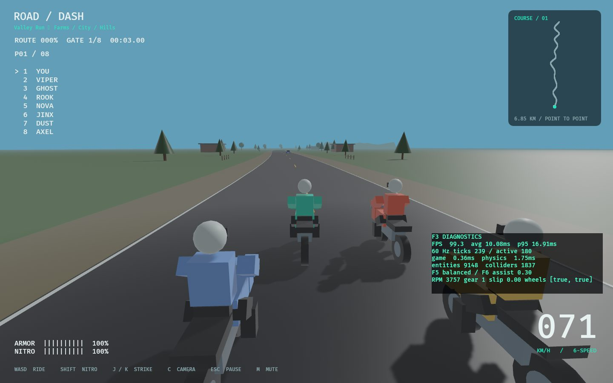
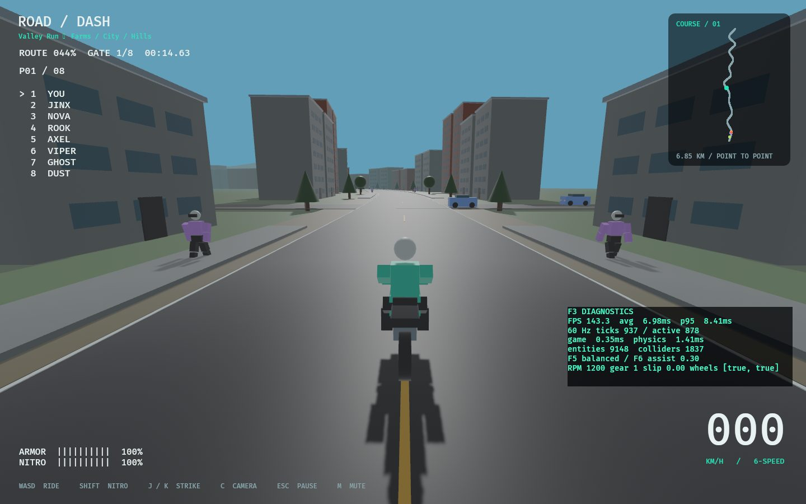

# ROAD / DASH

A native Rust + Bevy motorcycle combat racer. Race a point-to-point farmland → city → hills route against fourteen rivals, dodge two-way traffic, throw punches and kicks, and use nitro to make a pass. Crashes separate the rider into a jointed Rapier ragdoll and a tumbling motorcycle, using measured approach velocity and gravity.

This is the first playable foundation of a modern remake, with original procedural 3D scenery and models. It is inspired by Road Rash's racing/combat loop and the [arkits native port](https://github.com/arkits/road-rash). It does not contain that repository's code, sprites, music, or original game data.



## Run

Install [Rust](https://rustup.rs/) (the project pins Rust 1.94.0), then run from the repository directory:

```sh
git clone https://github.com/ImadMashhood/RoadDash.git
cd RoadDash
cargo run --release
```

First compilation builds the engine and can take several minutes. A desktop GPU with Vulkan, Metal, or DirectX 12 support is recommended. There are no assets to download or extract.

Linux needs X11 development libraries. Ubuntu/Debian:

```sh
sudo apt-get install build-essential pkg-config libx11-dev libxi-dev libxcursor-dev libxrandr-dev libxinerama-dev libxkbcommon-dev libasound2-dev libudev-dev
```

Fedora:

```sh
sudo dnf install gcc-c++ pkgconf-pkg-config libX11-devel libXi-devel libXcursor-devel libXrandr-devel libXinerama-devel libxkbcommon-devel alsa-lib-devel systemd-devel
```

Keyboard bindings can be supplied through `ROADDASH_BINDINGS=/path/to/input.json` using the validated [input schema](content/input.json). Features: `offline` + `devtools` by default, minimal `--no-default-features --features offline`, optional `--features debug_physics`. No online transport is implemented. [Architecture and developer guide](docs/ARCHITECTURE.md).

The Linux build uses X11 (and XWayland on Wayland desktops). Windows and macOS are supported by the engine, but have not yet been runtime-tested for this project.

## Controls

| Key | Action |
| --- | --- |
| Enter / menu button | Start / race again |
| W / Up | Throttle |
| S / Down | Brake |
| A, D / Left, Right | Steer across the road |
| Left or Right Shift | Nitro while accelerating |
| J / K or left / right mouse | Punch left / right |
| Space | Kick nearest reachable target to either side |
| C | Cycle three camera distances |
| Esc | Pause / resume |
| M | Mute / unmute audio |
| F2 / controller LB | Comfort settings and rebinding |
| F3 | Toggle developer frame/tick/physics/entity diagnostics |
| F4 | Toggle track spline/normal/bounds/spawn inspector |
| F5 / F6 | Cycle handling preset / adjust road assist (developer tuning) |
| F7 | Toggle optional biomechanical ragdoll diagnostics |
| R | Restart from the grid |

The dynamic bike has assisted road-relative steering and independent physical momentum. Holding a direction builds steering force; release and countersteering unwind it. Bike and rider lean together only from that steering input. The camera stays within compact chase distances at speed. Steering chooses a line across the road; tight bends push the bike toward the shoulder at high speed. Brake before sharp corners. Nitro regenerates when released. Grass reduces traction and speed while remaining driveable; it does not drain armor or cause a crash by itself. Traffic collisions, hard bike collisions, and melee damage can knock you off. After a crash, the camera follows your physical ragdoll until it lands. Your rider gets up, runs back to the actual fallen bike, lifts it upright, and remounts. Moving traffic and other racers can knock a rider down again during recovery.

Controller: left stick steers, RT throttles, LT brakes, X/B punch left/right,
Y boosts, A starts, Start pauses, Select restarts and right-stick click changes
camera. Right stick freelooks and returns to chase when released. LB opens settings;
Guide is an alternate. Remap buttons/keys in the F2 panel; its up/down selects,
left/right adjusts, Enter/A activates, Tab/Y changes binding device, and Esc/Start
cancels a binding or saves/closes. Reserved LB/Guide and F2 always open settings.

Comfort defaults to 75° FOV, configurable 60–95°, with adjustable camera response
and shake. Anti-nausea disables shake, speed FOV, turn anticipation and speed lines.
Preferences save under `$XDG_CONFIG_HOME/roaddash/settings.json` (fallback
`~/.config/roaddash/settings.json`) or `%APPDATA%/roaddash/settings.json` on Windows.
Override with `ROADDASH_SETTINGS`; unknown/corrupt files are preserved read-only.
Keyboard JSON through `ROADDASH_BINDINGS` still overrides the loaded keyboard map.
Gamepad support uses Bevy's Gilrs backend; Linux now also needs the libudev development
package listed above. Multiple pads use the lowest entity ID; disconnect clears input.

This separate [biomechanical ragdoll comparison branch](docs/testing/RAGDOLL_BIOMECHANICS.md) now enables the16-body rig automatically: run `cargo run --release` for racing or `cargo run --release -- --ragdoll-lab-view` for the standalone lab. No B press is needed. B only switches modes inside the lab; it is not a race control. Use `--ragdoll-baseline` to select the original eleven-body rig explicitly. This default change applies only to this unmerged comparison branch; main keeps its accepted physics.

See the dedicated [animation production plan](#animation-production) for the full reference/keyframe and runtime-animation backlog.

## Included

- A 6.85 km authored point-to-point course: open farmland, dense city streets, then rolling hills. Fifteen racers, nine ordered gates, one finish.
- A separate approximately 2 km handling test fixture, headless track validation and F4 spline/normal/bounds/spawn inspection.
- Seeded farms/fences and solid cows that react physically on contact; city cross traffic and walking sidewalk pedestrians; elevated hill terrain and guardrails.
- Authored textured rider and sport motorcycle meshes, plus original procedural cars, road markings, trees, farms, buildings, cows, pedestrians and start/finish markers. Human skins follow the existing ragdoll joints.
- PBR materials, directional shadows, atmospheric distance fog, and a speed-sensitive chase camera.
- Fourteen AI racers with pursuit, speed matching, lane changes, traffic avoidance, attacks, and selective downed-rider hunts.
- Twelve traffic vehicles traveling in both directions.
- Three direct side-by-side punches knock out a target when each consecutive hit is within three seconds; misses, gaps and duplicate contact do not count.
- Armor, nitro, collision detection, crash recovery and camera shake.
- Eleven rider bodies with anatomical shoulder/hip/spine/neck limits, directional elbow/knee hinges and bounded passive spring/damping resistance. This approximates tissue resistance; it is not biological muscle simulation.
- Independent bike wrecks slide on slopes and retain stopping friction on flat ground. Boost release/exhaustion slows gradually, and steering is about 20% tighter.
- Solid cars, bikes, riders, cows, pedestrians, trees, buildings, fences, curbs, guardrails and road/terrain surfaces. Road markings are visual decals.
- Equal-speed motorcycle contact and gentle side taps transfer momentum; fast rear/side impacts cause measured knockoffs. NPC hits can produce separate human or quadruped ragdolls.
- Crash entry uses measured approach velocities and explicit vehicle/civilian speed-loss rules, without scripted upward launch or spawn spin. The separated rider and wreck fall independently. Mounted yaw follows steering input; contacts can translate the bike without steering it.
- The recovery camera follows the ragdoll and then the running rider. A collision-aware character controller handles the run back and remount at the bike’s actual location.
- Synthesized engine RPM, wind, nitro, braking, impact, landing, punch, footstep, countdown, and finish audio. M mutes the mixer.
- Full-footprint scenery checks keep props clear; collision rays verify terrain does not cover banked road lanes.
- Garage/start menu, countdown, pause/restart, leaderboard, speedometer, live course map, and results.
- Persistent race count, wins, credits, and personal-best time.



Handling target: [arkits/road-rash investigation](docs/research/ROAD_RASH_HANDLING.md).
Progressive steering is implemented; **the entire original handling is not yet
reproduced**. Original bike/table data is absent, and current physics/profile
values remain RoadDash-authored. [Correction evidence](docs/testing/HANDLING_CORRECTION.md).

## Current scope

This is an arcade prototype, not a finished commercial remake. Native riding now uses an assisted dynamic chassis with two raycast wheels, suspension, combined grip limits, torque/gears and upright feedback. A retained kinematic adapter is available for regression comparison. Ragdolls and wrecks are physically simulated. The environment remains procedural; authored rider/bike meshes now replace the primitives, with connected anatomical visual bindings and the accepted physical ragdolls. There is one playable point-to-point course and three handling presets. Police pursuits, career events, purchasable upgrades, polished animation clips, multiplayer, and the wider production art pass remain future work. Credits are saved but cannot yet be spent.

## Development roadmap — completed first, remaining work in order

**140 verified tasks complete; 226 tasks remain open.** Part 00 contains all completed work. Parts 01–08 follow the requested fixes → animation study → animation implementation → buildings → props → NPCs/landscape → weapons → police sequence. Then continue with the existing Parts 09/10, followed by the remaining production requirements.

**One live checklist:** every task is now in this README, exactly once. Stable IDs retain their historical numbers; their current section determines execution order. An old `P06` ID under Part 03 does not mean work must wait for Part 06. The [historical blueprint checklist](docs/roadmap/BLUEPRINT_PARTS_01_08.md) is a frozen reference, not a second live backlog. [Progress](docs/PROGRESS.md) is generated from this README.

**Status:** `[x]` means implemented and verified; `[ ]` includes partial and unverified work. Moving a task does not change its status or close a gate. Carried-forward requirements retain their full original wording: some subfeatures already work, but their remaining tests, polish or acceptance keep the whole requirement open. The [execution contract](docs/roadmap/EXECUTION_V2.md) defines the new V2 acceptance criteria; the [supporting blueprint contracts](docs/roadmap/SUPPORTING_CONTRACTS.md) retain dependency proposals, environment/audio inventories, budgets and rights context. [Known issues](docs/KNOWN_ISSUES.md), [decisions](docs/DECISIONS.md) and [history](docs/CHANGELOG_DEV.md) retain evidence and limitations.

Current pinned baseline: **Rust 1.94.0, Bevy 0.17.3, Rapier 0.32.0, built-in Bevy audio**. The PDF's dependency upgrades remain proposals. The Animation A authoring tools use these installed versions; no dependency migration is included.

| Part | Work | Status |
| --- | --- | --- |
| [00](#part-00) | Completed and verified foundations | 140 verified complete |
| [01](#part-01) | Remaining handling, crash response and runtime corrections | 27 open |
| [02](#part-02) | Animation A — reference study, labeled keyframes and pose approval | 14 open |
| [03](#part-03) | Animation B — interpolation, terrain locomotion and active recovery | 30 open |
| [04](#part-04) | World A — facade study, original textures and procedural buildings | 18 open |
| [05](#part-05) | World B — props, materials and procedural dressing | 6 open |
| [06](#part-06) | World C — NPCs first, then sky/terrain/landscape art | 10 open |
| [07](#part-07) | Weapons and complete riding combat | 11 open |
| [08](#part-08) | Police, pursuit and arrest/escape loop | 10 open |
| [09](#part-09) | Vertical-slice playtest gate | 21 open |
| [10](#part-10) | Networking feasibility spike | 10 open |
| [11](#part-11) | Remaining production-art integration and acceptance | 2 open |
| [12](#part-12) | Garage, economy, progression and saves | 7 open |
| [13](#part-13) | Authoritative online races and lobbies | 10 open |
| [14](#part-14) | Content expansion and modes | 9 open |
| [15](#part-15) | Presentation, audio, UI and accessibility | 20 open |
| [16](#part-16) | QA, performance, platform, dependency and release gates | 21 open |

<a id="part-00"></a>

### Part 00 — Completed and verified foundations

Everything checked off lives here, grouped by the original system. These are verified requirements, not a claim that every broader feature or production milestone is finished. Expand a group for the exact IDs and evidence.

<details>
<summary>Baseline and dependency decisions — 1 verified task</summary>

- [x] **BASE-003** Record dependency versions, purposes, licenses, and notices in `docs/third_party/REPOSITORIES.md`; record media provenance in `docs/third_party/ASSETS.csv`.

</details>

<details>
<summary>Research, scope, and rights — 9 verified tasks</summary>

- [x] **P00-001** Document the original-successor approach and exclude the reference port's code, original game data, sprites, and soundtrack. Evidence: introduction and License sections of this README.
- [x] **P00-002** Establish a top-level production backlog from the blueprint. Evidence: this progress tracker.
- [x] **P00-003** Write a GDD v0.1 under 12 pages with P0/P1/P2 priorities, player fantasy, session length, fun metrics, and performance targets.
- [x] **P00-004** Lock the slice definition: one road, one bike plus two variants, at least three AI, punches/kicks, traffic, crash-to-foot control, valid foot finish, results, and retry.
- [x] **P00-005** Create at least 20 confidence-rated reference observations with source URL, build/version, date, recording description, and independent implementation notes.
- [x] **P00-006** Build bike, weapon, rider/outfit/palette, track, shop, progression, and UI content sheets; distinguish historical observation from new design.
- [x] **P00-007** Maintain research fields `source_id`, `observed_behavior`, `confidence`, `asset_owner`, `allowed_usage`, and `follow_up`.
- [x] **P00-008** Complete a rights register covering code, art, sound, fonts, contributors, attribution, and redistribution; remove unknown-license runtime content.
- [x] **P00-009** **Exit gate:** original-content policy, content schema, backlog, and one-page slice definition exist, with the reference and rights inventories reviewed.

</details>

<details>
<summary>Stabilize restart, rival steering and crash entry — 4 verified tasks</summary>

- [x] **V2-01-001** Restart at the authored grid, including on a zero-physics-tick frame.
- [x] **V2-01-002** Give AI proportionate, gradual steering and lean.
- [x] **V2-01-003** Use pre-contact world momentum for physical knockoffs.
- [x] **V2-01-004** Repair visual skeleton attachments and anatomical bending. [Verification for corrections 001–004](docs/testing/MOTION_REPAIRS.md).

</details>

<details>
<summary>Scenic world and original asset production — 2 verified tasks</summary>

- [x] **P11-001** Provide placeholder road, trees, mountains, ocean, bikes/riders/cars, solid scenery proxies, and full-footprint road-clearance validation. Evidence: [world](src/world.rs), [track](src/track.rs).
- [x] **P11-011** Use one human mesh/proportion/outfit definition for seated bikers, pedestrians, recovery runners and ragdolls; change pose without swapping appearance. Evidence: [shared model and four-state test](src/human.rs); the new authored skins use [four-state/physics parity tests](src/models/tests.rs) and [native receipts](docs/testing/MODELS.md).

</details>

<details>
<summary>Garage, economy, progression, and saves — 2 verified tasks</summary>

- [x] **P12-001** Award and persist credits, wins, race count, and a best time; write profile updates through a temporary file and atomic rename in the user data directory. Evidence: [profile](src/game.rs).
- [x] **P12-002** Test that a finished race pays once across subsequent updates. Evidence: `finish_awards_results_once_and_button_starts_next_race` in [game tests](src/game.rs).

</details>

<details>
<summary>Presentation, audio, UI, and accessibility — 2 verified tasks</summary>

- [x] **P15-001** Provide baseline PBR lighting, shadows/fog, menus/HUD/results, engine/wind/nitro/braking loops, impacts/footsteps/countdown/finish cues, and mute. Evidence: [world](src/world.rs), [UI](src/ui.rs), [audio](src/sound.rs).
- [x] **P15-002** Generate original PCM sounds in memory; verify valid non-silent WAV data and initialized/playing audio sinks in the native smoke check. Evidence: [sound test](src/sound.rs), [render/audio check](src/verification.rs).

</details>

<details>
<summary>QA, performance, packaging, and release — 2 verified tasks</summary>

- [x] **P16-001** Maintain functional regression tests for steering, circuit/projection, countdown/nitro/pause, combat, physical contacts, repeated knockdowns, camera tracking, full recovery, payouts, and scenery clearance. Evidence: tests in [game](src/game.rs), [track](src/track.rs), [world](src/world.rs), [sound](src/sound.rs).
- [x] **P16-002** Build and run a local Linux release; smoke-check garage -> riding -> crash -> get up -> run -> remount -> results with active audio. Evidence: [verification script](src/verification.rs).

</details>

<details>
<summary>Audio acquisition, event inventory, and mix acceptance — 1 verified task</summary>

- [x] **AUDIO-014** Exclude proprietary original Road Rash music, voices, and sound files from the current build; current effects are synthesized in [sound](src/sound.rs).

</details>

<details>
<summary>Rights, delivery evidence, and work-session order — 12 verified tasks</summary>

- [x] **CITY-01** Add side-road grids and denser urban blocks; compare road/sidewalk/frontage proportions against the verified original disc. Evidence: [city/combat verification](docs/testing/CITY_COMBAT.md), 657 solid buildings, native city captures and 9.56 ms p95 survey.
- [x] **COMBAT-01** Space auto-side kick pushes bikes and animates the selected leg; mouse buttons punch left/right. Evidence: nearest-side/push/input tests and native left/right kick captures in [verification](docs/testing/CITY_COMBAT.md).
- [x] **RIDE-01** Correct rival camera obstruction and supported contact-yaw instability; add symmetric input-only lean presentation. Evidence: crowd-camera/yaw tests, seven native bank captures and crash/recovery smoke in [verification](docs/testing/CITY_COMBAT.md).
- [x] **CITY-02** Join neighboring city buildings into continuous street fronts. Reason: the user rejected detached six-metre gaps; part: world development; dependencies: CITY-01, solid lots and recovery routing; acceptance: shared-edge infill, clear streets, exposed-perimeter recovery paths and road-height screenshots; verification: 347 shared-edge sections, physics rays for every infill, 113 passing tests and native road-height survey; [evidence](docs/testing/FRONTAGES.md).
- [x] **CITY-03** Improve sidewalks, plant solid street trees and raise urban buildings. Reason: user requested better pavement and a taller, greener city; part: world development; dependencies: CITY-01/02 and shared ground; acceptance: flat sidewalk shading, clear walking strip, solid trees outside junctions, taller whole-floor buildings without lot changes; verification: geometry/physics tests, native survey and crash/recovery smoke; [evidence](docs/testing/STREETSCAPE.md).
- [x] **COMBAT-02** Strengthen kick displacement and adopt the fifteen-racer CITY roster with reference-inspired shirt, helmet and bike colors. Reason: user requested original roster/color schemes and stronger kicks; part: combat/world; dependencies: COMBAT-01 and shared human meshes; acceptance: 14 named rivals, consistent minimap/ragdoll colors and stronger signed physical shove; verification: combat/UI tests and native captures; [evidence](docs/testing/RIDERS.md).
- [x] **CITY-04** Thin sidewalk trees from 22 to 44 m spacing. Reason: user found the avenue overplanted; part: world; dependencies: CITY-03; acceptance: roughly half the sites with existing clearances/collision; verification: placement tests and native survey.
- [x] **RIDE-02** Require player steering through curves, increase turn strength 50%, and topple abandoned bikes. Reason: user reported automatic driving and upright wrecks; part: Parts 03/04; dependencies: dynamic chassis and recovery; acceptance: neutral heading stays independent of road, stronger turn settings and physical roll without linear launch; verification: heading/roll/momentum/remount regressions and native smoke.
- [x] **AI-01** Add measured rival pursuit, speed matching and selective attacks on downed riders. Reason: user requested reference-inspired fighting/chaos; part: AI follow-up; dependencies: relative contacts and crash recovery; acceptance: start grace, bounded approach, alongside spacing, gradual speed matching, limited downed hunts and attack cooldowns; verification: deterministic pursuit scenarios, regression suite and native survey. Original relationship-table parity remains future work.
- [x] **AI-02** Match individual level-zero rival pace/stats and relationship-driven race/follow/fight choices; start YOU last with 12 m gaps. Reason: user rejected uniform aggression and crowded/front starts; part: AI follow-up/track setup; dependencies: AI-01 and supported dynamic grid; acceptance: distinct validated profiles, selective hostility and hit reactions, per-rider pace/strength/stamina/weight, solid separated rear grid and retry; verification: profile/decision/physical-grid tests plus native smoke/survey; [evidence](docs/testing/PERSONALITIES.md).
- [x] **ART-01** Research rigged character sources matching the user's faceted, natural-proportion references and biker gear. Reason: user requested a visual upgrade; part: character art; dependencies: reference images and shared human lifecycle; acceptance: sourced shortlist, format/rig claims and license review; verification: publisher/marketplace pages reviewed 2026-10-31; [findings](docs/third_party/CHARACTER_CANDIDATES.md).
- [x] **ART-03** Integrate the approved authored rider and motorcycle as presentation-only replacements, retaining all accepted ragdoll bodies/joints and crash/recovery behavior. Reason: explicit user request; part: 11 art; dependencies: authored GLBs/seat pose and existing visual joints; acceptance: shared rider through riding/walking/ragdoll, bike/wreck replacement, unchanged physics trajectories, complete recovery, native visual check; verification: [tests](src/models/tests.rs), [evidence](docs/testing/MODELS.md).

</details>

<details>
<summary>Workspace, CI, and runtime architecture — 11 verified tasks</summary>

- [x] **P01-001** Pin a Rust toolchain and dependencies; provide formatting, Clippy with warnings denied, and Linux headless tests in CI. Evidence: [toolchain](rust-toolchain.toml), [manifest](Cargo.toml), [CI](.github/workflows/ci.yml).
- [x] **P01-002** Launch a native Fedora/Linux 3D build with ground, lighting, camera, keyboard input, menus, pause, and reset. Evidence: [app](src/main.rs), [render smoke check](src/verification.rs).
- [x] **P01-005** Implement Boot/MainMenu/Loading/Race/Results lifecycle and fixed 60 Hz gameplay/physics scheduling, with independent render interpolation.
- [x] **P01-008** Add FPS, average/P95 frame time, 60 Hz tick count, entity/collider counts, physics timing, toggleable debug UI, logs, and panic reports.
- [x] **P01-012** Verify 30/60/120 render-FPS simulation equality and 100 crash/pause/resume/reset cycles without actor leaks. Evidence: [game tests](src/game.rs).
- [x] **P01-013** Preserve and consume short attack inputs once across zero/multiple fixed ticks. Evidence: [core buffer](crates/rr_core/src/lib.rs), [input tests](src/game.rs).
- [x] **P01-014** Version prototype profiles while retaining legacy progress and rejecting unsupported/corrupt data. Evidence: [profile tests](src/game.rs).
- [x] **P01-015** Provide a headless content-validation CLI and local panic report process probe. Evidence: [entry point](src/main.rs), [test receipts](docs/testing/PARTS_00_01.md).
- [x] **P01-016** Keep the complete README/tracker task index synchronized by stable IDs. Evidence: [sync checker](tools/sync_progress.py).
- [x] **P01-017** Audit declared dependency/media provenance, font notices, source hashes and excluded unverified embedded LUTs. Evidence: [audit](tools/audit.py), [inventory](docs/third_party/ASSETS.csv).
- [x] **P01-019** Decode Cargo metadata and repository text explicitly as UTF-8 across host locales; regress the Windows cp1252 audit failure. Evidence: [audit tests](tools/test_audit.py), [CI follow-up](docs/testing/PART_02.md).

</details>

<details>
<summary>Scenic road graybox and track format — 13 verified tasks</summary>

- [x] **P02-001** Build a closed driveable circuit with lanes, shoulders, solid road surfaces, and canonical arc-length progress. Evidence: [track](src/track.rs), [world](src/world.rs).
- [x] **P02-002** Validate circuit closure, distance wrapping, camera-right lane direction, progress projection, and full-footprint scenery clearance in headless tests. Evidence: tests in [track](src/track.rs) and [world](src/world.rs).
- [x] **P02-003** Document meter units, +Y up, spline-tangent forward, origin, and any future origin-rebasing policy.
- [x] **P02-005** Define typed track IDs, control points, surfaces, ordered checkpoint IDs, prop placement, spawn points, and safe foot/verge regions.
- [x] **P02-006** Build simplified collision meshes separately from render meshes, initially sampling around 2-3 m; add curbs, guardrails, fencing, and reliable highway boundaries.
- [x] **P02-007** Implement ordered gates and forward crossing validation; validate checkpoint order, intersections, NaNs, negative widths, and spawn overlap.
- [x] **P02-008** Add asphalt/dirt/gravel/grass/water metadata and traction/friction modifiers, animal crossings, and cliff hazard zones.
- [x] **P02-009** Add a track inspector for spline normals, triangle count, driving line, bounds, and spawns; load authored tracks headlessly.
- [x] **P02-012** Build the user-directed point-to-point map with distinct start/finish, no endpoint wrapping, canonical route HUD and safe endpoint/retry behavior. Evidence: [track](src/track.rs), [race tests](src/game.rs).
- [x] **P02-013** Populate seeded farm openings/fences/cows, city buildings/cross traffic/walking pedestrians, and elevated hills with physical guardrails. Evidence: [environment](src/environment.rs), [native captures](docs/testing/PART_02.md).
- [x] **P02-014** Keep terrain below banked road lanes and verify route support, render/collision winding and independent collision resolution. Evidence: [geometry tests](src/environment.rs).
- [x] **P02-015** Verify actual hill crash/get-up/run/remount at elevation without resetting the bike to sea level. Evidence: [recovery](src/recovery.rs), [native receipt](docs/testing/PART_02.md).
- [x] **P02-016** Keep hill guardrails on outer curves, open the straights, and add varied trees in all zones plus window/door/roof, cross-vehicle and pedestrian detail. Evidence: [environment](src/environment.rs), [native captures](docs/testing/PART_03.md).

</details>

<details>
<summary>First-map structural world - B00–B10 — 14 verified tasks</summary>

- [x] **BW-B00** Capture existing track/world statistics, measured legacy building census, reproducibility and native baseline views.
- [x] **BW-B01** Validate 15 sections, 19 archetypes, lot rules and exact 247/177/70/family budgets; allocate stable seeded planning IDs headlessly.
- [x] **BW-B02** Bind districts to baked road stations, resolve/blend all boundaries and final endpoint, reject mismatched courses and expose F4 preview.
- [x] **BW-B03** Generate field parcels and farm/suburban/city/hill ground classification across all sections.
- [x] **BW-B04** Build at least seven reserved junctions, side-street foundations and continuous accessible curbs/sidewalks.
- [x] **BW-B05** Generate non-overlapping, reachable frontage/secondary lots outside every road/junction/gate/spawn reservation.
- [x] **BW-B06** Place exactly 247 structural building roots with mass/roof/collision and validated full-footprint clearance.
- [x] **BW-B07** Grade supported pads and hillside foundations with shared render/collision heights and local cut/fill.
- [x] **BW-B08** Prove farm/city-alley/hill on-foot recovery and escape paths without geometry traps.
- [x] **BW-B09** Implement spatial building LOD/chunks while preserving collision/IDs and measure representative 1080p performance.
- [x] **BW-B10** Complete the full-map survey, plan export, count/geometry hashes, provenance, regressions and all base-world exit criteria.
- [x] **BW-X01** Protect paired LOD origins and local terrain vertices against disappearing ground; verify all 160 tile pairs and building children plus the native atlas.
- [x] **BW-X02** Record actual survey resolution/focus and use continuous uncapped benchmark updates so background idle timers cannot masquerade as frame cost.
- [x] **BW-X03** Clear recovery motion/routes on exceptional rescue and apply one visible five-second penalty; verify normal capsule routes and rescue state transitions.

</details>

<details>
<summary>Motorcycle physics and controls — 19 verified tasks</summary>

- [x] **P03-001** M0: reach the finish with a kinematic road-following arcade controller, throttle, braking, steering/lean visuals, and nitro. Evidence: [racing controller](src/game.rs).
- [x] **P03-002** Integrate collision-driven knockoff, continuous movement checks against solid geometry, and impact launch/landing/bounce behavior. Evidence: [controller](src/game.rs), [impacts](src/recovery.rs), steering/collision/bounce tests. Rider-to-rider contact is now severity-based (P06-019); historical universal hops are superseded.
- [x] **P03-003** M1: implement a dynamic chassis with mass, center of mass/inertia, upright assist, and separate rider/wheel visuals behind `VehiclePhysicsAdapter`.
- [x] **P03-004** M2: add front/rear wheel contact rays, spring-damper suspension forces, engine braking, service braking, and a torque/RPM/redline/gear model.
- [x] **P03-005** M3: implement surface-dependent combined longitudinal/lateral traction budget, slip, controlled drift, speed-sensitive steering, aerodynamic drag proportional to speed squared, and low-speed self-righting.
- [x] **P03-006** Define a simulation-facing `BikeState` with pose/velocity, yaw/lean, slip, grounded wheels, actual RPM/gear, damage, and rider condition references.
- [x] **P03-007** Author three data-driven handling presets: light/agile, balanced, and heavy/powerful; initially target 150-290 kg dry plus rider, 0-100 km/h in 3.5-6.5 s, and a roughly 50-60 degree lean clamp.
- [x] **P03-008** Expose live tuning and per-tick telemetry: bike ID, tick/dt, pose, velocity, inputs, yaw rate, lean, wheel contacts, spring forces, slip, surface mu, damage, and crash state.
- [x] **P03-009** Benchmark acceleration, braking distance, steady turns, lean recovery, and curb hits; compare numeric results at 30/60/120 render FPS and collect 100 Hz traces where needed.
- [x] **P03-012** Decelerate smoothly when boost is released or exhausted; preserve excess speed instead of clamping to the ordinary top speed. Evidence: [regression](src/game.rs).
- [x] **P03-013** Allow player/AI forward movement in grass, with reduced traction/speed and no grass-only health loss or knockoff; AI can return to the road. Evidence: [four-scenario regression](src/game.rs).
- [x] **P03-014** Tighten lateral handling approximately 20% using validated authored steering rates, retaining older schema-1 catalogs with defaults. Evidence: [tuning](content/catalog.json), [schema tests](crates/rr_content/src/lib.rs).
- [x] **P03-015** Reduce road assistance without pulling the rider to lane zero; expose F6 adjustment and preserve free lane choice. Evidence: [stationary-offset regression](src/vehicle_tests.rs).
- [x] **P03-016** Feed AI and human tick intentions through the same dynamic adapter, retaining AI traffic avoidance and launch grace. Evidence: [controller](src/game.rs), [dynamic grid regression](src/vehicle_tests.rs).
- [x] **P03-018** Investigate the C++ reference's steering, drive/braking, traction, gear, nitro and motion paths at an exact revision, separating source facts from missing calibration data. Evidence: [investigation](docs/research/ROAD_RASH_HANDLING.md).
- [x] **P03-019** Accumulate player steering force while held, unwind on release/reversal, scale the target with speed, and prevent parked sideways driving. Evidence: [pure rules](crates/rr_core/src/steering.rs), [integration tests](src/vehicle_tests.rs). Timing values remain provisional RoadDash tuning.
- [x] **P03-021** Double full-lean response left/right by halving steering buildup/return times and doubling visual bank response, retaining angle/force limits. Evidence: [symmetric rate test](crates/rr_core/src/steering.rs), [full lean/neutral test](src/vehicle_tests.rs).
- [x] **P03-022** Increase full-lean turn strength by 25% in each handling class, with shared profile gain in both driving adapters and unchanged visual bank. Evidence: [left/right comparison](src/vehicle_tests.rs), [verification receipt](docs/testing/HANDLING_CORRECTION.md).
- [x] **P03-017** Preserve selected dry bike mass in abandoned wrecks and clear stale velocity on dynamic remount. Evidence: [mass/recovery regressions](src/vehicle_tests.rs).

</details>

<details>
<summary>Chase camera, speed feel, and input — 13 verified tasks</summary>

- [x] **P04-001** Provide smoothed follow/look-ahead, near/default/far chase views, speed-sensitive FOV, impact shake, and scenery collision avoidance. Evidence: [camera](src/game.rs).
- [x] **P04-002** Provide keyboard throttle/brake/steering, pause/reset, and correct left/right steering in chase-camera space. Evidence: [input and regression tests](src/game.rs).
- [x] **P04-003** Add speed-linked engine pitch and wind feedback. Evidence: [sound](src/sound.rs).
- [x] **P04-005** Add gamepad stick steering/freelook, analog throttle/brake triggers, attack bindings, deadzones, and key/controller rebinding.
- [x] **P04-006** Provide persistent FOV/smoothing/anti-nausea settings; target configurable 60-95 degrees, about 75 degrees default, with optional reduced shake.
- [x] **P04-007** Add readable slip/traction feedback and optional speed lines; allocate the independent on-foot input context.
- [x] **P04-011** Verify camera continuity at 60/120/144 Hz, swept-volume obstacle clearance and safe large-warp snapping using automated scenarios. Evidence: [camera tests](src/camera_tests.rs).
- [x] **P04-012** Preserve malformed/future settings files, reject conflicting bindings, and prevent modal settings input leaking into racing. Evidence: [settings](src/settings.rs), [input tests](src/controls.rs).
- [x] **P04-013** Carry analog triggers into chassis forces and clear input on controller disconnect while retaining keyboard fallback. Evidence: [adapter test](src/vehicle_tests.rs), [device tests](src/controls.rs).
- [x] **P04-015** Historical correction: keep the character upright during steering. This was verified in Part 04, then superseded by the user’s coordinated, input-only bike/rider lean request in P04-016. [Historical receipt](docs/testing/PART_04.md).
- [x] **P04-016** Bank bike and rider together from accumulated steering input only; remove road/chassis bank from rendered roll and preserve the shared human model. Evidence: [bank/road-neutral test](src/human.rs).
- [x] **P04-017** Keep near/default/far camera views close at high speed, eliminate follow-lag zoom-out, and reduce optional speed FOV to three degrees. Evidence: [27 camera scenarios](src/camera_tests.rs), [native receipt](docs/testing/HANDLING_CORRECTION.md).
- [x] **P04-010** Color only racer minimap dots by their shirt palette, sharing the model color source. Evidence: [palette test](src/ui.rs), [shirt colors](src/world.rs).

</details>

<details>
<summary>Riding melee and weapons — 3 verified tasks</summary>

- [x] **P05-001** Implement left/right punches, directional range checks, damage, cooldown, simple arm animation, hit sound, and HUD feedback. Evidence: [combat](src/combat.rs), [animation](src/world.rs), [sound](src/sound.rs).
- [x] **P05-002** Test directional damage and a single takedown reward. Evidence: `directional_melee_damages_the_target_and_awards_one_takedown` in [game tests](src/game.rs).
- [x] **P05-009** Require three direct side-by-side hits with no more than three seconds between hits, with reach/side/height/heading/occlusion checks, one target per attack and duplicate-hit protection. Evidence: [core rules](crates/rr_core/src/lib.rs), [melee](src/combat.rs), [regressions](src/game.rs).

</details>

<details>
<summary>Damage, ragdoll, and controllable recovery — 14 verified tasks</summary>

- [x] **P06-001** Trigger physical knockoff from attacks, vehicle contacts, and solid roadside obstacles; maintain rider health and crash state. Evidence: [impacts](src/recovery.rs), [controller](src/game.rs).
- [x] **P06-002** Use separate owner-linked ragdoll, abandoned bike, and on-foot actors; implement falling -> getting up -> assisted run -> right bike -> remount. Evidence: [recovery](src/recovery.rs).
- [x] **P06-003** Provide an 11-body jointed ragdoll, CCD, friction/restitution, collision filtering for the hidden riding body, and a solid on-foot capsule with step/slope handling. Evidence: [recovery](src/recovery.rs).
- [x] **P06-004** Follow the physical torso and on-foot rider with the camera; allow traffic/rivals to knock a recovering rider down again without duplicate ragdolls. Evidence: [camera](src/game.rs), recovery-camera and repeat-knockdown tests.
- [x] **P06-005** Provide impact/footstep cues and verify the rendered crash/get-up/run/remount sequence. Evidence: [sound](src/sound.rs), [render check](src/verification.rs).
- [x] **P06-014** Preserve current crash momentum without synthetic upward launch and visibly separate the rider from the riderless wreck. Evidence: [crash tests](src/game.rs), [recovery](src/recovery.rs), [native receipt](docs/testing/PARTS_00_01.md).
- [x] **P06-015** Remount against the actual fallen bike collision shape, including sideways, upside-down and vertical poses, without the runner pushing it away. Evidence: twelve automated approaches in [game tests](src/game.rs) and native recovery smoke.
- [x] **P06-016** Apply post-remount protection to shoulder damage so recovery does not immediately drain health. Evidence: end-to-end recovery regression in [game tests](src/game.rs). Historical behavior: P03-013 now removes grass-only damage entirely.
- [x] **P06-017** Replace universal ball-joint limits with anatomical stops, directional hinges and bounded passive tissue resistance; verify 100 high-speed drops without detached joints or twisted hinge axes. Evidence: [articulation](src/recovery.rs), [stress test](src/game.rs).
- [x] **P06-018** Make fallen bikes slide on steep solid terrain while retaining flat-road stopping friction. Evidence: [slope contact friction](src/recovery.rs), [ramp regression](src/game.rs).
- [x] **P06-019** Classify motorcycle wipeouts by relative closing speed: >=50 km/h longitudinal or substantial side impact; lighter contacts nudge without universal launch/knockoff. Evidence: [severity rules](crates/rr_core/src/lib.rs), [contact tests](src/game.rs).
- [x] **P06-020** Add distinct pedestrian/cow ragdolls with direct-hit and solid-impact paths, an eight-actor budget, safe delayed standing and complete reset cleanup. Evidence: [NPC systems/tests](src/npc.rs), [native actor capture](docs/testing/PART_03.md).
- [x] **P06-022** Launch a mounted biker above cows/pedestrians using obstacle-height and mass-aware clearance impulses; preserve horizontal approach momentum and civilian ragdolls. Evidence: [six clearance cases](src/vehicle_tests.rs), [measurements](docs/testing/part-04/hazard-clearance.json).
Historical note: P06-022 records the earlier verified clearance-jump request. The latest user request supersedes that behavior under COLLISION-02: no scripted collision launch. The old receipt remains history.

- [x] **P06-021** Treat sidewalks as rideable support so low curb contact raises the bike instead of causing an obstacle wipeout. Evidence: [suspension](src/vehicle.rs), [curb-transition test](src/vehicle_tests.rs).

</details>

<details>
<summary>Race rules, HUD, and results — 2 verified tasks</summary>

- [x] **P07-001** Implement countdown, laps/progress standings, race clock, speed/armor/nitro readouts, minimap, results/payouts, and restart. Evidence: [race](src/game.rs), [HUD](src/ui.rs).
- [x] **P07-002** Persist basic race count, wins, credits, and personal-best time; test one-time finish rewards and restarting. Evidence: [profile and finish tests](src/game.rs).

</details>

<details>
<summary>AI racers, traffic, and police — 4 verified tasks</summary>

- [x] **P08-001** Populate seven rival racers with curve-speed planning, lane changes, traffic avoidance, attacks, and recovery through the shared recovery system. Evidence: [AI controller](src/game.rs), [recovery](src/recovery.rs).
- [x] **P08-002** Populate two-way civilian traffic with solid vehicle colliders. Evidence: [traffic setup/update](src/game.rs).
- [x] **P08-011** Treat crossing traffic as an explicit wipeout hazard with continuous/all-type contacts, including a moving car striking a stopped bike. Evidence: [four physical collision cases](src/vehicle_tests.rs).
- [x] **P08-010** Use American right-hand traffic lanes and separate one-way cross-traffic lanes; stop automatic AI fights/weaving during grid launch. Evidence: [traffic](src/game.rs), [cross streets](src/environment.rs), [grid tests](src/vehicle_tests.rs).

</details>


<details>
<summary>Collision heading, velocity and energy corrections — 3 verified tasks</summary>

- [x] **COLLISION-01** Keep mounted heading input-owned through contacts. Reason: contact spin steers the bike; part: 01; dependencies: dynamic chassis and fixed input; acceptance: neutral input cannot acquire collision yaw, gradual intended steering and recovery still work; verification: repeated spin at 30/60/120 Hz, handling/camera regressions and native smoke.
- [x] **COLLISION-02** Remove scripted collision launches and spawn spin. Reason: latest request supersedes civilian clearance jumps; part: 01; dependencies: separated rider/wreck and civilian knockdowns; acceptance: zero added upward/spin velocity at entry, gravity-led wreck toppling, civilian momentum sharing and working recovery; verification: six civilian/bike-class cases, entry snapshots, slope/toppling tests and native actor/race smoke.
- [x] **COLLISION-03** Apply measured arcade vehicle speed loss and a dissipative crash envelope. Reason: player/AI crashes reverse or gain energy; part: 01; dependencies: pre-contact samples and physical body mass/inertia; acceptance: 120 km/h rider versus either direction of 40 km/h car seeds 80 km/h forward, never negative retained speed, no added aggregate energy beyond gravity or reverse crash centre-of-mass motion; verification: player/AI directional cases, kinetic/potential/rotation budget checks, cross-traffic contacts and native recovery.

[Verification and limitations](docs/testing/COLLISION_RESPONSE.md).

</details>

<details>
<summary>Animation foundations and initial playback — 5 verified tasks</summary>

- [x] **V2-02-004** Investigate animation, IK and active-ragdoll repositories. Evidence: [five pinned source comparisons, licenses and compatibility](docs/research/ANIMATION_AND_RAGDOLL.md); no library or source imported.
- [x] **ANIM-01** Deliver the first reviewable static pose catalog and authoring validator. Reason: Animation A needs reproducible review assets before playback; originating part: 02; dependencies: existing authored rider/bike/contact rig; acceptance: 247 numbered draft candidates across 27 use cases, offline gallery, editable single-frame pose assets and independent connected-rig/contact validation; verification: [140 Rust / 14 Python tests, all-pose Blender round trip and gallery review](docs/testing/ANIMATION_A.md). This completes the review infrastructure, not pose approval or final animation coverage. V1 semantic labels were rejected and are superseded by the context-first trace below.

- [x] **ANIM-05** Recover source-ordered action/phase/view context before reconstruction. Reason: V1 misclassified inspection-helper slots; originating part: 02; dependencies: supplied retail build and pinned reference selectors; acceptance: all 104 bank/code slots, 194 ordered descriptors and 371 sprite-slot usages include semantic IDs, mirror/view variants, controls, timing counters and explicit fallbacks/unknowns; verification: independent decoder versus separately compiled reference (194 descriptor/rear matches), reproducible metadata and semantic/bounds tests. [Corrected catalog and limits](docs/animation/context/README.md).
- [x] **ANIM-07** Correct torso and support motion in the source-linked mounted action keys. Reason: limb-only poses missed the original silhouettes; originating part: 02; dependencies: ANIM-05 and shared authoring contacts; acceptance: punch lean/target look, raised kick hips/released seat, full-body tuck and mirrored phases, with retained fixed-length support contacts; verification: 138 static Action reloads, 20 Python tests and regenerated labeled review renders. [Evidence and art limits](docs/testing/ANIMATION_B.md).
- [x] **ANIM-08** Integrate the first full-body normal/tuck/turn/combat/recovery clip set. Reason: static keys need continuous presentation; originating part: 03; dependencies: ANIM-07 and existing visual skin adapter; acceptance: 36 keys / 13 clips, current-pose action entry/exit, steering-only turns, reference-informed tuck selection, held-contact constraints, pause/crash interruption and pickup space handoff without physical writes; verification: Rust sampler/state/contact/parity tests, nine authoring GIFs and native crash/remount/finish smoke. [Evidence and remaining production gates](docs/testing/ANIMATION_B.md).
</details>

<details>
<summary>Biomechanical ragdoll comparison — 4 verified tasks</summary>

- [x] **RAG-01** Audit the current rig and five requested biomechanics references. Reason: the existing system already had limits and must be diagnosed before replacement; originating part: 03; dependencies: current source/lockfile and reference source access; acceptance: actual joint/CCD/mass/bind/control causes, five pinned source and license decisions, no unlicensed imports; verification: [investigation](docs/research/RAGDOLL_BIOMECHANICS.md), repository register and ADR-036.
- [x] **RAG-02** Implement the optional 16-body anatomical articulation and passive resistance. Reason: wrists/ankles/split spine and bounded resistance were missing; originating part: 03; dependencies: RAG-01 and native Rapier; acceptance: calibrated local frames, elbow/knee hinges, bounded neck/spine/shoulders/hips/wrists/ankles, safe quaternion chart, 70 kg distribution/shape inertia, persistent passive motors and predictive collision; verification: native joint/torque tests and [nine dual-mode fixtures](docs/testing/ragdoll/lab-results.json). Original eleven-body control remains selectable.
- [x] **RAG-03** Integrate capped muscles and coherent crash release. Reason: crash states lacked smooth loss of strength and animation/spin handoff; originating part: 03; dependencies: RAG-02 and animation bind frames; acceptance: configurable native PD pose tracking, bracing/ejection/tumble/rest curves, bind-calibrated initial pose with coincident anchors, COM/pre-impact spin preservation, unchanged ejection events, no forced upright motion and natural sleep; verification: pose-hold/external-force/state/bind/momentum tests, bounded energy and 15-rider settling results in [report](docs/testing/RAGDOLL_BIOMECHANICS.md).
- [x] **RAG-04** Deliver the reproducible ragdoll comparison and tuning tools. Reason: the overhaul must be reviewable before merging; originating part: 03; dependencies: RAG-02/03; acceptance: central validated JSON, F7 shape/axis/limit/motor diagnostics, nine headless and native scenarios, B/reset baseline comparison, native clips and recovery/actor regressions; branch-only [automatic launch selection](docs/testing/ragdoll/default-launch/README.md) with explicit baseline override (2026-11-02); verification: 164 Rust tests, 20 tooling tests, native comparison/race/actor smoke, build/Clippy/format/audit [receipts](docs/testing/ragdoll/receipt.json).

</details>

<a id="part-01"></a>

### Part 01 — Remaining handling, crash response and runtime corrections

Next implementation work: measured vehicle crashes, over-car nose-down/vault behavior, combat knockoff swerve/countersteer and acceptance. Preserve the accepted player handling and passive ragdoll. The gradual AI steering, pre-contact velocity handoff, anatomical visual chains and grid retry fixes are already completed in Part 00. Older control/platform/architecture requirements below remain open where their full acceptance has not passed.


- [ ] **V2-01-005** Design and implement measured vehicle-impact and over-car crash responses.
- [ ] **V2-01-006** Add a combat knockoff loss-of-balance sequence.
- [ ] **V2-01-007** Compare the reference crash/control code and evaluate bounded physics changes.
- [ ] **V2-01-008** Exit gate: accept corrections before authoring motion.

#### Carried-forward requirements — still unfinished

- [ ] **ARCH-001** Isolate `client`, pure `sim`, `physics`, authoritative `server`, typed `content`, and developer `tools` responsibilities; clients never adjudicate hits/results from reported transforms.
- [ ] **ARCH-002** Define stable bike/rider/weapon/track IDs, cosmetic-versus-physics IDs, schema versions, validators, and migration-safe saves/protocols.
- [ ] **ARCH-003** Define `AttackIntent`, `AttackResolved`, `CrashStarted`, `RecoveryCompleted`, racer-level `RaceFinished`, and `PoliceBusted` contracts with IDs/ticks and single-result semantics.
- [ ] **ARCH-007** Tick/control simulation at 60 Hz, AI perception at 5-15 Hz, interpolate independently, and use explicit adapter-observed components/events rather than renderer or animation authority.
- [ ] **RIGHTS-006** Sessions 01-02: workspace, CI, debug metrics, clean Fedora scene.
- [ ] **RIGHTS-008** Sessions 05-08: acceleration/brakes, two wheel rays, stable camera/turns.
- [ ] **RIGHTS-009** Sessions 09-10: lean, surface grip, three distinct presets.
- [ ] **P01-003** Split the single-crate prototype into client/server/core/vehicle/combat/race/AI/content/network/tools responsibilities, with a plugin per subsystem and conventional commit rules.
- [ ] **P01-004** Keep pure simulation independent of UI/rendering; isolate the physics adapter, presentation, typed content, dev tools, and later server authority.
- [ ] **P01-006** Add action mapping/input contexts, stable content IDs, schema versions, and the intent -> simulation -> authoritative event -> presentation contract.
- [ ] **P01-007** Add `devtools`, `debug_physics`, `offline`, and `netplay` feature boundaries and reproducible quality modes.
- [ ] **P01-009** Extend CI to a validated Windows build plus content/license audits and workspace-wide checks; verify the dependency migration separately.
- [ ] **P01-010** Validate a native Fedora/NVIDIA launch, Windows launch, and 100 pause/reset cycles without state corruption.
- [ ] **P01-011** **Exit gate:** independent 60 Hz ticks are measured, both platform launches are verified, and the required CI matrix passes.
- [ ] **P01-018** Obtain actual Windows and Fedora/NVIDIA native launch/input/audio receipts in addition to the CI build matrix; record the measured adapter and keep unmet hardware gates open.
- [ ] **P03-010** Run a ten-minute aggressive-turning soak without NaNs/tunneling/unexplained flips; record at least ten test rides and controller feedback.
- [ ] **P03-011** **Exit gate:** three presets feel distinct, a beginner can finish, and handling is fun and stable with placeholder art.
- [ ] **P03-020** Reproduce and numerically verify the entire reference handling, including original bike specs, drive/brake ramps, gear thresholds, nitro charges, surface tables and fixed-point effects. Original calibration files are unavailable and the user has none; source reuse permission is unresolved. See [precise remaining work](docs/research/ROAD_RASH_HANDLING.md).
- [ ] **P04-004** Drive camera motion from interpolated fixed-step poses; verify no jitter at 120-144 Hz and readability through tight turns, impacts, and jumps.
- [ ] **P04-008** Validate camera clipping, both input devices, comfort-setting persistence, and responsive handling with an external tester.
- [ ] **P04-009** **Exit gate:** riding is fast, comfortable, responsive, and finishable with keyboard and gamepad without unintended auto steering.
- [ ] **P04-014** Verify the default mapping for the OS-discovered controller that Gilrs reports as unmapped; exercise real buttons/axes and add a licensed mapping only if needed. Evidence: [native receipt](docs/testing/PART_04.md); physical mapping acceptance remains open.
- [ ] **P06-006** Add independent stamina, bike durability, balance/wobble, police-hit and bad-landing crash thresholds, and one authoritative `CrashStarted` event.

<a id="animation-production"></a>

## Animation production — complete reference-to-game pipeline

**Status: unfinished.** The authored rider/bike, seat/contact reference pose and connected visual joints are a starting point. They are not a complete animation library. This work is split into **Part 02: study, create and approve keyframes**, then **Part 03: animate, interpolate and integrate them**. The latest user request starts Part 02 now; remaining Part 01 crash choreography is represented by draft candidates, with its acceptance still open. Buildings, props, NPCs/landscape, weapons and police follow this animation work.

The player handling already feels right: preserve it. Motion must express gradual steering, grounded movement and readable contact without driving authoritative physics from cosmetic poses. Keep the accepted passive ragdoll as the regression fixture. Any active recovery is a separate, bounded, tested option.

### Required animation coverage

Every row needs reference observations, labeled original 3D keyframes, contact/state metadata, approved screenshots, interpolated clips/transitions and in-game verification. This is the coverage of the existing V2-02/V2-03 checkboxes, not a claim that any row is already finished.

| Family | Required actions and key poses | What must feel right |
| --- | --- | --- |
| Riding and banking | Neutral seat, shallow/medium/full left and right banks, release to upright, countersteer, throttle tuck, braking and gear changes | Small AI corrections stay shallow; banks ease through neutral without repeated full-lock left/right snaps. Lean follows control input, not the road's curve. |
| Shared bike contacts | Mount approach, sit, grips, foot pegs, steering reach, tuck and hand/foot release | Universal seat/grip/peg anchors work across future bikes; hands and feet stay attached until the action explicitly releases them. |
| Unarmed combat | Left/right punch and kick: anticipation, windup, contact, follow-through, recoil, recovery, miss and interrupted attack | Side selection, reach, cooldown and hit windows remain gameplay-owned. An arm or leg cannot detach, twist through its joint or clip through the body. |
| Hits and combat knockoff | Light hit, flinch, stagger, decisive blow, outward swerve, smaller countersteer, separation and forward tumble | The loss-of-balance sequence retains useful forward momentum and can be interrupted by real obstacles; animation never adds an arbitrary launch. |
| Vehicle impacts | Rear, oncoming, crossing, side/grazing, stopped obstacle, nose-down pitch and proposed over-car vault | Label approach/contact/separation/landing poses against measured velocities and contact geometry. A pose is not permission to teleport or create kinetic energy. |
| Ragdoll reactions | Brace, tuck, reach, protect head, attempt to roll/right oneself, failed recovery, settle and repeated hit | Compare bounded active control against the accepted passive body. Solid contacts, anatomical limits and an energy budget always win over target poses. |
| Ground locomotion | Idle, walk, run, sprint, accelerate, decelerate, stop, turn, reverse, strafe and directional transitions | Stride follows actual speed; planted feet do not skate. Starts/stops and weight shifts read naturally from the chase camera. |
| Terrain locomotion | Uphill/downhill, cross-slope, steps/curbs, uneven ground, ledges and obstructed stride | Foot placement, knee direction, pelvis height and body balance follow the surface while collision/navigation remain authoritative. |
| Recovery and remount | Landing, slide, roll, stumble, front/back/side get-up, orient, seek bike, approach, lift bike, mount and resume | Blend from the actual ragdoll pose and ground, respect a fallen bike's orientation, allow manual movement, and avoid snapping or forced remount. |
| Weapons and police hooks | One/two-handed sockets, draw/hold/swing/recover/drop, police gestures, arrest/escape transitions | Reserve labeled contacts/transitions now; gameplay/content implementation remains Parts 07/08. |
| Pedestrians and animals | Human idle/walk/run/react/fall/get-up; quadruped idle/graze/walk/run/startle/cross/react/recover | Share the human model through all human states; use separate animal anatomy and gait rather than stretching human poses onto cows. |

### Research, labels and deliverables

Study every original Road Rash rider sprite category and relevant reference-code state/timing. Link each observed frame to a semantic use case; label missing, duplicate and view-dependent frames. Use original frames as research/keyframe references, then author our own poses on the approved 3D character. Keep local retail media out of runtime assets.

For every pose/clip record a stable number/name, action/state/side, original frame reference where known, confidence, bike/contact anchors, joint constraints, event phase, duration basis, entry/exit poses, interruption rules and blend neighbors. Do not guess recovered timing and present it as an original-game fact. Publish front/back/side and action/contact sheets with the same numbering used by the authored files.

Investigate verified games using the Synty/POLYGON character family for readable starts/stops, stride, terrain adaptation and weight. Our current rider is independently authored. Initial publisher examples and limitations are in [the research notes](docs/research/ANIMATION_AND_RAGDOLL.md); identify the actual pack or technique only when supported by evidence.

Compare these pinned research candidates before adopting an algorithm or dependency: [Sergio Abreu active-ragdolls](https://github.com/sergioabreu-g/active-ragdolls), [Hairibar.Ragdoll](https://github.com/hairibar/Hairibar.Ragdoll), [JoltPhysics](https://github.com/jrouwe/JoltPhysics), [bevy_mod_inverse_kinematics](https://github.com/Kurble/bevy_mod_inverse_kinematics) and [ozz-animation](https://github.com/guillaumeblanc/ozz-animation). Record licensing, separate asset rights, exact versions, Bevy compatibility, maintenance, integration cost and prototype measurements in the [repository register](docs/third_party/REPOSITORIES.md). A listed repository is not an adopted dependency or permission to copy code.

Part 02 delivers the complete use-case catalog, original numbered pose files, contact metadata, comparison notes and approved gallery. Part 03 delivers the state/blend graph, interpolated clips, terrain/contact solvers, bounded recovery prototype, event integration and regression/visual evidence. Part 02 requires reference-backed coverage and explicit pose approval. Part 03 additionally requires in-game verification; gallery renders alone cannot close its runtime gates.

<a id="part-02"></a>

### Part 02 — Animation A — reference study, labeled keyframes and pose approval

First study every original rider animation category, use sprites as reference keyframes, label every pose and use case, and publish a numbered gallery. Compare verified Synty/POLYGON-style games and animation/IK/ragdoll repositories; record licenses and compatibility. Initial research and static poses are starting points, not completion of this animation library.

**Current correction:** V1's slot-based action labels are superseded. Use the [context-first source catalog](docs/animation/context/README.md) and [new action-grouped gallery](art/animation/context/gallery/index.html): 104 action slots / 194 temporal descriptors, with 138 new draft human poses and 16 bike-only layouts. Ordered phases, actual mirror/view flags and native logical counters are recorded separately. The earlier 247 candidates remain historical drafts. Pose fidelity/approval, unknown callers and native execution validation stay open; Part 03 has not started.

- [ ] **V2-02-001** Build a complete animation/use-case catalog.
- [ ] **V2-02-002** Inspect all original rider animation categories.
- [ ] **V2-02-003** Research Synty/POLYGON-style games and authentic locomotion.
- [ ] **V2-02-005** Author and label the full original 3D keyframe set.
- [ ] **V2-02-006** Cover running, on-foot recovery and non-rider characters.
- [ ] **V2-02-007** Publish a numbered pose gallery with anatomical review.
- [ ] **V2-02-008** Exit gate: keyframes and catalog approved.

- [ ] **ANIM-02** Refine fingers, grips, fists and weapon sockets. Reason: the current twenty-bone rig has rigid hands; part: 02; dependencies: rider mesh/rig and contact catalog; acceptance: believable closed fists, wrapped grips and compatible held-weapon points without changing passive physics; verification: front/rear/side hand close-ups and rig/contact validation.
- [ ] **ANIM-03** Resolve reference sequence linkage, timing and ambiguous labels. Reason: sprite slots include view/depth variants and do not establish timing; part: 02; dependencies: local reference metadata and CANS/RRAN/EXE research; acceptance: evidence-backed phase/side/weapon labels and timing or explicit unknowns for every reference family; verification: source-linked sequence audit, no guessed native durations.
- [ ] **ANIM-04** Complete and review recovery/support and specialist poses. Reason: get-up kneel/sit candidates are preliminary crouches and arrest/equip/drop coverage is missing; part: 02; dependencies: catalog and hand refinement; acceptance: supported get-ups/lifts/mounts, reviewed vault/knockoff proposals, weapon equip/drop, police restraint and refined quadruped anatomy with clothing/body/bike clearance; verification: multi-angle art review, endpoint/chain checks and user pose approval before Part 03.
- [ ] **ANIM-06** Review context-first pose fidelity and finish unresolved action bindings. Reason: correct sequence metadata alone does not prove faithful 3D silhouettes; part: 02; dependencies: ANIM-05 and new source-linked draft poses; acceptance: review every action/phase, source mirroring, fixed grip/fist/weapon placement, grounded get-up/mount support, crash/bike silhouettes, additional camera views and unknown caller aliases; verification: labeled source/recreation strips, joint/contact tests, multi-angle art review and explicit approval before interpolation.

#### Carried-forward requirements — still unfinished

- [ ] **P11-003** Establish tested Blender -> glTF/GLB scale, axes, rig/bone names, PBR materials, collision naming, LODs, and source/export folder separation.
- [ ] **P11-006** Introduce asset validation for triangles, skeleton paths, textures/material references, ownership metadata, release clearance, and content hashes.
- [ ] **ARCH-006** Define evidence/classic-reference/new-design/rights/QA catalog fields; keep original-source observations distinct from new stats/unlocks/visuals.

<a id="part-03"></a>

### Part 03 — Animation B — interpolation, terrain locomotion and active recovery

The user authorized the initial clip integration after correcting torso motion; ANIM-08 records that verified subset. Full keyframe approval and the production gates below remain open. Animate and interpolate the full set. Make walking/running feel grounded through terrain-aware stride, foot planting, starts/stops and turns. Preserve universal seat/grip/peg contacts, improve get-up/remount, and prototype bounded attempts to regain control during ragdoll. Include manual on-foot control and valid foot finishes; keep the accepted passive ragdoll as the comparison fixture.

- [ ] **V2-03-001** Implement a data-driven animation state/blend graph. Initial riding/attack/recovery graph verified under ANIM-08; full weapon/police/locomotion coverage and approval remain open.
- [ ] **V2-03-002** Interpolate approved keyframes and combat/recovery transitions.
- [ ] **V2-03-003** Make walking/running match velocity and terrain.
- [ ] **V2-03-004** Keep hands and feet on bike contacts when required. Initial four-contact render solver passes fixed-length/endpoint tests; full runtime hand/foot deformation and clearance approval remain open.
- [ ] **V2-03-005** Prototype bounded active ragdoll and player attempts to recover.
- [ ] **V2-03-006** Blend physical landings into terrain-aware get-up and remount.
- [ ] **V2-03-007** Add motion/audio polish without changing gameplay outcomes.
- [ ] **ANIM-09** Finish native full-body animation acceptance. Reason: authoring renders and numeric constraints do not certify every runtime deformation/transition; part: 03; dependencies: ANIM-08, ANIM-02/04/06 and terrain locomotion; acceptance: native multi-angle normal/tuck-to-all-attacks, mirrored pickup and physical-pose get-up review, fingers/feet and cloth/bike clearance, Windows hardware and user approval; verification: labeled native video matrix, contact/deformation checks and regression parity.
- [ ] **RAG-05** Approve native biomechanics silhouettes and finish distal skin articulation. Reason: sixteen physical proxies still feed an eleven-joint skin and impact peaks require human review; part: 03; dependencies: RAG-02/03, ART-04 and ANIM-02/09; acceptance: independently visible wrists/feet/spine, reviewed source-pose release and multi-angle drop/car/terrain/knockoff clearance, acceptable distal impact velocities and user comparison approval before replacing defaults; verification: native videos, deformation/contact metrics and explicit user review.
- [ ] **RAG-06** Profile and approve worst-case race ragdoll performance. Reason: additional bodies/solver work cost more than the baseline and instrumented headless timing is not race FPS; part: 03; dependencies: RAG-04 and representative traffic/environment load; acceptance: compare frame/physics p95 and allocations across15 racers plus bounded NPC crashes, sleeping/wakeup, Windows hardware and quality presets without regressions; verification: repeatable native profiling on target hardware and user acceptance, keeping main unchanged until approved.
- [ ] **V2-03-008** Exit gate: motion is responsive, coherent and physically readable.

#### Carried-forward requirements — still unfinished

- [ ] **P11-008** Animate riding, fighting, crash, walking, and remount through a production rig; add lightweight animal animation/AI and safe cliff recovery.
- [ ] **FOOT-001** Crash 5 m before the finish; manually run forward across it -> finish once with valid prior checkpoints.
- [ ] **FOOT-002** Crash 5 m before the finish; run away from the bike across the line -> manual control wins and foot finish succeeds.
- [ ] **FOOT-003** Crash with neutral input -> seek bike around a known obstacle; verify safe proximity/facing/low-speed remount.
- [ ] **FOOT-004** Hold left/right/back after a crash -> independent chosen movement immediately; release -> assist resumes only after the configured neutral delay.
- [ ] **FOOT-005** Walk deliberately away near the bike -> no forced remount or teleport; camera follows rider and HUD shows bike arrow/distance.
- [ ] **FOOT-006** Bike and rider cross in the same tick -> exactly one racer-level finish event and payout.
- [ ] **FOOT-007** Walk backward through finish or skip a checkpoint -> reject until ordered forward progress is valid.
- [ ] **FOOT-008** Run off a cliff or become trapped between a fence and car -> recover without an invisible-wall/terrain softlock.
- [ ] **RIGHTS-012** Sessions 16-18: manual foot movement, optional assist, foot finish, remount, no softlocks.
- [ ] **ART-02** Acquire a licensed pilot rider and integrate one shared skinned avatar across riding, fighting, walking and ragdoll. Original authored pilot integration is tracked under ART-03; complete production deformation/animation/LOD acceptance remains open. Reason: researched assets are not yet working models; part: character art/animation; dependencies: ART-01, model selection/acquisition and exact archive license; acceptance: biker outfit/color zones, coherent rig and recovery, unchanged physics/controls, 15-racer performance/LOD acceptance; verification: deformation/animation/ragdoll tests, native visual checks and profiling.
- [ ] **ART-04** Polish the eleven-joint visual retarget and authored animation transitions without changing simulation. Reason: authoring rig has 20 bones and the current fingers/pose drivers are prototypes; part: 11 art/animation; dependencies: ART-03 and static pose library; acceptance: clean grip/fist/deformation and contact-aware transitions at gameplay speeds; verification: pose review, native clips and repeated physics parity tests.
- [ ] **P05-006** Implement idle/lean/punch/kick/hit/stagger animation states, input buffering/priorities, anti-spam, and gameplay-owned timing.
- [ ] **P06-007** Add immediate camera-relative 360-degree WASD/stick manual walking override, including running away from the bike; resume assist only after 0.25-0.5 s neutral input.
- [ ] **P06-008** Separate OnFootAutoSeekBike and OnFootManual states; support FinishedOnFoot and BustedOrRecover outcomes. **The current runner is automatic only.**
- [ ] **P06-009** Make remount safe: proximity, facing/interaction option, low bike speed, animation/collision checks, and no unwanted snap while deliberately walking away.
- [ ] **P06-010** Tune control handoff toward 1-3 s after a crash; add optional delayed stuck recovery with penalties and no automatic finish-line teleport.
- [ ] **P06-012** Run 100 high-speed crashes without frozen physics/terrain clipping; audit trapping around fences, buildings, curbs, cliffs, and traffic, and tune repeated-hit protection/time loss.
- [ ] **P06-013** **Exit gate:** knockoff, manual foot movement, optional assist, valid foot finish, and safe remount all work smoothly.

## World production and subsequent gameplay

Continue here after the animation gates: buildings → props → NPCs → sky/landscape → weapons → police → existing Parts 09/10.

<a id="part-04"></a>

### Part 04 — World A — facade study, original textures and procedural buildings

Study the original building/facade textures locally, rebuild them as original art in the approved RoadDash style, define the procedural city/world grammar, then generate detailed building families and whole blocks. Existing structural graybox and dense street fronts are completed foundations, not final facade art.

- [ ] **V2-04-001** Catalog every reference building/facade family locally.
- [ ] **V2-04-002** Create original facade textures in the RoadDash style.
- [ ] **V2-04-003** Plan a data-driven city/world construction grammar.
- [ ] **V2-04-004** Generate detailed building archetypes and whole blocks.
- [ ] **V2-04-005** Retain supported ground, roads, collision and navigation.
- [ ] **V2-04-006** Validate city life, visual density and performance.
- [ ] **V2-04-007** Exit gate: coherent procedural buildings are accepted.

#### Carried-forward requirements — still unfinished

- [ ] **P11-002** Create a road-world art bible for distinct town, farm, cliff, coast, and woodland identities before polishing bike/rider art.
- [ ] **P11-004** Author modular roads/intersections/sidewalks, storefronts/homes, barns/silos/fields/fences, cattle/tractors, cliffs/rocks/barriers, signs, poles, and landmarks.
- [ ] **P11-005** Build the route-zone/lot/terrain/encounter pipeline and foot-accessible collision/navigation surfaces described in the environment checklist below.
- [ ] **ENV-001** E0: author spline, widths, shoulders/sidewalks, vertical curves, checkpoint and finish volumes.
- [ ] **ENV-002** E1: author distance-station zones (example: town 0-2 km, farm 2-5 km, cliffs 5-8 km) with smooth art/audio transitions.
- [ ] **ENV-003** E2: stamp roadside lots/terrain cells; reserve 10-30 m of critical visibility at bends and intersections.
- [ ] **ENV-005** E4: validate bike and on-foot collision/navigation through curbs, barns, fences, buildings, and cliffs; remove trapping/invisible barriers.
- [ ] **ENV-007** Define `WorldZone` ID/from/to/biome/road style/speed profile/scenery/audio/music/encounters/hazards/safe-spawn fields and corresponding schema validation.
- [ ] **ARCH-005** Author track bundles containing road, ordered checkpoints, spawn groups, props/LOD, original source art, runtime GLB, and separate collider GLB.
- [ ] **RIGHTS-007** Sessions 03-04: spline mesh/collision road and valid start/finish/checkpoint gates.
- [ ] **P02-004** Replace the generated flat polyline with an authorable Catmull-Rom/Bezier centerline supporting widths, banking, elevation, sectors, and optional route splits/merges.

<a id="part-05"></a>

### Part 05 — World B — props, materials and procedural dressing

Repeat the reference → original textures/models → procedural placement → collision/audio/QA pipeline for props after buildings are accepted.

- [ ] **V2-05-001** Inventory reference prop categories and gameplay roles.
- [ ] **V2-05-002** Author original prop meshes and texture families.
- [ ] **V2-05-003** Place props through semantic rules.
- [ ] **V2-05-004** Give gameplay props reliable physical/audio behavior.
- [ ] **V2-05-005** Exit gate: dressed world remains playable.

#### Carried-forward requirements — still unfinished

- [ ] **ENV-004** E3: place memorable landmarks plus interactive fences, cows, cars, rocks, and tractors; make encounters readable rather than unavoidable surprise spawns.

<a id="part-06"></a>

### Part 06 — World C — NPCs first, then sky/terrain/landscape art

Repeat the same pipeline for pedestrians, riders, animals and believable NPC activity first. Then study and rebuild skyboxes, atmosphere, landscape textures and terrain materials; integrate them into the first map.

- [ ] **V2-06-001** Build NPC reference catalog and original character variants.
- [ ] **V2-06-002** Create animal-specific art, animation and physical responses.
- [ ] **V2-06-003** Populate the world with believable NPC activity.
- [ ] **V2-06-004** NPC exit gate before the landscape pass.
- [ ] **V2-06-005** Study skyboxes, atmosphere and landscape references.
- [ ] **V2-06-006** Author original sky and landscape textures/materials.
- [ ] **V2-06-007** Integrate landscape art with the playable world.
- [ ] **V2-06-008** Landscape exit gate: the complete first-map art pass is accepted.

#### Carried-forward requirements — still unfinished

- [ ] **ENV-008** Implement cow grazing/startled/turn/cross/react states with simple critical collision proxies; animal ragdolls remain optional cosmetics.
- [ ] **P08-005** Add traffic gap keeping, braking, lane changes/intersections, and obstacle rerouting.

<a id="part-07"></a>

### Part 07 — Weapons and complete riding combat

Add weapons after motion and world foundations: reference behavior, original assets, pickups, timing, contacts, animations and fair rival use. Existing punches/kicks remain working foundations.

- [ ] **V2-07-001** Research weapon behavior and define original data/assets.
- [ ] **V2-07-002** Integrate weapon animations, contacts and outcomes.
- [ ] **V2-07-003** Teach rivals fair weapon use and tune combat.
- [ ] **V2-07-004** Exit gate: weapons improve the race loop.

#### Carried-forward requirements — still unfinished

- [ ] **ARCH-004** Define weapon timing/range/stamina/damage/stagger/knockback/pickup data and bike class/mass/top speed/torque/grip/lean/durability/visual-asset data as authored files.
- [ ] **RIGHTS-011** Sessions 13-15: punches/kicks, timing/range/stagger validation.
- [ ] **P05-003** Add left/right kicks, then one simple held weapon and pickup rules.
- [ ] **P05-004** Define typed ability data for startup/active/recovery, range, stamina cost, impulse, damage, stagger, and cooldown; initial punch timing 0.15/0.12/0.30 s and kick timing 0.24/0.16/0.50 s are tuning proposals.
- [ ] **P05-005** Use stable side/front cones and transient swept sensor volumes; resolve each attack once with attacker/target/attack ID/contact point/relative speed/tick/result fields.
- [ ] **P05-007** Build a matched-speed side-by-side combat harness; test no double-hit, misses 0.5 m beyond range, and cooldown/stamina/immunity boundaries.
- [ ] **P05-008** **Exit gate:** three minutes of enjoyable punch/kick combat without weapons, with timing and hit validation evidence.

<a id="part-08"></a>

### Part 08 — Police, pursuit and arrest/escape loop

Add police after weapons: patrol, violations, pursuit/interception, knockoffs, on-foot chase, arrest/escape and fair feedback. Finish the offline loop before Part 09.

- [ ] **V2-08-001** Research original police behavior and author police content.
- [ ] **V2-08-002** Implement bounded police pursuit and interceptions.
- [ ] **V2-08-003** Integrate rider knockoff, on-foot pursuit and arrest/escape.
- [ ] **V2-08-004** Tune police feedback and fairness.
- [ ] **V2-08-005** Validate the complete offline loop before Part 09.
- [ ] **V2-08-006** Exit gate: proceed to existing Part 09, then Part 10.

#### Carried-forward requirements — still unfinished

- [ ] **RIGHTS-014** Sessions 23-24: police, town/farm/cliff audio zones, placeholder soundscape.
- [ ] **P08-004** Implement Cruise/SeekOvertake/Defend/Attack/Recover/Pursued/Arrested states with a blackboard and aggressive/cautious/opportunistic/reckless weights.
- [ ] **P08-006** Add police patrol, violation assessment, chase/intercept/bust, loss of target, and return-to-patrol states with testable transitions.
- [ ] **P08-009** **Exit gate:** fair, repeatable four-racer race with traffic, police, and melee, including opponent overtakes, hits, and recovery.

<a id="part-09"></a>

### Part 09 — Vertical-slice playtest gate

Then resume the original Part 09: full offline-slice validation, ten external play sessions, fun metrics, tuning and measured performance. Keep the original acceptance criteria.

- [ ] **P09-001** Consolidate the three-minute town/farm/cliff route with player plus three AI, traffic/police, punch/kick, manual foot control, foot finish, checkpoints, results, and retry.
- [ ] **P09-002** Run at least ten external play sessions with recordings, handling A/B comparisons, perceived-speed/crash feedback, and failure/input notes.
- [ ] **P09-003** Measure finish rate, retries, voluntary replay, attack/hit counts, collisions, and time outside player control; record the five biggest frustrations.
- [ ] **P09-004** Test the proposed fun targets: 80% finish within three tries, over 50% voluntary replay, and time outside control below 12% of a session.
- [ ] **P09-005** Measure a 1080p Fedora/RTX 3080 slice with all P0 systems active against a stable 60 FPS baseline; store P95 frame-time evidence.
- [ ] **P09-006** Record keep/change/remove decisions and freeze the minimal controller/combat/race interfaces for the network spike.
- [ ] **P09-007** **Exit gate:** core loops need no debug intervention and external playtest evidence supports replaying the graybox; retune before expanding content otherwise.
- [ ] **ENV-009** Verify a distinct silhouette/encounter every 10-25 s at 100-220 km/h and recognizable locations without reading the HUD; record the on-foot hazard audit and frame times.
- [ ] **RIGHTS-010** Sessions 11-12: timer, standings, results, complete retry loop and evidence.
- [ ] **RIGHTS-013** Sessions 19-22: AI and traffic budgets, repeatable full race.
- [ ] **RIGHTS-015** Sessions 25-27: ten external playtests, metrics, tuning, frustration fixes.
- [ ] **P02-010** Build a short approximately 2 km handling road, then a roughly 6-9 km town -> farm -> cliff corridor tuned for a three-minute race, with straight, turns, hairpin, and hazards.
- [ ] **P02-011** **Exit gate:** an authored graybox supports a complete race with valid gates, stable collision, clear progress, and no terrain fall-through.
- [ ] **P07-003** Add seeded starts, ordered forward-crossed checkpoints, route segments, canonical racer-level progress, and out-of-bounds recovery.
- [ ] **P07-004** Accept a valid forward finish from either rider or bike with shared racer identity; record source OnFoot/Bike and a single finish tick/event/payout. **Finishing while on foot is not implemented.**
- [ ] **P07-005** Reject backward crossings, skipped gates, shortcuts, and finish teleports; handle same-tick rider/bike crossing exactly once.
- [ ] **P07-006** Add distance/progress, bike damage, weapon state, and on-foot bike-direction/distance HUD; retain stable placement on split routes and off-road movement.
- [ ] **P07-008** Verify retry retains settings while resetting all live race state, including traffic and recovery actors.
- [ ] **P07-009** **Exit gate:** repeatable approximately three-minute start-to-results-to-retry race with stable, checkpoint-validated bike and foot finishes.
- [ ] **P08-003** Route AI through the same `BikeControl`/vehicle physics interface as human input; remove hidden grip/acceleration differences unless explicitly presented as difficulty assists.
- [ ] **P08-008** Add AI debug goals, paths, desired speeds, and headless tournaments; complete 100 races without deadlock and test human/AI foot recovery separately.

<a id="part-10"></a>

### Part 10 — Networking feasibility spike

Then resume the original Part 10: a measured server-authoritative two-client networking spike. No networking or engine migration is authorized by this documentation change.

- [ ] **P10-001** Introduce Lightyear only after the offline slice gate; run a headless authoritative server with two LAN clients on one graybox track.
- [ ] **P10-002** Send tick/sequence-numbered input batches covering bike controls, attacks, manual foot movement, and remount; server owns simulation, hits, rankings, and rewards.
- [ ] **P10-003** Predict local movement, buffer/interpolate remote snapshots, reconcile errors, and deduplicate confirmed combat/crash/result events.
- [ ] **P10-004** Test 2 -> 4 players, high-speed opposing collisions, and punch adjudication; consider server-owned simplified/cosmetic client ragdolls.
- [ ] **P10-005** Measure 60 Hz server simulation, 20-30 Hz snapshots, and an initial bandwidth target below 100 kbps/client for four players.
- [ ] **P10-006** Exercise 0/50/100/150 ms RTT, jitter, and 0/1/5% packet loss; record correction distances, response, recoverability, and consistent hit outcomes.
- [ ] **P10-007** **Exit gate:** two clients race at 100 ms simulated RTT, loss does not create a desync storm, and the authority/physics approach is documented with measurements rather than deterministic-lockstep assumptions.
- [ ] **ARCH-008** Document snapshot/prediction/reconciliation assumptions and clock offsets; do not require cross-machine bit-identical physics or replicate individual cosmetic fragments.
- [ ] **RIGHTS-016** Sessions 28-30: reproducible two-client/server Lightyear spike and 100 ms test report.
- [ ] **P06-011** Separate simulation-critical colliders from cosmetic debris; budget ragdoll bodies/joints and avoid per-fragment replication.

<a id="part-11"></a>

### Part 11 — Remaining production-art integration and acceptance

Cross-cutting production-art acceptance left from the original blueprint. Carry its criteria into Parts 02–06 where they apply; this section is the final integration gate, not a second world-build pass.

- [ ] **P11-009** Validate readable scenery at racing speed, zero missing material/texture references, provenance/credits, and asset swaps without gameplay changes.
- [ ] **P11-010** **Exit gate:** the original town/farm/cliff art replaces graybox assets without changing physics/race rules and fits measured budgets.

<a id="part-12"></a>

### Part 12 — Garage, economy, progression and saves

Retain these unfinished original blueprint requirements and acceptance gates. Schedule prerequisite work alongside the relevant earlier part; final acceptance remains here.

- [ ] **P12-003** Add real garage selection/ownership, prices, upgrade tiers, stat comparisons, repair costs, and cosmetic/loadout unlocks. The current garage is a start menu and credits cannot be spent.
- [ ] **P12-004** Define typed RON/TOML/JSON bike/rider/weapon/track/loadout/economy data; validate on load without recompiling tunables.
- [ ] **P12-005** Extend saves to owned bikes, finances, class/track records, unlocks, and options with explicit schema versions, migration fixtures, checksums, and rotating backups.
- [ ] **P12-006** Test interrupted writes, crash/quit/restart double-credit prevention, and save/load equality over 100 write cycles; keep absolute asset paths out of saves.
- [ ] **P12-007** Build an economy/progression simulator and play through starter -> upgraded bike without softlocks; keep offline/online trust models separate.
- [ ] **P12-008** **Exit gate:** purchasing a better bike changes play, saves/migrations are reliable, and repeated races have a working reward loop.
- [ ] **P07-007** Add penalties, practice/free-ride, best records per class/track, and data-driven race length/AI/traffic/police/difficulty settings.

<a id="part-13"></a>

### Part 13 — Authoritative online races and lobbies

Retain these unfinished original blueprint requirements and acceptance gates. Schedule prerequisite work alongside the relevant earlier part; final acceptance remains here.

- [ ] **P13-001** Add join/lobby/ready/bike selection, synchronized starts, disconnect handling, reconnect policy, and consistent results.
- [ ] **P13-002** Define unreliable-sequenced redundant input batches and delta snapshots; use reliable/bounded or ID-deduplicated combat/crash/pickup/bust/finish events and idempotent rewards.
- [ ] **P13-003** Validate input magnitude/rate, selected bike, weapon ownership, reach/cooldown, damage, transforms, checkpoint order, and foot-or-bike finish on the server.
- [ ] **P13-004** Implement interest culling, interpolation buffers, prediction smoothing, replication priority, CPU/egress/RTT telemetry, and lag-compensated melee history.
- [ ] **P13-005** Replicate rider-foot and abandoned-bike states separately; keep particles/cosmetic ragdolls separate from authoritative crash/recovery state.
- [ ] **P13-006** Add authenticated identity, abuse/rate limits, instance IDs, heartbeat/logs, replay/incident dumps, and a 30-60 s reconnect/spectator policy without retroactive placement.
- [ ] **P13-007** Validate four-player races at 150 ms RTT / 1% loss with identical results and no duplicated finish/prize or bypassed attack limits.
- [ ] **P13-008** Measure eight-player stress before enabling it: 60 Hz tick budget 16.67 ms, target server P95 below 8 ms, and bounded bandwidth/corrections.
- [ ] **P13-009** **Exit gate:** stable private four-player races; eight players remain a stretch goal until measured headroom exists.
- [ ] **FOOT-009** Disconnect while on foot -> reconnect/AI timeout preserves authoritative rider/bike state and results.

<a id="part-14"></a>

### Part 14 — Content expansion and modes

Retain these unfinished original blueprint requirements and acceptance gates. Schedule prerequisite work alongside the relevant earlier part; final acceptance remains here.

- [ ] **P14-001** Add at least three further distinct original tracks spanning city, farm/livestock, coast/cliffs, and optional mountain woodland with unique hazards and passing opportunities.
- [ ] **P14-002** Build lightweight/balanced/touring/superbike/specialty classes, rider archetypes, cosmetics, loadouts, weapon pickups, and police variants.
- [ ] **P14-003** Add classic sprint, career/tournament, time trial, private multiplayer, and optional combat arena modes.
- [ ] **P14-004** Provide accessible difficulty controls and progression/unlock tests; only surface intentional AI assists explicitly.
- [ ] **P14-005** Use one versioned, validated content format across player/AI/network; separate cosmetics from physics and load new bikes/tracks without core-code edits.
- [ ] **P14-006** Add track/spawn editing tools when multiple contributors need them; verify packaged content hashes.
- [ ] **P14-007** Balance classes with 1,000 automated races plus human playtests; prevent career softlocks and regressions against the original slice gate.
- [ ] **P14-008** **Exit gate:** several unique tracks/bikes work through the same data pipeline without breaking the quality gate.
- [ ] **AI-03** Extend original AI parity to all career levels, full three-axis relationships/events, seeded career speed jitter and rubber-band tables. Reason: normalized current-level rules do not prove full original behavior; part: future AI/career; dependencies: AI-02 and career/difficulty authoring; acceptance: independently implemented per-level scenarios and documented unit/random calibration; verification: pinned-reference scenario comparisons and human difficulty tests.

<a id="part-15"></a>

### Part 15 — Presentation, audio, UI and accessibility

Retain these unfinished original blueprint requirements and acceptance gates. Schedule prerequisite work alongside the relevant earlier part; final acceptance remains here.

- [ ] **P15-003** Implement the licensed free-audio catalog, actual RPM/load-driven engine-band crossfades, spatial emitters/listener, surface sounds, location ambience, music buses, and audio QA below.
- [ ] **P15-004** Add scalable lighting/shadows, sensible optional SSAO/SSR/reflections, decals, anti-aliasing controls, and optional motion blur; do not require grain/blur/heavy shake.
- [ ] **P15-005** Evaluate optional Hanabi particles for dust/exhaust/skids/sparks and cosmetic debris; cap emitters, GPU cost, and overdraw per quality setting.
- [ ] **P15-006** Polish garage/race/results UI, subtitles/non-speech captions, colorblind affordances, persistent input/audio/comfort settings, and rebinding.
- [ ] **P15-007** Add quality presets; test HUD at 1080p/1440p/4K and wide/ultrawide displays; never rely on color alone for critical state.
- [ ] **P15-008** Measure stable 1080p medium 60 FPS with four players/busy traffic and the aspirational 1080p high 120 FPS RTX 3080 target; add replay/highlight tools only if performance permits.
- [ ] **P15-009** **Exit gate:** presentation and audio are trailer-ready while meeting performance, legibility, accessibility, provenance, and saved-setting checks.
- [ ] **AUDIO-001** Create `content/audio_manifest.ron` / the asset ledger: path, author, exact source URL/license copy, acquisition date, hash, edits, redistribution permissions, attribution, and approval timestamp.
- [ ] **AUDIO-002** Motorbike inventory (~10 clips): idle, two mid bands, high band, rev hit, shifts up/down, two pass-bys, starter.
- [ ] **AUDIO-003** Surface inventory (~6): asphalt, gravel, dirt, grass, skid, wind; drive from wheel slip and `SurfaceType`.
- [ ] **AUDIO-004** Combat inventory (~5): light/heavy punch, kick, weapon, grunt; choose 3-5 licensed variants where appropriate from validated hit events.
- [ ] **AUDIO-005** Crash inventory (~5): body fall, metal hit, scrape, fence break, glass/crumple; layer by contact severity once per confirmed event.
- [ ] **AUDIO-006** World inventory (~6): city bed, farm insects/wind, cow, tractor, cliff wind, coast/surf; tie localized sources and ambience blends to zones.
- [ ] **AUDIO-007** Police/UI inventory (~4): near/far sirens, checkpoint, menu/finish cues; keep audible threat/readability priorities.
- [ ] **AUDIO-008** Implement an `AudioService` boundary with 3-4 seamless engine RPM/load bands, envelope crossfades, actual gear/transmission transients, and modest pitch changes.
- [ ] **AUDIO-009** Put the listener at the chase camera and emitters on bikes, police, cattle, and landmarks; test stereo/rolloff, opponent minimum volume, and distinct distance/gear cues.
- [ ] **AUDIO-010** Blend town/farm/cliff/coast ambience; visible livestock/tractors must match their sounds; keep music on a separate licensed, duckable, streamer-safe bus.
- [ ] **AUDIO-011** Evaluate Kira only if needed; if chosen, avoid running conflicting default Bevy audio and Kira backends.
- [ ] **AUDIO-012** Validate no loop clicks/gaps/clipping from idle to redline, distinguishable location ambiences, and no doubled combat/crash sound after prediction correction.
- [ ] **AUDIO-013** Persist master/engine/SFX/ambience/music sliders and input/audio options; caption critical non-speech cues and validate source release permissions.

<a id="part-16"></a>

### Part 16 — QA, performance, platform, dependency and release gates

Retain these unfinished original blueprint requirements and acceptance gates. Schedule prerequisite work alongside the relevant earlier part; final acceptance remains here.

- [ ] **BASE-001** Verify the proposed dependency combination with locked Fedora/Linux and Windows builds; record the selected versions and migration decision.
- [ ] **BASE-002** Preserve a working baseline while migrating; keep engine, physics, input, audio, and networking adapters independently testable.
- [ ] **P11-007** Give every scenery family LOD, collision, and audio metadata; reveal recognizable landmarks or encounters every 10-25 s without hidden active hazards/pop-in.
- [ ] **P16-003** Profile CPU/GPU/render stages, draw calls, animation, contacts, networking, server ticks, and repeatable 1080p/1440p frame-time percentiles.
- [ ] **P16-004** Add golden state/replay checks, reproducible crash reports, a bug template, automated 30-minute eight-bot soak, and high-latency/loss multiplayer soak.
- [ ] **P16-005** Verify clean Fedora KDE Wayland/NVIDIA and Windows NVIDIA/AMD installations, controller/reconnect matrix, ultrawide HUD, save migration, and network ports.
- [ ] **P16-006** Add dependency/content/license audit and compatible `cargo audit`/`deny` checks to CI; generate current SBOM/attributions and resolve all P0/P1 bugs.
- [ ] **P16-007** Review localization, accessibility, opt-in telemetry/crash reporting, privacy/moderation policy, source-asset permissions, and final public-title/trademark clearance.
- [ ] **P16-008** Package/install-test distributions; add Steam depots/achievements/cloud saves only if selected; rehearse hotfix/support and stage closed test -> demo -> launch.
- [ ] **P16-009** Verify beta crash-free sessions above 99%, 60 FPS preset P95 frame time <=16.7 ms, and server P95 tick <=8 ms on recorded target hardware.
- [ ] **P16-010** **Exit gate:** functional, platform, performance, stability, rights, clean-install, support, and release-signoff evidence is complete; a successful build alone is not release approval.
- [ ] **ENV-006** E5: stream/LOD by visibility/distance without unloading or hiding authoritative hazards.
- [ ] **NFR-001** Store repeatable benchmark scenarios and results against every mandatory row above; distinguish requirements from aspirational targets and record intentional scope cuts.
- [ ] **NFR-002** Validate adaptive scenery budgets: modular building boxes/low LOD, near-corridor tree/rock proxies, lightweight distant animals, stable cliff collision, and batched road furniture.
- [ ] **RIGHTS-001** Obtain written commercial-use permission for acquired assets/contributions and proof for soundtrack, voices, logos, and any real motorcycle brands.
- [ ] **RIGHTS-002** Review the original-successor title/marketing and any close reproduction of protected expression; assume no permission for EA branding, exact tracks/characters/art, original retail files, or extracted media.
- [ ] **RIGHTS-003** Generate attribution/SBOM notices from the actual lockfile and asset manifests; audit installers, screenshots, trailers, and website material.
- [ ] **RIGHTS-004** Archive selected source/license versions for R01-R09 and the audio/art catalogs; research-only code stays research-only unless permission is established.
- [ ] **RIGHTS-005** After each part, attach a tagged build, test results, recording, performance metrics, architectural decision, explicit remaining bugs, and source/rights notes.
- [ ] **ART-05** Author distance LODs and validate the detailed rider/bike budget on more hardware. Reason: LOD0 replaces cheap primitives across 15 racers; part: 11 optimization; dependencies: ART-03 and profiler; acceptance: readable silhouettes, stable collision-independent swaps and measured frame budget; verification: native distance/performance surveys and Windows hardware review.
- [ ] **P08-007** Budget active racers/cars/police by visibility and distance; perception 5-15 Hz, controls 60 Hz, safe spawn/despawn outside view.

## Development

```sh
cargo fmt --all --check
cargo clippy --workspace --locked --all-targets -- -D warnings
cargo test --workspace --locked
python3 tools/audit.py
python3 tools/sync_progress.py --check
cargo run -- --smoke-test
```

The render smoke test opens a real window, captures the garage, farmland racing/recovery, city, hills, a second hill crash/recovery, track inspector and results into `screenshots/`, then exits. It needs a working display/GPU and audio output. It verifies that audio playback sinks initialize and racing audio is playing. It does not modify the saved profile. CI runs format, lint, and headless tests; screenshots are a separate local check.

Source layout:

- `crates/rr_core`, `crates/rr_content`: pure rules, stable IDs, input buffering and typed content validation.
- `src/lib.rs`, `src/runtime.rs`: app assembly, subsystem plugins, lifecycle, fixed schedules and render interpolation.
- `src/controls.rs`, `src/content.rs`, `src/diagnostics.rs`: bindings, authored content, F3 metrics and local panic reports.
- `tools/`: declared-license/media audit and roadmap synchronization.
- `src/track.rs`: authored Catmull-Rom baking, 3D arc length, projection, endpoint rules and physical ordered gates.
- `src/environment.rs`: road/terrain meshes, collisions, zone dressing, gameplay actors and track inspector.
- `content/tracks/`: validated track files; override with `ROADDASH_TRACK`.
- `src/world.rs`: scenery, materials, and procedural bike models.
- `src/game.rs`: racing, AI, combat, traffic, camera, and persistence.
- `src/vehicle.rs`, `content/handling.json`: dynamic chassis, suspension, drivetrain, grip, presets and telemetry.
- `src/combat.rs`, `src/npc.rs`: direct-hit chains, actor knockdowns and bounded lifecycle.
- `src/recovery.rs`: articulated crashes, physical impacts, on-foot recovery, and remounting.
- `src/sound.rs`: in-memory PCM synthesis, sound cues, engine loops, and mute control.
- `src/ui.rs`: garage, HUD, minimap, and results.
- `src/verification.rs`: scripted render smoke check.

The audio backend needs ALSA development headers on Linux (`alsa-lib-devel systemd-devel` on Fedora, `libasound2-dev libudev-dev` on Ubuntu/Debian). No sound files need downloading. A missing audio device leaves the game playable with a backend warning.

Profiles now declare schema version 1; previous versionless profiles retain credits and records. Unsupported or corrupted existing profiles are preserved read-only instead of overwritten. Profiles are written atomically to `$XDG_DATA_HOME/roaddash/profile.json` on Linux (default `~/.local/share/roaddash/profile.json`), or `%LOCALAPPDATA%/roaddash/profile.json` on Windows. Set `ROADDASH_SAVE_DIR` to choose another directory. A malformed or unsupported existing save produces a warning and disables saving until that file is moved or restored.

## License

MIT for this project's source. Bevy and Rapier retain their respective upstream licenses. `vendor/cpal` is Apache-2.0 licensed CPAL 0.15.3, with a small ALSA underrun recovery patch documented in `vendor/cpal/ROADDASH-PATCH.md`. Road Rash is a trademark of its respective owners; this project is an independent game prototype.
