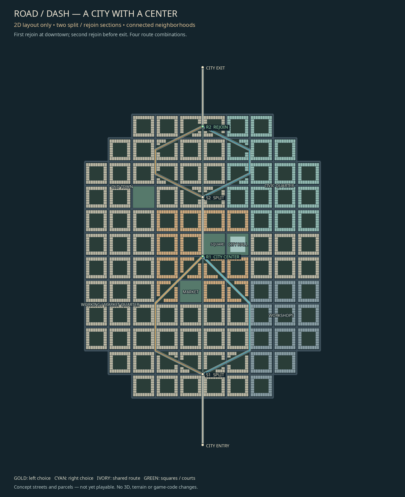

# City center and two split/rejoin sections — 2D proposal

Historical proposal: the user replaced this two-split brief with the [whole farm-to-long-city / one-split plan](../farms-long-city/README.md).

2026-11-07. Branch `codex/city-center-layout`, base 58eeabb.
The user rejected the corridor-shaped city and confirmed **two split-and-rejoin
sections**. The previous layout-only restriction remains active. No 3D changes.



[Routes without parcel detail](race-routes.png) · [Downtown close-up](center-detail.png) ·
[Interactive/vector review](index.html) · [Graph and plots](LAYOUT.json).

## A city with a center

The layout now has a compact, broad city footprint, not two narrow bands following
a road. Connected blocks spread in several directions around a civic square,
city hall and central retail avenue. A market square, old-town neighborhoods,
civic quarter, workshops and a neighborhood park give the city recognizable places.
Perimeter blocks place buildings close to their streets and put private courts
inside the blocks. Colours represent land use, not new 3D materials.

This draft uses local planning coordinates. It is deliberately **not** projected
onto the current Valley terrain or loaded into the playable track. Heights, models,
textures, lighting, physics, current lot quotas/IDs and game code remain unchanged.

## Two racing choices

| Section | Left alternative | Right alternative | Rejoin |
| --- | --- | --- | --- |
| S1 | Market Street | Station Street | R1, downtown at the central square |
| S2 | Old Town | Civic Avenue | R2, before the city exit |

R1 and S2 are joined by 300 m of shared central avenue. Each section offers two
alternatives; choosing independently gives **four complete paths** through the
city. All four have the same nominal polyline length, approximately 2.464 km.
Equal length is a layout check, not a claim about equal racing times or difficulty.

The layout also includes a background street network for city life/cross traffic.
It does not turn every street into a race shortcut. The planned race contract:

- Common gates at entry, downtown rejoin, second rejoin and exit.
- An ordered midpoint gate on whichever branch is selected, so a direct shortcut
  cannot receive valid race progress.
- Active-edge arc length mapped into a shared progress interval between each
  split/rejoin, avoiding position jumps between alternatives.
- Reserved clear merge approaches; lane transitions, corner radii, visibility,
  traffic priority, AI choices and recovery need future implementation/testing.
- Non-race approaches need closure/signage/access design before a playable bake.

There are 108 concept blocks and 2,992 proposed perimeter plots after rejecting plots
that enter the highlighted race clearance. These are 2D planning records, **not**
new instantiated models or replacements for the existing canonical lots.

## Verification and limitations

`python3 tools/plan_city_center.py --verify` generates the plan and verifies:

- The exact edge endpoints connect to their named split/rejoin nodes.
- Four complete entry-to-exit paths exist, without cycles or dead ends.
- The surrounding drivable city street graph is connected.
- Each pair reconnects at the specified node and differs in nominal length by 0%.
- Plot IDs are unique and accepted plot rectangles stay at least 6.2 m from each
  race centerline segment (4 m road half-width + 2 m sidewalk + 0.2 m setback).
- Invalid dead ends, cycles, endpoints and road-blocking plots are rejected.
- All eight exported map/data files regenerate byte-identically.
- Git shows no runtime changes against 58eeabb, including untracked runtime files.

[Validation receipt](VALIDATION.json) and CHECKS.txt record actual execution.
The PNGs were visually inspected. This is not complete construction validation:
diagonal-cut blocks still need purpose-designed corner/frontage plots; merge
radii, cross-street traffic control, pedestrian access, terrain alignment, whole-lot
rights of way, collision, canonical ID migration and performance remain open.
No new repository/library was investigated or adopted. Drawings and graph data
are original authoring work under the project license; no outside game media.

## Reproduce

```sh
python3 tools/plan_city_center.py --verify
```

Pillow and an installed DejaVu/Noto font are authoring tools only. The generator
writes to this planning folder by default; `--output` supports isolated exports.
No external inspection file is needed for the new local-coordinate city concept.

## Session report

Implementation/files: original 2D planning tool; JSON/PNG/SVG/HTML city, route and
center-detail exports; tracking, provenance and evidence documents. No files removed.
LAYOUT-02 remains open for user acceptance and detailed geometry validation;
ROUTE-SPLIT-01 tracks future playable integration and is not started.
ADR064 records the city-center/route-graph choice. Existing game regressions and
repository checks are captured in CHECKS.txt; no native 3D smoke is claimed for a
planning-only change. No performance improvement or subjective approval is claimed.
Next: review city shape/routes, then resolve merge/corner/access geometry before
separately scoping runtime integration. Local branch only; no push or merge claimed.

Executed repository checks: formatting, strict locked workspace Clippy, locked
workspace tests, locked build, audit, roadmap and synchronized progress all pass.
The unchanged game suite reports 271 passed / 1 existing ignored. No native game smoke
was run for this planning-only change. The artifact/graph checks are the relevant
verification of the new work, not the existing game's regression count.
