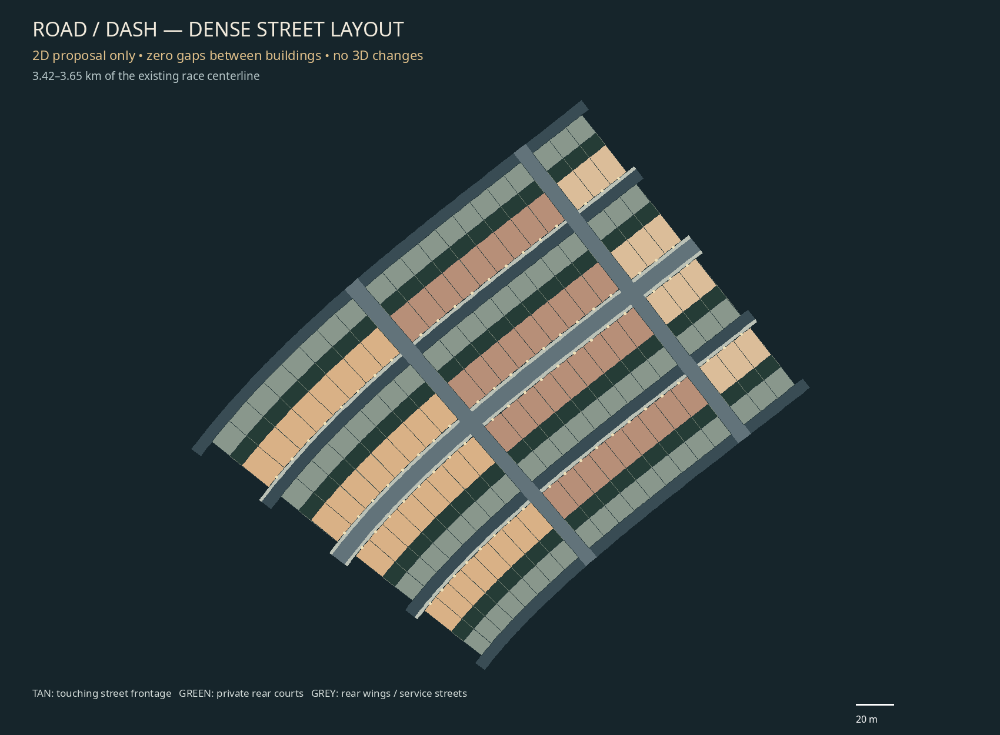

# Dense city — layout only

Status: retained earlier proposal. The user rejected its corridor-shaped city; see the [city-center/two-fork replacement](../city-center/README.md).

2026-11-07. `codex/dense-city-layout`, based on 149e355.
The previous sparse city plan was rejected. This is a new **2D layout proposal**,
not an update to the playable game or its 3D models.



[Full city masterplan](masterplan.png) · [Street width study](street-widths.png) ·
[Interactive/vector review](index.html) · [Parcel data](LAYOUT.json).

## What changes in the proposal

The city directly encloses the race road. Street-facing buildings touch their
neighbours along each block, with no lawns, parking forecourts or random gaps.
The main road is 8 m wide; each side has a 1.8 m sidewalk and 0.2 m setback. Opposing
fronts are 12 m apart. Doors open toward the street. Courtyards, rear wings and
servicing go behind the frontage. A second continuous block band and parallel
service streets on each side give the city depth instead of isolated roadside boxes.
Cross streets are the only interruptions to the primary street wall.

The draft follows the existing Valley race centerline between 2.70 km and 4.95 km:

| Measure | Proposed layout |
| --- | --- |
| Primary street frontage parcels | 376 |
| All concept parcels, including secondary blocks | 752 |
| Primary blocks, both sides combined | 44 |
| Total blocks, both depth bands | 88 |
| Main-road frontage, including cross-street breaks | 92.53% of route stations|
| Gaps between buildings within a block | 0 m |
| Nominal cross-street width / block pitch | 8 m / 108 m |
| Front building / court / rear wing depth | 18 m / 8 m / 12 m |

These are **proposal IDs**, not replacements for the existing 657 runtime lot IDs
or building quotas. Heights are deliberately unspecified. No Rust, game content,
models, textures, shaders, collision, physics or lighting files changed in this branch.
The colours distinguish plan regions; they are not new building materials.

## Verification and remaining work

The generator checks unique IDs, complete within-block station coverage, coincident
party boundaries and finite/nonzero footprint polygons. Outputs were visually
inspected and regenerated to check determinism. The existing race centerline was
read from an inspection report; it was not edited. No new GitHub project, external
code or game media was investigated or imported for this layout work.

This is a density/placement study, not a validated playable construction bake.
Cross-street widths are nominal at the race centerline; inside-curve approaches,
junction corners, complete polygon overlaps, gates and swept vehicle clearances
need detailed layout validation before any future 3D implementation. Terrain/pad
support, runtime quotas/ID migration and performance are also future integration
checks. User acceptance remains open under LAYOUT-01. The previous survey remains
historical evidence, not the selected city layout.

## Reproduce

```sh
python3 tools/plan_dense_city.py /tmp/world-repair-inspection.json
python3 tools/verify_dense_city_layout.py /tmp/world-repair-inspection.json
```

The input comes from the existing `--inspect-world` command documented in the
[earlier survey](../world-redesign/README.md). The tool writes only this planning
folder by default. Pillow and an installed DejaVu/Noto font are authoring tools,
not game dependencies. The JSON records the source report hash and fingerprint.

## Session report

- Implementation/files: 2D generator, JSON/SVG/PNG/HTML planning outputs and tracking
  documents only. No files removed and no runtime change.
- Checklist: LAYOUT-01 added in Part 04; draft delivered, density approval and future
  construction validation remain open. No major part completed.
- Research/assets: original engineering drawings; no new upstream code or media.
- Decisions: ADR063 separates this layout proposal from any 3D implementation.
- Testing: see VALIDATION.json and the captured check log. Native game smoke is not
  relevant to a branch that changes no game code, content or assets.
- Known issues/next: review dense frontage/layout, resolve corner/access geometry,
  then separately scope implementation. Performance gate from the previous branch
  remains open; this work makes no performance claim.
- Git: local `codex/dense-city-layout`; no push or merge claimed.

Executed checks: layout continuity/ID/polygon validation, zero proper outline
self-intersections, byte-identical regeneration of all seven exports, and a Git
scope check against 149e355 showing no runtime differences. The outline check found
and helped correct small inner-curve loops caused by discontinuous offset normals;
the corrected drawing uses continuous interpolated normals. General cross-parcel
and junction validation remains separate.

`cargo fmt --all --check`, locked strict workspace Clippy, locked workspace tests,
locked build, asset/dependency audit, roadmap tests and progress synchronization
all pass. The unchanged game suite reports 271 passed / 1 existing ignored. These
regression results do not turn this proposal into implemented 3D content.
