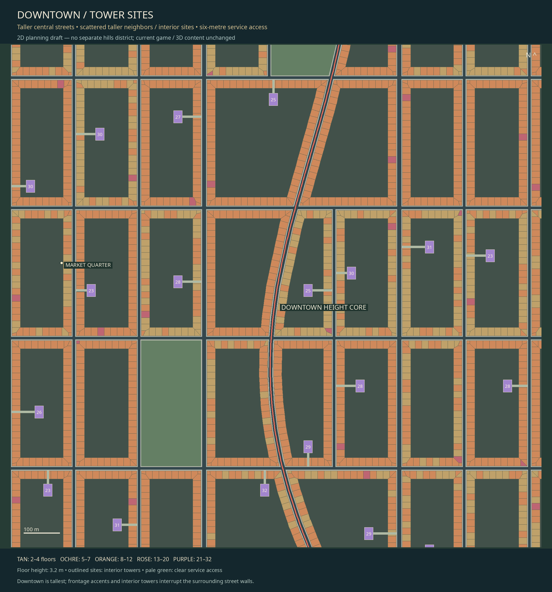

# Building height and detail plan — before 3D

2026-11-07 · LAYOUT-04 · ADR067 · `codex/race-first-city-layout` (massing base de20a70).
This finalizes the authoring proposal for this step; user design review and later
3D/runtime construction remain open. No models, game map or physics were changed.

[Full city height map](height-plan.png) · [Detail allocation](detail-plan.png) ·
[Whole route](whole-route.png) · [Editable rules](MASSING_RULES.json) ·
[All per-building data](LAYOUT.json) · [Verification receipt](VALIDATION.json).

## Skyline and neighborhood hierarchy

The existing central Market Quarter is the downtown height core, at draft race
station6.55km. The current road/property layout is retained. The height influence
falls with both distance along the city and lateral distance toward its edges:
an elliptical Gaussian with radii1100m east–west and2350m north–south. These are
authoring falloff scales, not hard district boundaries or changes to road elevation.

| Zone | Normal street walls | Occasional taller frontage | Selected interior buildings |
| --- | --- | --- | --- |
|Outskirts|2–4 floors /6.4–12.8m|6–9 /19.2–28.8m|9–13 /28.8–41.6m|
|Inner city|4–7 /12.8–22.4m|10–13 /32–41.6m|15–21 /48–67.2m|
|Downtown|7–10 /22.4–32m|14–18 /44.8–57.6m|23–32 /73.6–102.4m|

Floor height is a proposed3.2m. Heights above are roof height above local ground;
exported roof elevation separately includes the existing proposed terrain height.
Nearby street-front buildings share a block height baseline with small variation.
Selected frontage buildings rise above those neighbors. Interior towers occupy
scattered usable courts, with selection more likely near downtown. Parks/civic
sites and courts without room stay open. There is no tower requirement per block.

All choices use seed67201 and stable block/building keys. Reopening or rerunning
the plan does not reshuffle heights or towers; independent feature keys keep new
random decisions from shifting unrelated choices. These are original building
sites, not reference models or imported media.

## Interior sites and access

Each interior footprint must fit existing unbuilt court land, with6m clearance
from surrounding frontage. Pads use24×34m,20×30m or18×26m options. The access lane
is6m wide and opens through the street wall at ground level. Footprints crossed
by that lane are cut back; the plan does not route a driveway through a solid wall.

The data records the route to the street, affected parcel IDs and proposed joint
site assembly/access easement. This preserves the ownership plan as an explicit
planning requirement; it does not claim a legal parcel transfer. The audit checks
contiguous access, unblocked lanes, land/road/public-space clearance, sampled
endpoint grade below8% and footprint overlap. Actual pavement, turning space,
vehicle clearance, fire/service rules, final ground support and site ownership
approval must be resolved during later construction work.

Numbers inside tower footprints in the downtown drawing are floor counts. Pale
green lanes are reserved access. Purple towers are not placed on top of existing
frontage; the new footprints are part of the same geometric overlap audit.

## Detail decreases with distance from the race

Distance is the **minimum horizontal distance from a building footprint to either
legal race alternative or the common route**, not distance from its center or
from a random background street.

| Distance from race road | Authored tier | Intended geometry/material treatment |
| --- | --- | --- |
|Under70m|Hero|Detailed entrances/storefronts, facade depth, trim, roof edges and close materials|
|70–220m|Standard|Complete building, simplified trim, repeated windows and shared materials|
|220–550m|Skyline|Full silhouette/roof shape, large facade rhythm, baked small details|
|Beyond550m|Massing|Closed building/block volumes, stable roof/material identity, minimal trim|

**Interior towers always retain at least Skyline detail**, even far from the road.
Their height and visible profile matter to the city skyline. Every tier retains
closed walls and roofs; no roof-only tubes or changing building identities.

This is a static authoring budget, not an implemented runtime LOD switch. Camera
LOD, textures/mips, silhouette preservation, complementary ready transitions,
shared local origins and collision must remain independent during3D integration.
Buildings do not disappear or change height because their tier changes. No measured
frame-time or memory reduction is claimed by this plan.

## Validation and evidence

The generator extends the existing street/parcel audit with:

- Unique building IDs and one-to-one footprint/height metadata.
- Valid height bands, floor-to-height/roof elevation consistency, a taller
  downtown distribution and scattered frontage/interior exceptions.
- Tower pads outside existing built/public land, no footprint overlap,6m access
  reservations and a connected street-to-pad route clear of all footprints.
- Actual distance to both race alternatives, all four detail tiers represented,
  and protected skyline anchors.
- Rejection of invalid heights, wrong detail, missing tower access and a blocked
  service route, alongside the eight earlier route/land/grid negative cases.
- Fifteen deterministic map/data exports and unchanged game/runtime/content/Cargo.

[CHECKS.txt](CHECKS.txt) contains actual command output; [VALIDATION.json](VALIDATION.json)
contains geometry, count, height and tier results. The existing game tests are
regression evidence, not evidence that the proposed city is already playable.
Native game smoke is not relevant to this offline-only step.

## Earlier massing snapshot (de20a70; retained history)

The deterministic proposal contains145 interior tower sites and228 taller frontage
pieces (frontage pieces can split at access openings). Normal downtown street
walls average27.08m versus9.58m at the outskirts. Proposed buildings range6.4–102.4m.
Detail allocation:2,321 Hero,2,753 Standard,5,282 Skyline and9,614 Massing buildings.
These19,970 records were planning footprints, not instantiated game meshes.
Current geometry/sites were regenerated around the race under LAYOUT-05;
[RACE_FIRST.md](RACE_FIRST.md) and VALIDATION.json contain the current counts.
The same height/detail rules remain active.

The earlier15 exports regenerated identically; all12 earlier negative cases were rejected.
Current centering/junction verification adds two exports and four negative cases. Existing
workspace checks pass: formatting, strict locked Clippy,271 tests passed /1 existing
ignored, locked build, provenance audit, roadmap and progress synchronization.
Six SVGs also parse successfully. No runtime3D/GPU/performance test was performed
for an unapplied planning layer.

## Files, decisions and next step

New authoring code: tools/city_massing.py. Rules: MASSING_RULES.json. The existing
plan generator now exports height-plan, detail-plan and downtown-plan PNG/SVG,
and carries per-building heights/detail/access records in LAYOUT.json. README,
progress/placement, ADR067, known issues, development history, tests and provenance
are updated in the same change. No new library or external repository/media was
needed; the prior pinned Shapely/Pillow authoring stack is retained.

New task **LAYOUT-04** remains open for user design review and later construction/
LOD acceptance; WORLD-EXTEND-01 depends on it. Existing LAYOUT-03 and all runtime
integration gates remain open. No earlier tasks were removed or marked complete.
The next step is to build the first3D district from this agreed road/parcel/height
plan, including tower access and silhouette-consistent near/far geometry; that
implementation is outside this planning session. No push or merge claimed.
