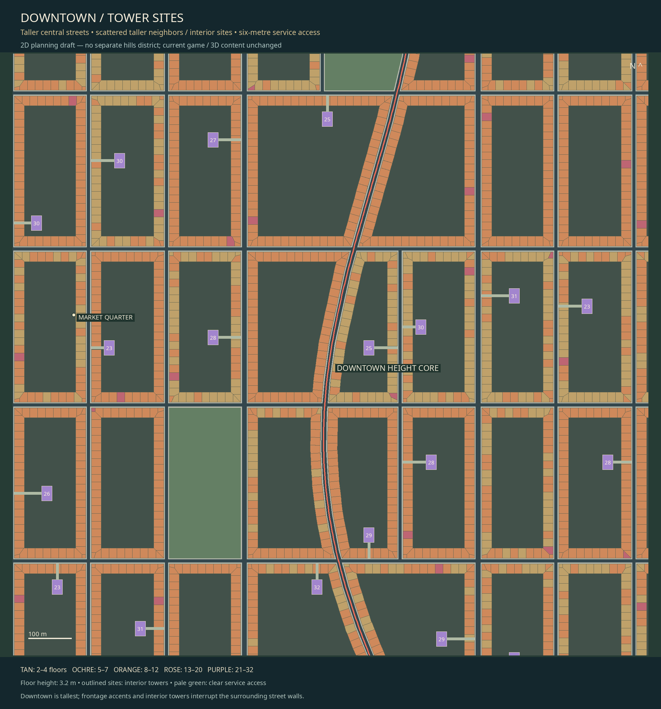

# Race avenue first — city centered around the track

2026-11-07 · ADR068 · LAYOUT-05 · local `codex/race-first-city-layout`.
Layout only. The game, models, physics and canonical world IDs are unchanged.

The user supplied a NYC-inspired reference and then circled unwanted secondary
streets immediately beside the race avenue. This revision makes the race the
primary city street, centers development around it, and removes those competing
parallel segments before deriving blocks/buildings.



[Entire farm-to-city route](whole-route.png) · [Race-first junction](race-junction-detail.png) ·
[First-quarter split](city-quarter-detail.png) · [Height plan](height-plan.png) ·
[Detail allocation](detail-plan.png) · [Editable race-layout rules](RACE_LAYOUT_RULES.json).

## City grows around the race

The full farm approach, race graph, exact route points, elevations, logical
chainage, split and rejoin remain fixed. The city envelope is selected around the
actual route at each city row. During the split, the midpoint of the two outer
race paths determines the development axis. Blocks continue beyond the urban
finish. Existing farm fields/projection remain identical to de20a70.

Select whole180×360m grid cells on both sides of that axis. This changes the
physical planning sites; it is not a camera recenter or a shifted drawing.
The resulting envelope center stays within half a cell (90m) of the race-path
midpoint in every row. Its edge steps between whole blocks. Buildings and streets
are not warped to follow that edge; regular streets stay straight, and angled
race intersections shape their residual block/parcel polygons.

## No closely competing parallel street

The initial35m/60%-of-segment filter missed the strips in the user's screenshot.
It is superseded by a local sustained-run rule:

- Sample each secondary segment at intervals of at most8m.
- Check distance and local direction against the nearest actual race alternative.
- A similarly aligned run (less than40degrees) within110m of the avenue for48m or
  more removes that **whole secondary segment**, between existing grid junctions.
- Keep perpendicular cross streets and adequately separated parallel streets.
  The two legal race branches remain intentionally distinct and are never removed.

This permits normal cross streets and junction approaches, while preventing
long narrow building strips between the primary avenue and a redundant road.
Deleting a whole grid segment lets adjacent land form a larger block, with
properties fitted to the primary avenue. It does not leave a little disconnected
stub next to the track or introduce a dogleg to force a90degree crossing.

The authored clearance is a proposed layout setting, not a universal street
standard. Thresholds and sampling are editable in RACE_LAYOUT_RULES.json. The
remaining network is audited again for competing parallel runs, not just the
segments that the selector reported removing.

## Primary intersections

Reserve the race roads first. Secondary crossings are considered by crossing
angle, favoring clear transverse connections. Leave80m around split/rejoin nodes
free of extra background crossings. Distinct secondary intersections along the
same primary edge must be at least65m apart; redundant whole segments are omitted.
All actual crossings have primary-junction records with location, local angle,
secondary street IDs and proposed avenue priority. The resulting street graph
must be connected, with all crossings noded.

The red line in the maps is the common race avenue, gold/cyan are its two legal
alternatives. Street surfaces and sidewalks define the land; building/property
polygons are derived afterward. Traffic priorities, markings, turn radii and
signals are still proposals, not implemented driving behavior.

## Heights, detail and valid land

Retain the previous central Market Quarter height core, district floor ranges,
seeded taller frontage/interior buildings, six-metre tower access and authored
detail tiers based on actual distance to either race branch. Both sides of the
race now receive development according to that same hierarchy.

Proposal block/parcel IDs and seeded placements regenerate because the land
changes. This is not a migration of immutable game lots or their quotas.
[Current machine receipt](VALIDATION.json) holds current counts; the earlier
massing counts in MASSING.md are explicitly preserved as historical evidence.

Merged/concave sites also need robust frontage clipping. The authoring overlay
uses a1e-9m snap grid and preserves footprint inner rings rather than filling
courtyard holes. Strict validity, overlap, road/public clearance, parcel coverage
and service access checks remain active. A numeric snap grid is not a visible
setback or a tolerance for overlapping buildings.

## Verification and reproduction

```sh
/tmp/roaddash-layout-venv/bin/python tools/test_race_first_layout.py
/tmp/roaddash-layout-venv/bin/python tools/plan_farms_long_city.py /tmp/world-repair-inspection.json --verify
```

The generator verifies centered sections, both-sided development, actual primary
junction incidence/spacing, protected throats, no remaining competing secondary
parallel runs and a connected street network, plus all earlier route/land/parcel/
height/detail/access checks. It compares race/farms directly with de20a70 and
checks runtime differences against fb46a0a. Seventeen exports regenerate identically.

Sixteen negative cases include false centering, off-track junctions, restored
omitted streets and disconnected fragments. Four focused regression tests cover
close parallel roads, a short local parallel run the old fraction rule missed,
proper perpendicular crossings/well-spaced avenues, and protection of both race
alternatives. [CHECKS.txt](CHECKS.txt) records actual execution; no native3D or
performance result is inferred from these offline tests.

## Executed result

Current plan: 26 centered city rows, maximum midpoint offset
83.89m within the90m whole-cell allowance; 29 primary
junctions with measured minimum spacing 131.67m. Removed45 competing
parallel segments and2 fork-throat segments. No retained secondary segment
violates the parallel-run rule; the street network stays connected.

The regenerated sites contain132 interior tower footprints and
199 taller frontage pieces. Normal downtown walls average
27.08m versus9.63m at the outskirts.
Heights remain6.4–102.4m. These are proposal records, not built game meshes.

All17 outputs are deterministic; all16 negative cases and4 focused layout
regressions pass. Race/farms match de20a70 exactly. Required repository checks
pass: format, strict locked workspace Clippy,271 tests /1 existing ignored,
locked build, audit, roadmap/progress/diff checks. Seven SVGs parse. No native
3D or performance measurement was performed for an unapplied planning layer.

## Work record and remaining gates

Added tools/race_first_layout.py, tools/test_race_first_layout.py,
RACE_LAYOUT_RULES.json and the junction PNG/SVG. Updated the existing street/
massing generators, all layout/height/detail outputs, provenance, README/progress/
placement, ADR068, development history, known issues and test matrix. The existing
pinned Shapely/Pillow stack is retained; installed Shapely intersection source was
inspected, no upstream code copied. The user's illustration is visual guidance,
not imported game media. No new dependency or external project adopted.

New **LAYOUT-05** remains open for design review and later construction/traffic/
native acceptance; LAYOUT-03/04 and WORLD-EXTEND-01 remain open. No historical task
was removed or falsely closed. Final architecture/site ownership/support,
intersection controls, native silhouette/LOD behavior and measured performance
must be resolved before playable integration. No3D work, push or merge in this step.
