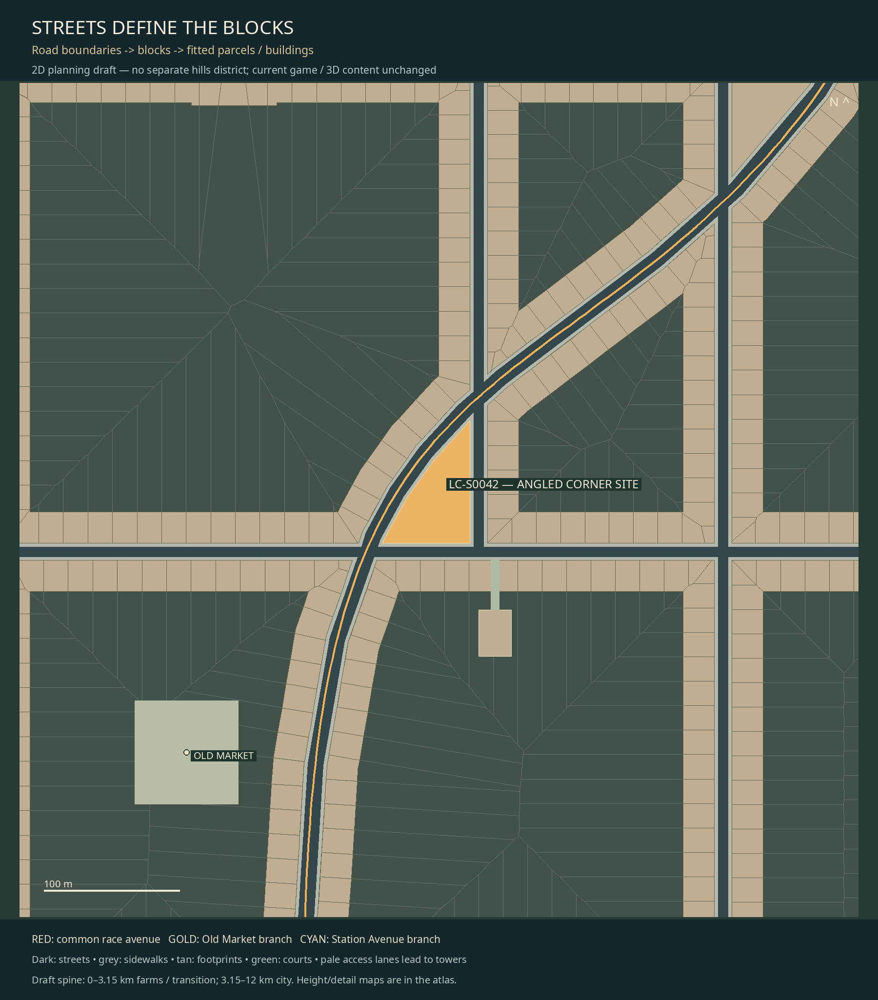

# Street-first plan — farms to a long city

2026-11-07 · current local branch `codex/race-first-city-layout` (height/detail base de20a70) · ADR066.
**Layout only.** No game geometry, content, models, physics or assets changed.
User review is still open under LAYOUT-03 / LAYOUT-04 / LAYOUT-05.

**Latest race-centered, track-first revision:** [whole-city and junction plan](RACE_FIRST.md).
[Race junction close-up](race-junction-detail.png).

**Height/detail layer:** [height, skyline, interior towers and detail plan](MASSING.md).
[Full height map](height-plan.png) · [Detail allocation](detail-plan.png) · [Downtown tower/access plan](downtown-plan.png).

The earlier drawings imposed rectangles on leftover land, then tried bending
street approaches to force right-angle intersections. Both interpretations were
wrong. The latest user reference is NYC/Flatiron: **streets define the spaces;
blocks, parcels and straight-edged buildings fit those spaces**. Triangular and
trapezoidal corner buildings are appropriate. There is no all-rectangles rule.



[Whole farm-to-city map](whole-route.png) ·
[First city quarter / split](city-quarter-detail.png) ·
[Elevation profile](elevation-profile.png) ·
[Atlas and zoomable SVG](index.html) · [Geometry and properties](LAYOUT.json).

## How the blocks are constructed

1. Reserve the race avenue first. Select whole city cells centered around the actual
   race paths in each row, including both alternatives. Retain a straight regular
   secondary street grid at **180m east–west ×360m north–south**
   centerline pitch. This preserves the requested two-block-tall proportions.
   Omit complete secondary segments that compete closely in parallel, crowd fork
   throats or create redundant nearby avenue intersections. No dogleg connectors.
2. Add the independent curved/diagonal race avenues. Do not introduce little
   doglegs to force90degree crossings. All crossing centerlines are noded into an
   explicit planning street graph.
3. Buffer actual carriageways and2.4m sidewalks. Union these street reservations
   and subtract them from the city envelope. The connected residual polygons
   **are the blocks**, including those cut into pointed and trapezoidal shapes.
4. Partition large blocks from frontage seeds into land parcels. They extend
   inward to shared/private courts;23m deep street-wall footprints cover their
   frontage. Neighboring footprints touch; they do not sit as isolated boxes.
   Tiny clipped parcel fragments are absorbed into a contiguous neighboring lot.
5. Small usable corner blocks become whole polygonal buildings. Unbuildable
   road slivers become landscape/traffic islands. Civic reservations are clipped
   to real land, never painted over a street or sidewalk.

Tan shapes are proposed building footprints, grey strips are sidewalks, dark
strips are streets. The highlighted gold corner is an actual site from this
map, not a separate illustrative triangle. Fine lines through the green courts
in the corner close-up show parcel ownership boundaries. Boundaries are a
planning subdivision, not a legal property survey or accepted architecture.

The only curves are road alignments; individual polygon faces consist of
straight segments. Road centerlines are simplified at2m tolerance before deriving
reservations, not by bending the grid or applying a deformation to buildings.

The NYC primary reference actually inspected is the
[Landmarks Preservation Commission Flatiron designation](https://s-media.nyc.gov/agencies/lpc/lp/0219.pdf),
which describes the triangular site giving the building its form. No NYC map,
architecture, image or source code was copied into these RoadDash artifacts.

## Whole journey and elevation

| Draft spine station | Place |
| --- | --- |
|0–2.70km|Farm fields, farmyards and access lanes|
|2.70–3.15km|Farm-to-town transition|
|3.15km|City entry|
|3.35km|City hall / one split|
|5.3625km|Rejoin near the first quarter of the city|
|5.36–12km|Continuous city: market, workshops/housing, terraced streets, north city|
|12km|Finish within the city; city blocks continue beyond it|

The ~12km spine and8.85km city are draft planning dimensions, not an approved exact
race length. The first3.15km use the existing inspection farm trace, rigidly
reoriented.42 source field IDs are preserved; proposed field extents and farmyard
symbols are not claims about exact current runtime dimensions.

There is **one split** into Old Market and Station Avenue, one rejoin, and then a
common route to the urban finish. The race has two legal paths; background roads
are city fabric, not additional eligible race alternatives. Measured path lengths
are~12.012km and~12.195km, reaching the rejoin at25.1% and26.6% of their actual city
paths. Racing-time balance, closures and checkpoint logic remain future work.

There is no separate hills district. Proposed urban crests/dips give street
levels~8.8–53.8m and maximum sampled grade3.34%. The height field/profile and5m
contours are planning evidence, not an applied game terrain or support surface.

## Verification and remaining gates

`--verify` checks real geometry, not just allocation counts:

- Valid, positive-area polygon blocks; no mutual block overlap or road intrusion;
  every area of the city envelope accounted for as reserved street or land.
- Carriageway and sidewalk partition the street reservation without overlap.
- Parcel ownership covers each subdivided block without overlap, and each parcel
  touches its block's street-facing boundary. Boundary incidence uses0.1micrometre
  tolerance to account for floating-point clipping, not a visible frontage gap.
- All footprints are valid straight-edged polygons inside their block, without
  mutual footprint overlap. A genuinely angled corner site is retained.
- All street crossings are noded. Regular nominal pitch180×360m.
- Exactly one race split/rejoin, two complete legal paths, quarter rejoin, farms
  to an urban finish, sampled grades and deterministic regeneration of seventeen outputs, including height/detail/downtown views.
- Negative cases reject a second split, hills phase, grade jump, out-of-city finish,
  footprint outside its block, duplicate parcel, wrong grid pitch and unnoded crossing.
- No runtime/content/art/Cargo differences against the earlier layout base fb46a0a.

See [machine receipt](VALIDATION.json) and [executed checks](CHECKS.txt).
The whole-route, quarter and corner/property views were visually inspected.
No native game smoke is needed to validate isolated planning changes; the game
suite is regression evidence, not proof that this map is playable.

Open: user design review, intersection controls/turn radii and acute junction
consolidation, lot/fire/service access, final civic-site design, building height
and terrain-pad construction, branch gameplay balance, exact extension length,
canonical runtime IDs/quotas, AI/recovery/checkpoints, production density and
rendering budgets. Parcel/building counts are proposal geometry, not built meshes.
Do not advance into runtime/3D integration without its separately scoped work.

## Reproduce

```sh
python3 -m venv /tmp/roaddash-layout-venv
/tmp/roaddash-layout-venv/bin/python -m pip install -r tools/requirements-layout.txt
cargo run --locked -- --inspect-world content/world/valley_world_v1.json content/world/building_archetypes_v1.json content/tracks/valley.json --output /tmp/world-plan.json
/tmp/roaddash-layout-venv/bin/python tools/plan_farms_long_city.py /tmp/world-plan.json --verify
```

Actual tested authoring environment: Python3.14.8, Shapely2.1.2 / bundledGEOS3.13.1,
NumPy2.3.4, Pillow12.0.0 and existing Noto/DejaVu font helper. Authoring dependencies
are pinned in tools/requirements-layout.txt and recorded in third_party/REPOSITORIES.md;
none are added to Cargo or distributed with the game. Original Python tool code
uses public library APIs; no upstream source was adapted. Input hash/fingerprint,
farm projection, backend versions, full road reservations and parcel geometry
are exported; `--output` supports isolated exports.

## Session record

Implementation/files: updated generator, new street-first geometry helper/pins,
whole-route/quarter/corner/profile drawings and SVG/JSON/HTML outputs, provenance
and tracking/test records. No runtime files removed/changed. LAYOUT-03 remains
unchecked; its geometry requirements were explicitly corrected. LAYOUT-04 adds the height/detail/access planning gate; LAYOUT-05 adds race centering/junction priority; no historical task IDs were deleted. WORLD-EXTEND-01/ROUTE-SPLIT-01 remain deferred. ADR066 replaces the
all-rectangles/forced-junction constraints while keeping the farm/one-fork/long-city
brief. Current work is on local codex/race-first-city-layout; no push or merge claimed. Review the corner and complete
map before future construction/runtime integration.
