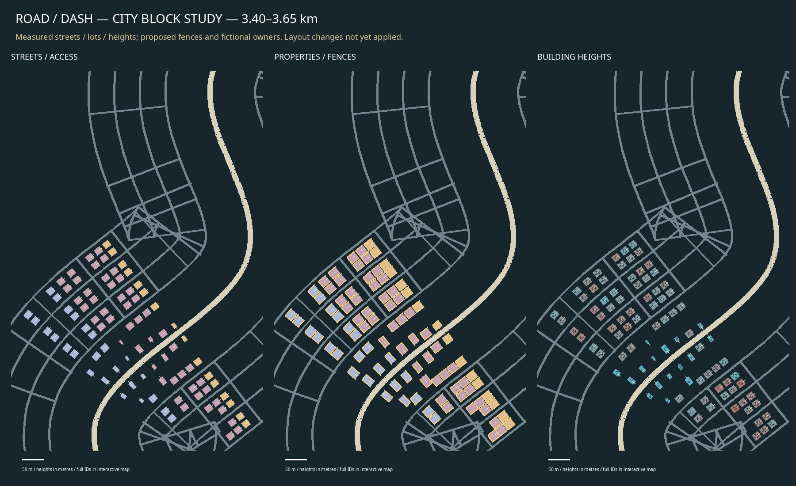

# World repair: plans before city rearrangement

Status: retained measured survey. The user rejected its dispersed layout as the density target; see the [new dense layout-only proposal](../dense-city-layout/README.md).

2026-11-07, `codex/world-repair-plan`.

[Interactive street/property/height sheets](index.html), [machine-readable plan](PLAN.json).


All 657 existing lot/building IDs are retained. Footprints, current building heights,
entrances and streets are measured from the actual generated world, rather than
invented allocation totals. The complete route sheets are [streets](streets.png),
[properties](property.png) and [heights](heights.png); SVG equivalents retain hover
labels and can be zoomed without losing boundaries. The urban block study shows
street access, proposed fences and measured heights at a more readable scale.

Ownership IDs are fictional planning groups, not real legal ownership. Three
proposed fenced edges and an open access edge are recorded per parcel. These are
**not placed fences**: gates, shared-party boundaries, traffic sightlines and whole-lot
rights of way need validation before placement. Field reservations remain listed
in PLAN.json. The current height map is a survey, not a new height prescription.
The lane proposal includes two-lane country roads, three-lane gateways and four-lane
city sections; only the rural width correction has been applied in this change.
No city parcel/building reordering has occurred.

## Art direction: the 3D reference

The user confirmed the **3D Come Bye: A Sheepdog Simulator** screenshots as the
reference, not a 2D/pixel interpretation. [Official Steam gallery](https://store.steampowered.com/app/1282380/).
The supplied screenshot and linked gallery are reference only. No source code,
textures, models or screenshots from that game are imported into runtime.

Use coherent faceted 3D silhouettes, grounded proportions, muted full colours,
soft daylight, blue-grey atmospheric distance and restrained material detail.
Country scenes need rolling pasture, clustered woodland, grass margins, dry-stone
walls and useful field/yard gates around a narrow two-lane back road. City detail
should read as connected properties: street hierarchy, pavements, entrances,
shared frontages, service yards and intentional height groups. Avoid scattering
unrelated catalogue pieces or using realistic photographic texture noise as a
substitute for this art direction. Preserve RoadDash's rider identity and readable
combat. This document does not claim that the complete art rebuild is delivered.

## Reproduce

```sh
cargo run --locked -- --inspect-world content/world/valley_world_v1.json content/world/building_archetypes_v1.json content/tracks/valley.json --output /tmp/world-plan.json
python3 tools/plan_world_redesign.py /tmp/world-plan.json
```

The report hash/fingerprint in PLAN.json identifies the measured input. The generator
requires Pillow and an installed DejaVu Sans or Noto Sans font; neither is a game dependency.
