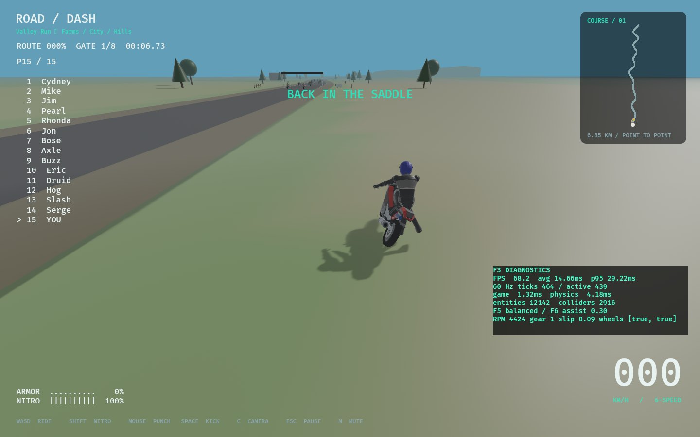

# Full-body keys and first interpolation pass — 2026-11-01

Branch: codex/animation-interpolation. PR #10's 154 independently authored frame
images were added to its description before merging d9e791ee2987ed9ddc482e4e51d5339c721b46cd.
The user's subsequent torso correction takes precedence over the old static-frame
approval dependency: correct body motion first, then implement this initial set.
It does not close Part 02 art approval or the full Part 03 production exit gate.

## Full-body correction

`art/animation/context/torso-profiles.json` now drives pelvis, spine, chest, neck
and head for mounted punch/kick/club/chain phases, tuck and acceleration. The
angles are original artistic reconstructions of qualitative sprite silhouettes,
not recovered native 3D matrices. Punches lean away, twist and look toward the
target; kicks raise the hips and release the seat while keeping the support foot
and both grips; tucking drops the head approximately 0.235 m. Kick phases raise
pelvis approximately 0.098 / 0.156 m in authoring space. White/red costume regions,
source rider/bike GLBs and accepted passive physics are unchanged.

All 138 static human poses / 16 bike layouts were regenerated and rendered.
The static Blender file reloads all 138 Actions with <1e-5 matrix error. Python
regressions verify mirrored torso motion, tuck lowering, kick seat release and
held support endpoints. Private retail comparison strips were regenerated under
`~/Downloads/RoadDash_Context_Review_v2`; original pixels stay outside the repo.
This is a correction of the named mounted actions, not approval of every draft.

## Runtime

`assets/models/motion.json` contains 36 original full-body keys / 13 clips.
Full 20-bone local rotations interpolate with shortest-arc quaternions; immutable
parent offsets keep bones connected. Four render-only two-link constraints retain
held grip/peg endpoints; released contacts remain free. The existing eleven skin
joints receive the resulting frames. No authoring transform writes a rigid body.

The 60 Hz animator snapshots previous/current poses for render interpolation.
Normal/tuck/acceleration blend smoothly; turns use steering input and existing
bike lean, with added upper-body motion. A punch/kick captures the actual current
normal/tuck/transition pose, enters over 0.10 s, plays source-ordered phase keys,
and returns over 0.12 s to the current riding base. Attack serials prevent cooldown
frames from retriggering the visual swing. Pause freezes both snapshots.

Original logical durations use a RoadDash-authored 0.02 s per counter. Existing
gameplay hit/damage timing remains authoritative; visual phases do not invent hit
events. Original source selector boundaries are implemented in rr_core, including
acceleration below 1800 legacy velocity units and tuck at 9501 units (about
153 km/h). Conversion uses the unrounded 41/4096 mph HUD coefficient. Runtime maps
lateral velocity to legacy units and uses the ordinary non-nitro flags branch;
this does not reproduce every original mode/flag. Unit tests cover both branches.

Get-up/run/pickup clips follow existing recovery stages. Pickup is mirrored to
the wreck side, lifts only its visual root and converts the running pose into
bike-anchor space, then back into mounted space without applying visual root
motion to gameplay. Existing 0.9 s get-up / 0.75 s mount timings are retained.
Actual direction mapping accounts for the authoring rig's +X-left convention.
Falling returns rendering to the existing physical-body driver.

## Review deliverables

[Overview](../../art/animation/motion-review/overview.jpg), nine GIF previews and
[clip/action list](../../art/animation/motion-review/clips.json). These are original
Blender authoring renders, **not native game captures**. The full authoring mesh
has wrist/foot/fist detail beyond the existing eleven-joint runtime skin adapter.
Editable `~/Downloads/RoadDash_Animation_Interpolation_v1/RoadDash_Animations.blend`
has 36 Actions: nine rig, nine bank, nine bike lift and nine fist tracks. All curves
use linear interpolation between sampled keys. Reproduce via build_context_poses,
export_motion_library, render_motion_review and package_motion_review tools.

[Native screenshots and machine-readable receipt](animation-b/receipt.json):

## Verification

- `cargo fmt --all --check`; workspace locked Clippy all targets with warnings denied;
  `cargo test --workspace --locked`; `cargo build --locked`.
- 150 regular Rust tests pass; one optional soak ignored. Includes full-body finite
  sampling, normalized rotations, fixed-length/contact interpolation (<6 mm),
  state entry/exit, paused/crashed visual state and 30/60/120 Hz smoothing.
  Content rejects invalid hierarchy/quaternions/durations/missing clips/keys and
  duplicate contact channels. Existing differential model/physics/recovery tests pass.
- `python3 -m unittest discover -s tools -p 'test_*.py'`: 20 pass (nine animation-specific tests).
- Blender independent static reload: 138 Actions; motion file: 36 Actions.
- Native `ROADDASH_SAVE_DIR=/tmp/roaddash-animation-smoke-save
  ROADDASH_VERIFY_REPAIRS=1 target/debug/road-dash --smoke-test` passed farm
  crash→get-up→run→remount, city/hills, hill crash→remount and finish; all 15 racers
  reset to the starting grid; five audio sinks initialized. Fedora/RTX3080/Vulkan.
  Observed screenshots 02,04,06,11 under local `screenshots/`. Native recovery
  captures are not an exhaustive visual test of every attack/tuck combination.
- Build used existing host runtime libraries via
  `PKG_CONFIG_PATH=/tmp/roaddash-native/lib/pkgconfig`; no dependency migration.
- Provenance/dependency audit runs through `python3 tools/audit.py`.

No Windows hardware test, original native-executable timing test, performance
benchmark, subjective animation approval or completed full-production rig claim.
Terrain-aware stride/feet, physical-pose-matched get-up, complete weapon/police
clips, runtime finger deformation and authored contact clearance remain open.
