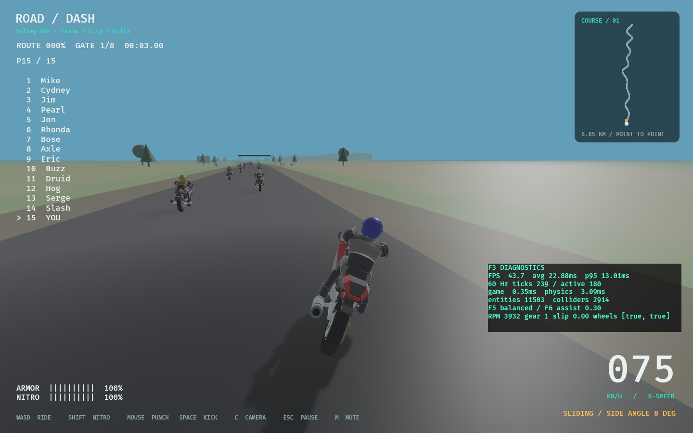
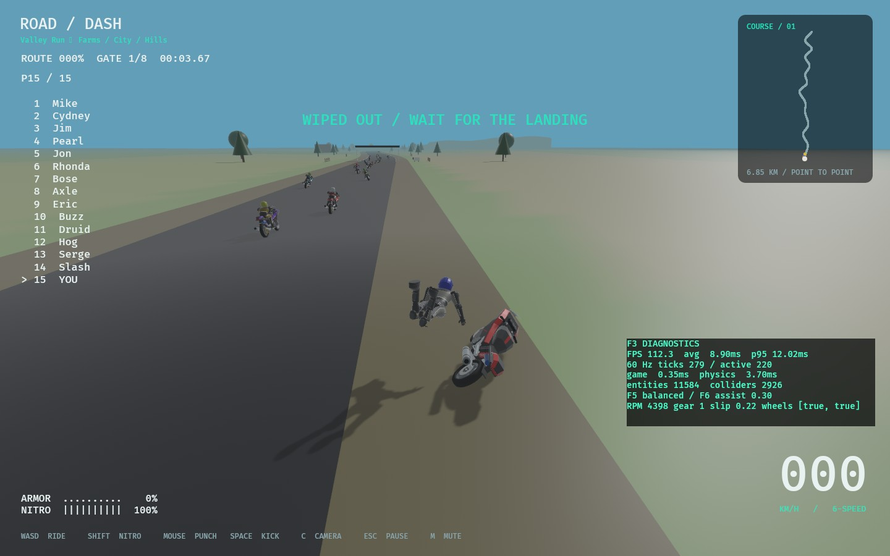

# Authored rider/bike integration — 2026-10-31

The approved authored rider and sport motorcycle now replace the native game's
primitive models on `codex/seated-models-preserve-ragdoll`. This is a presentation
change. The user explicitly required retaining the accepted ragdoll physics.

## Implementation and physics boundary

`src/models.rs` builds shared GPU-skinned meshes and original atlas materials once
at startup. Standing/riding bind surfaces use the same source character and
roster palettes. Existing visual joint entities drive riding/combat poses,
walking, pedestrians and physical ragdolls. The detailed bike replaces both the
rideable model and detached wreck; wheel visuals read the existing wheel state.
New meshes have no collider, rigid body, motor or animation-driven body motion.

Only three graphics-hook lines are added to recovery.rs. Removing them yields
byte-identical recovery source to the baseline. The full human body specification,
vehicle controller, Cargo.toml and Cargo.lock are unchanged. See
[physics-contract.json](models/physics-contract.json) for source hashes and
[differential tests](../../src/models/tests.rs) for executable protection.

New source/runtime files: `art/source` GLBs and seat/contact JSON, export scripts,
validated `rr_content::riding_model`, render adapter/tests, RDMESH01 buffer and
three PNG atlases. Modified integration files: human/world/environment/recovery,
client plugin wiring and loading lifecycle; game.rs changes only its test Art
fixture. Project tracking/provenance/testing documents and AGENTS.md preserve the accepted-physics constraint for future work. No files or
working systems removed; no physics engine/dependency migration.

## Verification results

| Check | Actual result |
| --- | --- |
| Baseline workspace tests before implementation | Passed, 120 tests; one optional soak ignored |
| `cargo fmt --all --check` | Passed |
| `cargo clippy --workspace --locked --all-targets -- -D warnings` | Passed |
| `cargo test --workspace --locked` | **125 passed**, one optional soak ignored |
| `cargo build --locked` and release build | Passed |
| Renderer-only bundle validation | Standing/seated 13,896 triangles each; bike 44,871; rejects truncated/corrupt data, NaNs, invalid joint IDs and physics payloads |
| Four human states | Same standing mesh/material handles across runner/ped/ragdoll, approved seated bind; all eleven joint references present; no physical components on skins/bike art |
| Ragdoll differential test | All eleven bodies' collider/mass/damping/friction/restitution/CCD/joint descriptors match; **180 ticks, maximum position difference 0 m**; velocities within 0.0001 and rotations within 0.001 rad |
| Full recovery differential test | Identical stage each tick through falling/getting-up/running/mounting/riding; health/speed/position match; detached skin cleanup passes |
| `python3 -m unittest discover -s tools -p 'test_*.py'` | Six tests passed |
| `python3 tools/audit.py` | 519 dependency declarations, 26 runtime records, 27 research observations; passed |
| `python3 tools/sync_progress.py --check` | README/progress IDs and checkbox states match |
| Native `--smoke-test` | Farm crash/remount → city/hills → hill crash/remount → finish passed; four playback sinks initialized |
| Native `--actor-smoke-test` | Independent human/quadruped crashes, solid contacts and bounded body counts passed |
| `--inspect-world` | Existing world quotas/structure/physical baseline validated |
| Native `--world-survey` | All 15 sections; **1920×1080 warmed city p95 12.90 ms**, existing 16.7 ms target met |

Cargo commands used the existing temporary libudev pkg-config shim on this host:
`PKG_CONFIG_PATH=/tmp/roaddash-native/lib/pkgconfig`. No system packages changed.
Native commands used `WGPU_BACKEND=vulkan target/release/road-dash`. Raw commands,
logs, metrics, source-contract receipt and screenshots are in [models/](models/).
The native adapter is NVIDIA RTX 3080 on the current Linux/Vulkan host; wall-frame
sampling is not isolated GPU timing, a human feel study or Windows certification.

Visual review covered the new seated racer/bike, steering lean, detached rider
and fallen bike, recovery runner/remount, hill crash and pedestrian ragdoll.
The first test run exposed missing asset resources in unrendered world fixtures;
the fixture now retains the legacy renderer when no asset system exists, while
new tests exercise authored skins explicitly. The first native launch exposed
Bevy's executable-relative asset lookup; packaged-binary/source-checkout lookup
now resolves the shipped atlases correctly. All final checks were rerun after
these fixes. Normal/roughness maps use linear loading, and Loading polls until
required textures are ready rather than assuming synchronous file loads.

## Scope, decisions and open gates

ART-03 is verified. ART-02's full production avatar acceptance is still partial;
ART-04 (finger/grip/fist/skin-weight polish and authored interpolated transitions)
and ART-05 (distance LODs and more hardware) are new deferred tasks. Each task's
reason, part, dependencies, acceptance and verification are in README/PROGRESS.
No unrelated roadmap tasks or exit gates were closed. The earlier static pose
library remains authoring input for the later animation step; this integration
retains the existing procedural animation drivers.

ADR-027 chooses an eleven-joint visual bind adapter rather than changing the
physical skeleton to match the author's twenty bones. The source mesh/cloth can
need refinement at extreme limb poses, and detailed fairings slightly overhang
the unchanged simplified bike collider. These are visual limits, not new collision
shapes. No first-person/controller/Windows/human playtest acceptance is claimed.

R08's existing installed Bevy 0.17.3 skinning/asset APIs were consulted (existing
MIT/Apache-2.0 dependency); no new repository dependency or source copied. Assets
are independently authored, user-approved project art; provenance/hashes are in
ASSETS.csv and art/README.md. No original game sprites/textures/models/disc data
were imported. Existing RIGHTS-002 release review remains open; the audit is not
legal clearance.

Next work should be a user review of the new visuals, followed by the separately
tracked animation/deformation polish. Any future graphics rig must continue to
consume physics poses without writing simulated transforms. The current physics
configuration is not a tuning opportunity in that work.

Local branch only; no push or PR was requested/performed. To compare or roll back
presentation without touching physics:

```
ROADDASH_LEGACY_MODELS=1 cargo run --release
```



