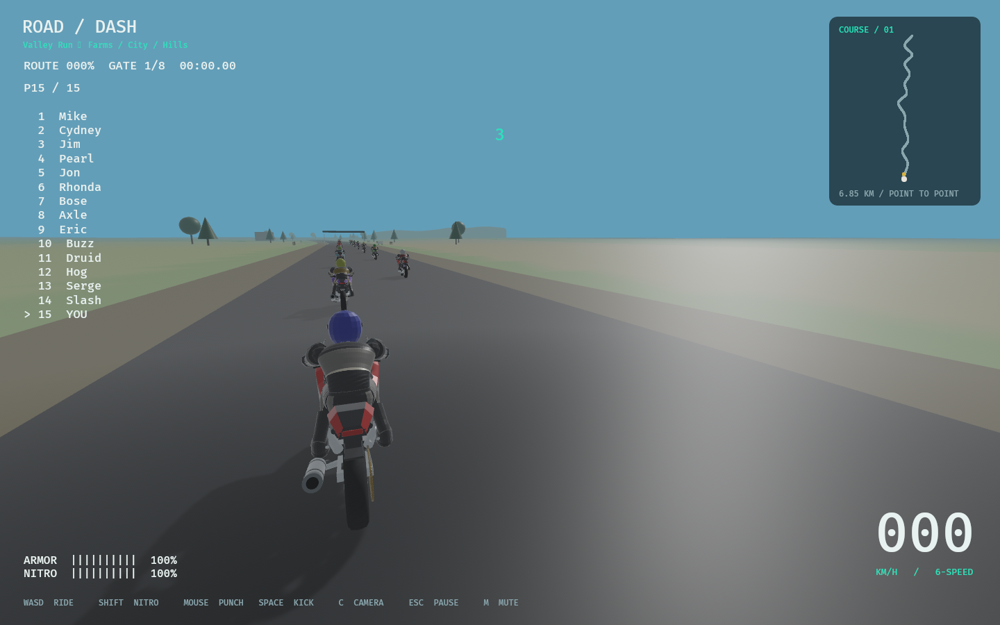
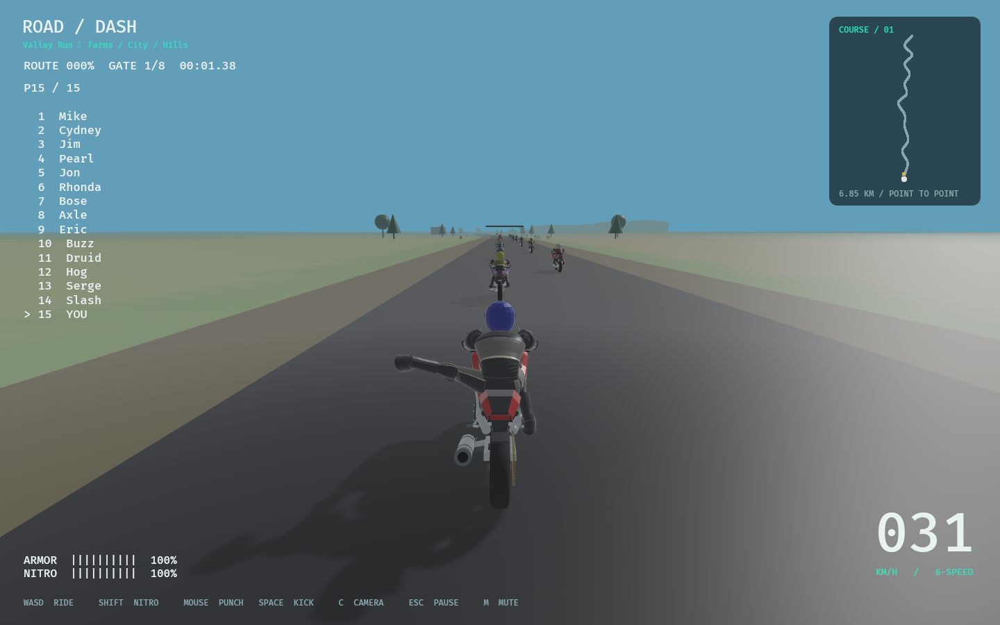

# Motion and restart corrections — 2026-10-31

Implemented on `codex/handling-crash-restart-roadmap`. This is a targeted repair,
not completion of the new animation/world production roadmap.

- Retry resets logical race state, all fifteen authored grid poses, velocities,
  forces, recovery, interpolation history and Rapier current/next poses together.
  The chase camera snaps during countdown. Palette/camera selection are retained.
- AI lane correction uses lateral error and velocity with proportionate bounded
  steering and gradual reversal. Player steering/handling is unchanged.
- Mounted collision detachment inherits cached pre-contact world velocity instead
  of the later solver bounce. Closing speed is not world velocity. Subsequent
  physical contact can still reverse a body; over-car vaults remain unimplemented.
- Original source-anatomy bind frames drive an attached render-only skeleton.
  Parent endpoints propagate through fixed bone lengths; elbows/knees use bounded
  hinge flex. Skinned visuals never overwrite authoritative physical transforms.
  Existing eleven-body masses, colliders, joint/motor limits and damping remain.

## Verification

Rust format, workspace Clippy with warnings denied, locked workspace tests,
locked debug/release builds pass: **130 tests passed, one optional soak ignored**.
Logs are in [motion-repairs](motion-repairs/checks.json). Tests cover retry from
racing/paused/finished with zero/one fixed tick, actual hierarchical backend pose,
AI settling/reversal at 30/60/120 Hz, forward pre-contact handoff, 120 extreme
poses per bind, anatomical endpoints/lengths, hinge bounds, four actor states,
and crash/recovery/remount cleanup.

The isolated physical comparison records **zero maximum positional difference**
for eleven ragdoll bodies over 180 ticks. Full recovery keeps exact stage timing
and strict health/speed checks; its remount position comparison permits 2 mm for
f32 projection/entity ordering (observed discrepancy about 0.7 mm). This is not a
claim that every complete physical scene is bit-identical.

Native Linux/Vulkan release smoke with `ROADDASH_VERIFY_REPAIRS=1` passes: injected
real R-key retry from 3.2 km restores all fifteen racers, farm/hill crash → recovery
→ remount → finish completes, and five audio playback sinks initialize. Separate
actor smoke passes human/quadruped ragdolls, solid contact and bounded bodies.
Screenshots below show the corrected grid and a connected left kick; the
[crash capture](motion-repairs/03-crash.png) records the detached skin.
The test fixture waits for asset loading and captures combat one frame after
pose injection; normal gameplay does not inject these actions.

Native builds used the existing `/tmp/roaddash-native/lib/pkgconfig` shim for this
host's missing libudev development metadata. Dependencies remain Bevy 0.17.3 and
Rapier 0.32.0; Cargo.toml/lockfile and authored mesh/texture surfaces are unchanged.

The final 15-section world survey passes: warmed 1920×1080 city wall-frame p95
**12.25 ms** against 16.7 ms on this Linux/RTX 3080/Vulkan host. This bounded sample
is not GPU timing or hardware certification; [receipt](motion-repairs/world-survey.json).
Nine Python tracker/source tests, progress synchronization and provenance audit
also pass (519 dependency declarations, 27 asset records, 27 reference observations).

## Remaining acceptance and scope

V2-01-005–008 remain open: measured vehicle impact/vault behavior, combat loss of
balance sequence, deeper crash-response comparison and user acceptance. Full
20-bone clips/fingers, terrain foot IK and bounded active ragdoll recovery are
future Parts 02/03. Visual proxies remain approximate. Windows and additional
hardware are unverified. The native screenshot review is not final human approval.

The roadmap adds 54 V2 tasks; all 294 original IDs/statuses remain preserved across
README and the historical archive. Only V2-01-001–004 are checked. ADR-028–030
record implementation and migration choices. See
[research](../research/ANIMATION_AND_RAGDOLL.md) for pinned repository screening;
no third-party source, media or dependency was incorporated. New runtime bind
metadata is original project art, recorded in the asset ledger.
