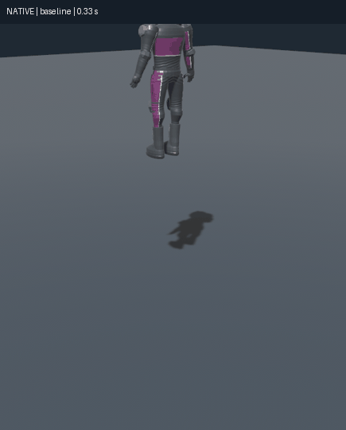
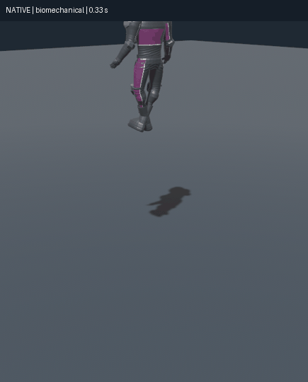

> Current status (2026-11-06): user approved integration into main. New physics
> starts automatically; --ragdoll-baseline selects the old rig. The comparison-only
> instructions below are historical. [Current integration and tuning evidence](ragdoll/integration/README.md).

# Biomechanical ragdoll comparison — 2026-11-01

PR #11 merged at 5fac329fce868e9e8db9fd5caa930624f84b2770. This overhaul is a
separate implementation on codex/biomechanical-ragdoll. Since the2026-11-02
user request, this branch launches the new mode automatically. Do not merge it or
replace the default before the requested comparison. No dependency migration.

## Run and compare

```sh
cargo run --release                         # new biomechanical mode automatically
cargo run --release -- --ragdoll-baseline    # original eleven-body baseline
cargo run --release -- --ragdoll-biomechanical
cargo run --release -- --ragdoll-lab-view    # isolated native comparison scene
cargo run --release -- --ragdoll-lab --output ragdoll-lab.json
cargo run --release -- --ragdoll-biomechanical --ragdoll-config content/biomechanics.json
```

The standalone scene does not run a race or load/write progression. B switches
baseline/new and resets; R resets; 1 drop, 2 limb force, 3 torso push, 4 hinge
stress, 5 low-speed ejection, 6 75 m/s / 270 km/h ejection, 7 road tumble, 8 wall,
9 fifteen simultaneous drops. L applies a forearm impulse, T pushes the torso,
Space pauses, F7 draws joint/proxy diagnostics. The headless version runs both
modes for each of the nine scenarios. The same --ragdoll-config override applies.
`ROADDASH_RAGDOLL=biomechanical` is the environment equivalent of the game flag.

## Original implementation and actual causes

Installed: Bevy 0.17.3, bevy_rapier3d 0.32.0, Rapier 0.31.0. The old system was
not unrestricted rope joints: ten GenericJoints already locked translations,
limited rotations and used small passive motors; elbows/knees already locked
Y/Z twist. Adjacent contacts were disabled. Its eleven cuboids totaled 56.5 kg,
with global angular damping 1.5. There were no physical wrists/ankles or split
spine, no muscle state/activation, and no animation-calibrated release pose.

Problems reproduced during this investigation:

- Independent wide shoulder coordinate limits approached Rapier's quaternion
  hemisphere singularity, causing violent corrective velocities.
- Hard CCD independently clamped articulated segments at obstacles, separating
  otherwise correctly placed anchors. Extra iterations alone did not fix that.
- Copying source skin rotations without removing standing bind axes would give
  physically incorrect joint targets; several limb bind rotations are far from identity.
- The crash energy guard wrote unchanged velocities every tick, waking bodies.
  Tiny reverse-COM corrections also prevented natural sleep in the new mode.
- The hidden chassis can be stopped before articulation initializes. Its live
  angular velocity is therefore not a reliable pre-impact spin source.

## Architecture and integration

`rr_core::biomechanics` owns backend-independent activation states/curves.
`rr_content::biomechanics` validates the bounded authoring JSON. Native integration
lives in src/biomechanics: initialized after the existing spawn/ejection systems
and before Rapier sync; native motors update at 60 Hz. Contacts/physics still own
body movement. On-foot repeat knockdowns never reuse a bike-anchor-space mounting pose. Existing collision detection, damage, crash events, recovery,
controls, animation playback, source meshes and audio remain integrated.

The enhanced rig has 16 bodies: original torso/head/pelvis/limbs, an intermediate
spine, two hands and two feet. Both spine joints are bounded; neck/shoulders/hips/
wrists/ankles have limited angular coordinates. Elbows are local-X hinges
[-2.53,0] rad (~0–145° flexion), knees [0,2.44] (~0–140°). Signs follow RoadDash's
body/forward convention. Initial local anchors coincide and direct neighbors do
not collide; nonadjacent segments and other actors remain solid.

Animation targets are calibrated against standing skin bind frames. On a rider
release, current normal/tuck/combat pose orientations seed an anatomically bounded
articulation with coincident anchors, before its first physics step. The spine
rotation is split across its two joints. Standalone/no-animation actors start
from the existing standing geometry and configurable bracing/rest poses. Subsequent
motion is fully physical; no per-frame bone teleport or upright root force.

Pre-impact angular velocity is captured before the solver/hidden-chassis stop.
Each released body receives omega and v_COM + omega×(r-COM); weighted COM momentum
matches the established ejection response. The wreck inherits measured spin in
the new mode. Existing linear crash rules are preserved. The existing dissipative
energy guard now includes initial rotational kinetic energy. Its baseline path
is retained; the new path avoids no-op/tiny reverse corrections so sleep works.
No arbitrary launch or spin impulse was added.

## Motors and crash phases

Every free angular axis uses a native ForceBased Rapier constraint motor. A passive
spring/rest target and damping remain at activation zero. Active pose stiffness,
damping and torque capacity are added according to activation. The effective
spring target is gain-weighted, and each motor's torque is capped. Rapier solves
relative angular velocity damping; no finite-difference PID or COM-following
translation force is layered over the solver.

The actual Rapier chart is 2*asin(relative quaternion imaginary component), not
Euler angles. Target conversion uses a consistent quaternion hemisphere. Config
validation rejects combined ball-joint ranges near its singularity. Conservative
shoulder ranges intentionally trade extreme reach for reliable articulation.

Riding uses the existing animation-authoritative body. Impact muscle activation
starts from configured riding strength, briefly braces, decays through ejection,
then low tumbling control fades completely. Passive resistance and limits remain.
Severe impacts shorten bracing; measured collision speed loss/force events provide
severity, with an explicit speed-based fallback for other ejections. Ordinary
support forces cannot repeatedly reset the quiet timer. Resting requires all
segments below linear/angular thresholds and real support for a dwell interval;
a moving/airborne body is not frozen. Backend sleep is allowed, not manually forced.
Secondary motion wakes the state; an unconscious settled body does not regain an
upright target. The existing automatic gameplay recovery may end the ragdoll before
its standalone resting stage; this overhaul does not add a new recovery delay.

## Default tuning

Edit content/biomechanics.json or supply --ragdoll-config FILE; invalid values,
unsafe charts, non-finite gains and inconsistent masses are rejected on launch.
Indices/shape/anchor topology are defined once in biomechanics::specs.

| Parameter | Default |
| --- | --- |
| Total mass | 70 kg; torso 17, head 5, pelvis 12, intermediate spine 5; each upper arm 2.3, forearm 1.4, thigh 6.8, shin 3.2, hand 0.6, foot 1.2 |
| Large joint passive K / D / torque cap | 5 N·m/rad / 2 N·m·s/rad / 12 N·m per angular axis |
| Neck/wrist/ankle passive K / D / cap | 2 / 0.6 / 3 in the same units |
| Large joint active K / D / cap | 45 / 6 / 40, multiplied by activation |
| Small joint active K / D / cap | 12 / 1.5 / 8, multiplied by activation |
| Riding / bracing / ejection / initial tumble activation | 1 / 0.7 / 0.15 / 0.025 |
| Bracing / ejection / tumble fade duration | 0.24 s × (1−0.7×severity) / 0.3 s / 2 s |
| Rest test | all segments <0.25 m/s and <0.5 rad/s, supported for 0.6 s |
| Body damping | linear 0.12, angular 0.8; secondary to joint resistance |
| Simulation / new-mode substeps | 60 Hz / 4; baseline remains 3 |
| Solver | 6 additional iterations on the articulated island root |
| CCD | predictive distance 0.35 m on new human parts; existing wreck CCD retained |

Torso/pelvis/intermediate spine and feet use boxes, head and limb segments capsules. Explicit masses
use shape-derived centers/inertia; adjacent mass ratios remain moderate. Neither
motor gain nor collision shape doubles as a visual bone transform. The optional
F7 overlay draws proxies, anchors, actual/target axes and limit rays; per-joint
console readouts include activation, relative angular velocity and anchor error.

## Verification and honest limits

Machine-readable lab results, native screenshots and final command receipts live
in [ragdoll/](ragdoll/). The lab includes externally forced tests; their injected
work is intentionally not subjected to the crash-only energy envelope. Collision
fixtures use the same envelope as the game. Initial shape inertia is measured
independently for mechanical-energy accounting. Headless wall-clock timings include
instrumentation and are not a production FPS benchmark.

Engineering checks cover live joint limits, zero-activation resistance, hemisphere
invariance, pose holding/yielding, bind calibration, coherent pre-impact spin/COM
handoff, high-speed wall/drop/tumble stability, natural sleeping and fifteen
simultaneous articulated characters. Existing model/physics parity and whole-game
regressions still run. Native comparison and recovery/actor smoke use Fedora,
RTX3080/Vulkan. Windows hardware and subjective realism are not certified.

The existing runtime skin still has eleven deformation joints. New wrists/feet
and the intermediate spine are physical proxies; independent skin deformation
for those extra segments is not yet authored. The debug scene exposes the actual
articulation. No clinical ligament model, injury model, finger skeleton, standing
balance controller or physical locomotion is claimed. Distal angular-velocity
peaks during hard impacts are retained in the report for review, not hidden.
Native silhouette/clearance/impact-peak review and full-race p95 performance/user
approval remain RAG-05/06; main must not replace the baseline yet.

All five requested source repositories were investigated; no code/media/dependency
was imported. [Pinned research and licenses](../research/RAGDOLL_BIOMECHANICS.md).
ADR-036 records alternatives, tradeoffs and rollback.

## Final receipts and acceptance

164 regular Rust tests pass; one optional soak ignored. Twenty tooling tests,
format, workspace all-target locked Clippy with warnings denied, locked build,
roadmap synchronization and provenance audit pass. Native baseline and new-mode
race/recovery smoke, actor knockdown smoke and comparison-view smoke passed.
The nine paired headless scenarios run 15 simulated seconds each; the new mode
sleeps all 16 bodies in each single-rider fixture and all 240 bodies in the 15-rider
fixture. Maximum anchor separation: 7.93 mm; maximum finite-step angular limit
excess: 0.01802 rad (~1.04°); measured initial COM momentum error below 0.00037 kg·m/s.
Collision fixtures stay within the inherited kinetic/gravity energy budget, with
only floating-point tolerance. External-force fixtures include deliberately added work.

The [quality profile](ragdoll/quality-profile.json) retains 8 substeps / 8 additional
iterations for comparison; its [results](ragdoll/lab-results-quality.json) have
lower transient errors but higher CPU cost. The selected 4/6 profile passed the
same settling/limit tests and reduced the instrumented 15-rider run from roughly
21 s to 10 s for 15 simulated seconds. These are observed headless wall times, not
native frame/p95 certification; RAG-06 stays open.

| Requested engineering criterion | Evidence / status |
| --- | --- |
| Knee/elbow direction and freedom | Native hinges, locked twist axes, torque tests and measured limit tolerance verified |
| Neck/spine/shoulder/hip limits | Validated bounds and safe chart; two spine joints verified |
| Passive resistance | Nonzero rest springs/damping/caps at activation zero verified |
| Configurable active pose holding | Elbow pose against gravity plus external torque test verified |
| External-force response | Limb impulse, torso push and hinge stress verified |
| Smooth activation transitions | Severity/rate/curve tests and native activation readouts verified |
| Limits after loss of muscle control | Native constraints remain unchanged; late zero-active settling verified |
| Ejection momentum | Bind/anchor/COM/pre-contact angular seed tests verified; no added launch |
| Natural settling | Backend sleep and supported quiet-state tests verified |
| No persistent separation/jitter | Bounded fixture errors and sleeping verified; subjective hard-impact peaks remain RAG-05 |
| Motorcycle/rider regression | Full suite and native race/recovery/actor checks verified |
| Reproducible scene | Nine scenarios, two modes, JSON report and native controls delivered |
| Relevant local checks | 164 Rust / 20 tooling tests, Clippy, format, build and audit verified |

Native GIFs are cropped real screenshots at six fixed ticks per frame (10 fps),
not Blender renders or AI motion. Full uncropped stills remain alongside them.

| Baseline | Biomechanical |
| --- | --- |
|  |  |

[Native recovery capture](ragdoll/06-remounting.jpg),
[machine-readable receipt](ragdoll/receipt.json),
[paired lab measurements](ragdoll/lab-results.json).

Files: new rr_core/rr_content biomechanics modules, content/biomechanics.json,
src/biomechanics/{mod,muscles,debug,lab,view,tests}.rs, native packaging tool and
research/evidence files. Modified game/vehicle/recovery/runtime/lib/main/verification
integration, AGENTS, README/progress/placement, decisions/history/known issues,
repository/asset registers and test matrix. No dependency, model or save replacement.
RAG-01–04 verified; RAG-05/06 remain open for distal skin/native realism and
production performance/user approval. Do not merge the comparison PR.

Host builds used `PKG_CONFIG_PATH=/tmp/roaddash-native/lib/pkgconfig` to locate
installed native runtime libraries; no system packages were installed/elevated.


### 2026-11-02 — Automatic comparison-branch launch

B belongs to the standalone lab; it never toggled modes in the race. Launch
selection now defaults to biomechanical in this branch, with a shared selection
path for game/lab. Explicit CLI mode overrides ROADDASH_RAGDOLL; baseline remains
available via --ragdoll-baseline or ROADDASH_RAGDOLL=baseline. Conflicting CLI modes
fail clearly. No joint, motor, mass, ejection or recovery tuning changed. Unit
fixtures still default to their original control rig; main remains separate.
Evidence for this usability follow-up is under ragdoll/default-launch/.
