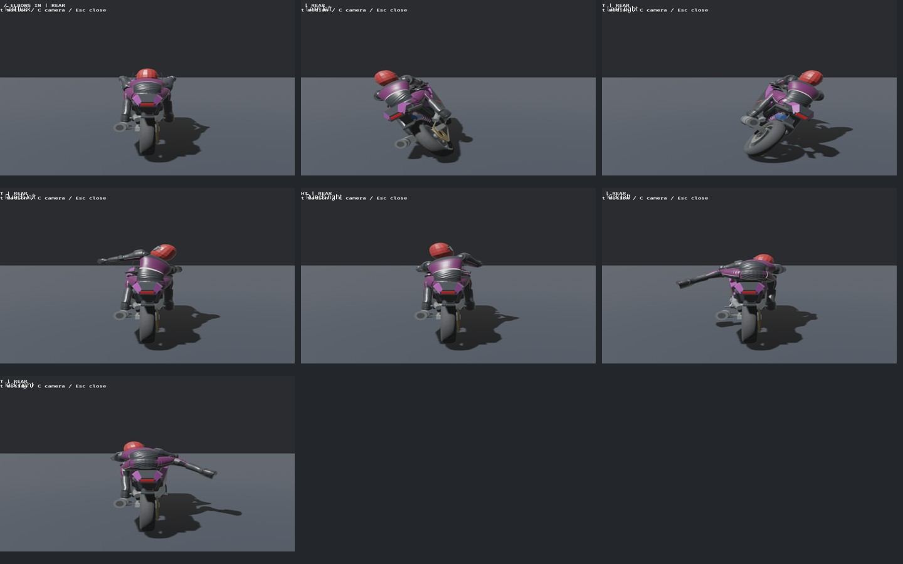
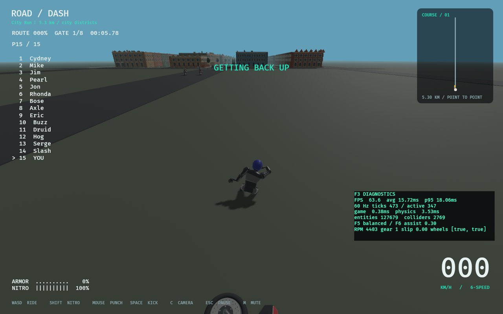
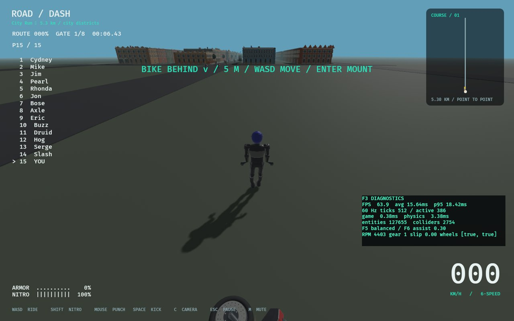
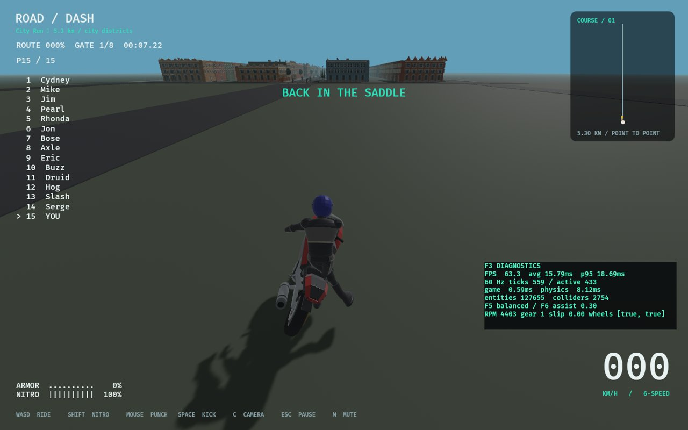

# Part 03 animation and recovery — 2026-11-06

Branch `codex/part-03-animation-recovery`, based on merged main `038d0b1`.
Local implementation; no commit, push or merge performed in this session.
Part 03 is **partially implemented**, not production-complete. ADR050 records
architecture and rollback. Original authored model, textures, physique, physical
body/joint tuning, contact rules, handling and saves remain integrated.

## Implementation and review



- Fixed the presentation boundary: gameplay right is forward cross up (-X),
  authored left is +X. Resolved left/right punches and kicks now select the
  corresponding clips; hit geometry/timing was not mirrored to mask the bug.
- Tuck and steering add a bounded inward elbow pole offset. Hand grip targets
  and upper/forearm lengths remain fixed. No lean is derived from road curvature.
- Pilot rider skin now has16 joints: independently articulated spine, wrists and
  feet, alongside the existing11 visual drivers. Distal weights are remapped and
  normalized at startup from original mesh/binds; no binary model replacement.
  The physical16-body rig is read, never repositioned by the skin.
- Running phase follows actual horizontal travel/stride; speed blends toward
  standing when blocked or stopped. Two support rays fit soles to ground normals;
  stance feet lock in world space with bounded release/reacquisition blending.
- Capture the settled physical pose before body cleanup. Blend that pose into
  the authored get-up, then existing mirrored pickup/remount transitions. This
  avoids starting every get-up from the same unrelated silhouette.
- Camera-relative WASD and both left-stick axes immediately override seeking.
  After0.35s continuous neutral input, assist resumes; `--manual-recovery` disables
  seeking. Manual walking near the bike does not force a mount. Interaction plus
  facing, proximity/height and low bike speed gates manual remount.
- Runner movement observes the same ordered gates as the bike. One racer-level
  completion/payout function handles foot and mounted outcomes, rejecting repeat,
  reverse and skipped-gate completions. HUD shows bike direction/distance.
- Footsteps follow measured travel rather than a recovery stopwatch. A manual
  below-terrain rescue leaves the bike alone, applies a5s penalty and clamps the
  rider before the finish; existing assisted rescue uses the same finish clamp.
- Player input after0.8s with ground support can raise native motor activation
  to0.12. This retains anatomical limits, passive resistance and torque caps;
  release returns to the normal activation curve. No root impulses/teleports,
  balance simulation or unrestricted steering in the air.





## Try it

```sh
cargo run -- --animation-lab-view
# 1 normal, 2 fast tuck, 3/4 lean left/right, 5/6 punch left/right,
# 7/8 kick left/right; C rear/front/side; Esc exits.
cargo run -- --manual-recovery
# After crashing: WASD/stick moves; Enter/menu-start interacts near a slow bike.
```

Edit validated `content/recovery.json` and rebuild to tune automatic seeking,
neutral delay, walking speed/stride, mount thresholds, brace activation and
rescue timing/penalty. Defaults: auto_seek=true, neutral_delay=.35s, speed6m/s,
stride3.2m, mount radius.8m/height1.2m/speed2m/s/facing dot.45, brace activation.12,
rescue delay120s/penalty5s. Existing `content/biomechanics.json` torque caps apply;
this change does not retune masses, solver, anatomical limits or passive motors.

## Tests and evidence

- `cargo fmt --all --check`: passed.
- `cargo clippy --workspace --locked --all-targets -- -D warnings`: passed.
- `cargo test --workspace --locked`:217 passed, one preexisting ignored long soak.
  Includes all16 physical segments at180 ticks with/without pilot rendering in
  the biomechanical rig, plus the original eleven-body control; no-input transform
  and velocity tolerances remain1e-4m/(m/s) and.001rad.
- `cargo build --locked`: passed. Logs alongside this file.
- `python3 tools/audit.py`:519 dependency declarations,33 runtime asset records,
  27 research observations. Declaration/hash audit only, not legal clearance.
- `python3 tools/test_audit.py`:2 passed. `tools/test_roadmap.py`:5 passed;
  `tools/sync_progress.py --check` agrees with README.
- New checks cover both attack sides/kinds; inward elbows with unchanged grip
  endpoints; sole-normal/chain invariants; normalized distal skin weights and
  independent rotation; bounded supported bracing/release and unchanged limits;
  camera-relative movement/neutral delay/stick axes; deliberate walk-away;
  actual crash5m before finish/get-up/manual foot finish on both rigs; skipped
  and backward gate rejection; once-only shared payout; slow versus moving-bike
  interaction; below-terrain rescue without finish/bike teleport.
- `--animation-lab-view --animation-lab-smoke`: eight mounted motions, three
  cameras, native rendered review passed. Initial viewer used the disabled
  tonemapping LUT path; corrected to Reinhard and reran before using screenshots.
- `RUST_MIN_STACK=16777216 ... --smoke-test`: current5.3km city, two crashes,
  both recoveries/remounts and results passed. Explicit `--ragdoll-baseline`
  also passed. Four audio sinks initialized. These scripted finishes are not
  the separate checkpoint-valid manual foot-finish test described above.
- `ROADDASH_TRACK=valley RUST_MIN_STACK=16777216 ... --actor-smoke-test`:
  independent16-body human and10-body cow, solid contacts/bounded bodies passed.
- `--ragdoll-lab --output ...`: all18 paired scenarios finite; new15-rider pileup
  has240 bodies,240 sleeping, max anchor error~.0014m. Raw measurements in
  `ragdoll-lab.json`; headless wall times are not race FPS or profiling acceptance.

Native host: Linux/NVIDIA RTX3080/Vulkan. Controller OS discovery is not physical
controller verification. Baseline/actor native runs overlapped; their frame-time
samples are not suitable performance comparisons.

Failed attempts retained: default-stack city debug startup overflowed an IO
worker during asset load;16MiB thread-stack workaround passed, root cause not
claimed fixed (ANIM-12). Actor smoke on default City Run failed its two-actor
precondition because there is no city cow; use Valley for that fixture. Neither
failure is hidden or reported as a passing default launch.

## Checklist, remaining gates and next steps

README/progress now162 checked /223 open,385 stable IDs. Newly verified existing
IDs: FOOT-001/002/004/005/006/007 and P06-007. New records: ANIM-10 (attack/elbow
correction), ANIM-11 (terrain/landing visual prototype), RAG-09 (pilot distal skin)
are checked; ANIM-12 (default-stack loader diagnosis) remains open. Each record in
README states reason, originating part, dependencies, acceptance and verification.

V2-03-001–008, ANIM-09, RAG-05/06 and broader production acceptance stay open:
remaining approved action coverage, terrain pelvis/stair/turn-in-place and slip
metrics, confined get-up/mount clearance, fingers/prop pedestrian articulation,
conscious/unconscious recovery policy and measured active work/energy,15-racer
plus NPC native p95/allocations, Windows and user art/feel review. Existing future
weapon/police clips remain with their owning parts; no new major part started.
First diagnose ANIM-12 and review the native poses/get-up; then finish terrain
clearance/quality and representative performance testing before closing Part03.

## Files, research and git

New code: `crates/rr_core/src/recovery.rs`, `crates/rr_content/src/recovery.rs`,
`content/recovery.json`, `src/models/articulation.rs`, `src/animation/preview.rs`,
`src/animation/grounding.rs`, `src/recovery/tests.rs`. Modified: library exports, animation/models/recovery and
their tests, biomechanics physical-rig lookup/muscles/tests, controls, game shared
finish, runtime tuning resource, main review command and HUD. Updated README,
PROGRESS/placement, DECISIONS, KNOWN_ISSUES, CHANGELOG_DEV, TEST_MATRIX,
REPOSITORIES, ASSETS and this evidence directory. No source files removed.

No new GitHub repository investigation, dependency or third-party media/source
incorporation. Reused the existing pinned comparisons in
`docs/research/ANIMATION_AND_RAGDOLL.md` and `RAGDOLL_BIOMECHANICS.md` (native Rapier
motors and separate visual targets); original code stays MIT. Existing original
model/texture hashes unchanged. Configuration and screenshot provenance is in
PROVENANCE.json and the asset register. Branch remains local and uncommitted;
no PR/remote integration claim.
