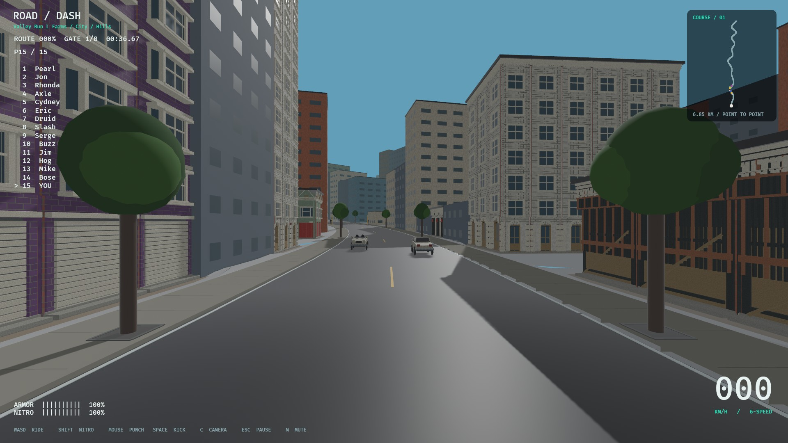

# Part 04 — authored Valley buildings (2026-11-06)

Follow-up surface/streaming/loader and offscreen crash work is recorded in
[world-polish](../world-polish/README.md); its residency/preparation contract
supersedes the initial cache-only loader behavior below. Initial measurements
are retained as historical evidence.

Branch: `codex/part-04-world-buildings`, based on main `825a5a1` (PR15 merge).
No gameplay, ragdoll, track, save, physics backend or dependency migration.
See ADR052 and [implemented building grammar](../../art/BUILDING_GRAMMAR.md).

## Implementation and scope

The original Valley map now uses the existing own-authored 3D building drafts,
rather than only generic colored shells. The separate explicit City Run remains
available and uses its existing renderer. All 19 Valley roles select from a
validated catalog of 128 original facade/structure designs. The deterministic
plan uses 108 distinct IDs across all 657 existing building lots. This is a binding
count, not a claim that every building is simultaneously loaded or visible.

384 derived GLBs contain ground/upper/crown scenes and three LODs; 34 deduplicated
own-material PNGs are shared. Real upper window floors repeat to match height. Rural structure fronts retain their full body below the cap rather than repeating floors.
Clipping boundaries follow the source generators' authored storefront/window
levels. Original source GLBs are unchanged. Source/export hashes, indices, finite
attributes, binary bounds, material paths, shared PNG hashes, per-band counts and
descending LOD budgets are independently verified. Exact vertex indexing reduces
file storage without decimating or changing the authored surfaces.

Runtime reserves pending as well as active scene budgets. Maximum 20 buildings,
750 panels, 1,000,000 triangle instances, 170 m radius; actual use depends on lots,
view, loading and LOD. Cache<=48 file/LOD entries; two camera-facing fronts per lot,
LOD hysteresis and 10 Hz reevaluation. Coarse detail skips duplicate ornament shadow
draws; structural shells retain main shadows. Native census walks instantiated
Mesh3d descendants and rejects any collider in decorative scenes.

## Automated evidence

- `cargo fmt --all --check`: passed.
- `cargo clippy --workspace --locked --all-targets -- -D warnings`: passed.
- `cargo test --workspace --locked`: **231 passed**, 1 existing ignored soak.
  New tests verify deterministic all-lot mapping, every transformed band/LOD stays
  within its existing lot envelope, genuine repeated floors, invalid pools/budgets,
  unsafe paths, missing identifiers/materials, hashes and inverted bounds.
- `cargo build --locked`: passed.
- `python3 tools/verify_architecture_kit.py`: 128 designs, 384 GLBs, 34 shared PNGs;
  geometry bytes 300,063,068. These are export counts, not placed-geometry proof.
- `python3 tools/audit.py`: 519 dependency declarations, 37 runtime asset records,
  27 observations. Declaration/hash audit only; not legal clearance.
- `python3 tools/test_audit.py`: 2 passed.
- `--inspect-world`: canonical quota 247 / 19 roles / 15 sections plus410 neighborhood lots,
  42 fields, unchanged geometry fingerprint `fnv1a64:9e86f98d4552ac15`, allocation
  fingerprint `fnv1a64:f866d824acfb111f`; support/walk audits retained.
- Existing whole-lot/party-wall/road-support/collision/race/controller/recovery/
  camera/animation/contact/reset/save/actor tests pass in the workspace suite.

## Runtime evidence and limits

The initial native survey with a 1,200-panel ceiling missed its warmed 1080p
wall-frame p95 target: 19.36 ms versus 16.7 ms. The failed measurement is retained in
initial-budget-survey.json. Do not present asset counts or reduced budgets as an
FPS result. Final native results are in native-survey.json and native-smoke.txt.

Final measured p95: **18.07 ms** (target 16.7 ms, **not met**); average
15.62 ms. Actual native census:
12 active buildings, 745 scene panels,
3619 instantiated mesh entities,
683,949 triangle instances and 48 cached file/LODs.
All 657 physical building owners remain. The prior 750-panel measurements were
20.05 ms and 18.24 ms; the initial larger-budget result was 19.36 ms. Do not infer
a repeatable improvement or 60 FPS certification from these short wall samples.
The repeated failed survey now returns process exit 1, verified after fixing
main's discarded AppExit status. Native gameplay smoke returns 0 and passes farm
crash/remount, city/hills, hill crash/remount and finish with four audio sinks.

[Farms](section-03.jpg) · [City core](section-10.jpg) · [Hills](section-14.jpg)
The fifteen section images alongside are actual native captures, not generated
concepts. Screenshot derivatives: original RoadDash native output, resized/JPEG
encoded only; repository MIT and existing runtime asset provenance apply.

Linux/NVIDIA RTX3080/Vulkan. Scripted screenshots cover all 15sections and street
views; benchmark sample includes active 15-racer simulation. A bounded wall-frame
sample is not GPU profiling, long-race/streaming memory acceptance or Windows/
controller hardware certification. Scripted finish is not real-user playtesting.

Open Part04 gates: artist/user review of all drafts; repeated module seams and
texel density; party-wall infill remains simple; U04 uses industrial cladding,
not authored parking structure geometry; barn/house frontage is not a navigable
interior/full bespoke footprint; broader world transitions/art bible; production
pop-in, cache memory and15-racer multi-hardware performance. `KIT-03` records newly
found infill/role gaps. Existing MESH/V2/P11/ENV tasks remain, not erased.

## Files, provenance and next work

New: rr_content architecture contract; content/world/architecture_rules.json;
world_gen/architecture plan/tests/renderer; three authoring/verification tools;
storey_kit exports/manifest/checksums/provenance; grammar and this evidence.
Modified: world/buildings/runtime hooks, inspection/survey, live roadmap and
permanent decision/issues/history/testing/repository/asset registers. No source
files removed. The native CLI now preserves AppExit failure codes for scripts. No new external repository or asset pack adopted; existing source
research is reused, original project code/assets retain MIT notices and earlier
catalog provenance. Retail reference sprites/textures are not shipped in this kit.

Review native city/farm/hill views next, then finish KIT-03 and remaining Part04
art/performance gates. Part05 was not started. Git changes remain local until
explicitly committed/pushed; this receipt does not claim a PR or merge.
