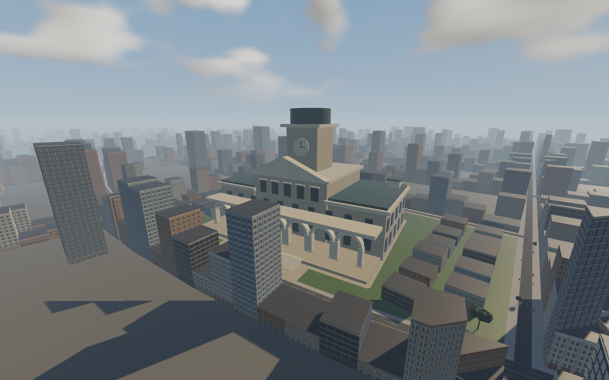
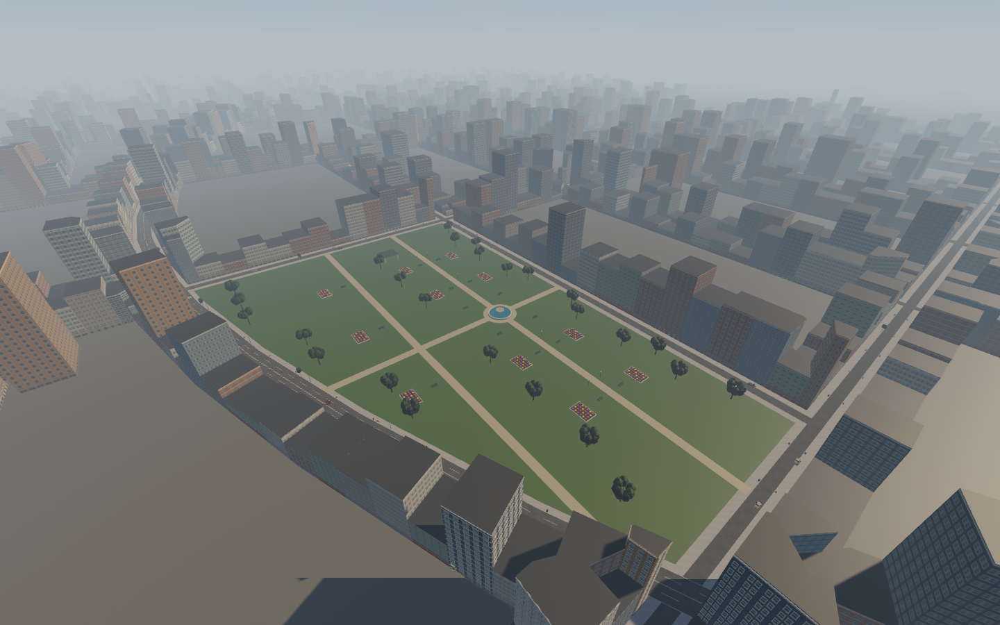

# Civic access and AI escape follow-up — 2026-11-09

Continues `codex/living-city-ai` from `c6eebbc`. The user rejected the isolated
City Hall plaza, requested surrounding buildings/greenery and nearer road placement,
and requested that park paths reach sidewalks. User explicitly confirmed both
mounted and on-foot AI get stuck. ADR121 records decisions. Existing CAST-AI-01
and CITY-CIVIC-01 are extended; no new requirement IDs or closures.

## Implementation

- City Hall remains in park 3, facing the actual driving street. Its centre moves
  24m toward that street, from (270,3960) to (293.606,3955.669). Whole foundation
  and stairs retain a 3m source-block margin. 31 new low-rise shops/civic offices use
  existing facade families, closed envelopes and permanent collision. Ten trees
  and approximately 28,422m² of lawn replace the empty stone apron; the grand
  forecourt and its sidewalk approach remain paved.
- Park5 retains its full irregular grass footprint. The two north/south promenades
  and east/west walk now end at six actual sidewalk points, not arbitrary lawn
  coordinates. A paved ring around the fountain connects the path arms while
  keeping the basin solid. The baker clips paths against actual road/sidewalk
  polygons; no road carriageway or old building is removed.
- Mounted AI detects insufficient forward progress, including repeated backup
  oscillations. A bounded grid search finds a collision-clear route to the driving
  lane. Low-speed movement follows world-space waypoints through the existing
  vehicle adapter, including latched reverse legs. Live swept-body checks stop
  blocked movement and invalidate obstructed cached routes. One mounted planning
  request per fixed tick; 49×49 grid, 3m cells, 1024-expansion cap, 65m local target.
- Walking NPCs detect blocked or stationary routes and plan around current physical
  obstacles, including objects absent from the static navigation authoring. Capsule
  sweeps preserve solid contact; cached routes refresh. One walking plan per fixed
  tick. Police pursuit targets remain reachable for arrests. Player manual/auto
  recovery and existing exceptional foot rescue policy are unchanged.
- Pure planning/progress/watch rules live in rr_core; authoring validation in
  rr_content; physics queries/control adaptation remain in the native client.
  No new teleport, joint/muscle tuning, player handling or save-format change.

## Evidence

- `authoring.json`: context buildings, greenery, placement and six entrance points.
- `geometry-audit.json`: 8,572 whole-car pavement samples, old identities/routes/gates
  retained, no civic/building overlap, continuous park path network, all entrances
  touching actual sidewalk with paved overlap. Context building footprints are
  excluded from the civic lawn coverage comparison.
- `escape-physical.txt`: mounted rider backs out of a three-sided solid trap and
  physically drives around it; no crash recovery or teleport allowed.
- `concave-tests.txt`: actual NPC capsule goes out through the back of a concave
  enclosure and reaches its bike without exceptional rescue; pure planner returns
  a collision-clear detour. Full-suite logs supersede the earlier targeted builds.
- `tests.txt`, `clippy.txt`, `fmt.txt`, `build.txt`, `release.txt`, `audit.txt`,
  `authoring-tests.txt`, `roadmap.txt`: final verification commands and results.
- Native runs use the serial guarded runner with isolated saves/settings, frozen
  input hashes and nonblank-image validation. Final results are recorded below.

Integration findings: the first full suite caught a slow queue being misread as
progress intent and a police arrest target being treated as an impassable obstacle.
Corrected the conditions, preserving the existing regression assertions. The old
building-count test now distinguishes 31 added civic buildings from the 19,068
retained original IDs and 9 previous approach buildings, with explicit counts for
all three groups. No test was weakened to permit lost buildings or queue impacts.

## Files, research and limits

Key files: `tools/civic_neighborhood.py`, `tools/living_city.py`,
`src/world_gen/metropolis/civic.rs`, `navigation.rs`,
`crates/rr_core/src/escape.rs`, `src/game.rs`, `src/recovery.rs`,
`src/vehicle.rs`, and their physical regression fixtures. The generated Metropolis
manifest and source-derived authoring/audits are included. Facade families/materials
are reused through the existing model-derived atlas contract.

No external repositories/assets were imported or researched in this follow-up;
original code and existing licensed project models are used. Dependencies remain
pinned to Bevy 0.17.3/Rapier 0.32. Provenance hashes/declarations were refreshed.
The audit is not legal clearance or hardware certification.

Bounded local planning does not guarantee escape from every enclosure. Sealed
spaces or routes outside the search budget may stop/retry; existing exceptional
on-foot rescue remains available. General full-race deadlock freedom, user art/
balance acceptance and the existing 16.7ms performance/hardware gates remain open.
Main checkout is unchanged; no push/merge or next major development part.

## Verified build and visual review

All 457 workspace tests passed (one pre-existing ignored), including physical
mounted and walking trap fixtures, queues, arrests and recovery. Strict Clippy,
format check, locked debug/release builds, 20 authoring tests and provenance audit
passed. The independent geometry audit checked 8,572 car samples with no failures.
Native City Hall and park captures were visually inspected: frontage retains its
road orientation, context buildings/lawn surround the hall, and the park path
network visibly joins the sidewalks and passes around the fountain.

The final standard route survey measured 17.32ms average and 22.26ms p95 wall
frame time; the separate civic-view survey measured 26.82ms p95. The 16.7ms target
remains unmet. These are bounded survey workloads, not paired performance claims
or full-race/GPU/hardware certification. Census: 19,108 buildings, 58 crossing
cars, 192 pedestrians and 1,521 street props. Existing original pass features are
listed in ../living-city-ai/README.md and remain integrated.

Five serial native runs (`civic`, `after`, `recovery`, `baseline-recovery`,
`actors`) exited successfully with unchanged frozen inputs and nonblank images.
Both recovery rigs/routes verified reverse at -1.898m/s and two remounts each
with 0.0000m pickup error. Independent NPC human/quadruped solid-contact and
bounded-body checks passed. No new requirement IDs were introduced or closed;
ADR121 records decisions and the existing checklist keeps qualitative gates open.

All 18 paired baseline/biomechanical ragdoll lab cases remained finite. The
follow-up is committed on `codex/living-city-ai` (see `git log -1`); the original
checkout remains clean at `2a3770e`. No push or merge was performed. Next steps
are user visual/balance review and the already-open full-race/performance gates.
