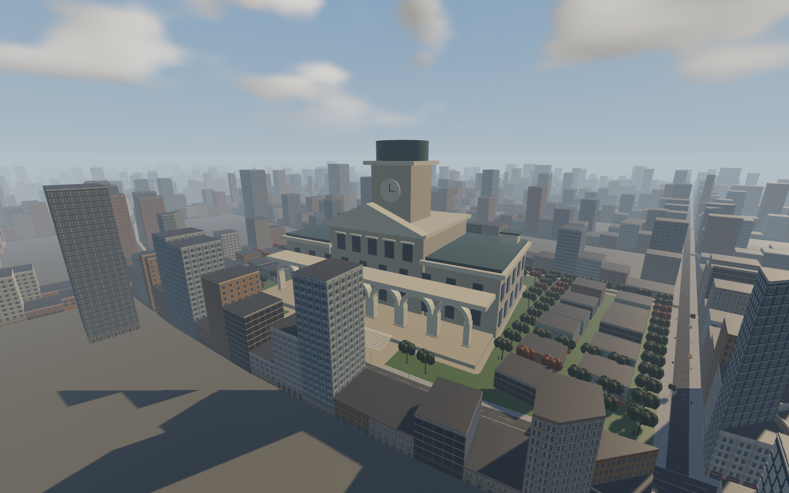
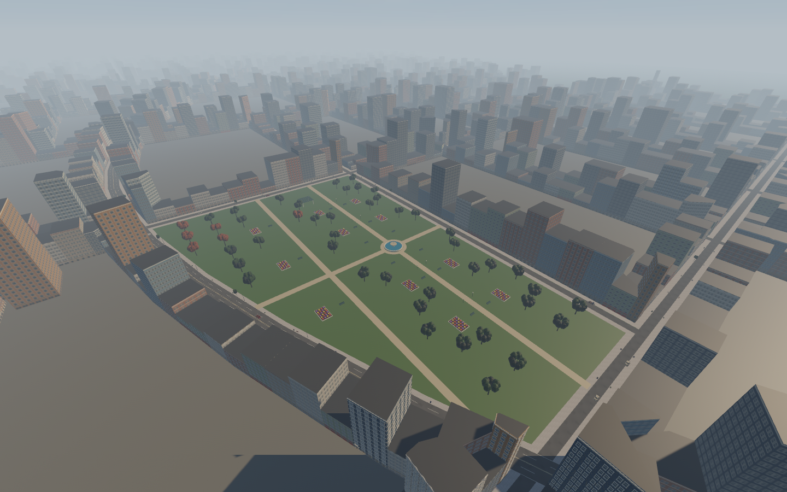

# Civic greenery, narrower-city preview and character gallery

User requested more trees/grass around City Hall and park 5, a map of a narrower
city, then specified removing about half the blocks that do not touch main race
roads. They also requested all new character images. ADR122; CITY-CIVIC-01 remains
open for art review and new CITY-WIDTH-01 remains a proposal pending selection.

## Implemented greenery

Hall trees increase from 10 to 120, fitted to lawn clear of paving and building
footprints. Existing hall, road-facing arches, 31 surrounding buildings and six
park sidewalk connections are preserved. Park planting now extends inside lawns,
with conservative bed/bench/pavilion/fountain exclusions. Tree collision and static
navigation use the same positions. Continuous turf remains under both sites.

Added 5,346 civic grass tufts (58,985 total), using existing wind material,
32m batching, 65–110m culling/fade and fixed placement budgets. These additions
increase geometry; no optimization benefit is claimed. No AI, player handling,
rig, animation, input, audio, save or runtime dependency changes.

## City proposal — not applied to runtime

[Before/after map](narrow-city-proposal.png), generated by
`tools/preview_narrow_city.py` from the approved planning source and live building
manifest. Protect whole blocks within 45m of either race centreline, conservatively
covering road/walk frontage. Protect all six park sites, including City Hall and
fountain park. Remove the farthest eligible whole blocks first.

- 330 blocks → 194 retained; 136 of 273 non-frontage blocks removed (49.8%).
- 19,108 buildings → 11,275 retained; 7,833 proposed removed (41.0%).
- Both race branches and live authored geometry remain unchanged.
- JSON records exact proposed IDs, source hash and criteria. Map covers the full
  city extent; farm approach is outside the displayed city crop.
- This is a massing/block selection preview. Side street termination, isolated
  park access and new edge vegetation need design before a live bake. No measured
  FPS gain or collision/streaming savings are claimed from these counts.

## Character images

[Open full image gallery](characters.html), [all 16 cast portraits](cast-contact.png),
[exported 3D catalog 1–30](models-contact-1.png),
[exported 3D catalog 31–57](models-contact-2.png).

The cast designs are approved portrait artwork, not 16 distinct finished 3D rider
meshes. The game currently shares a helmeted rider mesh with color variants.
All ten existing delivered-GLB review sheets are included (57 catalog entries,
including civilian variants and one cow); their source materials precede the
runtime matte treatment. The gallery includes a native helmeted-rider capture.
Contact images are headless Chrome screenshots of HTML laying out existing assets;
no new character design was synthesized and no mesh was modified.

## Verification and files

458 workspace tests passed (one pre-existing ignored), including new civic grass
access-clearance/population checks and existing physical recovery differentials.
Strict Clippy, fmt, locked debug/release builds, 20 authoring tests, provenance
hash audit and README/progress synchronization passed. Independent geometry audit:
8,572 whole-car samples, zero pavement failures, civic paths/old IDs preserved.
Native results and visual inspection follow below.

Changed rendering: `src/world_gen/metropolis/civic.rs`,
`geometry/landscape.rs`; authoring: `tools/civic_neighborhood.py`,
`living_city.py`, `bake_metropolis.py`; generated `content/world/metropolis.json`.
Read-only map script and galleries are separate from runtime. No external asset
or source research/import; existing project assets reused. Matplotlib was installed
only in the temporary authoring virtualenv. Rust/Bevy/Rapier pins unchanged.

Native civic and standard route surveys passed with unchanged frozen input hashes
and nonblank captures. City Hall/park images were visually inspected; denser trees
are present and sidewalk-connected paths remain visible. Blades are distance
culled in the aerial shots; native census verifies 58,985 tufts / 474 batches /
1,061,730 grass triangles. The standard route survey measured 19.11ms average,
22.99ms p95 wall frame time; separate civic-view p95 was 23.22ms. The 16.7ms target
remains unmet. This is not GPU/full-course or paired performance certification.

All five serial native runs passed (`civic`, `after`, `recovery`,
`baseline-recovery`, `actors`), with stable frozen input hashes and nonblank
screenshots. Both recovery rigs/routes reversed at -1.898m/s and remounted twice
with 0.0000m pickup error. NPC solid-contact/body bounds passed. Existing model
physics/recovery differential tests are included in the workspace suite.

README and PROGRESS updated together: 220 verified / 250 open, with CITY-WIDTH-01
added to Part 04 and TASK_PLACEMENT. No existing requirement was closed. Committed
on `codex/living-city-ai`; see `git log -1`. Original checkout remains unchanged;
no push/merge. Next step for the reduction is user map selection, followed by
source authoring, road-edge/navigation validation and measured performance.
