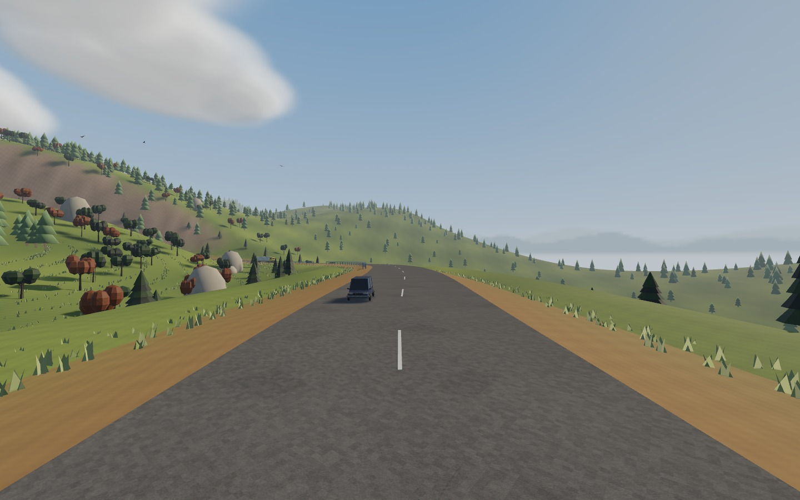

# Hills woodland, close-range passes and race outcomes

The reported Hills session put Aaron 2.74 m behind the stopped player with a
0.55 m lateral offset at roughly 1.225 km. The speed trace showed an eventual
pass about nine seconds later. The close-queue policy now starts the safe backoff
earlier and hands control back to the pass planner when a viable line opens.
Rear clearance, physical trajectories and solid contacts remain in use. In the
matching-gap physical fixture the rival was stopped for 41 fixed ticks
(0.68 seconds) and reached 30 m ahead after 457 ticks (7.62 seconds). The
separate sealed-road fixture still yields without contacts.

The distant wooded Hills relief uses world-aligned batches with two low-poly
crowns per tree, shared material, no shadow casts and no tree colliders. Existing
solid trees remain in the near woodland system. The extra bands appear from
325–820 m off the road and fade by 1.55 km from the view. Geometry placement
tests place 5,836 extra trees in 108 batches with 70,032 triangles.

Offline racers carry 100 points each of bike condition and rider health across
recoveries. Harder crashes cost more condition, bike strikes cost bike condition
and confirmed rider strikes cost rider health. The existing recoverable hit
chain and ragdoll physics remain in use. A river wipeout uses the rendered water
footprint below the actual deck, spawns or preserves the detached rider and wreck,
and emits one positional recorded splash. The publisher identifies Joseph
Sardin's recording as CC0. The game uses a trimmed mono PCM version registered in
the asset ledger. [Splash, Big #1](https://bigsoundbank.com/splash-big-1-s1519.html)

Standings show finishers in time order, then active riders in race order and
wasted riders below them. Finish leaves the race, Restart resets race state, and
Keep Race Running follows the highest-placed active rival. Escape reopens
standings while spectating. The last rival terminal outcome returns to final
standings. The offline health rule does not modify the multiplayer wire or
existing profile structure.

## Verification and follow-ups

The workspace run recorded 515 game tests passing and two existing Rapier
failures. The separately executed domain and content suites added 230 passing
tests. Covered paths include both health ends and reset, the river surface and
bridge exclusion, physical ejection and one world-position splash, the
stationary-player queue, standings order and the continuation lifecycle.
The pre-existing failures are the high-speed ejection anchor limit and the
Metropolis standalone static collision trajectory. Formatting, strict clippy,
locked debug and release builds, asset audit and roadmap consistency pass.

Native Hills and Metropolis smoke runs rendered standings and passed two
recoveries per course on an RTX 3080. The Hills run used the first integrated
candidate, before narrowing the quick-backoff eligibility. The Metropolis
smoke and the final Hills camera captures used the final release binary.

The isolated before/after run captured the same first two Hills sightlines at
1440×900 on RTX 3080 Vulkan under Xvfb. Across racing frames 180–469, wall time
p50 was 51.60 → 51.37 ms, p95 was 60.34 → 63.08 ms, and p99 was 70.28 →
73.82 ms. The sampled collider counts matched. This is one local short camera
pair. Full-route timing, GPU pass timestamps and human balance review remain
open, along with separate-network race rules.
