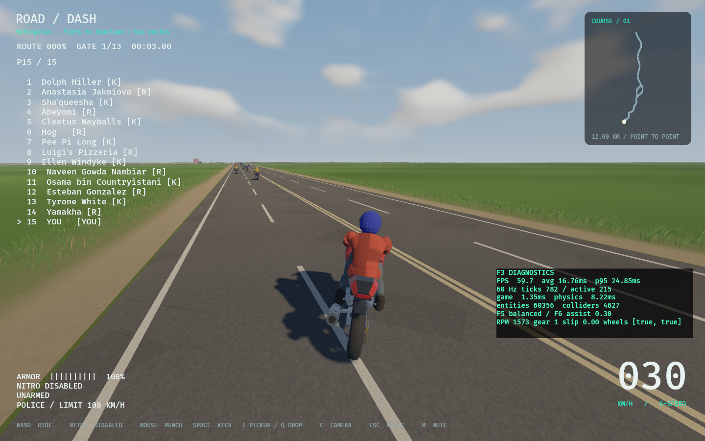
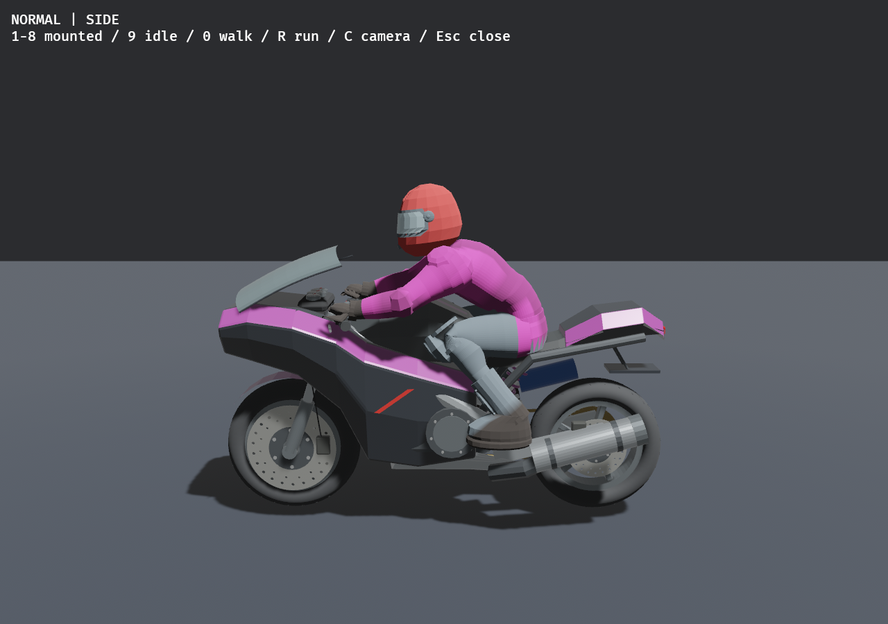
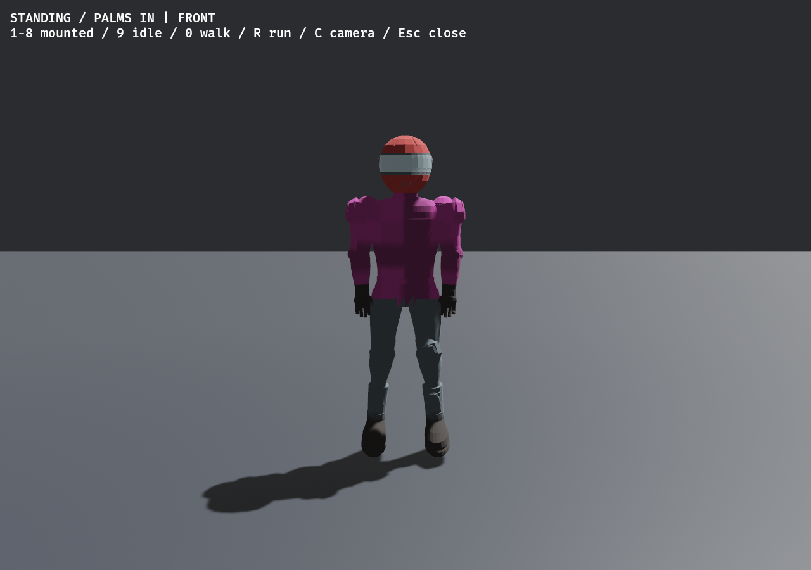

# Local main merge and next branch — 2026-11-09

User explicitly authorized merging the completed work with master, creating a
new branch, run instructions and biker-model images. This repository uses main;
there is no master branch. Target before merge: 2665e732; source: 2bbf731c on
codex/living-city-ai. Fresh branch: codex/city-next-pass.

Main's tree equals the earlier integration tree at 2a3770e1. Overlapping/squashed
history caused 18 conflicts. Resolved those paths using the verified source branch.
Compared all src/crates/tools/content/assets/Cargo.toml/Cargo.lock paths: merged
runtime matches the tested source exactly. Retained main's historical integration
evidence and UI artwork. No history rewrite, branch deletion or remote push.

## Included work

- Twelve polish passes: facade retention/hysteresis; same-time downed ride-over
  checks; smooth authored elevations; light/exposure and contact shadows; pavement
  detail; coordinated near/far facade materials; low-rise approach blending;
  atmospheric haze and sky; visual ankle bind alignment; confirmed-hit recoil.
- Landscape: original curved wind grass, soil/gravel verges, field variation,
  fence-clear cows and 16 existing farm props.
- Biker presentation: matte rust-red player jacket, charcoal trousers, dark boots
  and gloves, faceted cloth shading and corrected cloth partitions. Helmets stay;
  rivals retain color variants. Existing silhouette, vertices/skin influences and
  accepted physical rigs remain. This is not 16 newly sculpted cast meshes.
- AI: dossier names and loadouts, pace/lane patience/aggression, curve anticipation,
  reverse clearance and bounded obstacle-aware escapes while mounted or on foot.
- Street life: urban-only extra cars and pedestrians, cross-traffic wrap-velocity
  correction, larger walks, consistent lane paint and pedestrian crossings.
- City: gradual approach infill, covered cafés, grand road-facing park-3 City Hall,
  surrounding buildings/lawn and 120 trees; full-block park-5 fountain garden with
  connected paths, extra trees and grass. 58,985 grass tufts across 474 batches.
- Planning: map proposing removal of 136/273 non-frontage blocks, leaving 194
  blocks and 11,275 buildings. This reduction is NOT applied to the live map.

## Run

```sh
cd /home/imad/Documents/ChatGPT/RoadRash
cargo run --release --locked
```

Metropolis is the default. To inspect biker poses:

```sh
cargo run --release --locked -- --animation-lab-view
```

Lab keys: 1–8 riding/attacks, 9 standing, 0 walking, R running, C camera,
Escape closes. The lab uses a pink rider/bike color variant; gameplay player
clothing is rust-red. Images are existing native captures of the unchanged model:





## Verification and limits

Verification command receipts are in this folder. Prior source-identical native
coverage includes five serial runs, both recovery rigs/routes and NPC contacts.
Current performance gate remains open: previous bounded route survey p95 22.99ms,
target 16.7ms. Art/balance, broad deadlock coverage and hardware gates remain open.
No new task ID or acceptance closure; this is the explicitly authorized merge.

Merged-checkout verification: 458 tests passed (one existing ignored), strict
Clippy, fmt, locked debug/release builds, audit and roadmap sync passed. Fresh
release native Metropolis smoke passed farm/city crashes, reverse at -1.898m/s,
and both remounts at 0.0000m pickup error; frozen hashes unchanged and captures
nonblank. Prior complete native suites remain applicable to identical runtime
source/assets. Historical test logs have pre-existing trailing blank-line diff
warnings; source-format checks pass. Main merge and new branch are local only.
