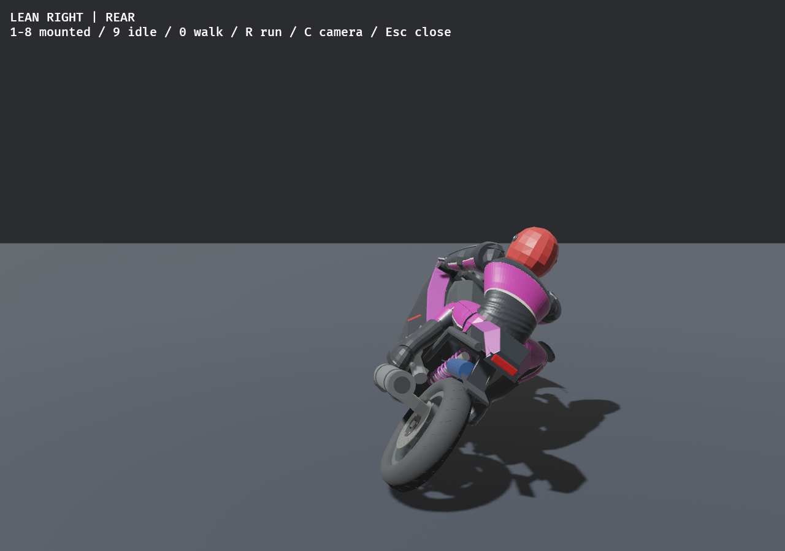
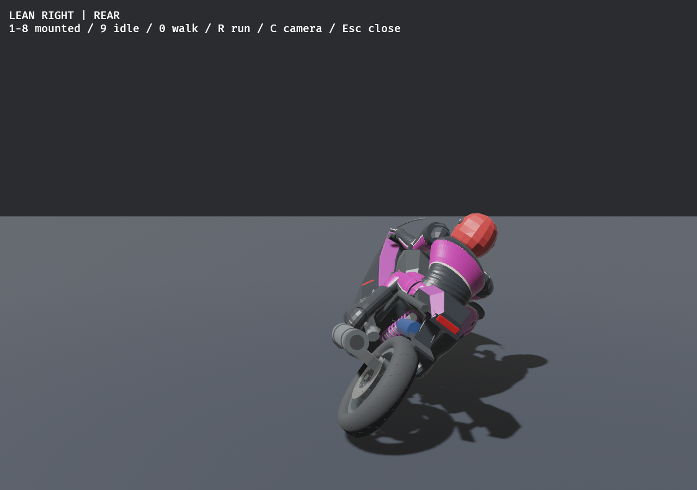
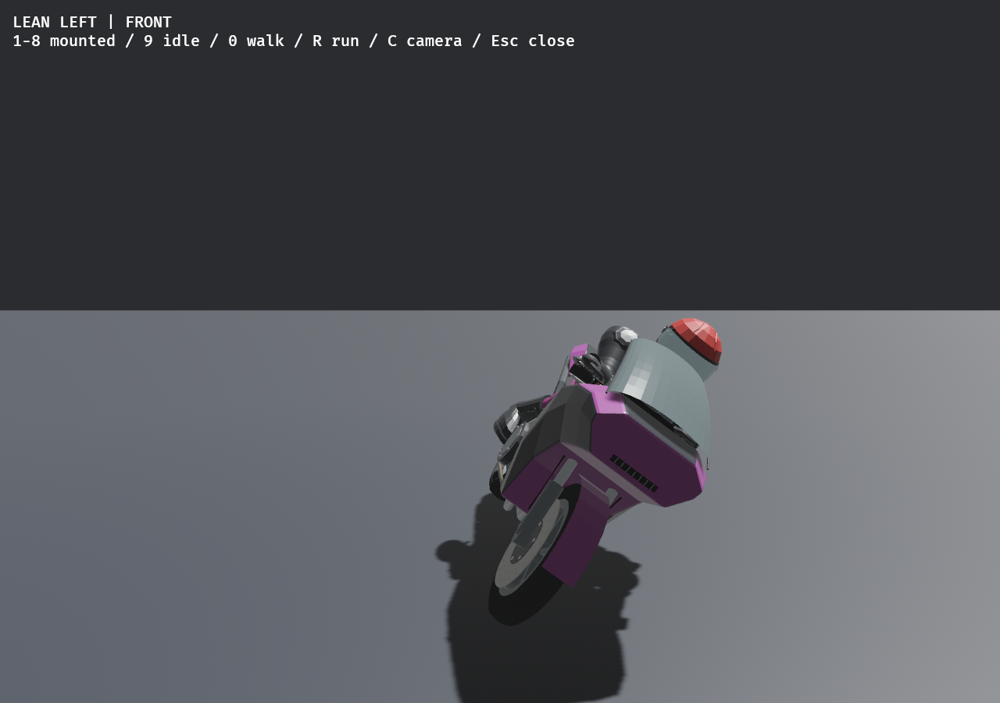

# Whole-body cornering follow-up — 2026-11-12

User approves the prior presentation and requests the rider's body, shoulders and
arms to shift together. FEEL-LEAN-01 / ADR173; no new task IDs or closures.

Implementation is limited to `src/animation.rs` and its pose regression test.
The seated pelvis banks up to0.12rad (6.9degrees), with a smaller bank and up to
0.08rad inward yaw when tucked. This carries the torso, shoulders and upper arms
through the existing hierarchy. Existing7.5cm inward displacement remains;
a6cm down/forward settle at full turn gives the outside hand sufficient reach.
Elbows adapt through existing two-link fitting while hands and feet retain their
grips/pegs. Steering smoothing, render interpolation, attack priority, player
handling and both physical rigs remain unchanged.

The new regression covers both directions, four turn amounts, normal/tucked/
accelerating poses, and peak punch/kick reactions. It measures shoulder/elbow
movement and retains contact and bone-length bounds. The initial larger roll
exceeded outside-hand reach; the final settled/tucked implementation passes.

Native hardware is now available: NVIDIA RTX3080, driver620.70.06. The original
report's mismatched-driver attempts are preserved as historical evidence.
Final validation and comparison captures are recorded below.

## Rendered comparison

Same final game meshes, camera, turn direction and fixed-clock review fixture:

| Previous weight shift | Whole-body follow-up |
| --- | --- |
|  |  |
|  |  |

The native animation review completed all13modes and three camera views (its
historical console label still says eleven). Reviewed front/rear captures show
coordinated torso/shoulder/arm movement; both hands remain at the bars.
This is a bounded visual review, not user acceptance or a performance benchmark.

## Verification

- Format, strict all-target Clippy, locked debug and release builds: pass.
- Full locked workspace suite:712pass,2pre-existing failures,2ignored.
  The unchanged failures are high-speed biomechanical anchor error and static
  Metropolis collider trajectory divergence. New pose/impact/grip/peg/chain-length
  checks and15model checks pass; no old physical thresholds were loosened.
- Native debug animation review: exit0; before/after captures above.
- Paired headless lab:18/18finite baseline/biomechanical cases; known high-speed
  anchor-error gate remains open.
- Asset/source declaration audit, README/progress synchronization and five
  roadmap tests: pass. No new assets, dependency changes or external research.

Release executable has been rebuilt: `./play-bevy20.sh` now runs this update.
The native checks below use the final-source debug executable and temporary
save/settings paths. Concurrent builds/tests make their wall times unsuitable
for performance comparison. Player subjective turn/arm feel and broad hardware
acceptance stay open under FEEL-LEAN-01; no requirements are marked complete.

Changes remain uncommitted on `codex/menu-rider-combat-polish`; no push or merge.

All four final-source native race/recovery checks pass: Metropolis and Hills,
each with current anatomy and the eleven-body baseline. Each initializes audio,
verifies the rival roster and completes two physical remounts with zero pickup
error. Hills reports zero exceptional rescues in both rigs. Receipts:
[Metropolis current](body-metro-current.txt), [Metropolis baseline](body-metro-baseline.txt),
[Hills current](body-hills-current.txt), [Hills baseline](body-hills-baseline.txt).

Next: user review of the stronger torso/arm shift in a normal race. No next major
roadmap part started.
