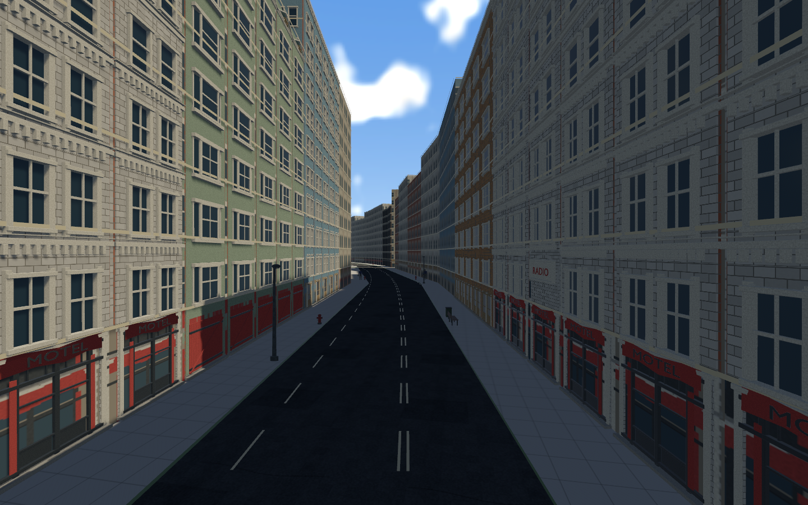
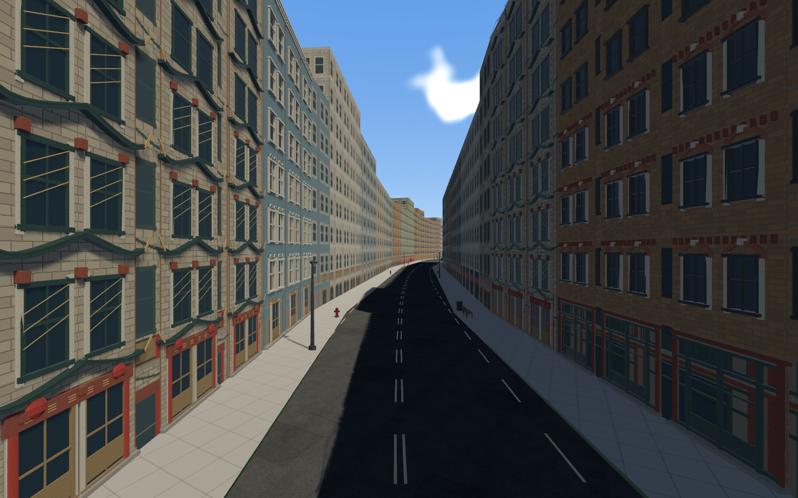
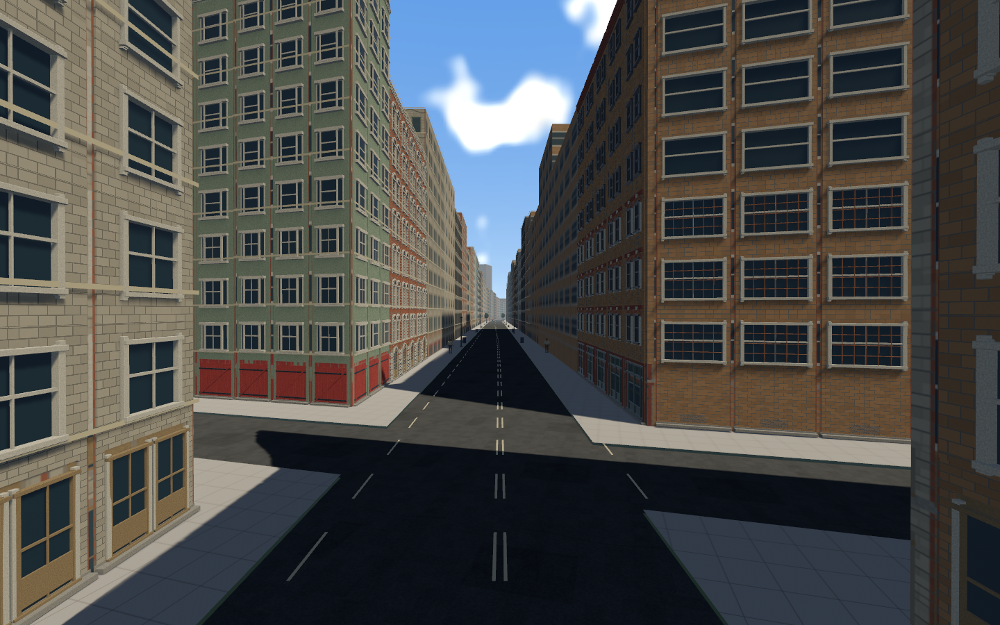

# Earlier detailed3D facade models on Metropolis — AUTHORED-01

2026-11-07, `codex/metropolis-authored-facades`, based on0d7ca0b.
The user clarified that the new city should reuse the earlier authored3D facade
models. It previously used only their albedo atlas on flat wall volumes. This
change actually draws the existing original GLB meshes and shared materials.

## Implementation and source identity

Twelve already mapped style families reuse their existing storey-kit GLBs:
BUSS1, BUSS4, CHINA12, CLSTGA11, OFFC1, OFFC2, OFFC10, RUNDWN11, VICT11, VICT12,
WHSE11 and WRHS1. Each polygon edge gets fitted bays, a ground-floor storefront,
repeated upper floors and a crown at its original building height. No rectangular
building is forced around a diagonal/triangular lot; no source model is stretched
to an entire tower. The existing height/width grammar fits individual bays/storeys.
Relief depth is capped at0.22m plus0.025m offset to respect the widened sidewalk.

Actual authored LOD1 primitives supply street-level rows; authored LOD2 supplies
upper rows above10m and crowns. These are one fixed composition per face, not
camera-driven file swaps. Full Gltf/Mesh/StandardMaterial handles stay resident
from loading onward. Hidden prototype instances prepare shared materials and
normal-map tangents before the course leaves Loading. Runtime detail uses those
same mesh/material handles directly, without repeated SceneRoot loading.

Source BUSS4 includes a unique RADIO sign. Keep it once per frontage at the first
upper central bay; use the earlier CLSTGA11 white-brick window module for its other
upper bays/floors. The Metropolis coarse upper tile now uses that same neutral
source, with source_design and SHA in assets/metropolis/PROVENANCE.json. No source
GLB/material or canonical global atlas was modified. Existing kit/atlas verification
passes;128 designs/384 GLBs/34 shared textures remain intact. This integrates the
currently mapped twelve-family subset; **it does not claim every earlier facade
is already used in Metropolis**. PALETTE-01 tracks curated district/catalog expansion.

## Residency, budgets and physical preservation

A64m spatial index selects nearby facing polygon edges within175m, with25m retention
and20m priority hysteresis. At most4 new faces enter per100ms. Groups fade over0.45s;
retiring groups keep their budget until removed. Maximum28 selected faces plus8
retiring slots,6,000 primitive instances and1,500,000 actual source triangles.
Materials/meshes are shared; no per-bay material cloning or per-frame file requests.

Opacity is encoded through existing PBR dithered VisibilityRange, synchronized
after final transform propagation and before visibility checks. New groups start
hidden with already prepared handles. The full original opaque building bodies,
roofs, collision and distant source-matched identity remain present underneath.
Detail is additive; it cannot turn a building into an empty roof shell. Over-budget
and distant faces retain proxies. This is bounded nearby3D detail, not nineteen
thousand fully detailed buildings resident simultaneously.

Entire Metropolis content manifest, all19,068 footprints/heights, both routes,
sidewalks,730 furniture owners and independent collision are unchanged. No input,
handling, crash, ragdoll, save, audio or recovery physics changes. No dependency
migration or new downloaded/proprietary media. ADR071 records alternatives/tradeoffs.

## Native verification

The actual running game is captured below. Survey dwell is extended so views show
completed fades rather than the first frames after teleporting the camera.

[Native draw audit](metro-authored-facades.json) checks every queried detail Mesh3d
handle against actual loaded original GLB primitive handles, sums real index
counts, rejects decorative colliders and enforces the mesh/triangle caps. The
recorded view has3,208 source-mesh instances /1,396,259 triangles; peaks stay within
6,000 /1,500,000. Resident base chunks remain2,993. This is evidence of instantiated
source geometry, not just a catalog allocation count. Street and aerial views are
surveyed; three native images are archived here.

[Performance](metro-performance.json): bounded1440×900 native RTX3080/Vulkan dev
sample, average18.46ms / p9519.81ms. **16.7ms target remains unmet.** The longer survey
has a different workload from prior measurements; no A/B improvement or production
frame-rate claim. Full-course/multiple-crash/streaming/platform profiling stays open.

West/east native smoke receipts cover authored15-racer grid restart, active audio,
farm/city crashes, get-up/run/mount and results presentation. The results state is
injected after recovery; this is not a complete manually driven physical finish.
Ordered branch gates and accepted physical systems remain in the regression suite.

## Tests and remaining work

See checks.txt and command receipts. Two added tests cover all12 families on6/32/
110m buildings: positive finite fitting, complete height, no bay overrun, bounded
relief, once-only special signage, diagonal normals and nearest-segment distances.
Existing independent kit/atlas tools verify source geometry/material hashes.
Content preservation receipt and unchanged-file Git comparison protect the map,
lockfile and original assets. Audit verifies declarations/hashes, not independent
rights clearance. No new external repository/code/assets were adopted; installed
Bevy0.17.3 Gltf/visibility APIs were studied (third_party/REPOSITORIES.md).

New files: src/world_gen/metropolis/facades.rs and this evidence directory.
Modified: runtime loading/render scheduling, metropolis spawn/survey, derivative
facade bake/atlas/provenance and engineering/roadmap/testing records. No files removed.
New tasks: AUTHORED-01 (scoped integration, Part04; completed tasks move to Part00)
and PALETTE-01 (future district/catalog expansion, Part04). Broader MESH/MAT/world
art gates remain open, including bespoke infill, source draft fidelity, sidewalk
projection/corner/graded-foundation art review, long transitions and production
performance. Existing building collision is preserved rather than refitted to
individual cosmetic window/ledge projections. No interiors added.

Run `cargo run --release`; review with `cargo run -- --metro-survey`.
This branch is local; no push or merge is implied.
