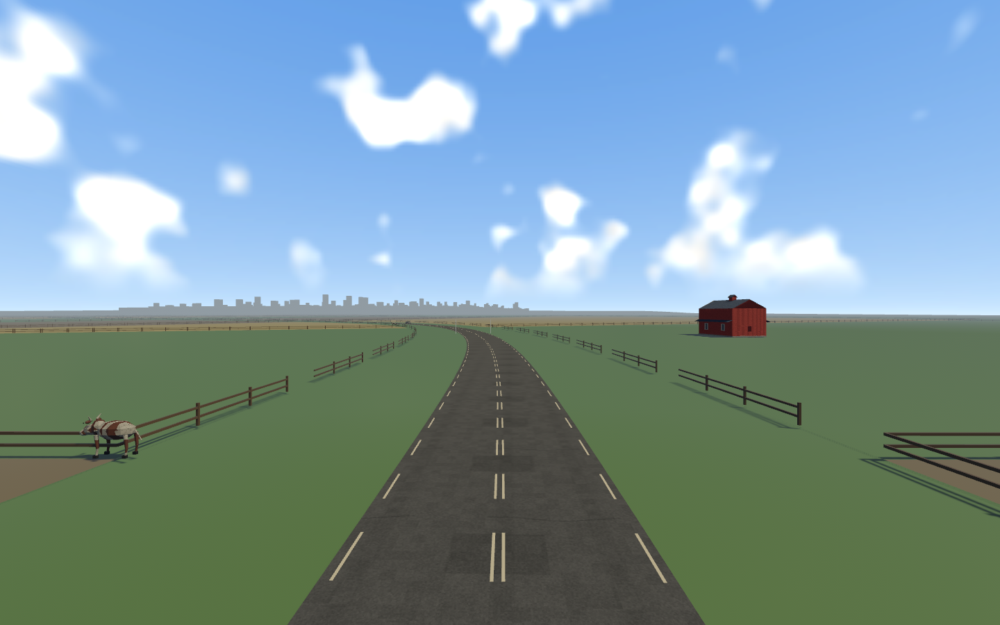
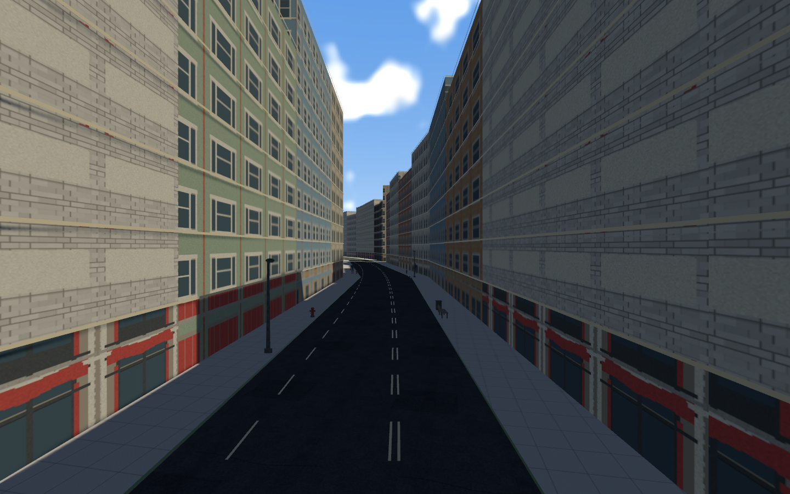
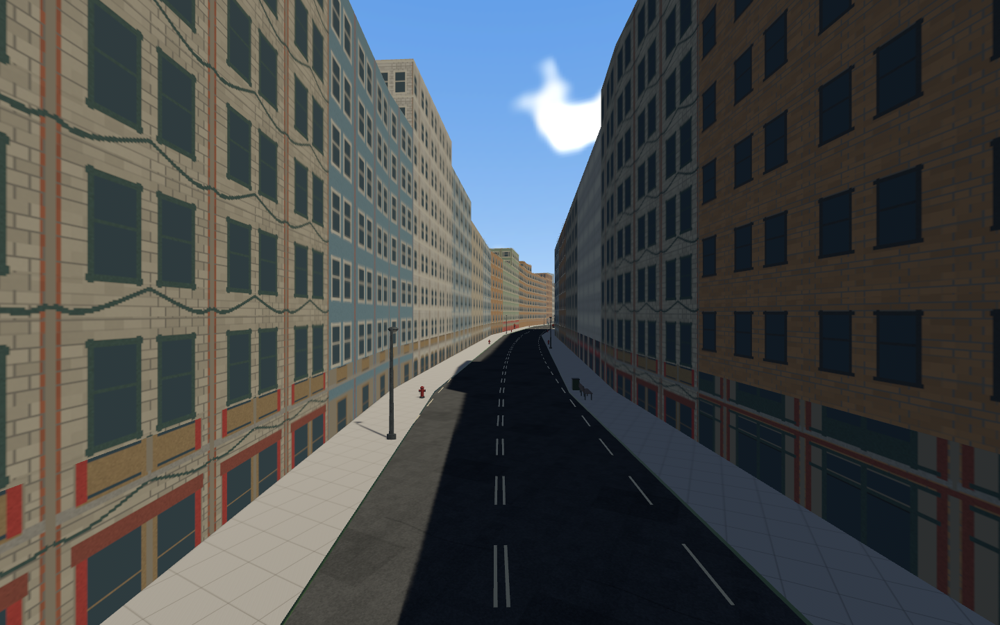
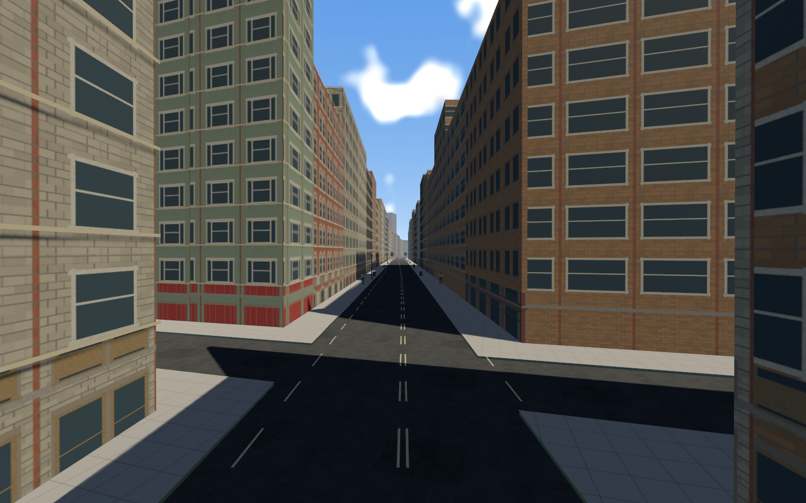

# Wider sidewalks and populated curbs — SIDEWALK-01

2026-11-07; branch `codex/metropolis-sidewalks`, based on787bc19. This implements
the user's sidewalk expansion/population request, without starting another part.

Typical city sidewalks increase from2.4m to3.4m by moving each curb1m into the
existing road reservation. Primary carriageways become10m wide; typical secondary
streets6m. Building fronts stay in place. The country road below the city boundary
stays unchanged, including approach width metadata. Road-width metadata/edge paint and cross-traffic lane centres
match the narrower city carriageways. Curbs retain the existing rideable0.14m step.

[Authoring report](authoring.json) and [preservation comparison](preservation.json):
all19,068 building records, both complete route paths, fields, streets, junctions,
bounds, source-layout hash, spawns and gates are byte-equivalent as parsed records
to the preceding committed manifest. Only pavement allocation, furniture and city
city half-width metadata change; farm approach widths retain their previous values. All street-reservation area is retained; no sidewalk
penetrates a building or carriageway. Fixed-precision clipping normalizes tiny
buffer slivers before constrained triangulation.

## Population and paving

730 original-model static props:205 lamps,70 benches,123 bins,114 flower planters,
57 hydrants,51 news-box groups,60 parking meters and50 broadleaf trees. This replaces
the earlier regular tree/lamp pass; no doubled population from retaining both.
Existing pedestrians remain. Curb groups alternate by side and station instead of
mirrored rows. All placements use existing project-original prop models with no
new downloaded media or libraries. Tree crowns may overhang; conservative ground
well footprints/trunks remain outside the clear walk.

Each complete buffered physical footprint must lie on pavement, remain at least
20m from priority junctions and1m from other furniture, and have a checked2m-wide
building-side paved strip. Placement searches across the actual polygonal curb
rather than assuming the simplified street edge equals the race tangent. If space
fails, omit the object. This is per-placement clearance, not an accessible-city or
building-code certificate. Corner geometry naturally varies in width.

Recovery navigation indexes each new physical footprint, so auto-recovery can route around furniture. Models fit their authored bounds; independent fixed cuboids/trunks remain physical.
No dynamic lights, runtime placement loop, new body forces or ragdoll tuning are
added. Original generated concrete texture uses1m slab joints, restrained grain and
high roughness. It repeats in world UVs, so adjacent pavement chunks line up.

## Native evidence

The native survey visits farms, both branches, downtown, aerial, north and finish,
and verifies persistent mesh counts while moving the camera. Four captures are
archived here; remaining original survey captures are in the local screenshots
output. The new census reports730 furniture owners and2,993 base chunks; original
buildings remain present. Screens are from the running game, not generated concepts.

The native crash/recovery fixtures check farm/city crashes, get-up/run/mount and
results presentation; restart checks all fifteen authored grid positions. Audio
is initialized. These fixtures inject the results state after recovery, not a
fully driven finish. Ordered physical gates on both routes remain covered by
automated tests. See west/east recovery JSON/text receipts.

## Tests, decisions and limits

- `cargo fmt --all --check`, strict locked workspace Clippy, locked workspace
  tests and locked build: see command outputs alongside this report.
- Workspace tests281 passed,1 existing ignored,0 failed. A navigation regression checks every furniture footprint is blocked while primary corridors stay open. New schema regression
  rejects unknown furniture roles, duplicate identities and nonfinite dimensions.
- Two Shapely authoring fixtures verify width/reservation/farm preservation,
  seed repeatability, all eight roles, whole footprints, walking clearance and
  junction setbacks. They use the existing authoring venv, not a game dependency.
- `tools/audit.py`, five roadmap tests, synchronized progress and whitespace checks
  remain required. Audit is declarations/hashes, not independent rights clearance.
- [Performance](metro-performance.json): bounded native dev sample1440×900 on
  RTX3080/Vulkan, average17.91ms and p9518.36ms; **16.7ms target remains unmet**.
  No measured improvement claim or full-course/release benchmark; sample differs
  from earlier runs. Entity count20,844 includes reused GLB hierarchies; further
  instancing/collision/streaming profiling remains a production gate.

ADR070 records the pavement reallocation, checked curb bands, shared material,
original asset reuse and independent collision. No new repository investigation,
dependency, external source copy, asset download or save migration. Existing art
source files/facade atlas and accepted velocity muscles remain untouched.

Files: new `tools/metropolis_streetscape.py`, authoring tests and runtime
`streetscape.rs`; updated bake, manifest/content validation, half-width adapter,
geometry/pedestrian/traffic placement, roadmap/provenance/testing/decision records.
No files removed. SIDEWALK-01 is the only added task; broader WORLDART/ENV/performance
requirements stay open. Legacy-prop comparison can omit new model furniture.
Existing recovery navigation is not a new general pedestrian AI. Final art/user
approval, long traffic playtests and platform certification remain open.

Run from the repository: `cargo run --release`. To review: `cargo run -- --metro-survey`.
No push/merge is implied by this local branch.
