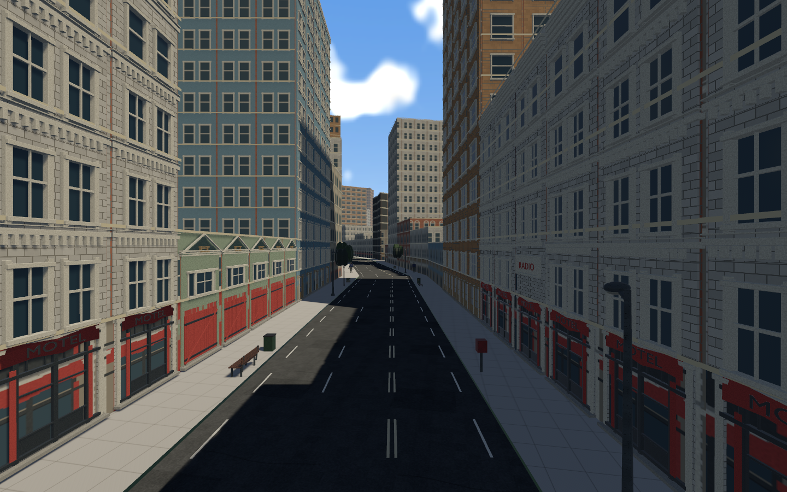
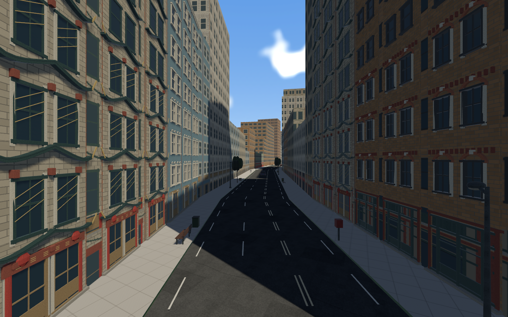
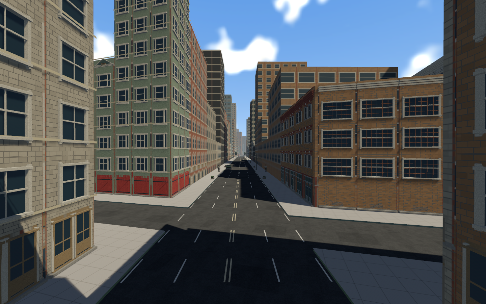
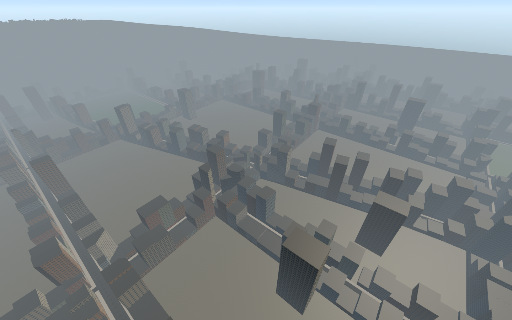
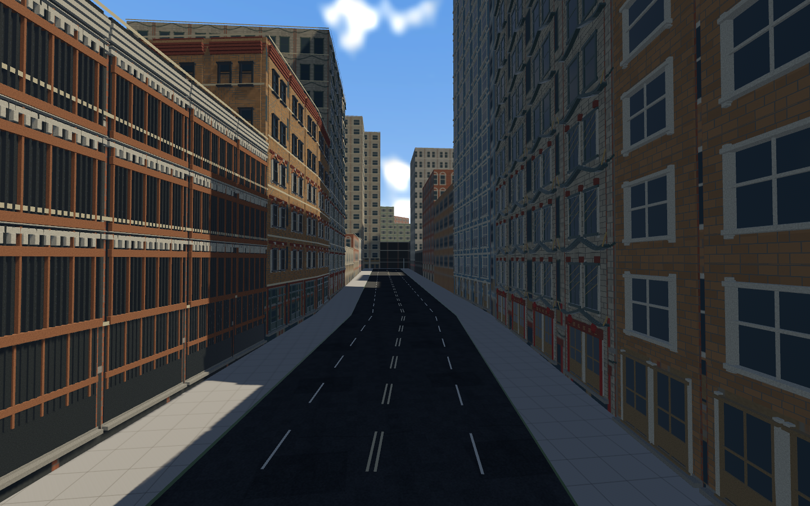

# Main-street activity, lane variety and height contrast

STREET-LIFE-01 · 2026-11-07 · codex/metropolis-street-life · parent8f83245.

This implements the user's request for busier main streets,2/3/4 lanes and visible
height differences. It retains both exact race paths, split/rejoin, checkpoints,
building/lot IDs and footprints, pavement/sidewalk polygons and earlier3D models.
Height changes update physical/rendered roofs together. Accepted rider/ragdoll,
controls, audio, saves and physics backend parameters remain unchanged.

## Traffic and lane layouts

Main fleet increases24→96:48 outgoing,48 oncoming, using existing hatchback/sedan/
sports/taxi/van/pickup models. Positions are initialized on actual streets before
racing, so the preview/menu does not stack traffic at world origin. American
right-hand centres apply to Metropolis. Cars follow slower/stopped traffic,
yield/honk for downed racers, retain assigned branch corridors and restore seeded
progress after restart. Existing30 cross cars yield before entering main-road flow.

Editable settings: [street-life config](../../../content/world/metropolis_street_life.json).
City marked sections use:

| Layout | Direction split | Lane width | Street allocation |
| --- | --- | --- | --- |
|2 lanes |1 each way |3.0m |6m travel lanes plus curb parking edges |
|3 lanes |2+1 or1+2 |2.8m |8.4m travel lanes, extra direction varies by section |
|4 lanes |2 each way |2.4m |9.6m travel lanes |

These are arcade lane dimensions **inside the existing10m city carriageway**.
Asphalt/curbs/sidewalks were not widened or building parcels cut. Country pavement
is retained. Double-yellow lines separate opposing traffic; dashed white lines
separate same-direction lanes. Lane centres/dividers interpolate through100m
section tapers. Normal rival roaming uses the marked travel area rather than
parking edges; pursuit/contact/steering response parameters remain intact.

Traffic and paint follow the street reservation's actual centre. The earlier
race polyline has small deviations from its simplified pavement centre. Simplify
original farm/branch/common edges independently, preserving the exact race path
and ensuring both routes have identical street centres after the rejoin. Avoid
expensive full-route nearest-point scans when car progress is already known.

## Population and skyline

995 curb-furniture owners replace730, adding bus-stop signs, callboxes, mailboxes,
recycling and utility boxes alongside benches, lamps, bins, planters and sparse
trees. Existing original prop models/materials are reused; no imported media or
new dependencies. Whole-footprint sidewalk support,2m building-side walking strips,
separation and20m priority-junction setbacks remain checked.

65 parked cars sit fully on asphalt in two-lane parking sections, at least25m from
junctions and110m from section boundaries. They are solid and indexed in recovery
navigation. Moving cars follow/yield using the existing contact policy; cars are
not new arbitrary launch impulses.

Per-building seeded height bands replace the old block-level±1-floor variation:
low2–4-floor shops, mid-rise, taller frontage accents and preserved original
interior towers. Downtown score raises the taller bands' upper ranges. Actual
buildings now span2–32 floors /6.4–102.4m. Repeated authored3D storeys and permanent
coarse envelopes use those same heights; collision roof height changes with them.
Every one of19,068 original footprints/styles/IDs remains. This changes the earlier
planning height proposal by explicit latest user instruction, not its street plan.

## Native views and evidence

Release-build captures from the running game:

[Native census](metro-street-life.json) queries96 main cars, both flows,65 parked
cars,995 furniture owners,2/3/4 lane profiles and the actual building floor histogram.
The existing original-GLB draw/triangle/cosmetic-collider audit still passes.
[Lane-clearance audit](lane-clearance.json):3,480 complete1.9×3.9m moving-car body
rectangles sampled through sections/tapers against actual paved polygons, with5cm
numerical/grade tolerance; zero failures. Same receipt compares preserved geometry
and race records against8f83245. This is sampled coverage, not proof of every time
step or a completed transport/city simulation.

## Performance and simulation interest

The first denser development sample had p9532.58ms. All cars retain logical
motion/following/rendering across the course, while main-car collision is admitted
by nearest-racer proximity:170m enter /220m retain. All riders' recovery positions
participate. This has no dependency on camera direction or visual LOD. A car keeps
its owner/shape and enters collision well before a high-speed encounter; solid
terrain/building/furniture collision is never culled by this policy. Unobserved
car/pedestrian impacts outside all racer radii are not simulated. Future detached
spectator/network observers must extend the interest set. Cross traffic retains
its existing physical simulation.

Release Vulkan/RTX3080 at1440×900: average19.91ms / p9524.93ms in the bounded survey.
**The16.7ms target is unmet.** This is not a full-course hardware certificate or a
formal A/B benchmark. Initial dev sample and release/faster-coordinate samples
have different builds/workloads; no quantified optimization gain is claimed.
More visible activity has a cost; profiling/instancing/streaming and physical
interest soak remain open under existing performance gates. No production60FPS
claim. See metro-performance.json and release build/native receipts.

## Verification, decisions and remaining work

- 288 workspace Rust tests passed;1 existing ignored,0 failures. Core tests cover
  American centres, continuous tapers, body margin, queue/braking and collision
  interest hysteresis; strict content rejects gaps/counts/width errors. Track
  tests cover shared street centres and actual lane placement. Legacy regression
  suite, accepted body/model/recovery tests and ordered branch gates remain intact.
- Three authoring fixtures cover seeded skyline/interior tower preservation,
  parked whole-body support/junction distance and race/street separation. Two
  existing furniture fixtures pass with all13 roles and walking-space checks.
- Formatting, strict locked workspace Clippy, dev/release builds, provenance audit,
  five roadmap tests, canonical progress and whitespace checks pass; command
  receipts accompany this report. Audit is declarations/hashes, not legal signoff.
- Native release west/east fixtures verify all15 grid restart positions, active
  audio, farm/city crash→get-up/run/mount and results presentation. Results are
  injected after recovery, not a complete manually driven finish.

ADR072 records width/allocation, source geometry, fleet interest and height choices.
No new repositories investigated or external code adopted: existing Bevy/Rapier/
Shapely APIs and project-original media are reused. New files are the street-life
config, rr_core street rules, authoring helper/tests/audit and this evidence;
modified files are content validation/bake, map, traffic/AI adapters, road paint,
parked placement/navigation, survey and project tracking/provenance. No files removed.
STREET-LIFE-01 is the only new task. Full traffic/zipper/intersection playtests,
art/palette approval and platform/performance acceptance remain open; later major
parts are not started automatically.

Run `cargo run --release`. Edit the config, then rebuild content with the existing
Shapely/Pillow authoring environment using `python tools/bake_metropolis.py`.
Review with `cargo run --release -- --metro-survey`. Local branch only; no push/merge
is implied by this report.
