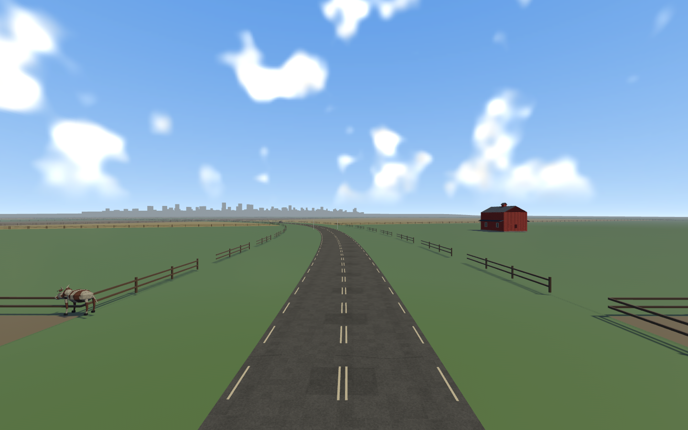
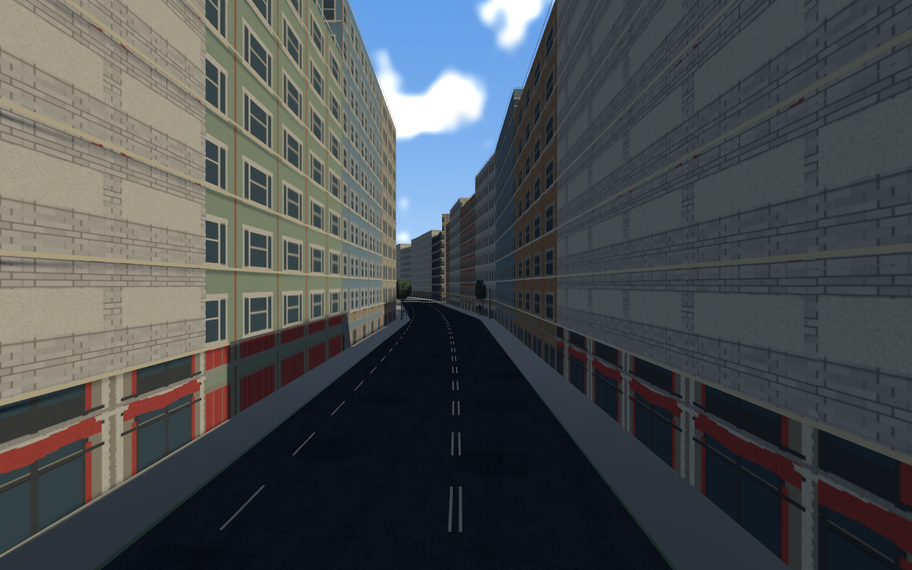
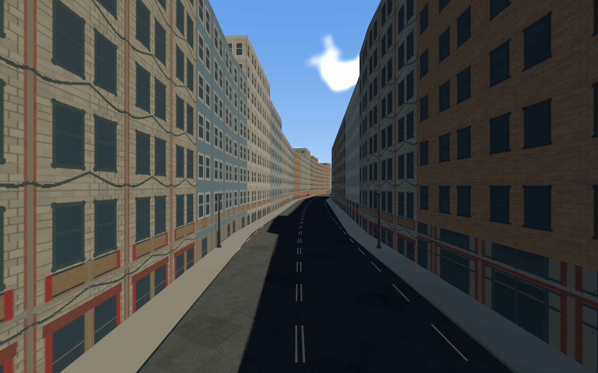
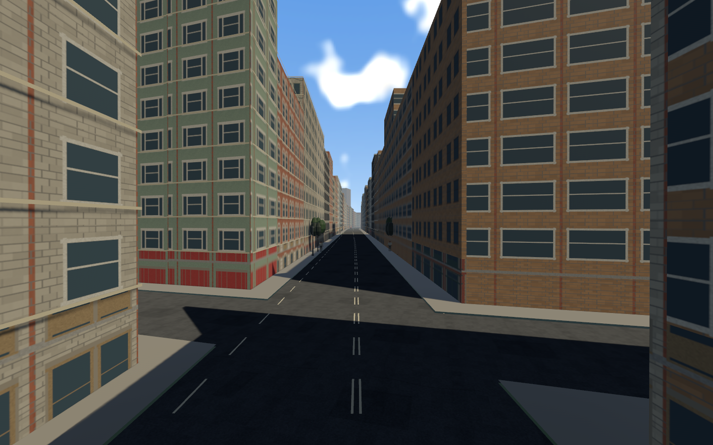
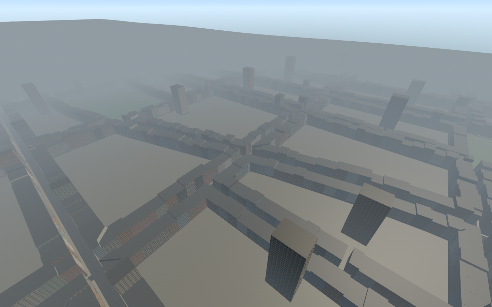
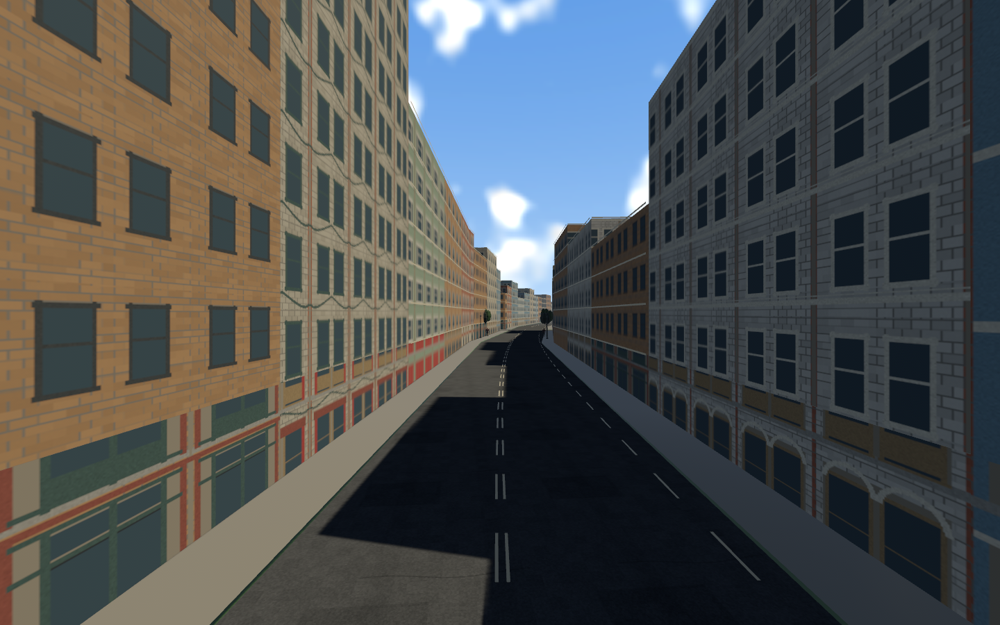
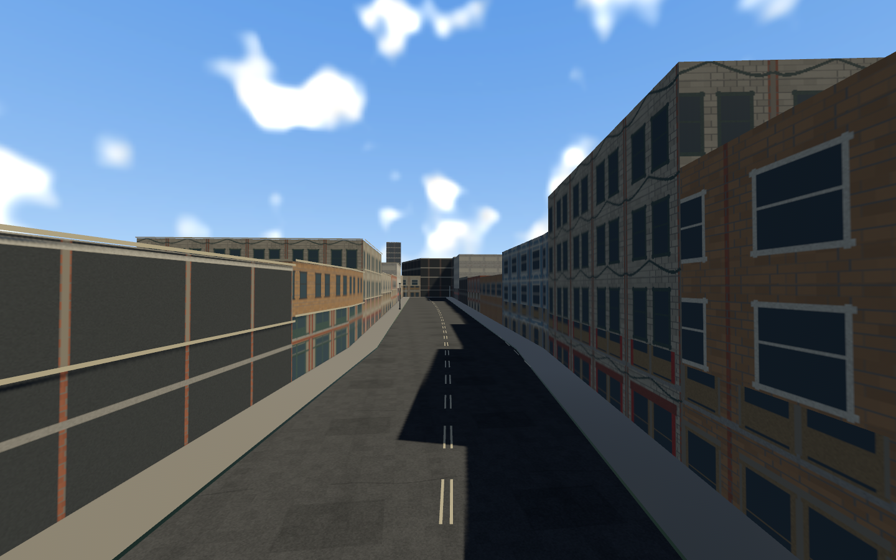

# Approved farm-to-city Metropolis — 2026-11-07

The approved race-first layout is implemented as a separate playable map and is
now the default. Farms lead into a long city, one early split rejoins, and the
race finishes in the city. Legacy Valley and City Run content remains selectable.
This is runtime construction of the approved plan, not final art acceptance.

```sh
cargo run --release
ROADDASH_TRACK=valley cargo run --release # preserved legacy map
ROADDASH_TRACK=city cargo run --release   # preserved 5.3 km map
cargo run -- --inspect-metropolis
cargo run -- --metro-survey
```

## Source and construction

Source: `docs/planning/farms-long-city/LAYOUT.json`, SHA256
`bad1cc469404a171315a32906a68275905e4711c2e315430d79980414e357d96`.
`tools/bake_metropolis.py` compiles that source using the already installed
Shapely2.1.2/GEOS3.13.1 and Pillow12, without a new runtime dependency.
[Bake hash evidence](bake-determinism.json) proves identical regeneration of the
manifest, facade tile data and provenance. Polygon normalization uses micrometre
precision with an area-change bound; constrained roof triangulation checks
coverage. Self-intersecting farm sketch fields are repaired before triangulation.
The historical layout-only tool's git-diff assertion predates authorization for
this runtime work and is not a current runtime acceptance check.

- All19,068 source building IDs, heights, floors and detail tiers are baked.
- Full polygonal closed walls/roofs/foundations remain resident; close cornices
  are additive. No transition swaps a building for an empty roof shell.
-35,008 paved road/sidewalk/court patches follow the shared analytical terrain;
 42 fields, original barn drafts and physical fences frame the farm approach.
- Street-derived triangular/trapezoidal footprints stay straight sided. Downtown
  height hierarchy and scattered interior towers come from the approved plan.
- Shared authored facade bands are sampled through a repeatable, guttered mip
  atlas. This reuses original RoadDash model-derived artwork, not Road Rash game
  textures. Exact source bands/hashes: `assets/metropolis/PROVENANCE.json`.
- Geometry batching produces2,991 mesh/collider chunks,2,696,852 render triangles
  and2,438,970 collision triangles. [Native census](metro-survey.json).
  Consolidation reduced11,020 batches to2,991 without removing envelope geometry.
- Independent static triangle collision is never removed by camera/detail state.
  Original vehicle, human/cow, tree and furniture assets are reused;30 crossing
  cars travel on the authored cross streets and yield at the avenue.

## Gameplay and architecture

Both complete physical alternatives use shared0–12000 logical progress. They
have different actual lengths; equal normalized progress means race position,
not identical physical metres on both branches. Players choose by proximity near
the fork with hysteresis; AI retains assigned branches. Branch-local sampling,
projection, curvature, camera, targets, traffic, minimap, physical gates,
recovery and deferred crash return all use that choice. Both branches share
physical checkpoints before/after the split. Large projection jumps and crossing
the other branch cannot award gates. Player remains last in the fifteen-rider
start grid with20m row spacing.

Building polygons feed bounded recovery navigation with service access. Native
recovery still uses the existing get-up/run/mount lifecycle. The velocity-muscle
ragdoll, controls, contact force rules, audio, progression and save format are
unchanged. New systems use the existing60Hz simulation. No physics/dependency
migration or proprietary source/media import occurred. ADR069 documents the
separate-content approach and material decisions.

## Native views

Farm start, both legal routes, downtown, skyline, north district and finish are
captured by the running Bevy game. The survey checks that the resident mesh count
stays constant while moving the camera. It does not prove every pixel/LOD/art
criterion or certify subjective visual approval.









## Verification and limits

Automated suite:279 passed,1 existing ignored,0 failed. Formatting, strict workspace Clippy, locked build, provenance audit and five roadmap tests pass.

See `checks.txt`, native logs/receipts, audit and deterministic bake alongside this
file. Automated coverage includes content rejection, branch selection/locking,
projection, ordered physical gates on both routes, opposite-branch/shortcut
rejection, exact-boundary navigation and the legacy gameplay/regression suite.
Native fixtures passed on west/east Metropolis routes and preserved Valley.
Both Metropolis fixtures verified all fifteen start-grid positions on restart.
The native smoke forces crashes, observes recovery and then injects the results
fixture; it is not a complete manually driven race or physical finish-gate test.
Physical gate order is tested separately. Native restart checks all fifteen grid
positions and cleared result/speed state. Audio sinks are active in smoke tests.

[Performance receipt](metro-performance.json): debug/dev build,1440×900,
NVIDIA RTX3080/Vulkan; average17.85ms, p9520.38ms. The16.7ms p95 target **is not
met**. This is a bounded wall-clock sample with fifteen racers in the farm section
and the camera at the urban finish, not GPU timing or full-course stress. Batch
counts alone do not establish frame rate. No release/hardware certification.

Remaining gates: full-course player branch/merge/traffic playtests, longer streaming
and simultaneous-crash profiling, final art approval/bespoke facade depth and
street detailing, lot/support validation across every slope and platform checks.
Courts are currently paved; interiors are not implemented. The exact approved
finish is retained; no extra post-finish runout was carved through existing lots.
Distant fog and repeated facade families remain visible in these honest captures.
Broader WORLD-EXTEND/ROUTE-SPLIT/art/performance tasks remain open.

## Files and research

New: offline bake, manifest, facade raw atlas/provenance/shader, rr_content schema,
rr_core route rules, track adapter, metropolis geometry/material/navigation/traffic/
survey modules. Modified: track/game/vehicle/recovery/offscreen crash/UI/runtime/
world/main/verification adapters, engineering/progress/decision/testing/license
records. No files removed, dependencies added, or legacy assets/quotas rewritten.
Legacy maps explicitly bypass branch filtering; a regression test prevents
Metropolis route IDs from hiding legacy AI/traffic targets.

Existing Bevy0.17.3 material APIs and Shapely2.1.2 triangulation were studied locally;
see `docs/third_party/REPOSITORIES.md`. No outside implementation code was copied.
New METRO-01 tracks scoped integration in Part04 (completed tasks move to Part00);
existing broad gates retain their original requirements.
