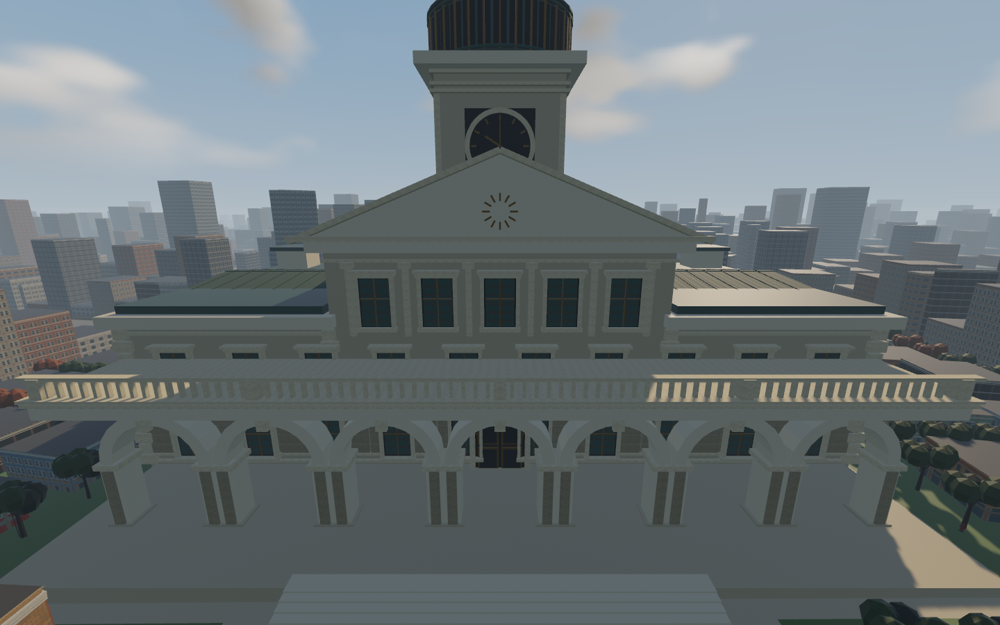
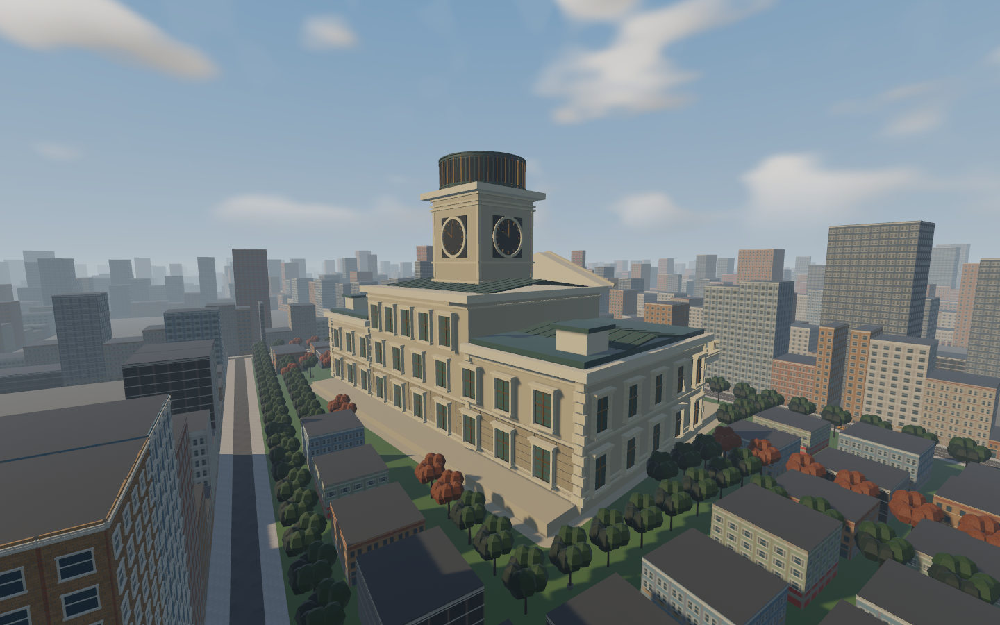
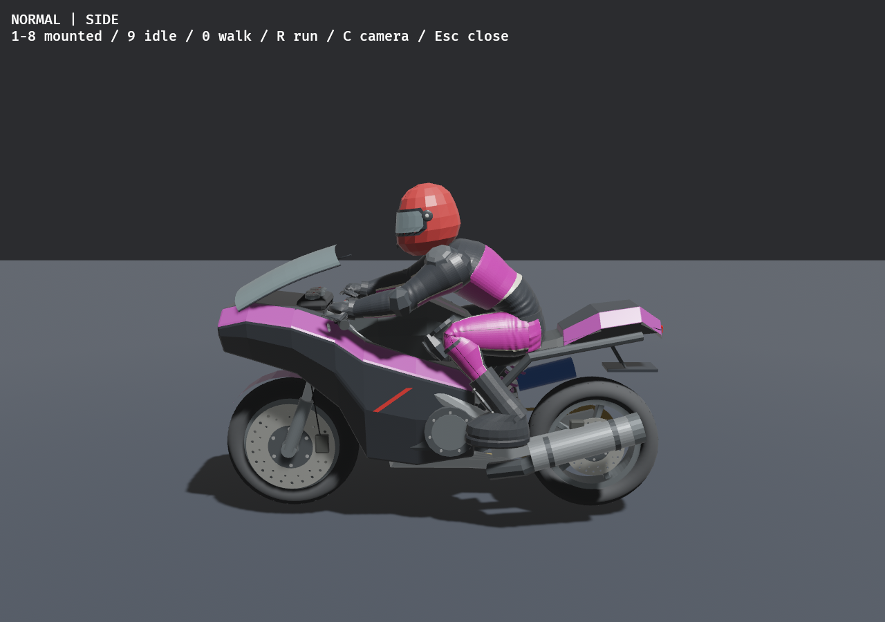
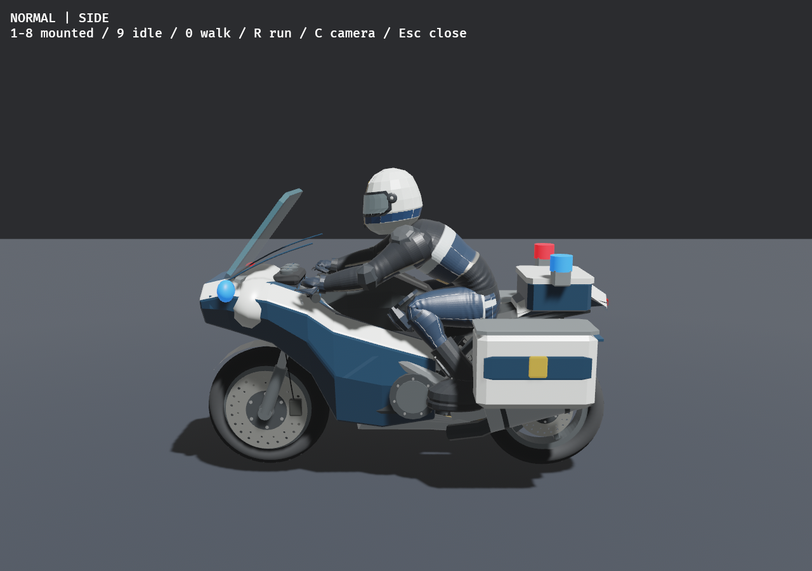
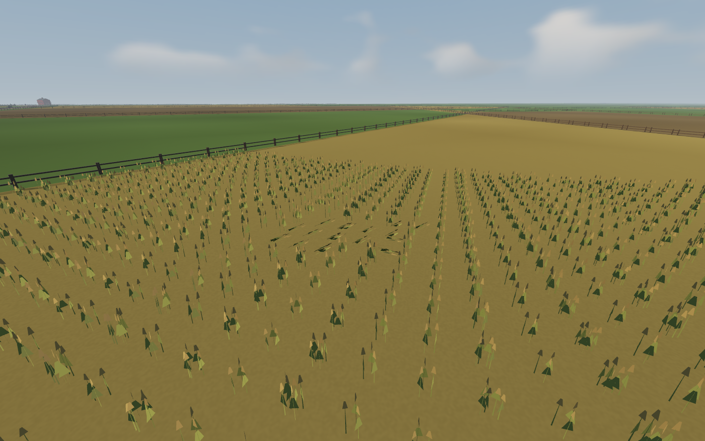

# Integrated fresh-agent follow-up — 2026-11-09

All ten requested implementations are integrated on **codex/city-next-pass**.
Each task received a fresh contextless GPT-6 Astra/medium agent in an isolated
worktree. Parent reviewed the source, inspected native art, fixed integration
fixtures and ran the combined acceptance suite. [Agent/commit record](COORDINATION.md).
Runtime source revision: **e3ae9a18**; [frozen binary/source receipt](source-revision.json).
Documentation commits follow that source revision. No remote push or new merge
into main; no next major development part started.

| Request | Implemented behavior and evidence | Principal files |
| --- | --- | --- |
| Town Hall | Original limestone articulation, framed windows, bronze doors, balustrades, four clocks and copper lantern/roof seams; five batches,19,764added triangles. Existing street-facing arches,31context buildings,120trees and collision retained. [Worker](../next-town-hall/README.md) | `src/world_gen/metropolis/hall_detail.rs`, `civic.rs` |
| Original biker outfit | Restored the pre-style original textured outfit, helmets and materials; ordinary roster skins/bikes remain unchanged by officer art. [Worker](../next-original-outfit/README.md) | `src/models.rs`, `src/models/tests.rs`; removed `src/models/style.rs` |
| Researched lighting | Coherent procedural sky with once-built cosine diffuse/GGX specular IBL; stronger directional fill, retained MSAA/sun/shadow policy. `ROADDASH_LIGHTING=legacy` comparison retained. [Research](../next-lighting/RESEARCH.md) | `src/sky.rs`, `src/sky/lighting.rs` |
| Race bounds/gates | Playable500..11500m,11km; existing grid shifted500m, finish500m earlier; complete12km physical map/both branches retained. Visible gates/dedicated colliders/HUD removed, internal route validation retained. [Worker](../next-race-bounds/README.md) | `crates/rr_core/src/race.rs`, `src/track*`, game/UI/recovery/verification |
| Entry lanes | Corrected asphalt beneath raised sidewalks/buildings;4→2taper before the narrow city envelope, consistent traffic/paint/road support and merge following. All19,108building records retained. [Worker](../next-city-lanes/README.md) | `tools/bake_metropolis.py`, streetscape/street-life authoring, `rr_core::streets`, `geometry.rs` |
| Queued AI passing | Reachable slow/current-speed passes, passing-side commitment, safe rejoin, rear/oncoming/occupied-gap checks,120m lane-drop bounds and curved static sweeps. Existing vehicle forces and escape/recovery retained. [Worker](../next-queue-passing/README.md) | `crates/rr_core/src/traffic_avoidance.rs`, `src/game.rs`, `src/vehicle_tests.rs` |
| Texture fidelity | Original limestone/copper/brass PBR maps, full mips, metre-scale UVs/tangents on civic detail. Nine128²maps,786,420pixel bytes; existing facade atlas unchanged. [Worker](../next-textures/README.md) | `src/world_gen/metropolis/hall_surface.rs`, `hall_detail.rs` |
| Persistent crops | Actual wheat in near-route grain parcels; swept bike/rider/wreck/limb contacts animate bends over0.32s, retain crash patches/trails through current race, freeze on pause and clear on retry. Sparse damage-buffer writes, no per-stalk entities/physics or mesh rebuilds. [Worker/method](../next-crops/README.md) | `rr_core/src/crops.rs`, `geometry/crops*`, `assets/shaders/crops.wgsl` |
| Elevation |25%more longitudinal relief,52→65m; analytic maximum grade3.00→3.75%, unchanged crossfall/C2smoothness. Guarded height-only bake preserves all planar geometry, IDs and repaired lanes. [Worker](../next-elevation/README.md) | elevation authoring/profile, approved `LAYOUT.json`, baked Metropolis manifest |
| Police art | Original navy/silver uniform and white helmet; custom patrol nose/screen, panniers, radio box and red/blue emissive lenses. Reserved officer identity cannot overlap16ordinary roster choices. Visual-only through walking/ragdoll/wreck/remount. [Worker](../next-police-art/README.md) | `src/models/patrol.rs`, `tools/bake_police_uniform.py`, officer texture, police/model adapters |

No city blocks were removed. Park3 remains Town Hall and park5 remains the detailed
park. Both legacy maps, controls, saves, audio, accepted physical rigs and recovery
remain integrated. The earlier city-width reduction remains a proposal.

Combined verification: **481tests passed, one existing ignored600-second turning
soak**. Formatting, strict workspace/all-target Clippy, locked debug and release
builds, declaration/provenance audit and progress synchronization pass. Exact
commands/results: [checks](checks.json), [tests](tests.txt), [audit](audit.txt).
The workspace packages were cleaned before rebuilding to eliminate cross-worktree
metadata reuse. No dependency migration or external media/code intake.

**23Metropolis Python tests and5roadmap tests pass.** The final elevated map's
[whole-car/paint audit](lane-audit.json) checks30,120car footprints and17,828paint
quads with zero failures, zero road/building overlap and only a1.56e-6m² numerical
road/sidewalk sliver. Actual sampled support interpolation remains below the
existing12mm threshold:11.921mm pavement,11.828mm fields. No tolerance was relaxed.

**12serial release native checks pass**, plus all**18paired ragdoll lab cases**
remain finite. [Run receipts](native-checks.json), [lab](ragdoll-lab.json): Town
Hall views, standard route survey, Metropolis recovery on both routes/rigs,
pedestrian solids, police behavior on both rigs, original-outfit poses, legacy
City/Valley recovery, and same-binary crop drawing off/on. Metropolis reverse is
-1.922m/s; both remounts on each route have0.0000m pickup error. Police verifies
actual player ragdoll/officer walking, pursuit/search/escape, arrest without race
payout, retained15racers+1officer and retry. Native scripts use isolated saves,
record frozen input hashes and reject blank captures.

Parent visually inspected Hall front/side/roof/window detail, the two-lane entry,
original outfit, refined officer gallery, gameplay on-foot arrest, and crop
intact/trail/reset views. Crop trail and later paused persistent PNGs have identical
hashes; reset visibly restores upright wheat. This is a scripted physical-shape
contact fixture, not a free-running crash or human playtest.

| Bounded measurement | Result |
| --- | --- |
| Standard route wall frame |18.115ms average /22.376ms p95;16.7ms target **not met** |
| Crop contact, render off |17.185ms average /20.687ms p95,105samples |
| Crop contact, render on |17.390ms average /20.527ms p95,105samples |
| Crop quiet, render off/on |6.965/6.953ms average;11.269/8.690ms p95,40samples each |
| Crop state |635tiles,2,600,960damage bytes per copy;45,056tile bytes uploaded including reset; stationary contact0tile bytes/frame |
| Visible crop view |13batches /24,624triangles;885,312allocated crop triangles overall |

The single off/on wall-frame pair is noisy and is not GPU timing, causal speedup,
globally-fastest-method proof or full-course/hardware certification. Crops are
limited to grain parcels within72m of the farm route, use1m contact cells and
current-race persistence; mesh payload is approximately124MB plus engine overhead,
with additional damage copies. Static global IBL is not local GI/occlusion.
Police lamps are static emissive lenses. Conservative passing may still wait in
sealed/narrow queues; full-race deadlock freedom is not established.

Verification corrections are retained, not hidden: [first strict-lint findings](clippy-first-rejected.txt)
were an authored metre dimension mistaken for TAU and a saturating-index lint.
[First test failures](tests-first-rejected.txt) were fixed by waiting for readiness
before retry input and freezing the old negative-control rim's road frame/elevation
alongside its old triangles. Current-map crossing assertions remain unchanged.
A long native batch ended with SIGTERM during police; [partial evidence](police-interrupted/INTERRUPTED.txt)
is excluded. A subsequent generic wrapper searched the wrong screenshot directory;
[diagnosis](police-harness-path/HARNESS.txt) is retained. Corrected standalone
police runs have explicit accepted exit0receipts for both rigs.

Research uses primary pinned Bevy0.17.3 sources for environment filtering/storage
buffers, plus [GPU Gems grass rendering](https://developer.nvidia.com/gpugems/gpugems/part-i-natural-effects/chapter-7-rendering-countless-blades-waving-grass).
Algorithms and project assets are original implementations; research is not
permission to copy third-party code. Shared source/texture hashes are updated in
`docs/third_party/ASSETS.csv`. ADR123–127 record choices and limitations.

Checklist: **221verified /253open**. New IDs are RACE-TRIM-01 (verified and moved
to Part00), CROP-TRAIL-01, ELEVATION-01 and POLICE-ART-01. The latter three and
existing broad art/AI/lighting/performance/hardware gates remain open for their
remaining acceptance. README, PROGRESS and TASK_PLACEMENT agree. Next steps are
user visual/feel review and measured full-course performance work; neither is
claimed complete or automatically started.

Run from the integrated checkout:

```sh
cd /home/imad/Documents/ChatGPT/RoadRash
cargo run --release --locked
```

Officer model review: append `-- --animation-lab-view --police-art-review`.
Original outfit review: append `-- --animation-lab-view`. The normal lab uses its
existing pink palette variant; this does not change the gameplay player palette.
Escape closes. All test/build/game processes ended before handoff.






