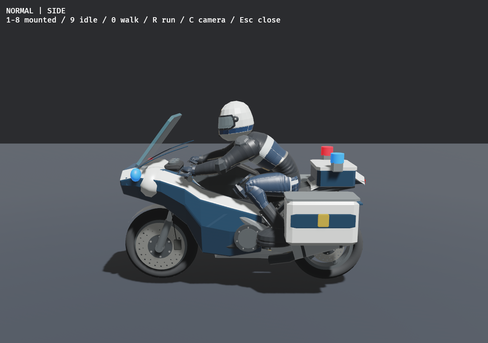
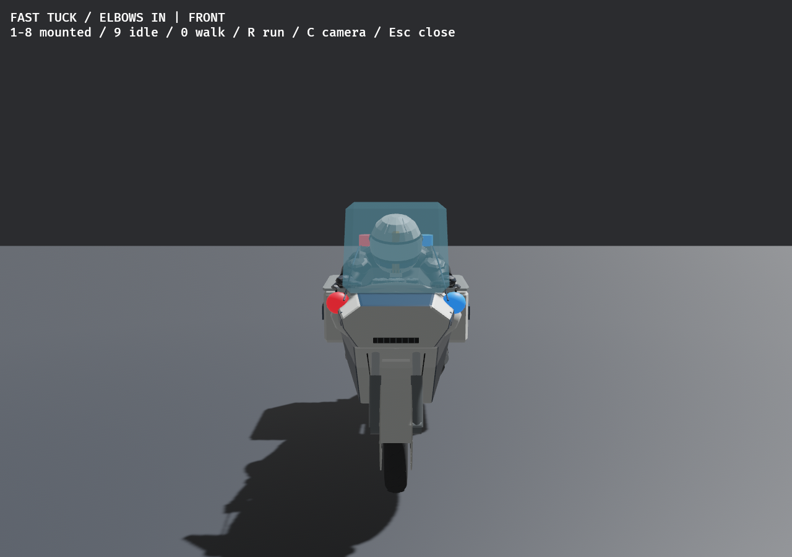
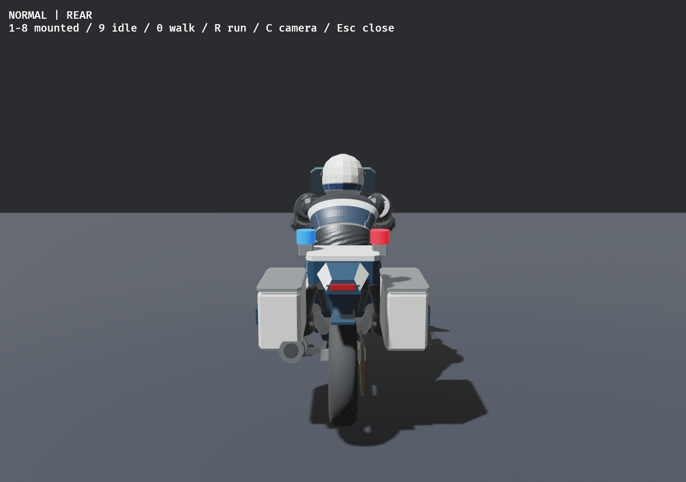
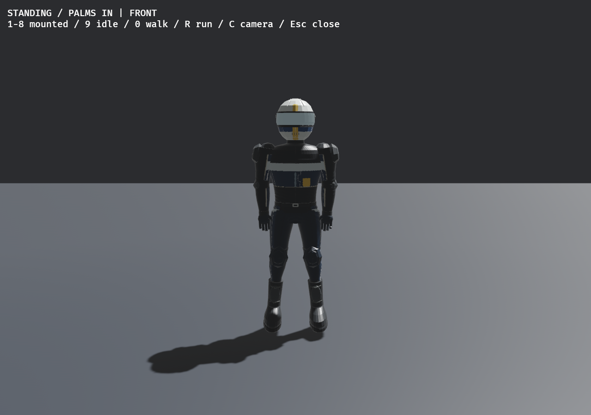
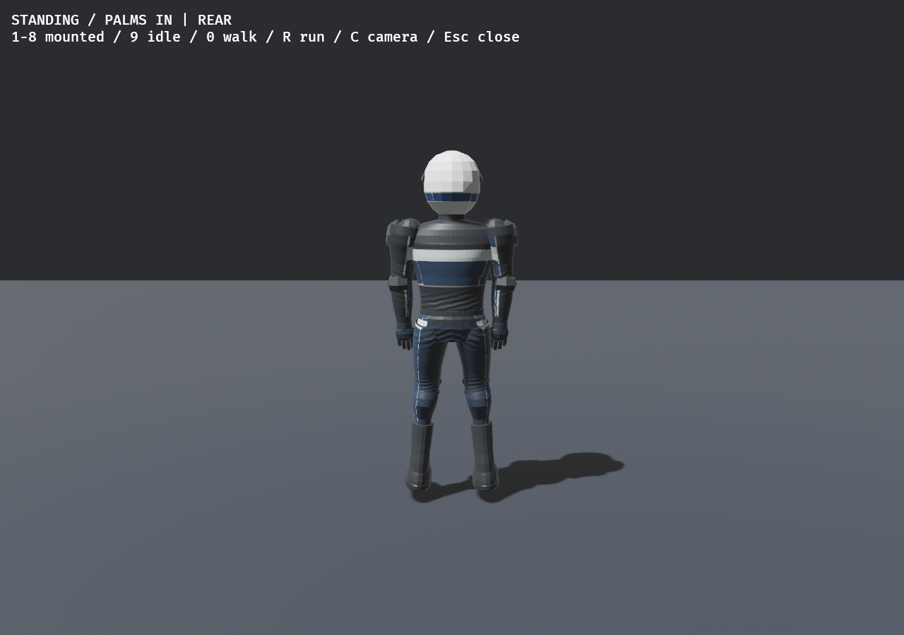

# Officer presentation — POLICE-ART-01

The resident officer has an original navy/silver uniform and white striped helmet,
with a generic gold shield, on the existing rider skin. The patrol motorcycle
adds a touring nose, framed windscreen, radio box, white/navy hard panniers and
red/blue emissive lamps to the existing motorcycle. No real police department,
motorcycle brand, downloaded media or reference code is used.

`src/models/patrol.rs` constructs 20 equipment children from three shared meshes
and seven materials. The existing bike paint receives an officer-only white
material; fairings/graphics become navy. The officer-only touring screen replaces
the stock screen, which remains unchanged on every ordinary rider. Luggage/trim
uses a shared 26-face chamfered solid and compact cylindrical rear lenses. All equipment is visual: no new collision, body, joint, mass, light,
audio or pursuit system. Lamps are static emissive lenses, not dynamic flashing
lights. Equipment follows the normal motorcycle lifecycle, including wrecks.
The unchanged authored human geometry, bind frames and existing normal/roughness
maps carry the new uniform through seated, walking and physical recovery states.

`models::OFFICER_PALETTE` is a reserved `usize::MAX` presentation token selected
by `police::setup`; it cannot overlap the 16 selectable identities. Ordinary
roster palettes and original rider/bike material handles remain unchanged.
Existing recovery carries that token through the runner/ragdoll/wreck factories.
The primitive fallback safely wraps its palette as before for human segments.

## Reproduce and provenance

Run `python3 tools/bake_police_uniform.py` (Pillow) to bake the 1024px atlas from
standing mesh UVs and original source base color. Colors and shield are authored
in model coordinates; cloth grain is deterministic. Source mesh, skeleton and
original biker textures are not modified. Exact input/output hashes and source
license are recorded in `assets/textures/officer-provenance.json`. No new research
repositories or external assets were investigated or imported in this pass.

Native gallery uses the game skin and equipment, not a separate illustration:
`road-dash --animation-lab-view --animation-lab-smoke --police-art-review`.
The normal lab flag without `--police-art-review` remains the original rider.
Native gameplay uses `road-dash --police-smoke` with isolated save/settings paths.

## Checks and limits

Worker verification: `cargo fmt --all --check`, `cargo build --locked`, 12
model tests and 10 police tests pass. Model tests cover all 16 ordinary palette
slots, officer-only equipment, collider/body/joint absence, and 180 fixed ticks
of both physical rigs for both original and officer appearances (maximum position
error 0m). Existing crash/run/remount differential now also runs with the officer
palette. Source mesh/base atlas hashes are unchanged; officer provenance hashes verify.

The final native gallery exits 0 and shows the actual skin/equipment at mounted
front/side/rear and standing front/rear. Both default anatomy and
`--ragdoll-baseline` Metropolis police fixtures exit 0 and report real falling,
officer Running, safe arrest with no payout, pursuit/search/escape and R retry,
15 racers plus one officer. These runs use isolated save/settings directories.
The default first run's optional `/tmp` performance logger hit disk quota; no
performance result is claimed. The baseline run directs logs under `/home`.
The newly added `arrest-contact.png` pre-arrest capture is compiled/tested but
has not yet been exercised natively in this worker; the parent final integrated
run will verify that screenshot hook. Existing `busted.png` captures the frontend after the arrest transition; use the
state JSON for arrest/retry evidence, not that UI image as an officer art view.

Final combined workspace clippy/tests/audit and latest combined Metropolis native
regression are parent-owned. Art approval, human
police fairness, full-course soak, distance LOD/performance and Windows hardware
remain open. A gallery screenshot is not performance or legal clearance.

[Pursuit state capture](pursuit.png), [default behavior receipt](police.json),
[baseline behavior receipt](police-baseline.json), [model tests](model-tests.log),
[police tests](police-tests.log), [source hashes](source-provenance.json).
