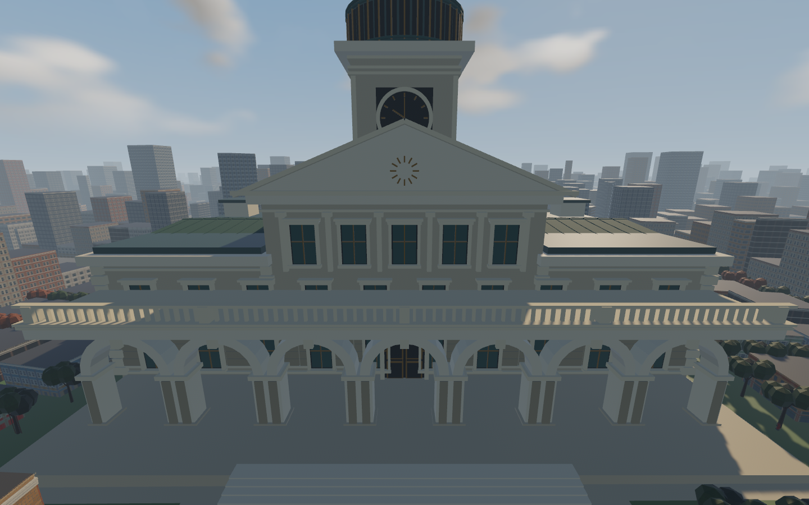
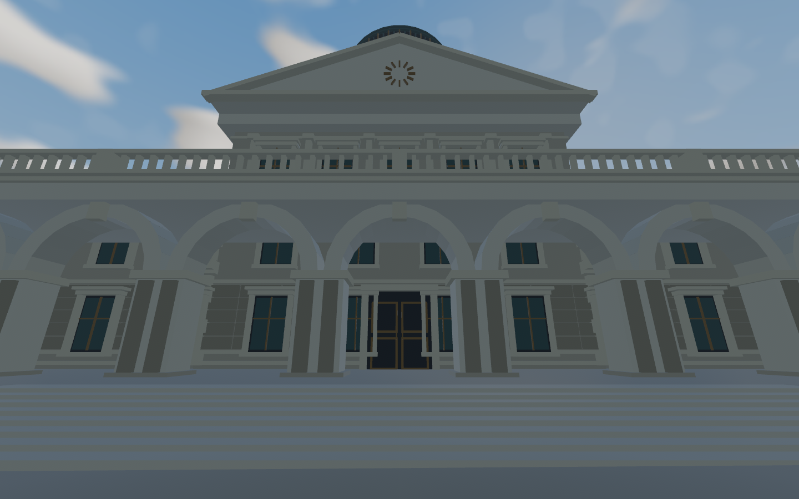
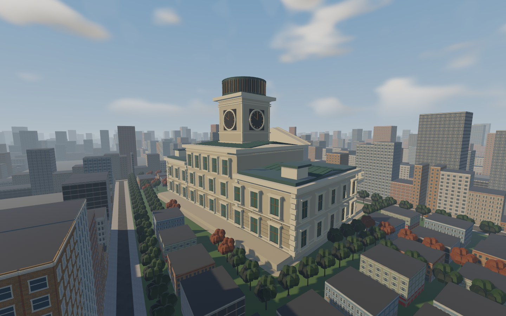
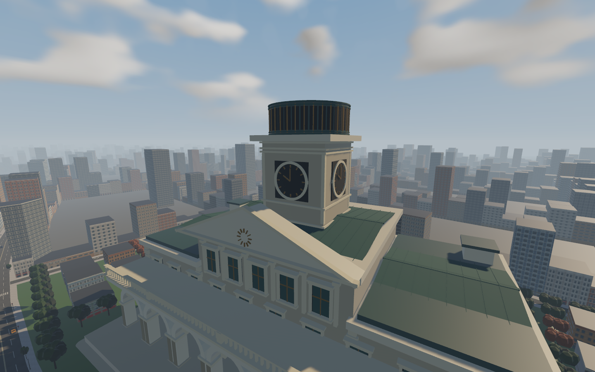

# City Hall stonework and civic identity

Scope: the user's request for a substantially less bland town hall. This is an
original procedural architectural art pass under existing CITY-CIVIC-01, not a
new development part or completed user-art acceptance gate.

## Architectural rationale

The retained grand limestone massing now has a readable base, middle and crown.
Rusticated lower courses, corner quoins and continuous belt courses give the
building scale. Deep dark window reveals, projecting pale jambs and hood moulds,
bronze mullions and panelled central doors make the wall surfaces read as civic
architecture. An open balustrade crowns the existing seven-arch entrance terrace;
capitals and keystones reinforce the arch rhythm without closing the openings.
Raking pediment cornices and an original geometric sunburst distinguish the
central hall. Four dark clock dials with bronze hands/hour marks, tower pilasters
and a ribbed copper lantern make the landmark readable from surrounding streets.
Shallow patinated copper roof slopes replace the visual flatness of the wings.

All detail is combined by material into five meshes. No per-window entities,
textures, external models, shaders, dependencies or animations are introduced.
Opaque rough limestone/copper and restrained bronze keep the material vocabulary
coherent. Original project code and basic architectural forms only; no external
repository/media research or asset intake. This resident civic model is separate
from the authored facade families/atlas; those source bands/materials stay intact.

## Preserved contracts

No existing solid piece, contact transform, collider shape or solid flag changed.
Only the obsolete three-piece decorative front clock was removed; all three
pieces had `solid: false`. The persistent compound collider remains independent
of the five decorative batches. Massing/root position, heading and 2.8 scale,
park3 source placement, 31 context buildings, 120 trees, full lawn and approach
remain unchanged. Detail lies within local x ±33m, z -20..20m, y 0..42m; the
original foundation and entrance steps extend farther. Doors are visual on the
existing solid wall; this does not create an accessible hall interior. Fine trim
and balusters do not add physical snag surfaces.

Controls, saves, routes, physics, baseline/new anatomical rigs, AI, lighting,
other maps, farm fields and facade streaming are untouched.

## Review and verification

`ROADDASH_HALL_VIEWS=1 --metro-survey` adds reproducible front-oblique,
street-entrance, rear-oblique, clock-detail and full-frontage views in the existing survey.
These cameras follow the authored hall heading and only move the render camera.
`run_native.py draft` / `final` isolate saves/settings and retain binary/content
hash receipts, full survey output and nonblank-image validation.

The geometry regression checks finite positions, outward triangle winding and
local ornament bounds, with a 25,000-triangle ceiling across five batches.
Targeted geometry test passed: 17,964 triangles across five resident batches.
All 11 src/models tests passed, including physical trajectory and crash/run/remount
differentials. `cargo check --locked` and fmt passed. Provenance audit initially reaches the expected changed-source hash
failure for metropolis/mod.rs; parent integration owns ASSETS.csv refresh.

User art review, full-race performance and hardware coverage remain open. Added
resident ornament costs geometry; five batches are a bounded implementation
choice, not a measured FPS improvement. No checklist requirement is closed.

## Native review and second pass

Draft captures exposed two specific weaknesses: the upper rear chamber remained
blank, and the distant street camera stood behind foreground buildings. The art
iteration adds five matching upper window bays on the front and rear and raised
standing seams on the broad copper roofs. The entrance camera now stands on the
unobstructed civic approach, showing the open central arcade, stairs and doors.
A fifth raised frontal view covers the entire arcade; the close entrance view
intentionally crops the outer bays. The final geometry test passes at **19,764
additional triangles / 39,528 vertices / five meshes**, below the 25,000 cap.
The removed old clock is not included in that additional triangle count.

The saved `draft` and `final` native receipts verify isolated binary hashes,
unchanged source/content inputs and successful full Metropolis surveys. Images
were opened and inspected, including the rear, roof/clock, entrance and frontage.
Only the architectural PNGs are retained; other route images were validated
nonblank during the survey and discarded to avoid unrelated evidence bulk.
These are Linux/Vulkan art and integration captures under the base lighting;
parent integration verifies the new lighting and hall together. No other cargo,
rustc or game process was active at each guarded survey launch. Editing and
ordinary OS activity were not isolated; this is not a standalone performance
comparison or evidence of a speedup. The final saved wall-frame report still
leaves the 16.7ms gate open. Civic detail is counted by its geometry test; the
existing world census is not a complete count of landmark decorative triangles.

## Parent integration handoff

Changed runtime files: `metropolis/hall_detail.rs`, `civic.rs`, `mod.rs` and
`survey.rs`. No authoring rebake or facade atlas rebuild is needed: neither the
source layout nor any atlas material/facade family changed. Source provenance
hashes and new original module registration belong to the parent's ASSETS.csv
update. Parent also owns README/PROGRESS/DECISIONS/KNOWN_ISSUES to avoid conflicts.
Keep CITY-CIVIC-01 open for user art review; no new task IDs or task closures.

Passed locally: locked check, fmt, final geometry regression, eleven model
physics/recovery regressions, locked release builds and native draft/final
Metropolis surveys. Full workspace tests, strict workspace Clippy, locked debug
build, refreshed provenance audit and integrated new-lighting/native recovery
checks are deferred to the parent integration suite, not claimed here.

Final bounded wall timing: 18.79ms average, 22.35ms p95;16.7ms gate unmet. This is not a hall-only cost or GPU measurement.
