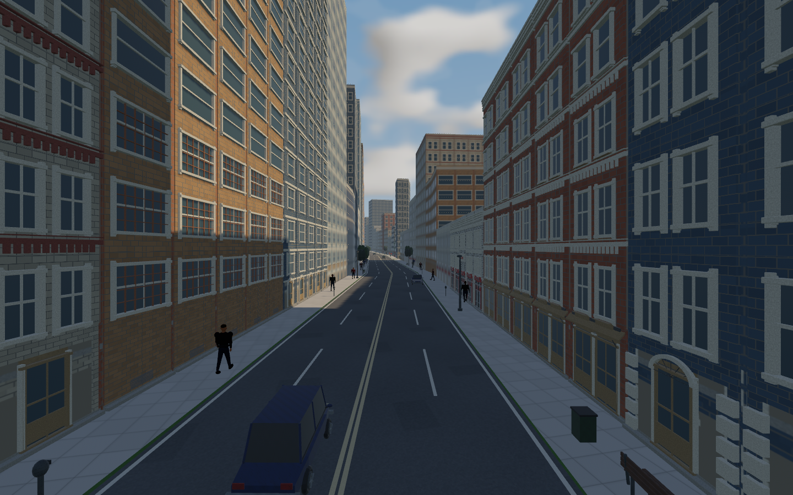

# Multiplayer, walking and city activity integration — 2026-11-09

Implemented on `codex/multiplayer-ui-walking`. **529 tests pass**, along with formatting, strict clippy, the locked build and dependency/asset audit. Native city, private map-reload and loaded-map multiplayer checks pass. Nothing has been pushed or merged into main.

## Changes

- AI recognizes crawling rider queues and plans committed passes with rear clearance and outbound road limits. Four-rider physical tests cover slow bikes and slow cars, with sustained passing and no damage, recovery events or road-boundary violations.
- Added **48 city-only cars**: city-only traffic rises from 32 to 80; the total main fleet rises from 96 to 144. The 64 shared/rural cars retain their existing placement. Urban pedestrians double from **192 to 384**.
- Added **10 authored street-crossing routes**. At most two pedestrians cross at once, with at least 12 seconds between admissions, 45 seconds of rest and a forecast of approaching traffic. Walkers follow actual road/sidewalk support and retain collision and ragdoll behavior.
- Player-hosted Host/Join/Quick Play supports public/private lobbies, map selection, randomized grids, a 15-second automatic countdown, joining humans replacing unfinished bots, and bot restoration after disconnects.
- Menus use original pictures from the user's external reference kit, with project-art fallback. The online Resume/Leave overlay remains readable over the live race. Retail images are not stored in Git.
- Rider walking/running now matches travel, while preserving controls and physical rigs.

Generated buildings, roads, terrain, fields, parked cars and Valley content are unchanged by the city population pass.

## Verification

[Check logs and executable identities](checks.json) record **529 passed, zero failed, one existing long soak ignored**. Five population authoring tests, three audit tests and five roadmap tests also pass. The audit covers 580 dependency declarations and 180 runtime asset records.

- [Native city survey](../city-activity-02/README.md): 144 main cars, 384 pedestrians, 14 reviewed images and two completed opposite-side crossings; no runtime errors.
- [Physical AI queue regressions](../ai-queue-02/README.md): crawling-bike and slow-car queues drain safely; retained before-fix failure and passing controls.
- [Final private map reload](../online-races/final-valley-reload/README.md): 1,497 matching snapshot hashes, preserved invite code and complete recovery.
- [Final loaded-Metropolis race](../online-races/final-metropolis-density/README.md): 1,495 matching snapshot hashes, movement/attack/crash/walking/remount observations and no errors.
- [Admission and late joining](../online-races/admission/README.md), [final admission rerun](../online-races/final-admission/receipt.json), [host loss](../online-races/host-loss/README.md), and [three-peer 150 ms delay fixture](../online-pass/compressed-delay150/receipt.json) pass.
- [UI verification](../online-ui/README.md) covers original/fallback pictures, the offline flow and final overlay. [Walking verification](../walking-animation/README.md) includes 152 nonblank captures, both-rig recovery and established contact-slip measurements.

Native captures retain their exact executable hash. The final subsequent change only fixes Quick Play's empty-search fallback on Valley/City: hosting uses the loaded map, preserving the queued automatic Start. Its regression is included in the final 529-test run and final build.



## Checklist, files and decisions

New IDs: **ONLINE-PLAY-01**, **UI-RETRO-BG-01**, **AI-QUEUE-02**, **CITY-ACTIVITY-02**. Walking continues under **V2-03-003**. CITY-ACTIVITY-02 is verified in Part 00; the live checklist now has **222 verified / 256 open**. AI retains dedicated rendered-queue/full-course human review; online/UI retain their broader acceptance gates.

Main files:

- Networking: `src/online`, `crates/rr_core/src/online.rs`, frontend/input/game/recovery integration.
- Queue behavior: `src/game.rs`, `crates/rr_core/src/traffic_avoidance.rs`.
- City authoring: `content/world/living_city.json`, `tools/bake_metropolis.py`, `tools/metropolis_population.py`, generated `content/world/metropolis.json` and `crates/rr_content/src/metropolis.rs`.
- Crossings: `crates/rr_core/src/pedestrian_crossing.rs`, `src/world_gen/metropolis/pedestrians.rs` and the host fixed schedule.

ADRs 128–133 record authority/discovery, temporary router leases, gait, replication neighborhoods, queue activation and paced crossings. [Repository intake](../../third_party/REPOSITORIES.md) records Mainline/IGD research; dependency versions are pinned. The attohttpc MPL dependency retains its scoped notice/source-access packaging obligation. Queue/crossing work adds no external code or media. The asset hash ledger, README and PROGRESS are synchronized.

## Remaining gates

Separate-Internet discovery/reachability, CGNAT/relay support, packet loss, prediction/lag compensation, hardware performance and human playtesting remain open. Public DHT discovery avoids a user-operated lobby directory but still depends on public bootstrap infrastructure and reachable hosts.

The final native multiplayer fixture observed the farm recovery area, with host progress peaking at 514.773 m. It measured about **6.41 Mbps per guest**, above the production 100 kbps target; it does not establish urban or 15-scattered-human bandwidth coverage. Maximum JSON frame size was 242,607 bytes, below the 512 KiB cap.

The debug city survey measured wall p95 **32.73 ms**, above the 16.7 ms target. This is not directly comparable to earlier release benchmarks. Sealed or occupied roads still require AI to wait; passing does not bypass sidewalks, opposing traffic or collision.

## Run and next steps

```sh
cd /home/imad/Documents/ChatGPT/RoadRash
cargo run --release --locked
```

Choose Multiplayer for Host/Join/Quick Play; Play Offline retains bots. Original pictures use the existing external kit or `ROADDASH_UI_REFERENCES`.

Implementation and evidence are committed locally. Next steps are human race/animation review and separate-network testing, followed by the existing bandwidth/frame-time work. No next major roadmap part is started automatically.
