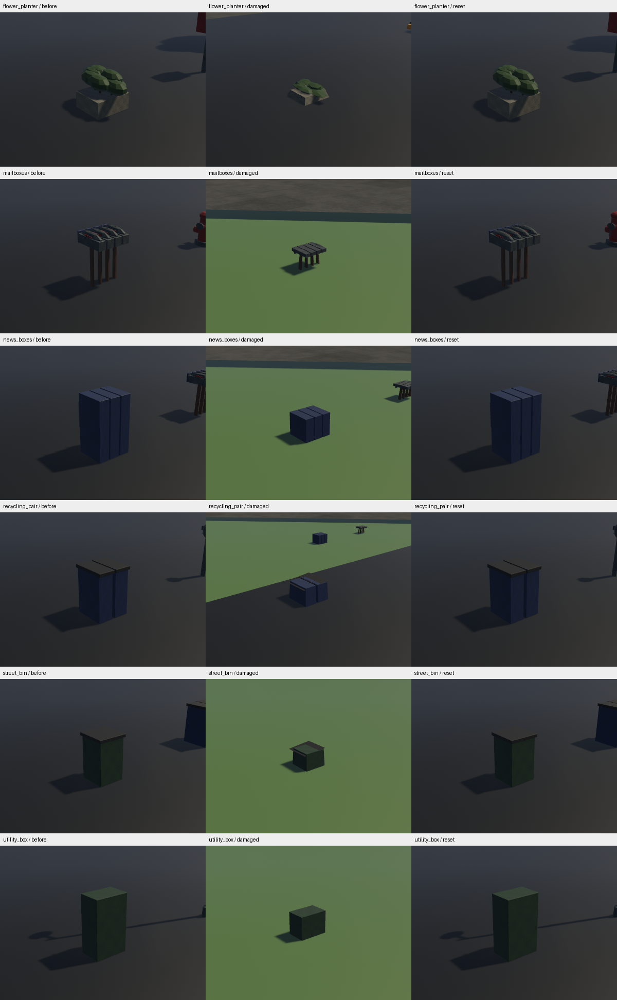

# Part05 original buckled furniture pass

2026-11-08 · branch `codex/part05-prop-breakage` · reviewed parent `ac91327`.
Scope: a functioning bounded pass toward DESTRUCTION-02, plus repair of the
Part03 resolved-contact integration regression. Props only; cars stay
indestructible. All ten Part05 checklist requirements remain open. No Part06 work.

## Implementation

Twelve matching damaged GLBs cover the existing variants of six crush roles:
street bins, recycling pairs, flower planters, mailboxes, utility boxes and news
boxes. The original semantic components remain recognisable: walls buckle,
front panels dent, lids tilt, and roofs/foliage sag. The deterministic offline
recipe reads only existing project-original GLBs, preserves topology, embedded
images/materials and UVs, and recomputes positions/normals/accessor bounds.
No external media/code, library changes, facade material edits or atlas changes.
The new derivative manifest binds exact recipe, source and output SHA256 values.
A packaged runtime using its optional `assets/props` asset source must copy the
whole `art/props/mesh_assets/broken/` directory alongside the existing models and
skins. `content/props.json` lists intact sources only; the derivative manifest is
`broken/manifest.json` and runtime selects `broken/<source-ID>.glb#Scene0`.
No standalone release bundle pipeline is introduced or certified here.

Each affected physical owner prepares one hidden fixed low-LOD damaged sibling.
It is shown only after SceneInstanceReady, material-detail readiness and normal-mapped-mesh tangent
availability. Until then, an impact retains the old supported crush fallback.
Reset shows the original immediately even if damaged assets are still preparing.
Visibility runs after PropLods and both presentations retain the500m distance
cap. Offline mesh Y height and fitted base-offset Y each compress once; there is
no second damage-scene scale. Unchanged transforms use set_if_neq, avoiding
constant dirty transform propagation. The sibling adds resident entity/mesh cost;
its actual native census is in the results receipt. No new dynamic bodies,
fragments, expiry, per-frame vertex generation or damage-time scene spawning.

The existing solid38% crush collider,48-body budget, release/settling, navigation
footprints, mass, collision policy, audio and reset remain. Seven topple roles
still use whole intact original meshes. Accepted velocity-muscle and eleven-body
baseline rigs, car collisions, controls, saves and recovery are unchanged.

Prop melee now consumes the same scheduled StrikeContact as racer/NPC melee,
including its frozen kick side, after combat::schedule. The Part03 intent change
had left prop damage listening only to legacy immediate AttackAttempt fixtures.
Those resolved fixtures remain supported. Live keyboard tests now prove zero
damage before the contact key, paused windup, cancellation and one contact only;
an opposite-side prop cannot flip the chosen leg. No weapon feature is added.

## Reproduction and evidence

```
python3 tools/bake_broken_props.py --check
python3 tools/verify_broken_props.py
cargo fmt --all --check
cargo clippy --workspace --locked --all-targets -- -D warnings
cargo test --workspace --locked
cargo build --locked
cargo build --release --locked
python3 tools/audit.py
python3 tools/test_roadmap.py
python3 tools/sync_progress.py --check
DISPLAY=:0 ROADDASH_TRACK=metro cargo run --release --locked -- --destruction-survey
```

The independent decoder verifies12 variants,3576vertices and1632 finite
nondegenerate triangles, unit normals, unchanged topology/UVs/material definitions
and embedded image bytes, fitted solid-bound containment and nonuniform geometry
change beyond root squash. This is not a final artist review of intersections,
fracture surfaces, silhouette quality or realistic deformation.

Rust regression coverage includes contact release, finite-body cap/static
fallback, supported settling, body/backend reset, slow/paused/disabled impacts,
wall-blocked melee, live keyboard windup/pause/cancel/single-contact, chosen kick
side, and loading/reset/repeated damage/distance/no-double-crush presentation.
The full workspace also runs the existing differential model physics/recovery,
navigation, stable map layout and game regression suites.

The native fixture uses actual production registration/meshes/contact logic,
ramming all13 roles with180kg spheres at20m/s, then checking reset and excluding
cars. Before/damaged/reset views include six per-role medium-distance views. The fixture
asserts each crush variant is prepared and reports all hidden roots/entities/
mesh instances, in addition to the48-body limit. Timing windows cover intact,
damaged and reset phases on the same fixture; they are wall-frame observations,
not a controlled before-change comparison, GPU timestamps, full damaged-route
worst-case performance or hardware approval. The16.7ms target remains open.

Exact successful commands, build/test counts, host, native outputs, resident
cost and timing observations are recorded in receipts.txt and adjacent files.
Screenshot sheets are native medium-distance observations of draft geometry,
with unscaled400x300 center crops for comparison. The damaged subjects are small
in the original frames; this is insufficient for detailed buckling/fidelity art
review, and is not user approval. Dedicated close inspection remains open.

The first native gate correctly failed the initial readiness policy: it required
all meshes to have tangents, including materials without normal maps. Those
materials never enter the existing normal-mesh tangent queue, so the fallback
stayed visible. The corrected policy requires material readiness for every mesh
and a tangent only when that material has a normal map. A dedicated regression
covers both hierarchy/material-ready orders and the normal/plain distinction.
The failed native receipt is retained; only the subsequent passing run is used
for results and captures. A second run exposed an assertion ordering gap:
the fixture could inspect intact visibility between PropLods and the damage
visibility adapter. The fixture now runs after the explicit PropDamageVisuals
set, and separately waits for its six prepared variants before captures/contact,
with a30s wall timeout naming missing source IDs. The second failed receipt is
also retained; diagnostic success alone was not used to dismiss the race.
The reset role captures were moved to440–445, outside the reset timing window,
so asynchronous screenshot saves finish before the fixture exits at470.

## Recorded results

336workspace tests pass with1pre-existing ignored test; all required locked
build/Clippy/format/provenance/roadmap checks pass. Native verifies13/13 real
contact breaks,13peak dynamic bodies, zero damaged cars and complete reset.
The ready damage siblings add411roots/2626entities/902mesh instances including
the six affected fixture props. Encoded derivative GLBs total638,616bytes;
whole-process sampled VmRSS peaks at3,997,780kB, which does not establish an
attributable memory delta. Intact/damaged/reset p95 wall frames are18.41/19.38/
20.88ms;16.7ms target remains unmet. Native Metropolis route0 recovery/restart
smoke passes with two0.0000m pickup errors and four initialized audio sinks.
See [exact receipts](receipts.txt), [native assertions/timing](native-results.json)
and [source/capture hashes](PROVENANCE.json).



## Per-task disposition

| Task | Result of this bounded pass | Still open |
| --- | --- | --- |
| DESTRUCTION-02 | Twelve original buckled meshes for six crush roles, ready presentation, solid-bound checks and reset/contact fixture | Seven topple roles, severed art, final silhouettes, user review and worst-case damaged-route performance |
| WORLDART-01 | Existing property placement and world content preserved | Coherent final world art/landscape/roads and visual acceptance |
| MAT-03 | No facade source/material changes; existing atlas/source hashes retained | Delivered future texture-family rebakes and paired appearance approval |
| MAT-02 | Exact original furniture material identity retained | Bespoke per-family PBR art and user review |
| V2-05-001 | Existing source/role mapping retained, no new references | Identity/archetype/source-use review and unresolved banks |
| V2-05-002 | Dedicated damage derivatives of twelve existing original drafts | Finished silhouettes, rigs, pictograms, textures and production art |
| V2-05-003 | Existing deterministic semantic placement retained | Full-category variety/encounter/placement review |
| V2-05-004 | Resolved-contact prop melee integration repaired and tested | Other category behavior/audio and comprehensive QA |
| V2-05-005 | Native contact/reset fixture and playable recovery regression | Full dressed-route art/gameplay/performance acceptance |
| ENV-004 | Existing cows/cars/rocks/tractors/landmarks retained | Finished readable encounter/landmark coverage |

No requirement IDs were added, moved, removed or checked. README and PROGRESS
remain synchronized. ADR083 records architecture/alternatives; KNOWN_ISSUES and
CHANGELOG_DEV retain limitations/history. ASSETS.csv records the two changed
registered runtime sources and fourteen new original recipe/manifest/mesh records plus the review provenance;
no unrelated asset hashes were refreshed. No external repository investigation,
rights clearance, Windows verification, push or merge is claimed.
