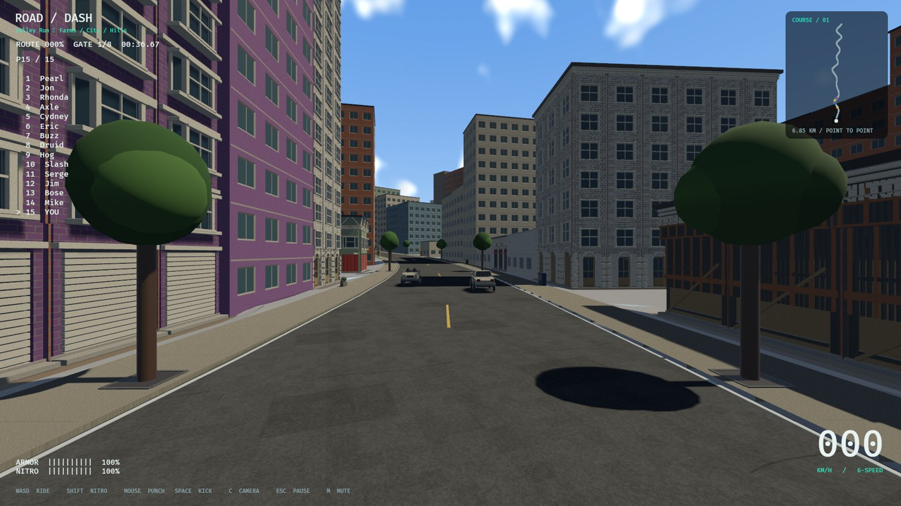
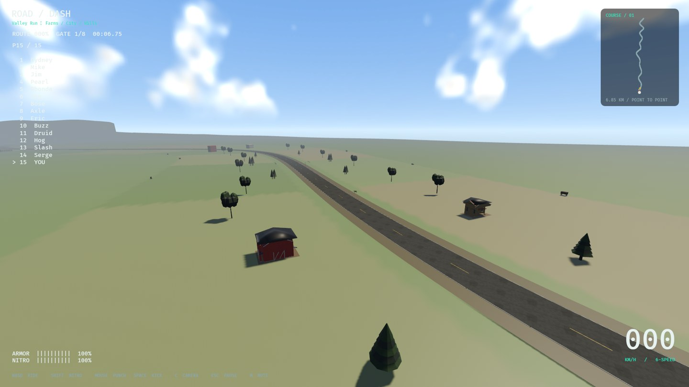
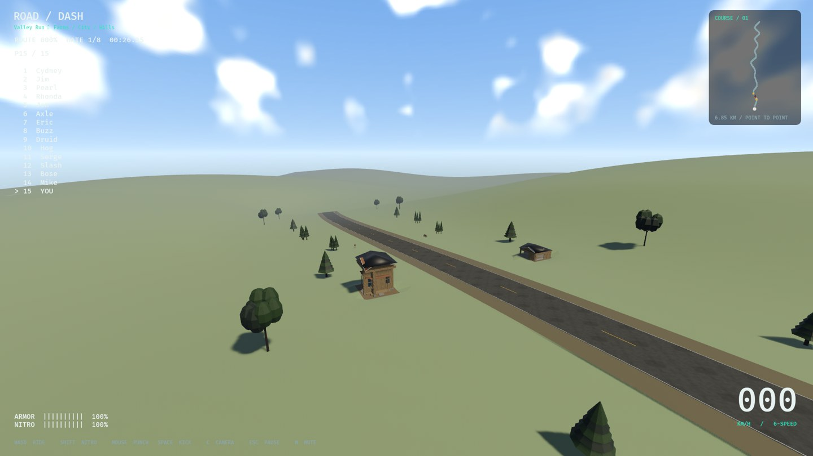

# Part05 world dressing and soft-contact follow-up

2026-11-07; branch codex/part-05-world-dressing, based on merged PR16/main
2a3ea003d59921dc3817251b69c4b894b9e6a17e. The user explicitly requested
Part05 and sky/lighting while broader prior art gates remain open.

## Implementation

- Pedestrians and recovering runners no longer stop or wipe out the mounted
  attacker. Runner targets fall; pedestrian targets enter their existing ragdoll.
  Downed bikes retain a small ride-over lift. Response starts with saved entry
  velocity, transfers target momentum and spends remaining pair linear kinetic
  energy on lift. Upright bike rear contacts and cow behavior remain separate.
- Authored facade replacements wait for ready scene instances and transition
  through the detailed fallback using a0.30s shader dither. Displayed/hidden
  budgets remain separately bounded. No collision or authoritative transforms
  are faded. This reduces abrupt swaps; it is not geometry morphing.
- Original34 palette textures gain shared normal/roughness maps generated in at
  most two background jobs. Missing mesh tangents are generated independently,
  without changing positions or skin weights. Concrete sidewalks use repeated
  original microdetail. This is not a bespoke albedo remake of every asset.
- Deterministic existing prop models populate guarded city sidewalks, field
  edges, rural areas and hills. Whole footprints exclude buildings, access paths,
  grid streets, junction sightlines and the main road. Solid proxies, support
  relief checks and a160-owner cap apply; no additional trees are spawned.
- An original seamless256px cube sky with procedural clouds and sun,16px diffuse
  environment, warm directional daylight, exposure and distance fog replaces the
  flat background. Clouds drift slowly. It is a bounded static cloud texture,
  not volumetric weather or a physically prefiltered HDR environment.

## Tuning

content/world/art.json controls lighting/sky/fog; dressing.json controls roles,
zone sockets and caps; material_profiles.json records exact original pixel/source
fingerprints and microdetail strength/roughness. Rebuild/verify palette metadata
with tools/build_material_profiles.py and tools/verify_material_profiles.py.
Contact energy and trajectory rules live in rr_core::contact. Accepted ragdoll
articulation/masses/motors/recovery are unchanged.

## Verification and remaining gates

Receipts alongside this file record commands actually run. Unit/integration
coverage includes three handling presets, stopped post-solver soft-contact input,
energy bounds, malformed inputs, deterministic guarded placement,34 source
fingerprints, tangent position preservation, cube edges/mips and dither weights.
Native testing must additionally prove actual meshes, maps, scene readiness,
recovery and rendered sky. Broad art approval, all-texture repainting, category
sounds/breakables, long streaming/memory tests and Windows hardware stay open.

Initial native result:131 placed solid props/376 actual meshes across15 roles;
934 enhanced materials sharing32 used profile map pairs;1,284 tangent meshes,
zero unsupported, both queues settled;657 building owners,42 fields and9 junctions
retained. First survey measured19.02ms p95 and failed16.7ms. Hidden prepared
facade meshes were unnecessarily receiving fade commands; skip those until their
parent is visible, then repeat the same native survey. The failed receipt is
retained as survey-before-fade-trim.json. A functional smoke run initially exposed
conflicting read/write VisibilityRange queries; explicit Without<Fallback> makes
those sets disjoint. The corrected native smoke passed.

Final native sample after hidden-scene command trimming:17.93ms wall-frame p95,
15 sections captured, still above16.7ms. All census/geometry assertions passed.
A separate repository's ignored source-scenery factory test was observed using
~96% of one CPU during this run; it was not interrupted. These samples cannot
certify isolated performance or attribute all frame cost to this branch. Keep
production performance open; do a controlled idle-machine rerun next.





Final automated commands (all passed):

```
cargo fmt --all --check
cargo clippy --workspace --locked --all-targets -- -D warnings
cargo test --workspace --locked
cargo build --locked
python3 tools/audit.py
python3 tools/verify_material_profiles.py
python3 tools/sync_progress.py --check
python3 tools/test_roadmap.py
```

Workspace:245 passed,1 existing ignored soak; roadmap:5 passed. Audit:43 runtime
asset records,519 dependency declarations,27 reference observations. Source/hash
checks are not legal clearance or hardware certification. No new dependency or
third-party repository adopted. Native commands: target/debug/road-dash
--smoke-test and --world-survey. Valley inspection uses explicit authoring inputs:

```
target/debug/road-dash --inspect-world content/world/valley_world_v1.json content/world/building_archetypes_v1.json content/tracks/valley.json
```

Allocation fnv1a64:f866d824acfb111f and geometry fnv1a64:9e86f98d4552ac15 match
PR16 exactly. All247 quota owners/19 archetypes/15 construction sections and410
neighborhood additions remain. The recovering-runner regression explicitly
asserts its owner enters Falling while the attacking bike remains mounted,
keeps>20m/s of its30m/s entry and receives positive bounded clearance lift.

Verified new IDs: COLLISION-07, LOD-01, DRESS-01, MAT-01, SKY-01. Open MAT-02 owns
the remaining per-family texture repainting. README/PROGRESS retain179 complete,
223 open,402 unique tasks; no old task was removed. These follow-up edits remain
local on codex/part-05-world-dressing; PR16 alone is already pushed and merged.
