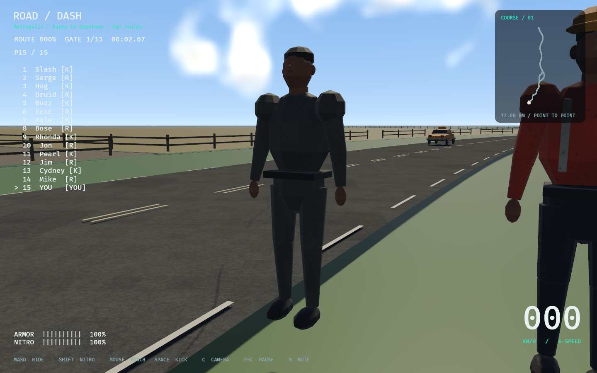
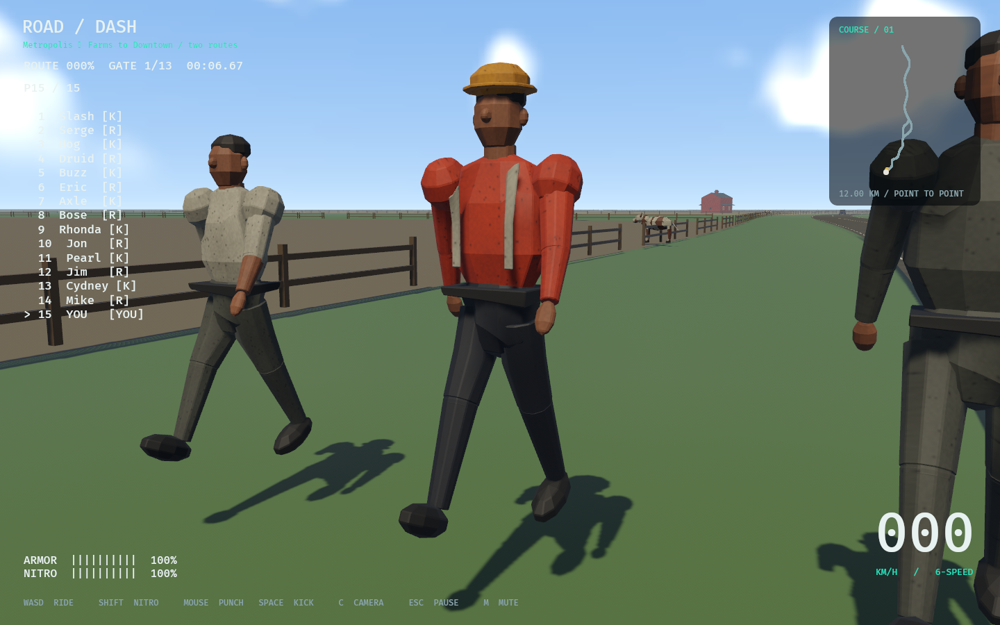
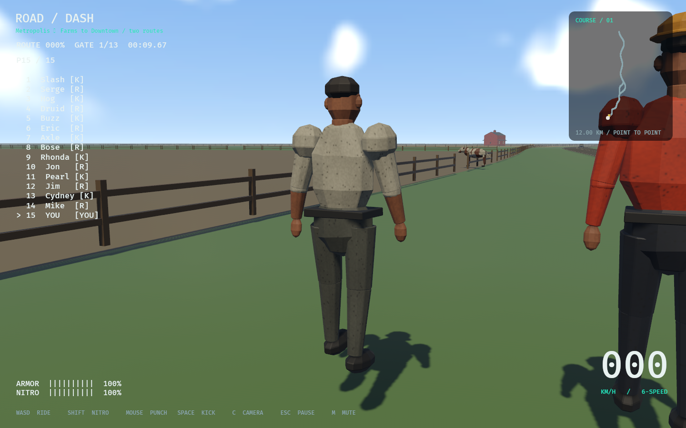
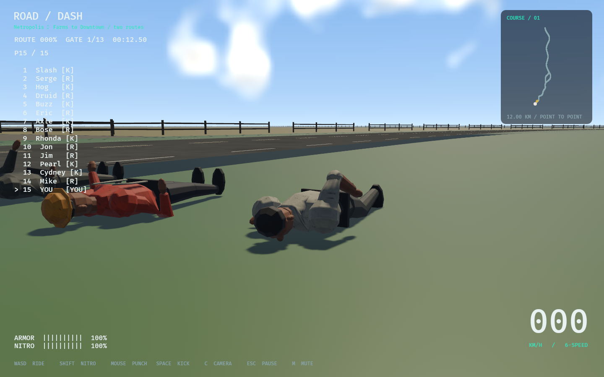

# Part06 civilian skin continuity development candidate

2026-11-08 · `codex/part06-npc-skin-continuity` · reviewed parent `96be522`.
This is a bounded NPC-SEAMS-01 pass. All eleven Part06 boxes remain open.
No landscape pass, new requirement IDs, external media/code, dependency migration,
push or merge. ADR084 records the architecture and rollback.

## Implementation and measured limits

The original generator authors intersecting clothing/body volumes. The previous
intake rigidly attached each whole semantic primitive to one frame, despite source
seams differing from physical frame centres. A shared continuous source-space
four-influence field now spans torso/head/pelvis/arms/legs, with female source
height normalization, connected hand sampling and rigid held equipment. Central
pelvic influence stays continuous across x=0 through its complete source extent.
The original 55 human sources are retained;110 runtime GLBs are regenerated.
Eight cow GLBs are byte-identical to the parent. Authoritative physics drivers,
accepted16-body anatomy/velocity muscles,11-body control,10-body quadruped,
colliders/masses/joints/motors/damping/momentum/recovery are unchanged.

A single conforming midpoint split on each blended primitive samples the curved
field. Each shared edge gets one midpoint; all triangles in that primitive split
rather than creating skinning T-junctions. Neutral source surface/winding/UVs,
original vertices, materials and embedded source bytes are retained. Unit normals
are interpolated; new vertices resample weights. The hard ceiling is one level,
4x triangles per primitive and no more than original vertices plus source index
count. No extra mesh/material/entity/physical body, runtime deformation generation
or scene spawn in PostUpdate. Source/cost audit independently reconstructs exact
shared-edge topology and neutral positions/UVs; original sources remain untouched.

**Cost is material:** the110 human derivatives grow68,108,624→101,278,208 bytes;
vertices658,292→1,062,972; triangles305,828→777,932 across both LODs/all families.
Maximum individual actor:15,712 triangles/20,424 vertices; maximum family triangle
ratio2.9104. This is catalog/residency capacity, not simultaneous displayed cost.
The number of primitives/scene entities/materials is unchanged; GPU vertex/index
buffers grow. See `source-and-cost.json` and bounded native performance receipts.
No60FPS, unchanged-cost, full-crowd or cross-platform claim.

## Paired geometry measurements

`verify_actor_deformation.py` decodes actual GLB positions/indices/weights and
measures unsigned point-to-triangle distance for up to24 nearest source-overlap
vertices per attachment/side. Split actual triangles by side: original meshes
combine both limbs into one semantic node. Include shoulder/elbow/knee caps,
wrists, torso/pelvis, hips, neck/head and tape/hair/hardhat attachments where present.
The control applies the former semantic rigid bone to the same neutral surface;
affine subdivision preserves the exact old surface. These are attachment samples,
not a watertight-volume theorem, signed penetration test or all-pose approval.

Synthetic hierarchical rotations around unchanged physical anchors cover all55
families/two LODs,2688 attachment cases per pose. Compound adds shoulder/hip
abduction/twist and flexed elbows/knees; labels are synthetic, not gameplay output.

| Synthetic pose | Old rigid mean | New mean | New max sample |
| --- | ---: | ---: | ---: |
| Rest |8.42mm|8.42mm|34.23mm|
| Walk |14.20mm|8.54mm|34.23mm|
| Impact |27.56mm|8.62mm|39.28mm|
| Ragdoll |28.45mm|8.53mm|48.49mm|
| Compound3D |23.79mm|8.53mm|37.02mm|

**Individual regressions remain:**830/10,752 dynamic attachment cases worsen in
mean by more than1mm, mostly torso/shoulder/pelvis. Largest mean regression:
AVGMSM06/PROP-AD62F66BA933,LOD2,left torso/shoulder,synthetic walk9.52→23.65mm;
its maximum changes27.40→28.65mm. Worst new absolute sample is same family/LOD2,
left pelvis/thigh,synthetic ragdoll: old max114.65→48.49mm (mean50.35→10.07mm).
`regressions.json` lists exact identities; `deformation.json` retains every case.
Earlier investigative aggregates were superseded after correcting side selection,
midline discontinuity and finite triangle interpolation; they are not acceptance.

Actual final propagated native driver matrices are separately exported by the
opt-in `--actor-skin-survey` fixture (`native-poses.jsonl`) and decoded with the
same method. It uses real active walking and existing NPC-hit/physical knockdown
paths; close camera overrides and tiny patrol area exist only in this fixture.

| Native phase | Cases | Rigid mean | New mean | New max | Mean worsened>1mm |
| --- | ---: | ---: | ---: | ---: | ---: |
| Walk |666|8.08mm|6.98mm|29.38mm|8|
| Impact |74|9.40mm|6.94mm|29.68mm|6|
| Ragdoll |148|10.16mm|6.91mm|30.30mm|10|

Native matrices cover everyday AVGMSM06, worker CTM1A00 and sport JGW100, with nine
walking camera captures plus impact/front/rear falls. Other families have decoded
synthetic coverage; this is not full native pose/family approval. Source waist
bands, faceted cap shapes and material/silhouette quality remain conspicuous.
Screenshots are evidence for review, not approval of finished stylized3D art.

## Verification and reproduction

```
python3 tools/prepare_runtime_props.py
python3 tools/verify_runtime_props.py
python3 tools/test_actor_weights.py
python3 tools/verify_actor_source.py
/tmp/roaddash-layout-venv/bin/python tools/verify_actor_deformation.py --output docs/testing/part06-npcs/deformation.json
cargo fmt --all --check
cargo clippy --workspace --locked --all-targets -- -D warnings
cargo test --workspace --locked
cargo build --locked
cargo build --release --locked
python3 tools/audit.py
python3 tools/test_roadmap.py
python3 tools/sync_progress.py --check
DISPLAY=:0 ROADDASH_TRACK=metro target/release/road-dash --actor-skin-survey
/tmp/roaddash-layout-venv/bin/python tools/verify_actor_deformation.py --native docs/testing/part06-npcs/native-poses.jsonl --output docs/testing/part06-npcs/native-deformation.json
DISPLAY=:0 ROADDASH_TRACK=metro target/release/road-dash --actor-smoke-test
DISPLAY=:0 ROADDASH_TRACK=metro target/release/road-dash --actor-smoke-test --ragdoll-baseline
DISPLAY=:0 ROADDASH_TRACK=metro target/release/road-dash --smoke-test
DISPLAY=:0 ROADDASH_TRACK=metro target/release/road-dash --smoke-test --ragdoll-baseline
target/release/road-dash --ragdoll-lab --output docs/testing/part06-npcs/ragdoll-lab.json
```

Rust:336 passed, one inherited ignored soak. This includes existing model physical/
recovery differential and NPC mass/shape/joint/momentum regressions. Six focused
Python authoring regressions pass (shared fields, female height, wrists, outer thigh,
continuity, central pelvic midline and equipment; some share test methods).
Intake validates118 exact output hashes/source hashes/recipe, inverse binds and
finite normalized weights/indices. Source/cost audit validates110 human neutral
surfaces and8 byte-identical cows. NumPy2.3.4 is offline measurement-only in the
existing layout venv; no Cargo/Python runtime dependency was added. Source audit
needs the reviewed96be522 Git object for exact prepass bytes. Formatter, Clippy,
workspace tests, debug/release builds, audit and roadmap/sync receipts are retained.
Headless lab runs paired baseline/anatomy in each invocation:18 finite cases,
preserved passive/active fixtures; the second baseline-flag invocation is a repeat,
not a separate backend. Native NPC/recovery receipts identify both actual paths.

## Exact task disposition — none checked

| ID | This pass | Still required |
| --- | --- | --- |
| NPC-SEAMS-01 |55families/twoLODs, shared fields/refinement, decoded/native attachments|Individual regressions, source topology/bind/art and broader native pose approval|
| V2-06-001 |Retain original human/cow family identity/provenance; improve deformation|Finished variants/outfit/species identity, authoring rig/art review|
| V2-06-002 |Preserve quadruped/source physics; paired native actor checks|Animal-specific gait/idle/art and behavior acceptance|
| V2-06-003 |Existing actual patrol/knockdown stays integrated|Believable navigation, crossing/avoidance and activity variety|
| V2-06-004 |Measured skin candidate and bounded regression checks|NPC art/motion acceptance, crowd/leak/performance gate|
| V2-06-005 |Deferred behind NPC acceptance|Sky/atmosphere/landscape study|
| V2-06-006 |No new landscape assets|Original approved sky/landscape textures/materials|
| V2-06-007 |Existing world retained|Integrated accepted landscape and terrain support review|
| V2-06-008 |No exit claim|Whole first-map visual/performance/user acceptance|
| ENV-008 |Existing cow contacts/knockdown preserved|Grazing/startled/turn/cross/react states|
| P08-005 |Existing traffic retained|Complete gap/lane/intersection/rerouting behavior|

Research was local-only: original prop generator/GLBs, human/quadruped driver code,
and existing intake. ASSETS.csv refreshes only110 changed human records; development
intake is not legal clearance/production redistribution approval. No new task IDs.
Next scoped work is source topology/attachment art and activity under these open
Part06 IDs; this pass does not automatically start landscape or Part07.


## Native review images

Raw captures retain HUD, source junctions and ground clearance. No crop hides draft
artifacts. `baseline/` contains actual prepass rigid-weight assets; `refined/`
contains the current derivative assets under the same release binary and fixture.
Sources are the unchanged original 55-family catalog, not imported character art.






Native NPC/default-control checks and both Metropolis recovery smokes pass; each
recovery smoke records two zero-error remounts. Known host warnings remain missing
Vulkan DRM extension and default mapping for the detected OS controller. These
are not actual controller-input verification. The close-survey asset comparison
uses warm-cache windows3..14s, captures actual mesh/entity/material/body/memory
counts and raw1Hz samples, and is not a general gameplay or GPU benchmark.


### Bounded native cost receipt

The same final release binary ran sequentially with exact96be522 rigid actor
GLBs in a separate packaged asset root, then the current derivatives. All other
sources are unchanged. `native-baseline-assets.json` binds all118 control hashes;
`native-images.json` binds24 raw images, and `performance-comparison.json` binds
the identical executable hash. The initial incomplete packaged-copy attempt was
corrected with the complete existing asset root before these successful runs.

Median1Hz p95 windows3..14s: old19.55ms, current18.94ms; **both miss16.7ms**.
This is no performance-improvement or unchanged-cost claim: global asynchronous
scene loading differs (peak mesh entities12,331 vs14,361; mesh assets5,368 vs5,994;
materials1,269 vs1,453). Peak dynamic bodies are63 in both. Raw process-memory and
paging samples are retained, separate from catalog byte/triangle growth. The
fixture is short and uses only three close civilians; broad crowd/racing/GPU/
steady-state/hardware budgets remain open. No unmeasured GPU attribution.

Peak process RSS in those windows was 3279.93 MiB with old skins and 3398.43 MiB
with current skins (+118.50MiB); full global loading differences prevent isolated
actor-memory attribution. Catalog derivatives independently grow 31.63 MiB.
