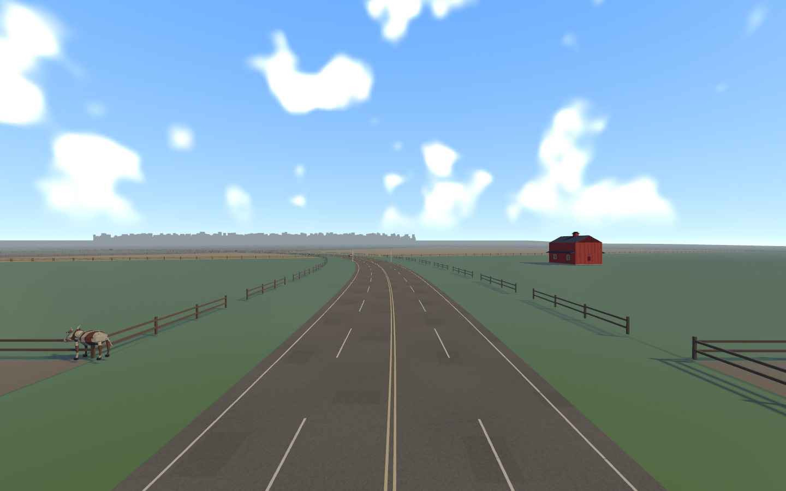
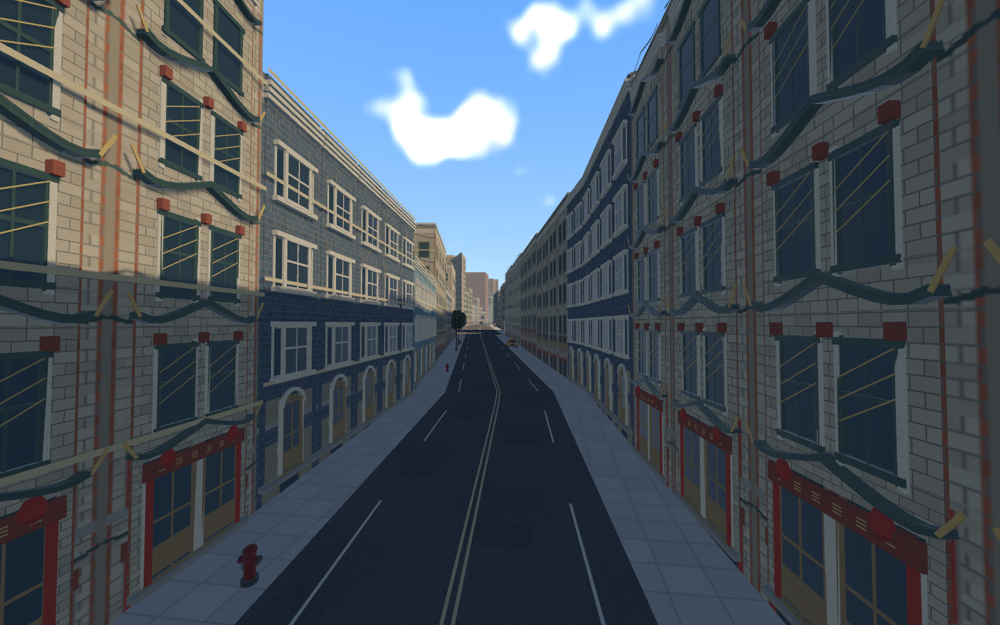
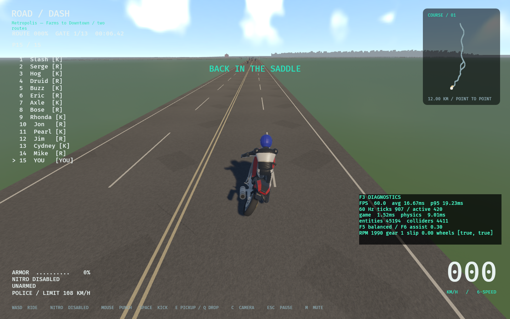

# Pass06 — existing road, paint and paving materials

Follows9f89e6005805c213d228a50966ad6ca30466a745 in RoadDash-polish,
codex/gameplay-graphics-polish. ADR110; partial P11-004 evidence, no new IDs,
placement/count changes or checklist closures.

## Investigation and implementation

Metropolis separates collider owners from render chunks. The legacy asphalt
installer only queried RoadChunk render meshes, so default-map roads had plain
color. Metropolis now creates the shared original procedural asphalt PBR directly.
The legacy installer skips allocation if no matching render surfaces exist.
This avoids an unused second set of three512² images on the default map.
Legacy maps retain their original meshes and use the same refined asphalt.

Eight-metre world UV tiles are assigned before chunk-origin rebasing; generated
tangents follow the actual sloping pavement. Fine aggregate, low-contrast1.28–
1.84m repair patches and short tar seals replace broad repeated tire bands.
Opaque white/yellow wear uses0.5m world scale and stays at least215/255 in its
texture channel at every mip. Existing paint widths, gaps and projected heights
are unchanged. Existing1m pavement slabs get slight per-slab tones, narrow seams
and dirt feathered along slab edges. These are texture joints, not modeled drain
grates or curb-specific runoff. Complete mip chains/linear repeat sampling
retain consistent scale without new floating overlays, transparency or LOD swaps.

No triangle positions/indices, collision/friction, ROW, terrain, building/facade
materials, assets/atlas hashes, props, physics/rigs, saves, controls, audio or
race logic change. Sources researched: repository procedural pixels, surface
batches and previous road evidence only. Original source media under project
MIT provenance; no third-party assets/code or UI artwork imported.

## Verification and cost

run_native.py runs the shared release binary with isolated saves and checks no
compiler/game process is active. Before is pass05; final after is rebuilt06.
Native survey uses matched1440×900 stations, with independently moving actors
and clouds. Dark-trial is a rejected lower-base-tone candidate, not final cost.
run_checks.py records mandatory commands serially after measurements.

The shared asphalt map set is4,194,300 bytes of uncompressed RGBA mip payload;
two64² paint sets add43,688 bytes. The formerly unused legacy set is no longer
allocated on Metropolis. This is image payload, not measured GPU residency.
Road shading now samples three textures instead of flat color; paint adds one
sample. No new render groups/meshes/entities or draw submissions. Native wall
frames measure whole application work, not isolated GPU shader cost.

New regressions cover world UV/tangent continuity across256m origin rebasing,
unchanged mesh positions/indices, opaque readable paint at every mip and no
unused legacy image allocation. Existing actual-pavement support, paint height,
Valley quotas and model differential/recovery tests stay in the workspace suite.

Full-course motion/shimmer, subjective curb/drainage art, user approval, GPU
profiling,16.7ms frame budget and Windows/controller/hardware remain open.
Static views cannot prove flicker-free racing. No whole milestone completion.

## Native results

Before19.606ms average /33.708ms p95; final19.972ms average /37.740ms p95.
Both miss16.7ms. The observed increase is retained, not labeled an optimization
or proved GPU regression. Identical census:3,067chunks,2,909,113render triangles,
2,613,119collision triangles,2,531static collision batches and19,068buildings.
Actual default-map survey and recovery exit0; reverse−1.898m/s, both pickup
errors0.0000m. Native farm, shaded city and remount images inspected: fine road
texture and quiet repairs visible near camera; continuous lane/edge markings
remain legible into the distance. Moving sky/actors are not pixel matched.

Final mandatory checks all exit0: fmt, workspace locked/all-target strict Clippy,
424workspace tests (1pre-existing ignored soak), locked debug build, asset audit,
5roadmap tests and progress check. Locked release build passed. New three tests
and existing model180-tick/body/joint/crash/run/remount differential fixtures pass.
Full paired rig native labs were not rerun: neither rig nor simulation changed.

Legacy Valley world survey:15sections/657roots retained;17.157ms average /
19.938ms p95 at1080p. Exit1 is the16.7ms performance gate, not a structural
failure. Source survey JSON and native log retained. Default --inspect-world
exits0:19,068buildings,36,635surfaces,two routes,12km. Representative Valley
S05 capture inspected; full temporal/legacy art acceptance remains open.
