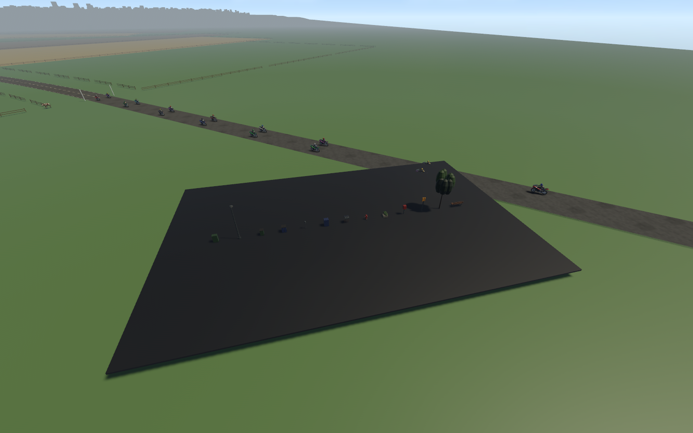
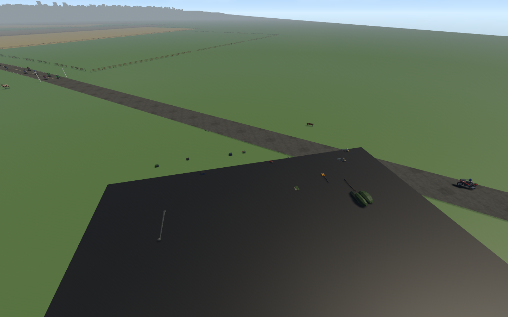
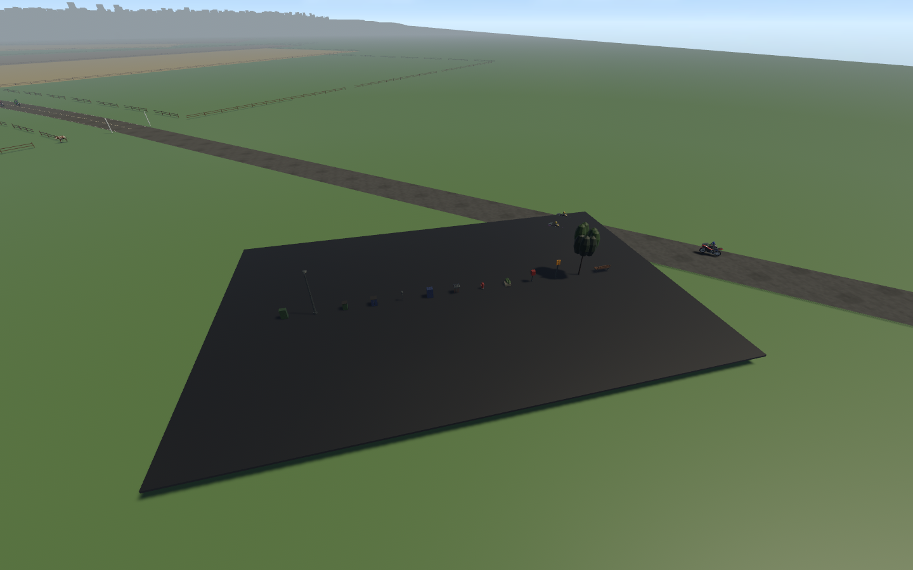

# Persistent destructible sidewalk props

DESTRUCTION-01 · 2026-11-07 · codex/persistent-world-destruction · parent2cf3892.

User scope: **props only, no cars**. All995 Metropolis sidewalk props across13
placed types now have persistent durability. Cars, buildings, roads and the
accepted rider/ragdoll systems are not damage targets. This does not retrofit
legacy Valley/City Run scenery or add whole-building fracture.

## What happens

Real swept/contact impacts accumulate bounded incoming closing-energy damage;
slow nudges below4m/s do nothing. Duplicate swept/contact reports share a0.5s
source/target cooldown. Direct punches/kicks deal140/350 strength units using
existing side-by-side geometry and a solid line-of-sight test. These are arcade
durability thresholds expressed in joules, not calibrated material fracture.

Original authored models remain attached to the authoritative physical owner.
Bins/planters/boxes compress to38% height with a matching solid collider. Poles,
signs, hydrants, benches and trees can detach, fall and scatter under Rapier's
contact response and gravity. The subsystem adds no launch impulse or rider
velocity adjustment. Hard objects retain existing crash risk; broken soft
furniture no longer forces a scripted knockoff, but remains physically solid.

Broken models stay in their damaged state through distance/LOD changes. Their
current scene LOD is pinned while broken; distance visibility remains bounded.
There is no destruction lifetime that makes wreckage disappear. At most48 prop
bodies simulate at once. After8s, only supported, sufficiently slow debris becomes
static; airborne or moving props continue simulating. Further destruction at a
full budget produces supported static wreckage. Walking navigation indexes the
new physical footprints instead of retaining invisible old prop obstacles.

Start/retry restores health, physical and backend poses, original colliders,
rigid-body modes, visual scale, LOD eligibility and navigation footprints. The
native test found that resetting only Bevy transforms let Rapier write back old
poses; the final implementation resets both backend and component state.

## Configuration and architecture

- `content/world/destruction.json`: all13 roles, mass, strength, crush/topple and
  soft/hard flags; speed threshold, cooldown,48-body budget,8s settling threshold.
  Embedded at build time; edit and rebuild. `rr_content` validates complete role
  coverage, finite values and safe bounds.
- `crates/rr_core/src/destruction.rs`: pure cumulative durability/reset and bounded
  energy rule; does not mutate racer state.
- `src/destruction/`: fixed-step contact/melee integration, reset, supported settling,
  visual state and reproducible native fixture.
- `src/world_gen/metropolis/streetscape.rs`: stable model/physical-owner registration.
- `src/world_gen/metropolis/navigation.rs`: moved/static ruin footprints and reset.
- `src/game.rs`, `src/props.rs`, `src/recovery.rs`, `src/sound.rs`: explicit restart,
  pinned broken LOD, soft-ruin contact policy and original synthesized break sound.
- ADR073 records alternatives and tradeoffs. No dependencies or downloaded assets.
  Existing Bevy0.17.3/Rapier0.32.0 integration remains; Rapier backend is0.31.0.

| Type | Strength J | Mass kg | Damage |
| --- | ---: | ---: | --- |
| hydrant |3000 |60 |topple |
| street lamp |6000 |35 |topple |
| bench |1200 |20 |topple |
| street bin |250 |7 |crush |
| planter |350 |12 |crush |
| broadleaf |16000 |90 |topple |
| parking meter |1800 |18 |topple |
| bus sign |900 |12 |topple |
| callbox |1600 |22 |topple |
| mailboxes |500 |10 |crush |
| recycling pair |350 |9 |crush |
| utility box |1800 |28 |crush |
| news boxes |500 |12 |crush |

## Verification

Reproduce the actual-model contact fixture:

```sh
ROADDASH_TRACK=metro cargo run --release --locked -- --destruction-survey
```

The fixture registers13 original catalog models with the production factory,
rams each using a real180kg20m/s sphere, checks that all13 break, checks car
exclusion and the dynamic budget, then resets and verifies every original pose
and fixed-body state. It captures before/damaged/reset views. The spheres are
test equipment; normal gameplay has no new projectile or launch force.





Automated coverage includes actual solver contact/release, restart backend pose,
slow contact, disabled-body and paused damage suppression, static wreckage when the dynamic
budget is full, direct two-punch bin damage, wall-blocked melee, supported debris
settling without deletion, navigation relocation/reset and content validation.

Execution receipts and exact command results are saved alongside this document.
Native scripted smoke verifies crash/getup/run/remount and race restart on both
branch choices; injected result-state checks are not proof of driving a whole race.

## Remaining limits

Damage is deliberately coarse crush/topple. There are no bespoke snapped meshes,
shattered glass, wood splinters, leaks, scorch decals or artist-approved broken
variants yet (DESTRUCTION-02). Toppled tree collision retains the existing trunk
shape, not per-leaf collision. The full-budget static fallback is an approximation.
The live-body cap is tested; this is not a measured full-course worst-case frame
budget or Windows hardware approval. Legacy-map breakable coverage remains outside
this Metropolis implementation; the existing broad prop/art exit gate stays open.

### Recorded results

- `cargo fmt --all --check`: passed.
- `cargo clippy --workspace --locked --all-targets -- -D warnings`: passed.
- `cargo test --workspace --locked`:298 passed,1 pre-existing ignored test.
- `cargo build --locked` and `cargo build --release --locked`: passed.
- `python3 tools/audit.py`: passed,519 declared dependencies/86 runtime source/media
  records/27 reference observations; declaration/provenance checking only.
- `python3 tools/test_audit.py`:2 passed; `python3 tools/test_roadmap.py`:5 passed;
  `python3 tools/sync_progress.py --check` and `git diff --check`: passed.
- Release `--destruction-survey`:13/13 real-model collision breaks,13 peak dynamic
  prop bodies, reset poses/body modes restored, no car damage.
- Release `--smoke-test`, both route0 and route1: native crash/getup/run/remount,
  fifteen-racer authored-grid restart, initialized playback sinks and result fixture
  passed. Linux/NVIDIA RTX3080/Vulkan; no Windows or subjective sound-quality claim.

New task IDs: DESTRUCTION-01 (verified implementation in Part00, originating05),
DESTRUCTION-02 (open broken-art refinement in05). Files added: core/content damage
modules, destruction config, runtime subsystem/fixture/tests and these receipts.
Modified: core/content exports, app/main registration, streetscape ownership,
prop LOD, soft-ruin recovery, race restart, navigation, sound and tracking/provenance
records. No files removed, no new library/source/media import. Next step is approved
broken-art variants and a measured worst-case damaged-street performance review;
no later major development part is automatically started. Local branch only;
no push, pull request or merge is claimed.
