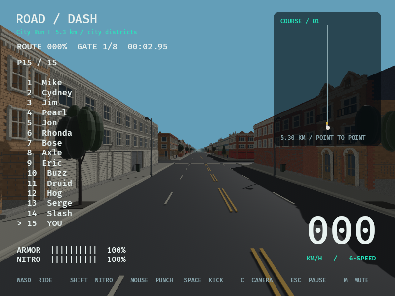
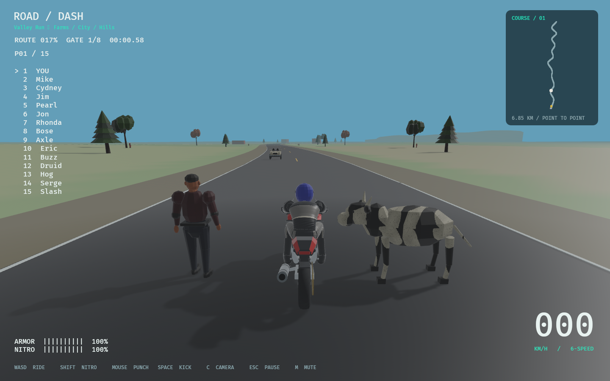
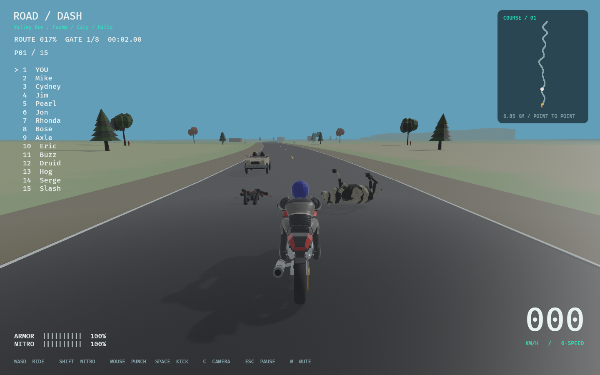

# Playable draft prop integration — 2026-11-01

## Implementation and checklist

PROP-03 applies selected authored volumetric drafts in the playable game, rather
than the isolated inspector. City Run has 212 tree and 212 lamp replacements,
318 reserved sidewalk fixtures, 28 parked vehicles on parallel streets, 32 moving
traffic/cross-traffic appearances and 52 pedestrian skin bindings. Valley retains
its structural content with 206 tree replacements, 16 traffic appearances and
42 human/cow bindings in the actor smoke scene (including temporary knockdowns).
These are spawned scene counts, not simultaneously visible/rendered counts.

Native receipts record 141 selected IDs in City Run, 72 in Valley, 165 unique
IDs across both. The whole catalog has 369 addressable source-bank IDs; remaining
banks are not falsely claimed placed. There are 118 separate runtime skin GLBs
(two LODs each for 55 human and four cow banks). Human/cow skin appearance persists
through standing/walking and existing physical knockdowns. Accepted rider/bike art,
collision policy, mass, joints/motors, ejection and recovery remain authoritative.

PROP-03 is newly verified in Part00 (145 checked /227 open,372 IDs). It originated
in Part05; reason, dependencies, acceptance and verification are in README.
V2-05-002/003/004/005 and V2-06 remain open for finished art, broad placement,
category audio/behavior, deformation and production QA. No future part started.

## Files and design

- `src/props.rs`: asset source, semantic choice/bounds fitting, native intake
  receipts, dependency-aware LODs, visibility and visual-only skin binding.
- `content/props.json`, `crates/rr_content/src/props.rs`: validated catalog; rejects
  traversal/nonfinite/invalid bounds and unexpected physics fields.
- `src/{lib,world,game,environment,runtime,npc,recovery}.rs`: plugin/loading,
  existing-owner visual attachments and human/cow appearance handoff. Cow physical
  specs and human anatomical construction are preserved. No original file removed.
- `src/world_gen/city/{mod,geometry,props}.rs`: omit superseded chunk visuals,
  retain collisions, place solid fixtures outside crossings/road/pedestrian lane.
- `tools/{prepare_runtime_props,verify_runtime_props}.py`, mesh `runtime/` folder:
  reproducible visual skin conversion, independent binary intake validation.
- Prop queue planner/reference tests, README/progress/task placement, ADR048,
  known issues/history/test matrix/research and asset provenance updated together.

ADR048 compares physical replacement with visual attachment and selects the latter.
Physics drivers are read; bone transforms are written only without RigidBody.
Static LOD thresholds 32/95m have hysteresis; actors use 70/90m hysteresis, hiding
beyond250m; static props hide beyond500m. No scene meshes spawn in PostUpdate.
Set `ROADDASH_LEGACY_PROPS=1 cargo run --release` to compare earlier presentation.

## Testing

- `cargo fmt --all --check`: pass (`fmt.txt`).
- `cargo clippy --workspace --locked --all-targets -- -D warnings`: pass (`clippy.txt`).
- `cargo test --workspace --locked`: 179 passed, one preexisting ignored soak;
  no failures (`tests.txt`). New NPC regression compares shapes, masses, damping,
  joint configuration and initial ejection velocity, then runs both layouts for
  180 ticks checking finite/bounded body states. Chaotic contact trajectories are
  not claimed bit-identical across ECS allocation layouts. The failed initial
  cross-world exact-trajectory experiment is retained in
  `trajectory-comparison-attempt.txt`; it was replaced by physical-definition,
  initial-momentum and bounded-contact checks, which pass in `tests.txt`.
- `cargo build --locked`: pass (`build.txt`).
- `python3 tools/verify_runtime_props.py`: 118 actor GLBs; exact intake hashes,
  weights/indices, inverse bind matrices, rest frames and finite geometry pass.
- Prop authoring/reference tests and all1,107 original static GLB/LOD/material
  checks are retained; see `python-tests.txt`, `static-validation.txt`.
- Roadmap synchronization/regression tests and `tools/audit.py` pass. Audit covers
  519 dependency declarations,31 existing shipped records and27 observations;
  it is declaration/hash checking, not legal clearance.
- Actual Vulkan RTX3080 game: nine-view `--world-survey` passes with977 complete
  buildings/53blocks; Valley `--actor-smoke-test` passes ten-body cow/eleven-body
  human knockdowns with solid contacts/audio; City `--smoke-test` passes two
  crashes, get-up/running/remount and finish. Native logs/receipts/screenshots here.
- Bounded City smoke sample: wall-frame average17.10ms,p95 20.73ms; this is not
  GPU timing, a benchmark comparison or a60FPS/performance certification.

## Actual game views

## Research, provenance, limits and next steps

No newly investigated GitHub repository, new dependency, external code or original
retail media incorporated. Existing independent draft authoring was reused.
ASSETS.csv adds118 source-hashed local-development skin records; visual-design
release review remains pending, shipped=false, following ADR047/048. Development
loading is distinct from approval to distribute a standalone release.

The meshes remain rough shared-archetype drafts, not faithful finished concept
renders. Rigid per-part weights can expose seams and disconnected-looking joints;
anatomy, smooth clothing, signage icons, vehicle detail and foliage need art review.
No new prop-specific sound, breakability, species behavior, Windows/macOS verification
or full performance approval is claimed. Continue refinement under existing V2-05
and V2-06 IDs. No new unfinished scope was silently checked off.

Branch: `codex/props-in-game`; working-tree implementation only. No commit, push,
PR or merge performed. The repository already contained extensive uncommitted city,
collision and catalog work; it was preserved. This report describes this integration.
