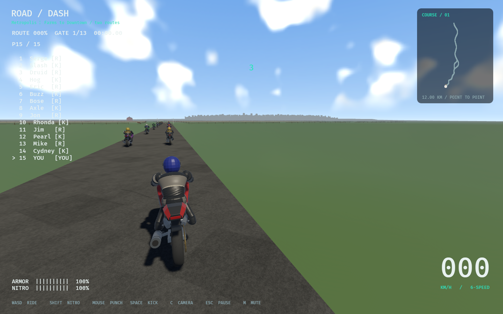

# Racers and killers

AI-10 · 2026-11-07 · codex/racer-killer-ai · parentc696e45 · ADR074.

Fourteen AI rivals split evenly into seven racers and seven killers. Odd rival IDs
are racers, even IDs killers. Standings label them `[R]` / `[K]`; player controls,
roster identity/colors/bike statistics and accepted physics remain intact.

Racers prioritize the race and find passing space around slower riders. They do
not start melee. A landed direct punch/kick records the exact attacker's racer ID:
only that attacker becomes eligible for pursuit and retaliation. Multiple actual
attackers may each be remembered, but sharing a personality slot does not confer
hostility. Racers do not hunt downed riders. Grudges persist for the current race
and reset at restart. Incidental vehicle bumps do not start a grudge.

Killers pursue nearby opponents without provocation, match speed to fight, and
retain the existing nearby forward downed-rider hunt. Pursuit is bounded to at
least64m ahead/10m behind and9m lateral separation; same-corridor checks prevent
pursuit across separate branches. Cooldowns are60% of the authored baseline with
a0.75s floor. The eight-second opening grace, stamina costs/regeneration, direct
strike geometry, occlusion, three-hit knockoff, traffic avoidance, smooth steering,
curvature pace and physical crash/recovery rules remain integrated.

Pure decisions live in `crates/rr_core/src/rival_ai.rs`; runtime uses them in
`src/game.rs`. `src/combat.rs` enforces permissions both when selecting automatic
kick direction and when resolving a hit, then records only actual landed hits.
`src/ui.rs` adds labels; `src/verification.rs` asserts actual seven/seven native
roster coverage. No new dependency, asset, proprietary media or external source.

## Verification

Domain scenarios cover seven/seven assignment, no unprovoked racer combat, exact
identity retaliation (including riders sharing personality0), fresh-race reset,
launch grace, killer hunting/cooldown, passing and racer refusal to hunt fallen
attackers. The integrated combat fixture verifies a racer refuses an opening
strike, becomes hostile after a real player punch, and auto-kicks that player
without hitting a closer innocent rider sharing the same personality slot.

The prior decisive-punch physics fixture now uses a killer attacker, preserving
its original purpose under the new permission rule. All existing momentum,
ragdoll, camera, prop destruction and recovery regressions remain required.
Native release smoke on both Metropolis routes checks the seven/seven roster,
crash/getup/run/remount, fifteen-racer grid restart and initialized audio sinks.
Result fixtures do not prove a complete driven race or subjective balance.

Exact command receipts and native metrics are stored here after execution.

## Scope and remaining gate

AI-10 implements behavior; AI-11 retains human full-race aggression/fairness
review. There is no positional rubber-banding, physics retune or new damage boost.
Predictable alternating assignment and persistent multi-attacker grudges are
intentional defaults. Future role tuning should preserve identity-based permission.
No next major development part is automatically started. This branch is local;
no push or merge is claimed.

## Recorded results

- `cargo fmt --all --check`: passed.
- `cargo clippy --workspace --locked --all-targets -- -D warnings`: passed.
- `cargo test --workspace --locked`:303 passed,1 existing ignored test.
- `cargo build --locked` and `cargo build --release --locked`: passed.
- `python3 tools/audit.py`: passed (519 dependency declarations,86 runtime asset
  records,27 reference observations; declaration audit, not legal clearance).
- `python3 tools/test_audit.py`:2 passed; `python3 tools/test_roadmap.py`:5 passed;
  `python3 tools/sync_progress.py --check` and `git diff --check`: passed.
- Both release native smoke routes: seven racers/seven killers, fifteen-racer
  restart, farm/city crash/getup/run/remount and result fixture passed. Audio
  initialized; no subjective sound/platform or full driven-race balance claim.

New task IDs: AI-10 verified in Part00 (originating01), AI-11 human balance open
in Part01. Added pure core rival_ai and these receipts; modified core exports,
game pursuit/passing/cooldowns, combat permission/hit memory, UI roles, native
census and tracking/research/test records. No files removed. ADR074 records exact-ID
memory instead of personality-slot retaliation; existing libraries reused without
new research imports. Next step is user full-race feedback under AI-11. Local
branch codex/racer-killer-ai; no push/merge is claimed.
