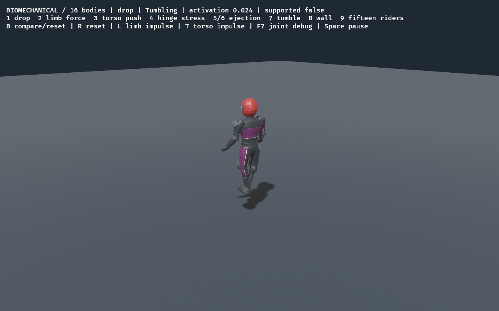

# Automatic ragdoll comparison launch — 2026-11-02

The user requested new physics without B. B is a standalone-lab control, not a
race toggle. The unmerged comparison branch now launches the biomechanical rig
with plain `cargo run --release`. The lab uses the same selector and also starts
in biomechanical mode. `--ragdoll-baseline` selects the old rig; explicit CLI mode
overrides ROADDASH_RAGDOLL. Conflicting CLI flags fail clearly. Physics test
fixtures retain their baseline default. No masses, shapes, joints, motors,
velocities, recovery, animation, assets, dependencies or save formats changed.

Changed source: src/biomechanics/{mod,view,tests}.rs. Updated AGENTS, README,
progress, decisions, known issues, development history, test matrix and existing
ragdoll report. RAG-04 now includes automatic startup coverage; no new task ID,
checkbox status or major exit gate changed. RAG-05/06 acceptance stays open.
No new repository investigated or third-party code/assets incorporated.

Validation: cargo fmt --all --check; strict locked all-target workspace Clippy;
locked workspace tests (165 passed, one preexisting ignored soak); locked build;
roadmap sync/five roadmap tests; provenance audit all pass. Native default race
and explicit baseline race each pass two crashes, recovery, remount and finish.
Native standalone view passes both modes; initial capture visibly labels
BIOMECHANICAL /16 bodies with no user key press. Logs and metrics are alongside.
These are local Linux/NVIDIA checks, not Windows/performance/art certification.

Branch: codex/biomechanical-ragdoll in /home/imad/Documents/ChatGPT/RoadDash-ragdoll.
Changes are local and uncommitted; not pushed or merged. Main remains unchanged.
Run `cargo run --release` here to test racing, or append -- --ragdoll-lab-view for
the lab. Baseline rollback is explicit -- --ragdoll-baseline. This comparison
checkout intentionally retains its older map/art. B is optional and lab-only.
