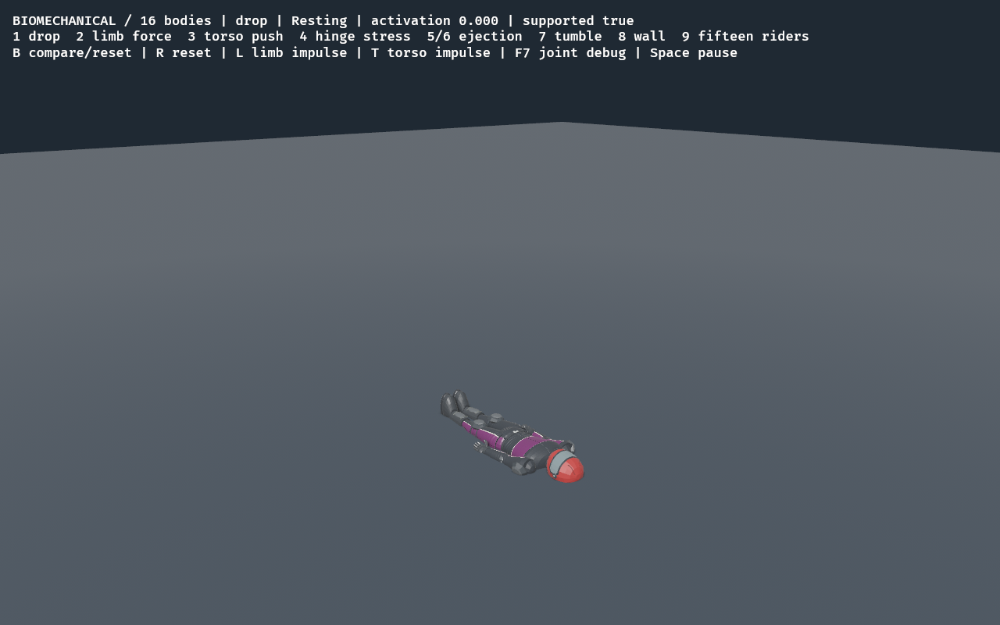
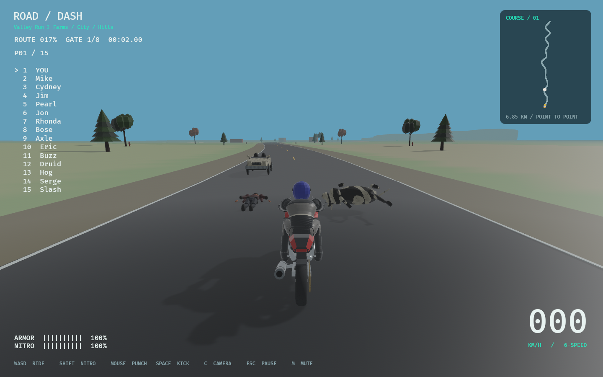

# Approved biomechanics integration — 2026-11-06

User scope: merge the new ragdoll physics, then incorporate reported knee crossing/
weak resistance and rear/downed ride-over behavior before integration. PR #12:
https://github.com/ImadMashhood/RoadDash/pull/12

1. Implementation:16 physical bodies, anatomical stops, persistent passive and
   capped active motors, crash activation curves and existing recovery, integrated
   with current5.3km City Run, props and original contact comparison. Launches use
   the new rig automatically; --ragdoll-baseline retains the11-body control.
2. Checklist: RAG-07 integration, RAG-08 legs and COLLISION-05 ride-over verified.
   README/progress now152checked /229open,381stable IDs. Reasons, parts,
   dependencies, acceptance and verification are in README. RAG-05/06 distal
   deformation/art and broad production performance/platform coverage remain open.
3. Files: imported src/biomechanics/{mod,muscles,debug,lab,view,tests}.rs, pure
   rr_core/rr_content biomechanics and content/biomechanics.json; adapted game,
   vehicle, runtime, recovery, verification and main/lib. Current city, art,
   NPC appearance bindings, saves and controls retained. Contact rules/tests in
   rr_core/contact.rs, recovery.rs, game.rs and collision_tests.rs. No working
   source removed. Updated AGENTS, README/progress/placement, decisions/issues/
   changelog/test matrix, repository and asset registers, research/evidence.
4. Research/provenance: five previously pinned ragdoll repositories remain
   reference-only. No additional investigation, copied code/media, dependency or
   engine migration. Original configuration/source hashes reconciled in ASSETS.csv.
5. New IDs: RAG-07 and RAG-08 (Part03), COLLISION-05 (Part01); all acceptance
   details are in README. Existing future gates were retained.
6. Tests: cargo fmt --all --check; locked workspace all-target strict Clippy;
   locked workspace tests (200passed, one preexisting ignored soak); locked build;
   roadmap sync/five roadmap tests; audit (519dependency declarations,
   32shipped records,27research observations) pass. See actual audit.json for counts.
   City default and explicit-baseline smoke each complete two crashes, recovery,
   remount and finish. Valley actor smoke verifies16human/10cow bodies and solid
   contacts. Native standalone view passes both modes, and18headless lab runs are
   finite. Current screenshots/metrics/logs alongside. Linux/NVIDIA/Vulkan only.
7. Design: ADR049 combines existing owners/visuals and new articulation. Rebuilt
   energy envelopes retain original-crash allow-reverse behavior (new regression).
   Hip medial stops0.08rad, twist±0.22rad; passive hip k/d/cap12/3.5/28 and knee
   18/4/32. Knees retain single-X0–2.44rad hinge. Four substeps/eight extra solver
   iterations. Equal3Nm knee load: old deflection0.600rad, new0.167rad (~72%less);
   paired20Nm inward hip stress retains minimum knee separation0.266m. High-speed
   settling/energy/limits remain within existing thresholds. Initial six-iteration
   tuning overshot the high-speed limit gate slightly; stronger convergence fixes
   it. Initial attempt retained in leg-tests.txt, final tests.txt passes.
8. Contact behavior: closing>=3m/s rear/downed hits get upward speed
   min(2.8+0.035*closing,4)m/s,0.35s cooldown. Fast rear hits knock target down;
   gentle rear hits nudge. Downed solids receive a bounded push with the scripted
   momentum charged to the attacking bike. Native horizontal collision transfer
   is retained. Actual dynamic contacts produced~0.38m rise while remaining mounted
   and moving the target. Both entity orders, own-body exclusions, tiny touches,
   repeat knockdowns/no duplicate bodies and head-on/car regressions pass. This
   intentional arcade vertical-energy assist is the user's requested exception;
   no original-arithmetic parity claim is made for these ride-over classes.
9. Limits/next:16physical segments still feed11visual frames; independent distal
   deformation and final art remain open. No Windows/macOS or worst-case race
   performance certification. Eight extra iterations require broader RAG-06
   profiling. Baseline-labelled screenshots still show the preserved old control.
10. Git: integrated on codex/biomechanical-ragdoll with current main; original
    comparison-only restrictions are superseded by the2026-11-06 merge approval.
    Publish and merge through PR #12; server state is the delivery record.

