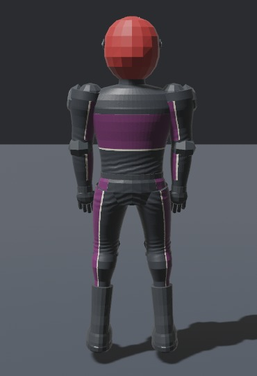
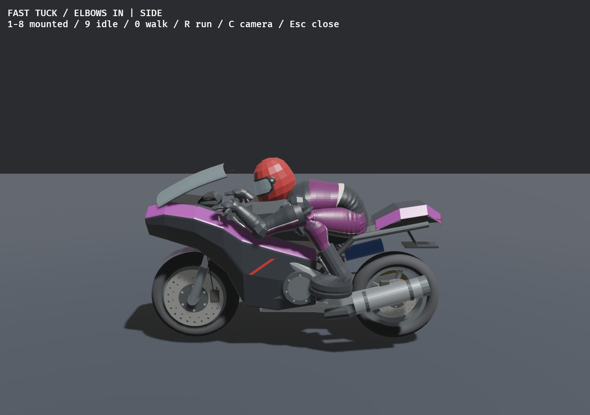
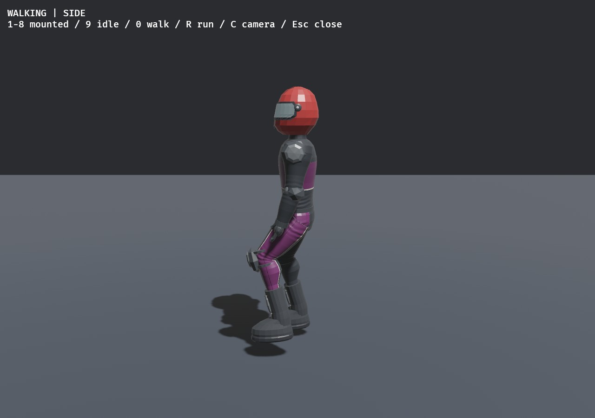
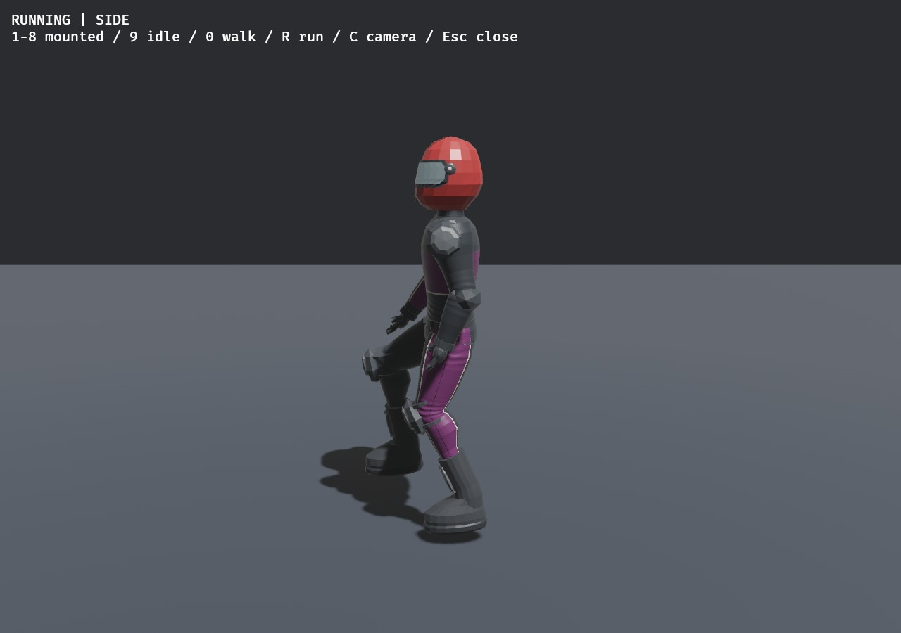

# Camera, contacts, gait, wrists and crash motion — 2026-11-06

Local branch `codex/part-03-animation-recovery` from main `038d0b1`; includes the
preceding uncommitted Part03 work. No commit/push/merge performed. ADR051 records
design and rollback. No dependency, physics backend, save or art-asset replacement.

## Corrected wrists



The earlier extra wrist twist was the wrong correction. The actual defect was a
neutral-frame mismatch: the forearm used the animated frame while the hand kept
its authoring-world neutral frame. Distal frames now inherit their animated parent,
with a parent-relative local motion delta and fixed attachment offset. Standing
uses identity local wrist rotations, so the hands continue straight down from the
forearms. This also corrects the ankle/spine neutral calibration without moving
physical bodies. Standing/seated wrist-axis and attachment tests pass. Before:
[rejected bent wrists](before-standing.jpg).

## Requested changes

| Request | Working implementation |
| --- | --- |
| Camera jumps near people/under objects | Static obstruction sphere excludes moving, owned and NPC bodies; horizontal/lowered boom candidates handle ceilings; degenerate look vectors retain orientation. Recovery holds its initial chase heading across nearest-road tangent changes. Solid walls still block the camera. |
| Rear bump bounces | Upright rear contacts no longer call the ride-over hop. Closing normal speed shares as `(mA*vA + mB*vB)/(mA+mB)` using bike+rider masses. Source slows, target accelerates; both native velocities are updated from pre-impact snapshots. Separating contacts are ignored. |
| 60km/h faster knocks the front rider off | At closing>=60/3.6m/s, front victim detaches with shared response velocity. Below threshold both stay mounted. Side/head-on/downed-object policies remain separate; downed-body/wreck hops remain. This supersedes the earlier upright rear-hop request. |
| Elbows point upward | Held-arm pole targets point down, including fast tuck; grips and chain lengths stay fixed. |
| Rewrite walking | Continuous distance-phase foot stance/swing/lift, opposing arm swing, pelvis/shoulder counter-rotation and body weight shift replace old run-clip playback. Stable forward knee poles prevent IK bend flips. Existing terrain support/stance locking remains integrated. |
| Side rolling/forward somersault tendency | One supported slide cue per ragdoll: axis is up cross travel. After0.3s at>=3m/s, request<=2.2rad/s but pay the full angular/relative kinetic cost from at most8% of current horizontal COM energy. Vertical momentum/forward direction are retained. Geometry can interrupt the roll. |
| Legs kick back on frontal impact | Forward speed loss>3m/s marks a frontal release; a0.38s curve targets hip+.25rad/knee+.65rad with<=.35 activation floor through existing torque-capped motors. No direct spawn velocity impulse. Existing joint limits/passive resistance and crash energy guard remain. |
| Return to original map | Bare launch selects6.85km Valley (farms/city/hills). `ROADDASH_TRACK=city` and `=valley` retain explicit choices. No generator quotas, lots or content IDs changed. |





## Try locally

```sh
cd /home/imad/Documents/ChatGPT/RoadRash
cargo run --release
cargo run --release -- --animation-lab-view
# 1-8 mounted motions, 9 standing, 0 walking, R running, C camera.
cargo run --release -- --ragdoll-lab-view --crash-motion-demo
# 5/6 ejection, 7 tumble; B compares the baseline, R repeats.
ROADDASH_TRACK=city cargo run --release
```

Tune original validated `content/crash_motion.json` and rebuild. Set
roll_energy_fraction=0 or release_activation=0 to disable the corresponding cue;
`--ragdoll-baseline` preserves the old physical control. The roll is a small arcade
assist paid from motion, not arbitrary continuously powered angular acceleration.
Frontal joint motors may do bounded work subject to the existing energy envelope.
No physical masses, passive resistance, anatomical limits, solver settings or
handling were retuned. Source pose and terrain contacts still determine outcomes.

## Verification

- `cargo fmt --all --check`: passed.
- `cargo clippy --workspace --locked --all-targets -- -D warnings`: passed.
- `cargo test --workspace --locked`:228 passed, one existing ignored long soak;
 163 game-library,1 executable helper,25 content and39 core tests.
- `cargo build --locked`: passed.
- `python3 tools/audit.py`:519 declarations,34 runtime asset records,27 research
 observations;2 audit tests and5 roadmap tests pass; README/progress sync agrees.
- New tests: rear threshold/mass-weighted transfer/no lift, pair momentum/energy,
 both entity orders, camera wall/ceiling/foreign ragdoll at60/144Hz with mounted and
 on-foot focus, no on-foot tangent snap, whole gait cycle continuity/lengths,
 downward tuck/normal elbows, standing/seated neutral wrist attachment/axes,
 one-shot forward/side roll energy/forward-speed bounds, no unsupported/baseline
 roll, and frontal motor targets with exactly unchanged pre-solver velocities.
- Existing model differential physics/recovery, traffic/cross traffic, combat,
 downed-object hop, manual foot/finish, reset, saves and structural tests pass.
- Native animation review: eleven motions across three views, corrected wrists
 inspected in rear/front/side; current images alongside. The first review fixture
 omitted the runner owner binding and displayed a static avatar; fixed before
 accepting locomotion renders. The gait test caught and fixed a knee-pole flip.
- Native optional crash-motion comparison: ejection demo passes both physical
 modes, with HUD reporting frontal/roll state; no freeze/panic observed.
- Native Valley default: two crashes, both recoveries/remounts and results pass
 without RUST_MIN_STACK override. Explicit baseline and independent cow/human
 actor smoke also pass. Audio initializes four sinks. Overlapping smoke runs are
 functionality evidence, not frame-time comparisons or performance benchmarks.
- All18 paired headless ragdoll scenarios finite; new15-rider fixture has240 bodies,
 all asleep at end and max anchor error~.0014m. Default fixture has no gameplay
 rider, so the new style is intentionally tested separately by the energy tests
 and explicit native `--crash-motion-demo`; do not present ordinary lab metrics
 as measurement of the style-enabled rolling response.

Native host: Linux/NVIDIA RTX3080/Vulkan. No Windows, physical-controller, subjective
motion acceptance or production15-racer frame/physics p95/allocation claim. The
optional large-city debug stack issue ANIM-12 remains open; restoring Valley does
not diagnose it. Complete terrain/cloth/bike clearance, NPC distal skins, enclosed
traps and user crash/gait approval remain existing production gates.

## Tracking, files and next steps

New verified IDs: CAM-02 and COLLISION-06 (Part01), ANIM-13 and RAG-10 (Part03),
MAP-01 (Part01). README gives reason/dependencies/acceptance/verification for each;
167 checked/223 open,390 IDs. Previous tasks/history retained; COLLISION-05's
upright-rear subset is explicitly superseded. Part03 exit gate stays open.

Main changes: `src/game.rs`, `src/camera_tests.rs`, `src/collision_tests.rs`,
`src/recovery.rs`, `crates/rr_core/src/contact.rs`, `src/track.rs`, `src/animation.rs`,
new `src/animation/locomotion.rs`, review fixture and model distal calibration/tests;
`src/biomechanics/{mod,muscles,reactions,view,tests}.rs`, new validated
`crates/rr_content/src/crash_motion.rs` and `content/crash_motion.json`. Updated
AGENTS, README/progress/placement, decisions/issues/history, testing and provenance
registers. Earlier Part03 files remain in the same uncommitted change. No source
files removed. No new repository investigation, external code/media or dependency
adoption; original project code/configuration stays MIT. Source-track hash and new
configuration provenance are recorded in ASSETS.csv; screenshot provenance alongside.

Next: user review of straight wrists, full-speed gait, ceiling camera and crash
motion, then remaining terrain/clearance/energy/performance acceptance. Do not
advance automatically to world production or other major parts.
