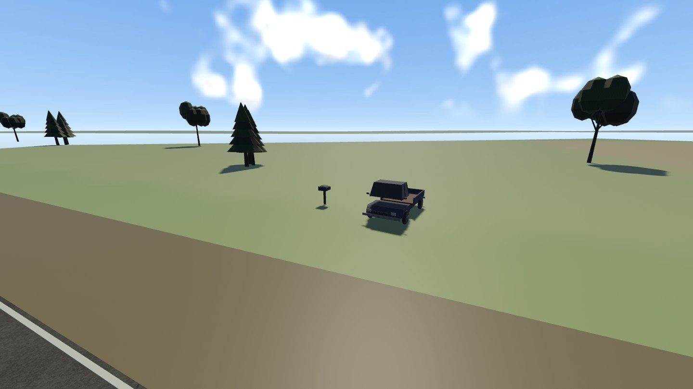
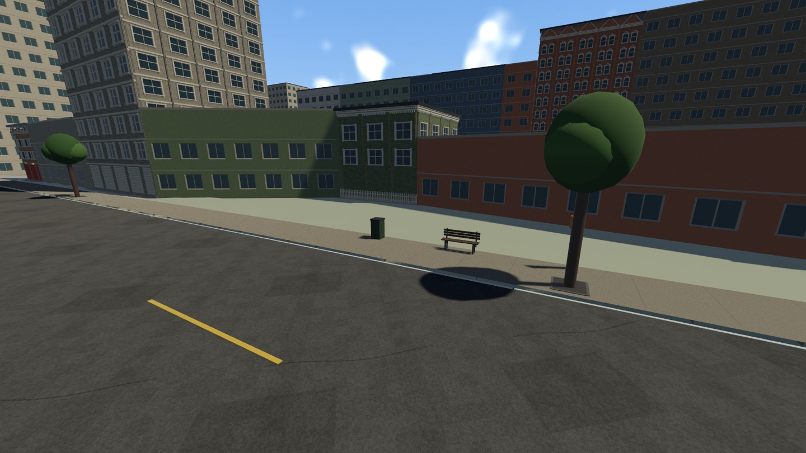
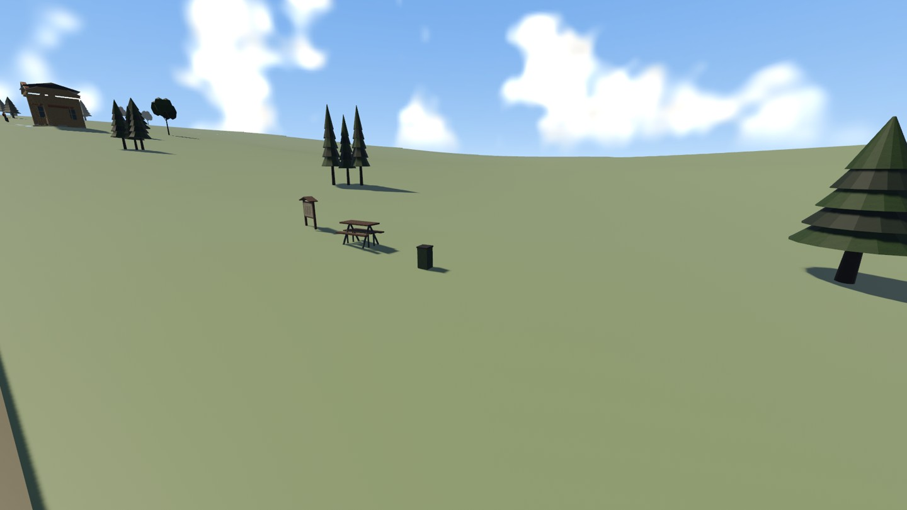

# Roadside variety — 2026-11-07

User request: more varied roadside scenery. Follow-up on the existing uncommitted
Part05 branch, without changing accepted rider/ragdoll behavior or structural map.

The former15-role mirrored single-object cycle is replaced by35 registered prop
roles and20 small authored groups: farm mail/supplies/markets/loading/parked
pickups/scrap; city transit/post/pause/service/phone/civic furniture; rural utility/
loading/scrub; hill picnic/camping/timber/service/rocks. Near-road farm verges now
complement distant field-edge dressing. These reuse existing original draft GLBs;
no new assets, source copies, third-party repository or dependency adopted.

World scenery seed and stable zone/anchor/member hashes select group, model,
spacing jitter, modest size variation and heading independently for each side.
Each zone reserves a weighted share of224 maximum static owners. The city gets
four shares, farm verge/hills two each, and field edges/rural one each. Seeded site
priority distributes budget through the full zone rather than filling its start.
Road, whole building/access footprints, grid roads, junction sightlines, existing
objects and support-relief guards still apply to every group member. Groups may
be partially rejected. Sidewalk offsets/yaw are specifically constrained to leave
pedestrian space. No additional trees, NPC/traffic behavior or physical rig tuning.

## Acceptance and evidence

DRESS-02, Part05; reason: repeated/mirrored roadside props; dependencies: DRESS-01,
PROP-03, existing registered model catalog and supported layout. Accept seeded
repeatability, at least28 placed roles/16 groups across all five zones, broad
station coverage in each zone, bounded counts and native actual mesh proof.

The placement regression compares every position/rotation/size/model seed,
verifies seed changes alter dressing, checks all road/access/group clearances,
requires zone start/end coverage and rejects malformed groups/missing references
and sidewalk members intruding into the pedestrian band. Native route survey
records actual solid owners, rendered mesh descendants, roles/groups/zones and
close farm/city/hill captures. Broad finished-art/audio/hardware gates remain open.

## Decisions, limitations and next work

ADR056 records weighting, partial group rejection and original-catalog reuse.
Prop silhouettes/materials remain draft quality. Parked vehicles are solid static
scenery, not additional traffic. The per-frame mesh LOD behavior is unchanged.
First Part05 performance samples remain historical; any new frame measurement is
reported separately rather than inferred from the spawn cap. Full prop production
and broader V2-05 acceptance remain open. Next work: review roadside composition
at riding speed and refine specific prop art/encounters, not indiscriminate trees.

## Git

codex/part-05-world-dressing; this follow-up and preceding Part05 work remain local
and uncommitted. PR16/main2a3ea00 is the merged base; no push or merge claimed here.

## Verified result

Native first pass:224 placed solid owners,680 actual mesh descendants,34 used
roles and all20 groups across five zones. Zone counts: farm fields23, farm verge45,
rural23, city89, hills44. All placement, actual geometry and architecture budget
assertions passed. No existing-object rejections. The35th configured role is an
unused barrier option, not a claimed placed type. Original map allocation and
geometry fingerprints match the preceding pass exactly. Native farm/city/hill
close inspection is included after the benchmark stages; pause/HUD nodes are
hidden only in these automated review views for legible evidence.

245 workspace tests passed, one existing ignored soak; strict workspace Clippy,
format check, locked build,43-record asset audit and five roadmap tests passed.
Native smoke passed farm crash/remount, city/hills, hill crash/remount and finish,
with four audio sinks. First new survey measured17.96ms p95, missing16.7ms; exit1
is the performance gate, not a mesh/placement/assertion failure. Retain the failed
performance receipt. Broader optimization/hardware and final art gates stay open.

Changed this follow-up: content/world/dressing.json; rr_content dressing schema;
world_gen dressing planner/owner metadata; report/survey inspection; README,
PROGRESS, task placement, decisions/history/issues/test matrix and asset inventory.
No files removed. No gameplay/contact/physics code changed by this follow-up.
Only new task: DRESS-02, verified Part05 scope and placed in completed Part00;
roadmap now180 complete/223 open,403 unique IDs. Existing open requirements stay.

Final clean-view survey:17.11ms wall-frame p95 (still above16.7ms), all geometry/
variety assertions passed again.224 owners/680 mesh descendants/34 roles/20 groups
remain. The first17.96ms receipt is preserved. Exit1 continues to identify the
performance target; broader performance gate is intentionally open.

