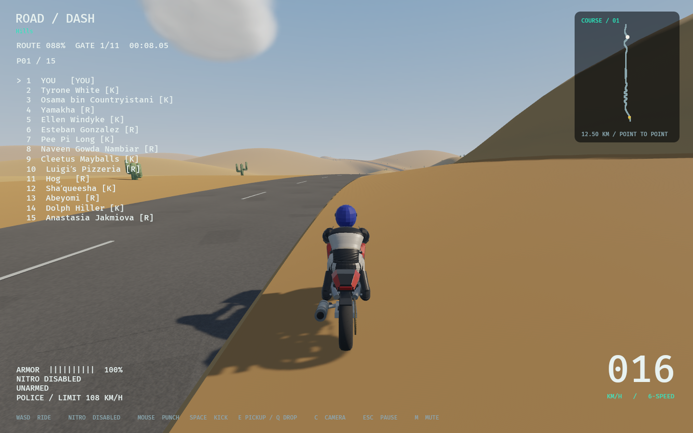

# Sand speed penalty — issue 29

The shared sand implementation passes controlled adapter comparisons and four native functional cases. Final integration checks against the latest main are recorded below; human feel and broader hardware gates remain open.

The existing Surface enum had no sand. Hills used Dirt beyond station 5500 even
though its shoulders and western/dune terrain were sandy. Dynamic handling only
limited grass to 32 m/s; Assisted applied an off-road 32 m/s limit and 1.8 m/s²
drag. Metropolis has 6957 asphalt, 12793 sidewalk and 16865 other paved surface
polygons; its farm soil/gravel is not authored sand. No current track control point authors Water; the unrepresented Water metadata is preserved and is outside the driveable-course comparisons. No new sand biome is invented.

Shared rr_core surface rules append the serde name `sand`, preserve old names,
and use a 18 m/s drive cutoff, 0.55 forward-drive multiplier, 0.50 traction and
additional rolling deceleration `1.8 + 0.14 * abs(speed)` m/s², bounded so drag
cannot reverse velocity. Dynamic resistance is budgeted after tyre/aero acceleration so combined braking cannot double-spend the stopping impulse. The cutoff removes engine power smoothly rather than
clamping incoming momentum. Reverse retains its existing control acceleration;
rolling resistance still applies. Assisted sand replaces its legacy off-road drag rather than stacking both. Other surface coefficients are unchanged.

Hills' 5200–5500 m meadow blend is shared between visual shoulder/terrain
colour and classification (sand at the halfway point). Asphalt takes precedence,
including the other western branch at the junctions. Rendering reads the authored
blend; simulation never reads texture pixels. Metropolis street offsets are
accounted for; no changes to map geometry, rigs, saves or input bindings.

## Measured behavior

Same balanced bike, flat grade, full throttle, 60 Hz; speeds in m/s. These are
simulation measurements, not performance measurements. [Raw adapter receipt](adapter-metrics.txt).

| Surface | Dynamic at 2 s | Dynamic at 20 s | Assisted at 2 s | Assisted at 20 s |
|---|---:|---:|---:|---:|
| Asphalt | 12.600 | 49.482 | 22.000 | 55.000 |
| Dirt | 12.576 | 49.482 | 16.500 | 55.000 |
| Gravel | 12.557 | 49.482 | 14.300 | 55.000 |
| Grass | 12.562 | 31.147 | 14.960 | 32.000 |
| Sand | 2.875 | 11.118 | 2.127 | 8.172 |

Both adapters pass stronger coasting loss from the same 30 m/s start, no entry
velocity clamp, road-pace recovery after exit, AI traversal, and forward after
reverse. Six-second sand reverse speeds: Dynamic -0.7583 m/s and Assisted
-0.7935 m/s. A separate test covers reverse on the authored flat western shoulder.
Core stopping-budget checks prevent combined engine/sand drag from reversing a
coasting bike near rest. Existing model differential/recovery tests are unchanged.

## Native evidence and regression checks

The pre-integration behavior tree passed 603 workspace tests (one existing
ignored soak), formatting, strict Clippy, debug/release builds, audit and roadmap
checks. The native fixture initially queried ground in the same Update that
left Garage, before the physics broad phase was ready. [Initial failure](native/initial-readiness-failure.txt)
is retained. Waiting two active fixed ticks fixes fixture readiness without
changing gameplay; post-fix strict Clippy, format, release build and all four
native cases passed.

Native binary SHA256: `f5751b658a3213d404cae3775f1ca9919b0fc178759ed9a078471e0232eaa7bf`.
It predates integration of performance PR35; those receipts are historical,
not a claim that the later combined executable was used.

- [Hills surface receipt](native/surface-hills/receipt.json): two grounded wheels,
  road 25.822 and sand 4.564 m/s after 240 active ticks; [measurements](native/surface-hills/surface-survey.json).
- [Metropolis surface receipt](native/surface-metro/receipt.json): asphalt and
  existing non-sand off-road ground remain driveable; [measurements](native/surface-metro/surface-survey.json).
- [Anatomy recovery, Hills route 0](native/recovery-anatomy/native.txt) and
  [baseline recovery, Hills route 1](native/recovery-baseline/native.txt): both
  pass, two remounts each, zero exceptional rescues and 0 m pickup error.

Native `--surface-survey` drives real authored ground at Hills 11000 m or
Metropolis 1200 m. Native slopes differ; use the matched flat-grade tests above
for comparisons. Runs used Vulkan on NVIDIA GeForce RTX 3080 under concurrent
compiler load; no frame-time or broad hardware claim is made. Human sand-feel
acceptance and steep-uphill parking-reverse coverage remain open.

## Main integration

PR35's measured defaults and exact terrain cache are retained. Shared sand tint
is evaluated per vertex after the cached/uncached geometry path; vertices,
indices and collision remain unchanged. Integrated checks: pending completion.

Research: local current track/handling/terrain implementations and locked Bevy
0.17.3/Rapier 0.32.0 were inspected. Requested engine-neutral level-design,
game-feel, input-systems, performance-optimization and procedural-gen skill
instructions informed deterministic shared authoring, input preservation and
measured verification. Their repository provenance is gamedev-skills (Apache-2.0);
Bevy skills are MIT and target 0.20, so no 0.20 API or migration was imported.
No third-party code or media was copied. No performance/hardware claim.
