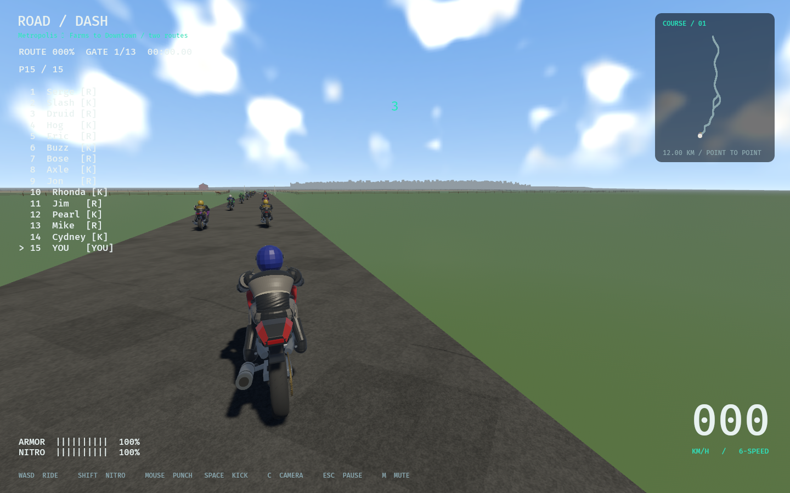
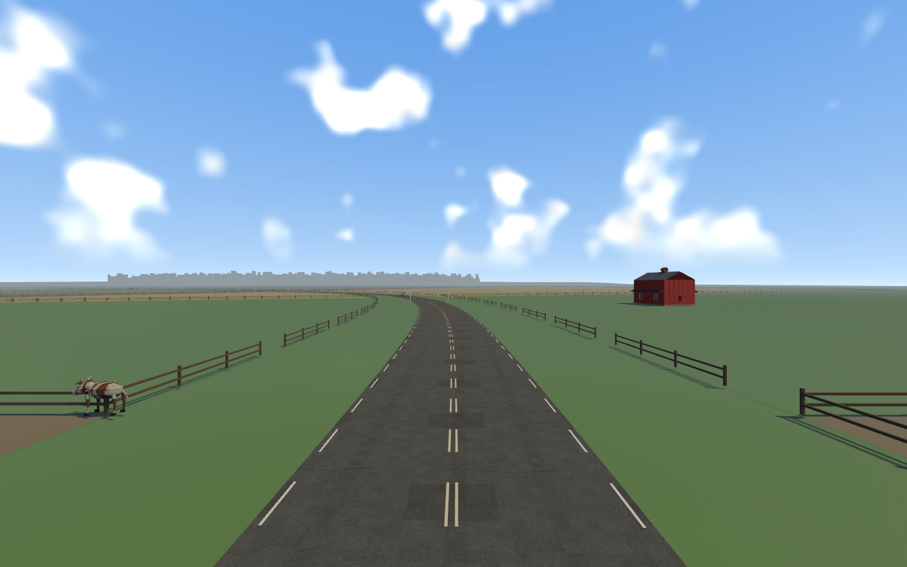
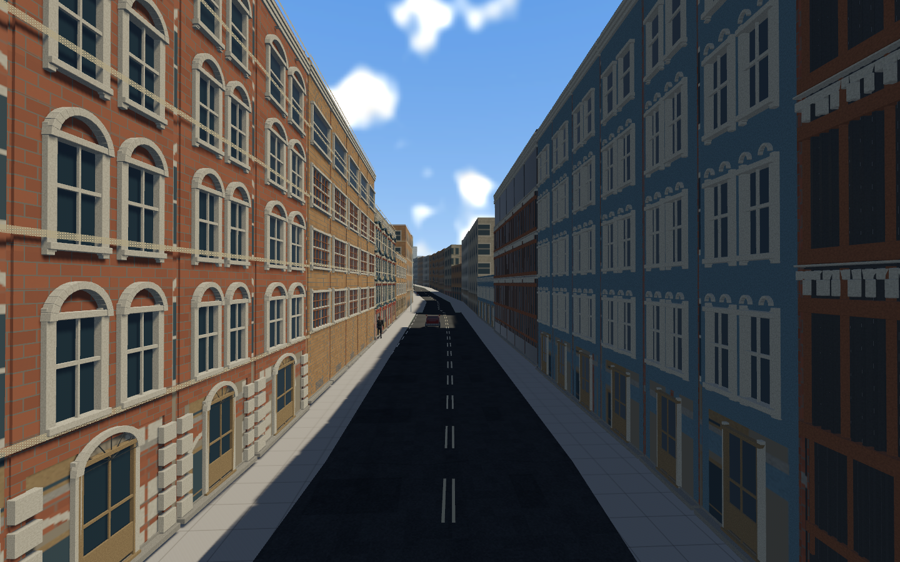
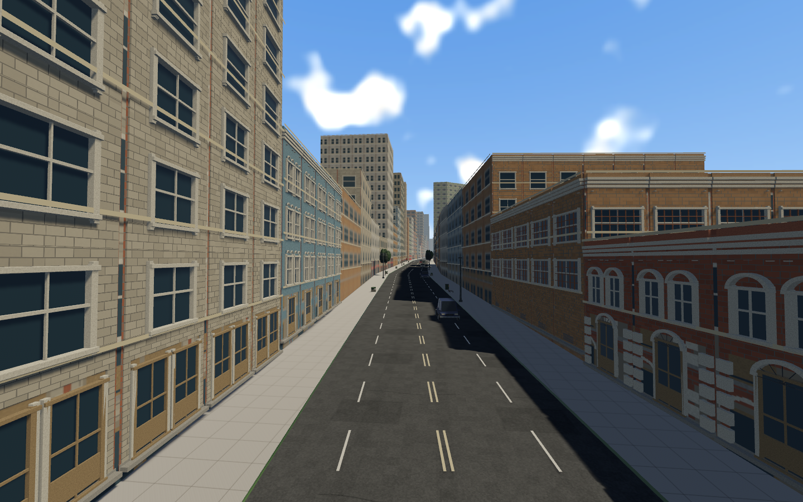
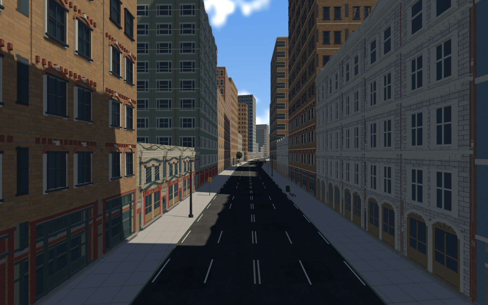

# Opening-road, contact and presentation repairs; frame logs

REPAIR-01 / PERF-07 · 2026-11-07 · codex/startup-world-diagnostics · parent2d9fcdf.
ADR075 records tradeoffs. Accepted ragdoll anatomy, muscles, body masses, forces,
crash momentum and recovery remain unchanged; seated-leg correction is visual IK.

## Changes

- Held seated knees use a slight outward pole bias while feet stay on pegs.
  Unheld walking/getup/pickup knee planes remain unchanged.
- Fence bays have posts on both ends. Shared endpoints deduplicate by position;
  intentional field entrances are still open.
- Farm road and start apron are10m wide: two3.6m lanes and1.4m paved shoulder per
  side,2m verge, with matching5m handling width. City carriageways are unchanged.
- Moving main traffic96→64; initial placement starts700m from the start. Cross
  traffic, parking, seven racers/seven killers, route gates and restart remain.
- City-edge heights grow under a smooth2→32-storey cap over1.8km, including
  interior towers. All19,068 building IDs/footprints/styles and both exact race
  paths remain; physical/rendered roofs use the same rebaked height.
- Vehicle contacts require5m/s closing speed for scripted wipeout. Gentle touches
  still collide physically; substantial oncoming/rear/cross hits retain ejection.
  Wall and upright rider thresholds stay separate. Current contacts are checked
  as well as Started/swept events so accelerating into an existing contact works.

## Capture the FPS problem

Run the normal release game:

```sh
cargo run --release --locked
```

The terminal prints `Performance log: /tmp/roaddash-performance/performance-PID.jsonl`.
A line is recorded every real second. To select an easy-to-find folder:

```sh
ROADDASH_LOG_DIR="$PWD/performance-logs" cargo run --release --locked
python3 tools/summarize_performance.py performance-logs/performance-PID.jsonl
```

Replace PID with the printed file's number. Disable logging with
`ROADDASH_PERF_LOG=0`. Logs rotate at16MiB with one `.old` file per process.
Optional `ROADDASH_TRACE_CONTACTS=1` prints collision normals and relative speeds;
leave it off for performance measurements because terminal output can block.

JSONL contains wall average/P95, fixed steps and aggregate gameplay/physics time
per rendered frame, main-world duration, latest renderer extraction and renderer
schedule CPU/wait duration, scene/visible mesh/asset counts, dynamic bodies,
player/camera position and Linux RSS/swap/system paging counters. The render
thread communicates via atomics; disk/proc reads run on a bounded background queue,
not in the simulation. Dropped samples and writer failures are surfaced.

Interpretation: compare wall and main/render spans, then simulation/physics shares
and visible entity counts. Render CPU/wait is not a GPU timestamp and can overlap
main-world work. Low aggregate CPU usage can coexist with a slow critical thread.
A full swap device with available RAM does not establish current paging; compare
counter deltas and this process's VmSwap. These logs narrow the bottleneck; they
do not by themselves certify GPU utilization or establish a60FPS fix.

## Verification and remaining work

Authoring fixtures verify monotonic edge-height caps, even for towers. Independent
3,480-sample car-clearance audit preserves source race paths/fields/parcels/gates,
checks unchanged city sidewalks and verifies widened pavement contains all old
asphalt. Tests cover mounted knee bend direction/peg contacts, existing unheld
anatomy/lengths,0.5km/h car touches and existing high-speed ejection/recovery.
Native survey includes farm, city edge and growing skyline views; both branch
recovery/restart smoke fixtures and measured logs are recorded alongside this file.

PERF-08 remains open for profiling/optimization against target hardware. Full-course
user visual/balance approval and Windows hardware remain open. REPAIR-01 covers
technical corrections; it does not close WORLDART-01 or broad performance gates.
No dependencies, downloaded media or original-game source are introduced.

## Recorded results

- 307 Rust tests passed;1 existing test remains ignored. Clippy with warnings denied,
  debug/release builds, formatting, roadmap/progress checks and asset/source audit
  pass. Four street-life authoring fixtures and3,480 city vehicle-clearance samples
  pass. Summary-parser partial-line/order fixture passed.
- Both release branch smoke fixtures pass actual seven/seven AI census,15-racer
  authored-grid restart, farm/city crash/getup/run/remount and result fixture.
  Scripted results are not a complete human-driven race.
- Release nine-view survey passed; actual farm fence, widened pavement, mounted
  stance, edge and skyline views are included below.19,068 building footprints
  remain; main fleet is64, furniture995 and parked cars65.
- Native JSONL is parseable, renderer counters are nonzero and no samples were
  dropped. See `performance-summary.json`: excludes the first four startup windows
  and reports means of logged windows, not an independently measured GPU benchmark.

| Scenario | Logged wall avg ms | Mean logged P95 ms | Main world ms/frame | Physics span ms/frame |
| --- | ---: | ---: | ---: | ---: |
| Route0 scripted recovery |16.215 |21.688 |16.861 |9.372 |
| Route1 scripted recovery |16.662 |22.182 |17.701 |10.251 |
| Moving-camera survey |13.704 |17.982 |13.885 |6.789 |

The main-world/physics spans are substantial in these recovery samples; physics
is a concrete profiling candidate. The renderer's latest CPU/wait samples also
have measurable cost, and may overlap main. The game reported VmSwap0kB; global
swap-in/out counters did not increase during any recorded run. This does not
establish the cause of the user's separate full-session hitching, nor prove that
GPU/presentation is never a bottleneck. Profile individual Rapier sync/step/
writeback phases next, compare an uninterrupted normal race, and capture GPU timing
if render/wait dominates. PERF-08 remains open; target P95 <=16.7ms is not closed.







Files: visual IK in `src/animation.rs`, fence batching and extra survey views in
`src/world_gen/metropolis/`, road/traffic initialization in `src/track/metropolis.rs`
and `src/game.rs`, native contact policy in `src/recovery.rs`, domain threshold in
`rr_core/contact.rs`, regression fixtures in `src/collision_tests.rs`/game tests,
background/render logging in `src/diagnostics.rs` and `src/diagnostics/perf.rs`,
summary CLI in `tools/summarize_performance.py`, generator/config/manifest and
source/provenance/roadmap records. No files removed. Some old contact fixtures
were corrected to wait for lifecycle readiness and restart at the authored grid
before testing real impacts; a slow-scrape expectation now asserts solidity
without a knockoff. The raw-velocity test uses an aligned frontal target.

New tasks: REPAIR-01 and PERF-07 verified in Part00 (originating01), PERF-08 open
in Part11. No new dependency, copied implementation or downloaded asset. Existing
Bevy/Rapier/Shapely source API follow-up is recorded in third_party/REPOSITORIES.md.
Local branch codex/startup-world-diagnostics; no push/merge claimed. Next is a
user normal-race log and focused measured optimization, not a ragdoll rewrite.
