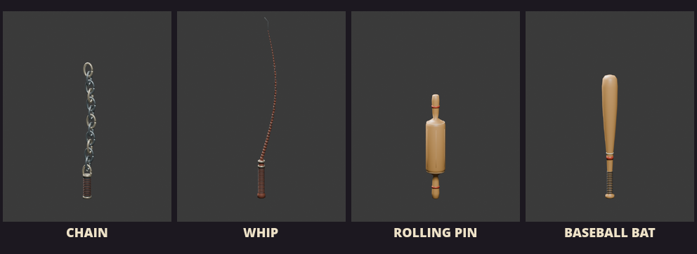

# Fresh-agent traffic, weapons and road integration — 2026-11-09

Branch: `codex/traffic-weapons-road-fixes`. Three new agents worked with fresh contexts in isolated worktrees. This pass does not start another development part or publish/merge the branch.

## Implemented and verified

- **AI-12:** speed-aware car approach prediction, swept crossing conflicts, braking/yield/resume and occupied-pass protection. Hazard-free police/combat intent is retained. No collision immunity, player handling change or weakened crash threshold. See [scenario evidence](../ai-traffic-repair/README.md). Four-rider queue control impacted 3/4; planner impacted 0/4, minimum pair separation 4.567 m. This is a focused scenario comparison, not a whole-race crash-free claim.
- **WEAPON-MODELS-01:** original editable chain, whip, pizza rolling pin and baseball bat, each with three GLB LODs, validated grip/bounds/hashes and optional held/pickup presentation skins. Existing club remains default. See [catalog/native gallery](../new-weapon-models/README.md). Chain/whip are rigid presentation silhouettes; distinct attacks, flexible simulation, loadouts and automatic distance LOD remain open. No third-party source/media was incorporated and no new external repository investigation was needed.
- **ROAD-WALK-01:** continuous road-edge/double-yellow paint and regular lane dashes, with placement on actual pavement triangles; explicit four-lane entry evidence. Approved source layout was already four lanes, three per split, four after rejoin. Grounded walking now uses 0.5 m/s downward adhesion versus 5 m/s unsupported, avoiding reproduced curb climb/slip cycling. Original capsule/step/solids and accepted ragdoll tuning remain unchanged. See [road and physical traversal evidence](../roads-walkability/README.md).

## Integrated checks

[checks.json](checks.json) records successful formatting, strict workspace Clippy, locked workspace tests, debug/release builds, repository audit, weapon validation and roadmap tests. Rust tests: **396 passed, one existing ignored**. Shared target cross-worktree fingerprints were eliminated by cleaning the three project packages before the final root build/test.

[authoring-checks.json](authoring-checks.json) records successful street-life/streetscape tests, paint audit and lane-clearance audit. Paint audit found zero buried/unpaved separator centers among 3,066 on the actual map; buried paint is not established as the original map's cause.

[Combined native receipt](native/receipt.json) records successful current-source native recovery on route 0/anatomy with chain and route 1/baseline with whip: actual terrain/sidewalk walks, ready weapon scenes and four zero-error remounts. Together with the road agent's four paired route/rig runs (eight remounts), recovery was checked in both paths. The road agent's 24 actual-support traversal fixtures passed; a 1 m wall remained blocking. These checks do not establish hardware-wide performance, final art approval or full-race AI balance.

## Decisions and remaining gates

ADR096–098 document predictive traffic intent, optional presentation-only weapon models and minimal grounded adhesion/paint correction. README and progress move the three narrow verified IDs to Part 00; **FOOT-SPAWN-01 stays open**. GettingUp currently checks a center support ray without full capsule/interior clearance. An invalid test setup was enclosed in a building; ordinary crash incidence is unverified. No speculative rescue/teleport policy was added.

Human AI balance, final weapon/map art, flexible weapon mechanics, broad traversal/performance and hardware acceptance remain open. No accepted body specifications, mass distribution, joint tuning or passive ragdoll behavior were replaced.

## Changes and history

Implementation commits: `d22fa68` and `acd1efc` (AI), `a77603e` (weapons), `d7bf961` and `e07149f` (roads/evidence). Shared integration records update README, PROGRESS, TASK_PLACEMENT, DECISIONS, KNOWN_ISSUES, CHANGELOG_DEV, TEST_MATRIX and ASSETS.csv. Model sources are in `art/weapons`; runtime assets in `assets/weapons`; domain logic in rr_core, validation in rr_content and presentation/game adapters in src. Per-stream evidence lists exact files and commands.

Preview an asset with `cargo run --locked --bin weapon_preview -- --id chain --lod 0`. Use `ROADDASH_WEAPON_MODEL=chain cargo run --release --bin road-dash` to equip its presentation skin. Other IDs: `whip`, `rolling_pin`, `baseball_bat`.
