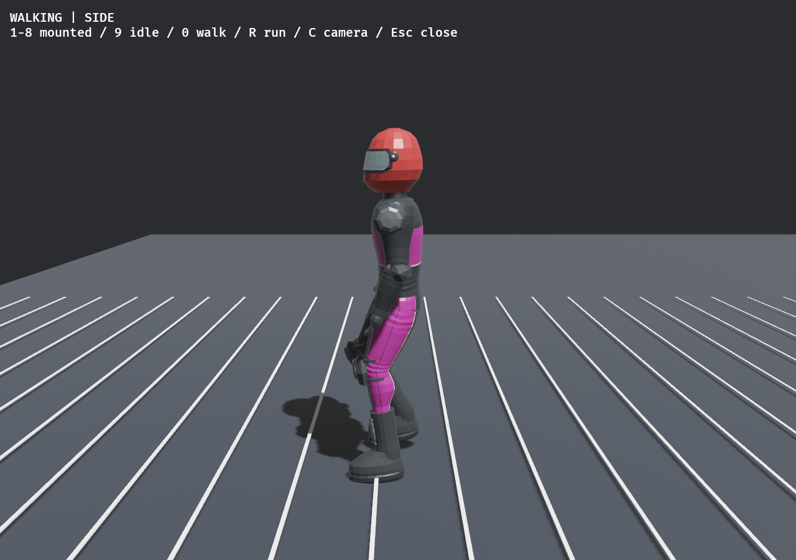
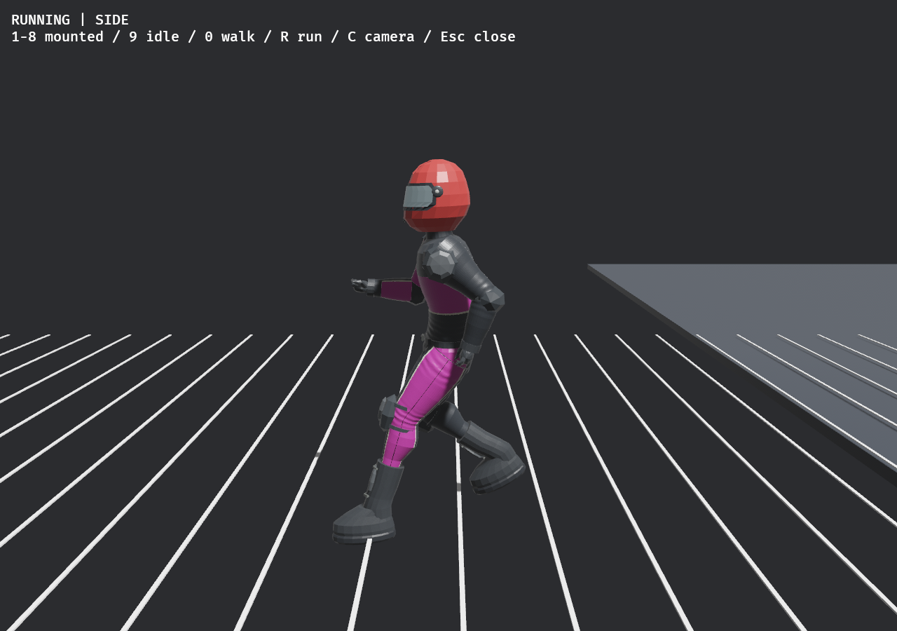

# Walking and running animation correction

Final implementation and native gait review are complete; user animation approval
remains open. Earlier checkpoint/pending notes below record the review history;
the final verification section supersedes them.

User explicitly clarified that walking **animation**, rather than the movement
or turning controls, is the problem. Work is isolated from75eadcf1 on
codex/walking-animation. Existing V2-03-003/ANIM-09 remain open for user review;
this does not claim a complete locomotion library or approved feel.

## Diagnosis and intended change

The old presentation advances a3.2m gait cycle from measured travel but moves a
foot only0.84m through its50% stance. The body therefore travels1.6m while that
foot's authored sweep covers0.84m. Ground locks can exceed the chain's reachable
span, producing hovering, straightened legs and reacquisition. At low speeds the
sweep is shortened further without matching cycle length. The same pose is used
for walking and running; the arms remain nearly straight, the trunk remains
upright, and the leading leg and same-side arm move forward together.

Baseline native review uses the actual skinned runner translated over marked
half-metre ground intervals, with an actual fixed Rapier support and following
side/front cameras. `before/receipt.json` identifies the frozen executable;
`before/harness.diff` records the instrumentation-only source changes. This is a
translated visual fixture, not a human-controlled race or a control-feel test.

The correction keeps an independent visual cycle clock advanced by measured
travel without rephasing when speed changes. Walking has double support; running
has short stance and airborne intervals. Sole sweep matches the chosen cycle and
stance duration. Velocity blending settles starts/stops, local measured velocity
steers swing targets while turning, and opposing bent arms/trunk counter-motion
provide a readable run. Authored standing sole clearance is fitted to existing
support IK. No new animation files, dependencies or external assets are imported.

All changes are presentation-only in animation.rs/animation modules. The physical
runner, manual walking/turning, recovery/remount rules, both ragdoll rigs, muscles,
joints, saves, maps and network authority/input adapters remain unchanged.
Footstep sound still uses the existing recovery distance schedule; exact new
contact-synchronous audio remains outside this animation-only correction.

## Verification

Results will be appended after targeted tests and native after-review. Tests
cover distance/stance velocity matching, phase continuity during speed changes,
arm/leg opposition, fixed anatomical lengths through turns, translated support
slip on level/uphill/downhill ground, idle settling and unchanged physical roots.
Existing terrain support lifecycle, mounted contacts and recovery differential
checks remain required. Parent owns shared README/PROGRESS/DECISIONS/provenance
updates and the final integrated strict workspace suite.

## Passing implementation checkpoint — native after-review pending

22 animation tests pass, including existing contact/hand/mounted-attack/pause
regressions.12model tests pass, including exact physical trajectory and full
crash/run/remount differentials.10recovery tests pass, including manual departure,
foot finish and NPC escape. Formatting passes. A shared-target stale rr_core
metadata incident initially exposed another worktree's UI enum; touching the two
local crate roots rebuilt the correct dependency source. No UI enums were changed.

Actual fixed-step, fully locked stance measurements (not inferred allocations):

| Translation | Maximum sole displacement per tick | Samples |
| --- | ---: | ---: |
|2m/s level walk|0.0054mm|136|
|6m/s level run|0.0004mm|46|
|2m/s,+12%grade|0.411mm|136|
|6m/s,-12%grade|0.239mm|46|

The first uphill test exposed16.2mm/tick drift caused by finite leg reach. The
second implementation derives bounded visual pelvis lowering from each planted
chain's reach and smoothly restores height after lift-off. This reduced the
measured uphill drift without changing runner position, collider, physical bones
or slopes. These numbers cover established high-weight contacts, not transient
landing/lift-off, human feel, all stair geometry or platform performance.

[Before frame-sequence video](before/walk-run.mp4) contains original5fps samples;
it demonstrates poses/support problems but does not establish motion smoothness.
Ten representative native PNGs are retained; the video contains all captured
sequence frames. The after harness captures15fps for finer contact review. The
review floor has fixed physical support throughout; its finite visible base
ends behind the later run views, while half-metre markers continue.

Native after-review and both-rig game recovery runs remain pending the parent's
combined release binary. This checkpoint is not completed visual acceptance.
Full integrated workspace/Clippy/debug/release/provenance and user-feel approval
remain parent/integration gates. No new task ID, checklist closure or external
research/import. recovery.rs, controller configuration and physics files are
byte-unchanged in this branch.

## Native checkpoint review and final pose refinement (validation pending)

Combined frozen debug binary SHA256
`aa2c8b5489e1f996fe8822ead76eb7757cd04741cb76cbea3f384bee805476dd`
passed the translated after-draft sequence (153 nonblank captures) and both actual
native recovery paths. Anatomical route0 and eleven-body baseline route1 each
reversed at-1.922m/s and remounted twice with0.0000m pickup error. Running,
get-up/remount and hill-running frames were opened and inspected. Retained PNGs
focus on these stages; receipts cover all original captures.

Native networking/DHT/UPnP were disabled for these cases. Parent network headless
physics tests ran concurrently, so screenshots' timing overlays and saved wall
metrics are **functional evidence only**, not a performance result.

[First after-draft15fps sequence](after-draft/walk-run.mp4) showed distinct running
flight, opposing bent arms and stronger heel recovery, but also excessive walking
crouch and high running knees. The final small pose refinement raises the walking
pelvis over support instead of holding a constant squat, lowers swing clearance
from12/34cm to8/22cm (walk/run), and partly curls running fingers without wrist
rotation. Cycle/contact timing, support solver, body authority and physical rules
are unchanged. **This refinement awaits the parent's full tests and final native
capture; first-checkpoint passing results do not certify its final appearance.**

## Final verification and deliverable

[Final15fps native sequence](after/walk-run.mp4) contains149 captured frames over
9.93seconds, with no generated interpolation frames. The native run exited0 with
152 nonblank total screenshots. Representative side/front walking, foot-contact,
flight and running phases were opened and inspected. The final posture is less
crouched during walking, with lower swing clearance and relaxed running fingers.
The existing segmented avatar caps remain visible at deep knee flexion; this is
an animation correction, not a new mesh or physical rig.

Frozen combined debug executable SHA256:
`a52dee9f2330a662e80d3ee602bd083717c6c091941fbef6b0e53c6c788373c9`.
The parent reports507passing integrated tests for this checkpoint, including the
refinement. Final support metrics were additionally rerun directly from the
parent-built test binary; source hashes match the worker's animation modules.
See final-support-receipt.json and final-support-test.txt.

| Final translated contact case | Maximum sole displacement/tick | Samples |
| --- | ---: | ---: |
|2m/s level|0.065mm|136|
|6m/s level|0.016mm|46|
|2m/s,+12%grade|0.409mm|136|
|6m/s,-12%grade|0.238mm|46|

These measure established locked contacts, not every landing/lift-off or stair.
Both-rig native game recovery is recorded on the first implementation checkpoint
above; the final amplitude/hand refinement did not change its controller,
contact schedule, physics or remount logic. Final native gait and parent tests
cover the refined visual pose. Concurrent root/network work means no performance
claim is made from these functional captures.

No new task IDs or checklist closures. V2-03-003/ANIM-09 retain user art approval,
full stairs/turn-in-place/weapon-pose coverage, exact contact-synchronous footsteps
and broader performance/hardware gates. Parent owns shared documentation and
provenance integration. No further runtime changes are planned in this pass.

