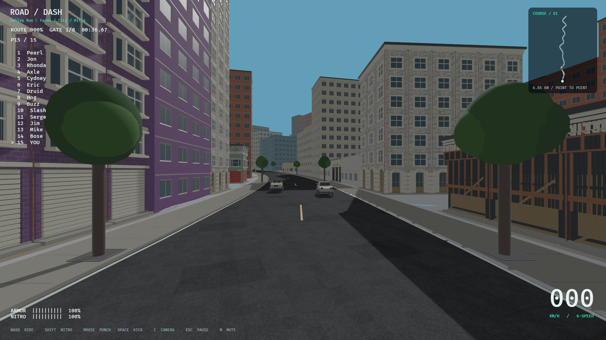

# Building/road polish and unseen NPC crash budget

2026-11-06; codex/part-04-world-buildings. Includes the preceding uncommitted
Part04 implementation. ADR053 records the user authorization and tradeoffs.

## Changed behavior

- Tall fallback buildings keep measured-scale window reveals, mullions, floor
  bands and roof trim. Infill matches its owner's masonry; tile sampling repeats.
  This improves skyline and infill detail without replacing the authored near GLBs.
- Asphalt now has original aggregate, normal/roughness, repair/tar and subtle
  tire-wear detail with a complete10-level mip chain. Main and structural side
  roads use consistent6m world UVs; collision meshes/friction remain independent.
- Used coarse designs/masonry are resident. Higher LODs retain the displayed scene
  while loading; hidden preparation must finish before a scene swap. Spatial
  hysteresis reduces nearest-budget churn. No claim of seamless geometry morphs.
- Far rear NPC crashes use the user's five-second approximation, with no ragdoll
  or wreck allocation. Mounted player/visible/nearby and already-fallen riders keep
  the existing physical path. The hidden bike has no simulation/collision; at300
  active ticks it returns at the recorded crash station, lane0, speed0. Pausing
  stops the timer, restart clears it, and gates/progression are preserved.
- Expanded loading reproduced IO-thread stack overflow (loader-stack-before.txt).
  Only asset IO workers now receive16MiB stacks, with the original1–4 thread policy.
  Native testing uses no RUST_MIN_STACK override. This is a loader budget fix.

## Verification

Mandatory fmt/strict clippy/workspace tests/locked build and audit are recorded
alongside. Current workspace result:237 passed,1existing ignored soak. New tests
cover actual relief bounds/outward winding, mip/PBR channels, rear/front/near/look-
back eligibility, zero physical crash allocation, full five-second delay, pause,
centre-road return and restart cancellation. Existing accepted model/physics,
contact/combat/reset/camera/recovery/foot finish/save tests remain included.

Native smoke,15-section world survey, optional city loading and final frame-time
measurements are recorded in the corresponding logs/JSON and images. Short wall
samples do not certify production FPS, memory stress or Windows hardware.
No new repository, dependency or external asset adopted. Existing source/license
research reused; new source files and original procedural art are MIT-registered.

## Remaining work

KIT-03 bespoke roles/full infill art, MESH fidelity/approval, LOD morph/crossfade
polish and broad frame/memory/hardware gates remain open. No change to player
ragdoll articulation, masses, motors, collision or recovery. Deferred NPCs remain
hidden until their timer expires even if the player turns back toward them.
Offscreen shortcuts apply at crash entry; existing active ragdolls stay physical.

New verified task IDs are KIT-04 (surface detail), KIT-05 (ready-scene streaming)
and PERF-06 (rear crash delay). See the live README for complete acceptance and
placement. Part05 begins only on the new branch after the authorized merge.

## Final native results

- Default Valley: farm/hill crash, both remounts and finish; four audio sinks.
- Explicit City Run: startup, two crashes, both recoveries and finish, no stack
  environment override. ANIM-12 locally resolved with explicit asset IO stacks.
- Fifteen-section1080p survey: **15.83ms wall-frame p95**, target16.7ms met in this
  sample. Before shadow trimming:19.78ms. This is not broad FPS certification.
- Display census:12 authored-detail buildings,742 panels,3,994 actual mesh entities,
  680,064 triangle instances;22 additional cached high file/LODs,108 resident coarse
  file/LODs and0 pending panels at capture. All657 physical building owners retained.
- Canonical quota247/19roles/15sections and geometry fingerprint remain unchanged.
  Original collision/navigation/recovery tests pass. See world-inspection.json.

Images are native RoadDash output, JPEG encoded only; original project MIT and
existing runtime-asset provenance apply. Not image-generated concepts.
